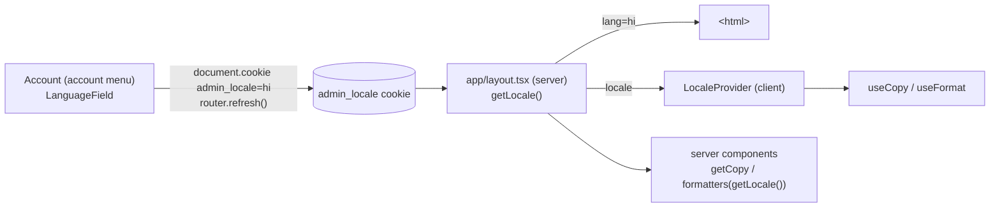

# Admin languages

The admin speaks English and Hindi. English stays the source: every string still lives in
`apps/admin/src/data/<feature>.ts`. Hindi is a typed overlay in `data/hi/<feature>.ts` merged
over the English **key by key**, so a page (or a single key) with no Hindi shows English and
nothing breaks.

No library: the copy is plain TypeScript objects with functions in them (`(n) => ...`), which
ICU-message libraries such as next-intl (MIT) would have meant rewriting. The layer is about
150 lines in `apps/admin/src/lib/i18n.ts` and `lib/copy.ts`.

## How a request gets its language



The root layout reads the cookie on the server, so the first paint is already in the right
language: no flash, nothing for hydration to disagree with. There is no database column; the
choice is per browser, like the theme mode.

| Piece | File |
| --- | --- |
| Locales, cookie, `Translation<T>` type, `mergeCopy`, `untranslated` | `lib/i18n.ts` (pure) |
| Registry of Hindi files | `data/hi/index.ts` |
| `localize(en, locale)` (cached per export) | `lib/copy.ts` |
| `getLocale()`, `getCopy(en)` for server components | `lib/copy-server.ts` |
| `useLocale()`, `useCopy(en)`, `useFormat()` for client components | `hooks/use-copy.ts` |
| Money, numbers, dates per language | `lib/format.ts` |
| Page names by route (sidebar, top bar, settings rail) | `data/hi/navigation.ts`, `lib/page-names.ts` |
| Status badge labels | `lib/status-labels.ts` |
| Word list | `docs/i18n-glossary.md` |

## Reading copy in a component

```tsx
// client component
const copy = useCopy(ordersContent)
const fmt = useFormat()
return <p>{copy.summary(count)} · {fmt.money(totalPaise)}</p>

// server component
const copy = await getCopy(ordersContent)
const fmt = formatters(await getLocale())
```

Module-scope helpers and `.ts` files take the copy (or a `locale`) as a parameter:
`totalRows(order, copy, fmt)`, `rateErrors(copy, rate)`. Don't keep translated text in state;
keep the code (`'invalid'`) and look the text up at render, so switching language updates it.

A component that still imports `ordersContent` and reads it directly keeps working; it just
shows English.

## Adding copy

Add the English key to `data/<feature>.ts` as usual. If that file has a Hindi twin, the
typecheck then fails on `data/hi/<feature>.ts` until the key is there too: the `Translation<T>`
type requires every key, rejects keys the English does not have, and requires functions to take
the same parameters. That is deliberate, so nothing goes missing silently. If you can't write
the Hindi, say so explicitly:

```ts
import { translation, untranslated } from '@/lib/i18n'

translation(ordersContent, {
  // ...
  newBanner: untranslated, // shows English until someone translates it
})
```

`rg untranslated apps/admin/src/data/hi` lists them; the i18n test prints the count.

A new `data/<feature>.ts` with no Hindi file needs nothing: it stays English.

## Translating a feature

1. Create `data/hi/<feature>.ts`:

   ```ts
   import { ordersContent } from '@/data/orders'
   import { translation } from '@/lib/i18n'

   export default [
     translation(ordersContent, {
       title: 'ऑर्डर',
       count: (n) => `${n} ऑर्डर`,
       // every key; ids and hrefs copied as they are
     }),
   ]
   ```

2. Spread it into `hindiCopy` in `data/hi/index.ts`.
3. Move the components that read it onto `useCopy` / `getCopy`. `scripts/i18n-codemod.py
   <file> <exportName>` does the mechanical part for client components.
4. Follow `docs/i18n-glossary.md`: plain everyday Hindi, and the English words merchants
   actually say (order as ऑर्डर, COD, GST, SKU, UPI, pincode, brand names in Latin).
5. Run `bun run --cwd apps/admin test` (the i18n test checks for unknown keys) and the typecheck.

Keep `data/*.ts` free of imports from `lib/copy`, `lib/format*`, `lib/page-names` and
`lib/status-labels`: those import the Hindi registry, which imports the data files, and the
cycle breaks at module load. A test enforces this.

## Money, numbers and dates

`useFormat()` returns formatters for the language. Both languages keep Indian lakh/crore
grouping and Latin digits (`₹1,23,456`), through `@commerce/money` with `en-IN` or `hi-IN`.
Compact amounts differ: English `₹1.2L` / `₹1.2Cr`, Hindi `₹1.2 लाख` / `₹1.2 करोड़` (the
package spells the units out and stays in crore instead of hi-IN's own `अरब`). Dates use
`hi-IN` with full month names (`12 सितंबर 2026`), still pinned to the store's zone
(Asia/Kolkata) through `formatInZone` in `@commerce/dates`; relative days (`आज`, `कल`,
`5 मिनट पहले`) come from `data/dates.ts`. Need another pattern? `useFormat().pattern(value,
{ ... })`, never a hand-built `Intl.DateTimeFormat` (the `date-format` sweep fails on one).

## Page names and status badges

Sidebar labels, the top bar title and the settings rail are looked up by route in
`hindiPageNames` (`data/hi/navigation.ts`), so reordering or adding nav items never shifts a
label; a route with no entry keeps its English name. Status badges keep `data/status.ts` as it
is: `StatusLabel` finds the badge's English label in the orders, order detail, shipment,
products and home copy and shows the text at the same key of the Hindi.
