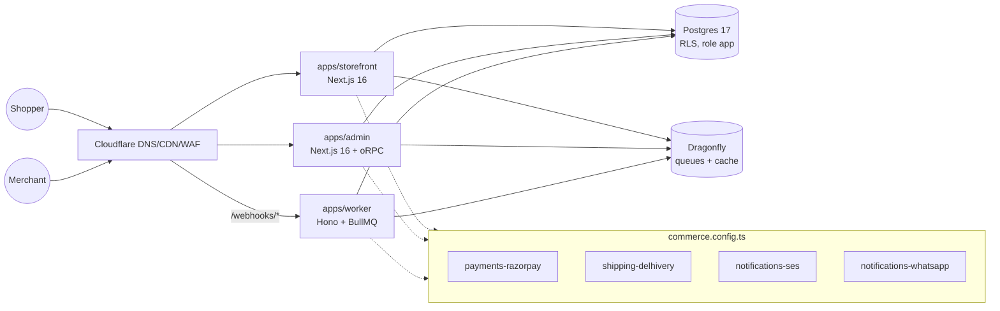
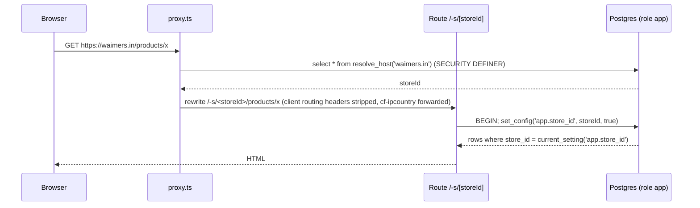
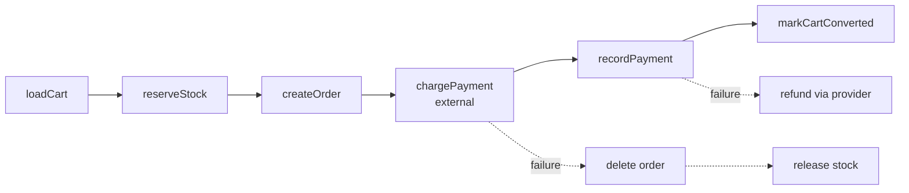
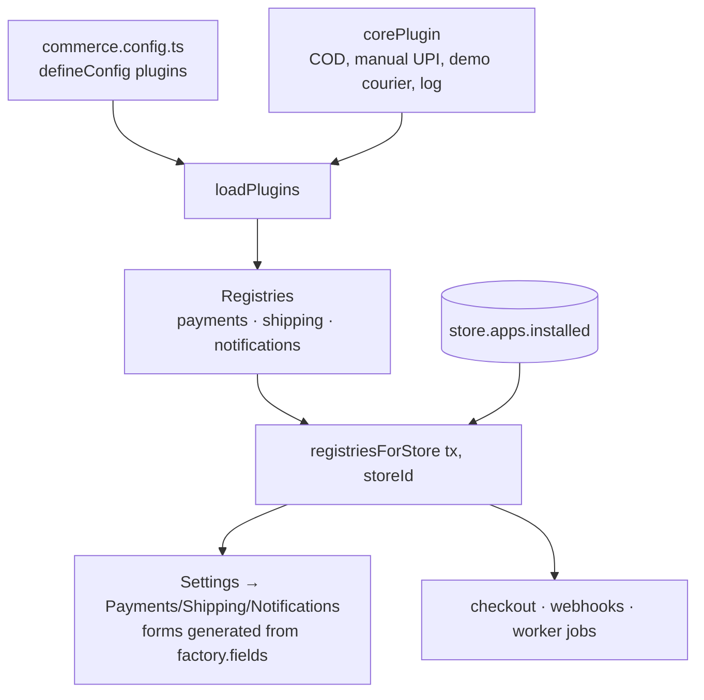

# Architecture

How the platform is built today, what keeps it multi-tenant, and the order in
which we grow it toward Shopify/Medusa-class scale. Sections 2–4 describe
**what exists**; section 5 is the **roadmap**. Nothing in section 5 is built
unless it says so.

## 1. Goals

- **Indian D2C SaaS.** Many stores per deployment: INR, GST, UPI/COD, Delhivery,
  WhatsApp. Waimers is store #1, not a special case in code.
- **Cheapest viable infra.** One Postgres, one Dragonfly, three containers on
  ECS behind Cloudflare's free tier. Every design choice must still hold when
  that becomes several Postgres clusters.
- **Plugin-first.** Gateways, couriers and channels are packages behind a
  contract, installed per store from Admin → Apps. The platform never imports
  an adapter directly (`docs/plugins.md`).
- **Boring correctness.** RLS in the database, workflows with compensation,
  idempotent webhooks, one test database per package.

## 2. Current architecture

### 2.1 System context

| Piece | Where | Notes |
|---|---|---|
| Storefront | `apps/storefront` | Host → store via `proxy.ts` rewrite to `/-s/<storeId>/…`; server actions for cart/checkout; Puck-rendered pages from `@commerce/blocks`. |
| Admin | `apps/admin` | Better Auth (email OTP + organisations; one org = one store); oRPC router in `packages/api`; Puck editor; Lexical editor. |
| Worker | `apps/worker` | Payment webhooks, notification delivery, shipment tracking poll, heartbeat. |
| Data | `packages/db` | Drizzle schema, 23 migrations (`0000`–`0022`), `withStore`, SECURITY DEFINER lookups. |
| Domain | `packages/core` | Workflows, settings + encrypted secrets, catalog, cart, order, payments/shipping/notifications glue, plugin registries. |
| Contracts | `packages/{payments,shipping,notifications}` | Provider interfaces, registries, conformance suites. |
| Plugin host | `packages/plugins` | `definePlugin`, `defineConfig`, `loadPlugins` → registries, duplicate-id checks. |
| Queue | `packages/queue` | BullMQ/ioredis factories, named queues, Dragonfly cache helpers. |
| UI | `packages/ui`, `packages/blocks`, `packages/editor`, `packages/richtext` | shadcn shell + admin components; Glide-derived storefront blocks; Lexical editor; server-safe rich-text renderer. |

### 2.2 Request flow (storefront)

Every tenant query runs inside `withStore(db, storeId, fn)`; the policy
`store_isolation` on every tenant table is what enforces isolation, not the
`where` clauses. Admin follows the same path after the membership check in
`storeProcedure` (session → organisation → `resolve_store_for_organization`).
[Request flow](/developer-docs/building/request-flow) walks through this, the admin path and
checkout-to-webhook step by step.

### 2.3 Order workflow

`placeOrder` runs as a saga through `runWorkflow` (`packages/core/src/workflow`).
Steps run in order; on failure, every completed step with a `compensate` is
undone in reverse. Property-based tests pin that invariant.

`chargePayment` and `recordPayment` are separate on purpose: a capture that
succeeded at the gateway but failed to persist must be refunded, and the split
makes the compensation for each half unambiguous. Payment-method adjustments
(COD fee, UPI discount) are recomputed server-side inside `createOrder`; the
client total is never trusted.

### 2.4 Plugin loading

A provider only exists for a store once its plugin is installed
(`store.apps`), then enabled and configured under Settings. Secrets are
AES-256-GCM encrypted at rest under `SETTINGS_SECRET` and masked in the API.

## 3. Tenancy model

**What exists**

- Every tenant table has `store_id uuid not null`; `apply_store_rls()` (re-run
  in each migration that adds tables) enables **and forces** RLS with policy
  `store_isolation` using `current_setting('app.store_id', true)`.
- Runtime role `app` is `NOBYPASSRLS`. Cross-tenant lookups go through
  SECURITY DEFINER functions that return only ids: `resolve_host(hostname)`,
  `resolve_store_for_organization(org)`, `stores_with_open_shipments()`.
- `packages/db` has an RLS coverage test: any new table without the policy
  fails CI.
- Tests: one database per package (`commerce_test_{db,core,auth,api}`) so
  Turbo can run suites in parallel.
- Webhooks are deduplicated by `(store_id, provider, event_id)` in
  `payment_event`.

**Sharding-readiness rules** (keep these true so section 5h stays possible)

1. No query joins across stores. If you need it, it is a SECURITY DEFINER
   function that returns ids, run outside `withStore`.
2. Global tables (`user`, `organization`, `session`, `store`) are the only
   ones without `store_id`. Everything else is per store.
3. A `storeId` must be known before any tenant query — never derived from a
   row fetched without one.
4. Background jobs carry `storeId` in the payload and open their own
   `withStore` transaction.
5. IDs are UUIDv7 generated in the app, never database sequences, except
   per-store counters (`store.next_order_number` → `order.number`) that are explicitly scoped.
6. A reference written from a request (`orderId`, `segmentId`, …) is read under RLS before
   it is stored. Foreign-key checks bypass RLS, so the database alone would accept another
   store's id. The cross-store leak test (`docs/guardrails.md`) catches a missed one.

### Noisy neighbours: per-store fairness

One store's big job (a Shopify import with 5,000 images, a 50,000-recipient campaign, a
restock blast) must not make every other store wait. Two layers:

**Worker queues.** Every queue that carries store jobs has a worker `concurrency` and a
lower `perStore` cap, both in `QUEUE_LIMITS` (`packages/queue/src/index.ts`):

| Queue | Concurrency | Per store |
|---|---|---|
| notifications | 5 | 3 |
| app events | 3 | 2 |
| app jobs (imports, PDF batches) | 4 | 2 |
| marketing send | 2 | 1 |
| media processing | 2 | 1 |
| back in stock | 2 | 1 |
| store export | 2 | 1 |

`fairProcessor` (`packages/queue/src/fair.ts`) wraps each processor. Before a job runs it
takes a slot for the job's `storeId` in a Redis sorted set `fair:<queue>:<storeId>` (one
member per running job, scored by lease expiry; MULTI/EXEC, no Lua, so it works on
Dragonfly). A job whose store is at its cap is moved back to the delayed set for 1.5–3 s
(`moveToDelayed` + `DelayedError`: no attempt is used up) and the worker takes the next
job, usually another store's. When the deferred job comes back it joins the end of the
queue, so busy stores take turns with everyone else: rough round-robin, without BullMQ
Pro's groups. Slots are leases renewed by the running job, so a crashed worker's slot
lapses after a minute instead of blocking that store. The cap is shared by every worker
process, so it holds with several replicas.

Trade-off: the caps are not work-conserving. A store alone on the platform still runs at
most `perStore` jobs at once on a queue (one image at a time, for example). That is the
price of a hard guarantee; raise `perStore` for a queue if a lone store's speed matters more.

**Heavy admin actions.** Imports, bulk edits, exports and the full store export / delete
are rate-limited per store (`heavy(action)` middleware, `packages/api/src/procedures/heavy.ts`,
on the existing Dragonfly sliding-window store). Each kind is one budget per store, shared by
every button of that kind: import 20 an hour (a preview and a run count separately), bulk 60
per 10 minutes, export 30 per 10 minutes, full store data 5 an hour. Over budget the API
answers `TOO_MANY_REQUESTS` with a plain "try again in N minutes".

### Store export and offboarding

Settings → General → "Download your data" builds a zip of every table with a `store_id`
(one NDJSON file each, found from the catalogue, so new tables are included) plus the store
row, in the worker (`{store}-export` queue), into the store's own storage under
`stores/<id>/private/exports/` with a random suffix, downloadable through the API for 7 days.
Secrets are redacted; customer phones are decrypted. "Delete store" (owner only, store name
typed to confirm) deletes the store's files (`deletePrefix('stores/<id>/')` on each storage
it used), then every `store_id` row in foreign-key order (`deletionOrder`, children first,
read from `pg_constraint`), then the store row and its Better Auth organization, in one
transaction. Both write to `platform_audit_event`, a platform table the app role can insert
into but never read, so the record outlives the store. Code: `packages/core/src/store-data/`.

### Secrets keys

Provider credentials, gift card codes, import tokens and customer phones are AES-256-GCM
under `SETTINGS_SECRET`. Ciphertexts carry the key id (`v2.<keyId>.…`; legacy `v1.…` has
none and still decrypts), retired keys go in `SETTINGS_SECRET_PREVIOUS`, settings blobs are
re-encrypted under the current key whenever they are saved, and `bun run rotate-secrets`
moves everything else. Runbook: [Key rotation](/developer-docs/operations/key-rotation).

## 4. Modules and plugins

Compared with Medusa's [modules](https://docs.medusajs.com/learn/fundamentals/modules):
a Medusa module owns its tables and service and is isolated from other modules;
cross-module work happens in workflows and links. We are looser inside the
monolith (one schema, one `core` package) and stricter at the edge (adapters
are separate packages behind a contract). The pieces:

| Concept | Ours | Medusa equivalent |
|---|---|---|
| Contract | `PaymentProvider`, `ShippingProvider`, `NotificationChannel` | module provider interfaces |
| Adapter package | `@commerce/payments-razorpay` etc. with `src/plugin.ts` manifest | provider package |
| Registration | `commerce.config.ts` → `defineConfig({ plugins })` | `medusa-config.ts` modules |
| Per-store enablement | `store.apps.installed` + Settings | n/a (Medusa is single-tenant) |
| Conformance | `describePaymentProvider` etc. (offline + live env-gated) | n/a |
| Multi-step ops | `runWorkflow` with compensation | Workflows SDK |

What is **not** modular yet: catalog, cart, orders and settings live in
`packages/core` and share tables directly. That is fine for one team; the
seams to cut later are the service files under `packages/core/src/<domain>`.

## 5. Scale roadmap

Ordered by leverage and dependency. Effort: S ≤ 2 days, M ≤ 1 week, L > 1 week.

### a. Domain events + transactional outbox — **M, first**

- *They do:* Medusa emits events from modules and delivers them through the
  Event Module to subscribers ([docs](https://docs.medusajs.com/learn/fundamentals/events-and-subscribers)).
  Shopify delivers webhooks at-least-once with retries and signs them.
- *We have:* direct enqueues after `placeOrder`, in the webhook path and on
  admin status changes (`packages/core/src/notifications/enqueue.ts`).
- *Change:* `domain_event` table (store_id, type, payload, created_at,
  published_at) written **in the same transaction** as the state change; a
  worker relay publishes to BullMQ; subscribers (notifications, search
  indexing, outbound webhooks) consume by type. Removes the "we committed but
  the enqueue failed" gap and gives every later item one hook.

### b. Read caching with tag invalidation — **S**

- *They do:* Shopify caches storefront reads aggressively at the edge; Medusa
  ships a Cache Module.
- *We have:* Dragonfly cache helpers in `@commerce/queue` (serviceability, 24h).
- *Change:* cache product/collection/page reads per store in Dragonfly keyed
  `store:<id>:<kind>:<key>` with tags; Next `revalidateTag('store:<id>:product:<handle>')`
  from admin mutations via the event bus (a). Cloudflare page cache for
  anonymous HTML with `Cache-Tag` headers once the event bus exists.

### c. Idempotency keys — **S**

- *They do:* Shopify and Stripe accept `Idempotency-Key` on mutating calls.
- *We have:* webhook dedupe only.
- *Change:* `idempotency_key` table (store_id, key, request_hash, response);
  `checkoutAction`/`placeOrder` and admin create/update procedures take a key
  from the client (generated per form submit) and return the stored response
  on replay. Prevents double orders on flaky mobile networks.

### d. Rate limiting and per-store quotas — **S**

- *They do:* Shopify's leaky bucket per app/shop ([docs](https://shopify.dev/docs/api/usage/rate-limits)).
- *We have:* a Dragonfly sliding-window limiter on OTPs, checkout, webhooks and the heavy
  admin actions (per store), and per-store worker caps (section 3, "Noisy neighbours").
- *Change:* Cloudflare WAF rate rules on `/checkout`, `/api/rpc`, `/webhooks`;
  in-app token bucket in Dragonfly keyed by store + IP for server actions and
  oRPC, returning 429 with `Retry-After`. Quotas per plan later.

### e. Search module — **M**

- *We have:* none (product page by handle only).
- *Change:* Postgres FTS (`tsvector` column on product, GIN index, per-store)
  behind a `SearchProvider` contract; Meilisearch as a plugin later using the
  same contract, indexed from events (a). Filters/sort for collections come
  with it.

### f. Observability — **S**

- *We have:* console logs, `/health` on the worker.
- *Change:* structured JSON logs with `store_id`, `request_id`, `user_id`
  bound in `AsyncLocalStorage`; OpenTelemetry traces from Next + Hono to a
  cheap backend (Grafana Cloud free tier); BullMQ queue depth/failure metrics;
  error tracking (Sentry). Required before real merchants.

### g. Versioned Storefront API — **M, later**

- *They do:* Shopify's Storefront API is versioned quarterly
  ([docs](https://shopify.dev/docs/api/usage/versioning)).
- *We have:* server actions + oRPC used only by our own apps.
- *Change:* expose a public, read-mostly `/api/storefront/v1` (oRPC with
  OpenAPI) once third parties (headless themes, mobile apps) need it. Keep
  contracts additive within a version; date-stamped versions like Shopify.

### h. Database growth path — **L, staged**

- *They do:* Shopify runs **pods** — fully isolated datastores for a set of
  shops, with shared stateless app servers that talk to one pod per request
  and a router ("Sorting Hat") that picks the pod
  ([engineering post](https://shopify.engineering/a-pods-architecture-to-allow-shopify-to-scale)).
- *We have:* one Postgres; the section 3 rules already make every tenant
  query pod-shaped.
- *Stages:*
  1. Connection pooling (PgBouncer/RDS Proxy) and read replicas for admin
     reports; `withStore` gains a `readOnly` flag that routes to a replica.
  2. Partition the hottest tables (`order`, `order_line`, `payment_event`,
     `notification`) by `store_id` hash — invisible to code.
  3. **Pods:** `store.pod` column in the global database; `resolve_store`
     returns `{ id, pod }`; a `dbForPod(pod)` factory replaces the single
     `db` import; the worker and admin resolve the pod before `withStore`.
     Moving a store = copy rows by `store_id`, flip `store.pod`, drop old rows.
- *Must stay true in code:* rules 1–5 in section 3; no cross-store joins; no
  global sequences; migrations must be runnable per pod.

### i. Media and CDN — **S**

- *We have:* media table with external URLs (imported from Shopify CDN).
- *Change:* uploads to Cloudflare R2 via presigned URLs from admin; Cloudflare
  Images (or `next/image` with a custom loader) for resizing; `media.key` +
  store-prefixed paths so a store's assets can be moved with its pod.

Recommended order: **a → f → c → b → d → i → e → h → g**. Events first because
caching, search, outbound webhooks and audit all hang off them; observability
second because every later item needs measuring.

## 6. Non-goals for now

- Microservices. One deployable per app is the plan until a pod split forces
  otherwise.
- Kafka or any broker beyond BullMQ on Dragonfly.
- Multi-region. India first; Cloudflare handles the edge.
- Runtime plugin installation without a deploy (marketplace). Plugins are
  npm packages listed in `commerce.config.ts`; per-store install is a flag.
- Per-tenant databases from day one. RLS in one database until section 5h.

## 7. Glossary

- **Store** — a tenant. One organisation in Better Auth, one `store` row, N
  hostnames.
- **RLS** — Postgres row-level security; `store_isolation` policy on every
  tenant table.
- **`withStore`** — opens a transaction and sets `app.store_id` for it.
- **SECURITY DEFINER** — a function that runs as its owner (bypasses RLS) and
  is the only sanctioned way to look across stores.
- **Workflow / compensation** — ordered steps with undo actions run in reverse
  on failure (`runWorkflow`).
- **Plugin / provider / factory** — plugin = npm package with a manifest;
  provider = an implementation of a contract; factory = builds a provider from
  a store's settings and declares its form `fields`.
- **Registry** — the set of factories for one contract, filtered per store by
  installed apps.
- **Outbox** — events written in the same transaction as the change and
  relayed asynchronously (planned, 5a).
- **Pod** — a fully isolated datastore for a group of stores (planned, 5h).
