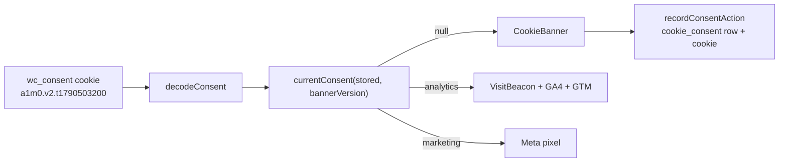

# Customer privacy and accounts

Settings → **Customer privacy** and Settings → **Customer accounts** (migration
`0075_customer_privacy`). They build on Settings → Policies (#206): the grievance officer stays
on `store.preferences.policies` and is read with `grievanceOfficerOf` / `loadPolicySettings`;
nothing is duplicated.
Google, Apple, Facebook, Truecaller, magic links, passkeys and "Remember this device" are in
[Shopper login options](/developer-docs/building/shopper-login).

## Where the code lives

| Piece | File |
| --- | --- |
| Settings shapes, data request rules, consent gate `hasMarketingConsent` (pure) | `packages/core/src/privacy/client.ts` (`@commerce/core/privacy`) |
| Account settings, method fallbacks (pure) | `packages/core/src/customer-accounts/client.ts` (`@commerce/core/customer-accounts`) |
| Settings storage, "ask again", cookie consent proof | `packages/core/src/privacy/service.ts` |
| Data requests (create, list, move) | `packages/core/src/privacy/requests.ts` |
| Export JSON / CSV | `packages/core/src/privacy/export.ts` |
| Anonymisation with the invoice legal hold | `packages/core/src/privacy/anonymise.ts` |
| Audit trail writer and reader | `packages/core/src/privacy/audit.ts` |
| Marketing consent writer and history | `packages/core/src/privacy/marketing-consent.ts` |
| Which sign-in methods a store can deliver | `packages/core/src/customer-accounts/service.ts` |
| Phone sign-in codes, deletion codes | `packages/core/src/accounts/otp.ts` |
| Dev SMS channel (`log-sms`) | `packages/core/src/providers/log-sms-channel.ts` |
| Cookie consent cookie, `currentConsent`, `allowedTags` | `packages/core/src/online-store/preferences.ts` (`@commerce/core/preferences`) |
| API | `customerPrivacy.*`, `customerAccounts.*` in `packages/api/src/routers/` |
| Admin | `apps/admin/src/components/settings/customer-{privacy,accounts}-settings.tsx`, `apps/admin/src/components/privacy/*`, `apps/admin/src/components/customers/marketing-consent-card.tsx` |
| Storefront | `apps/storefront/src/components/privacy/*`, `apps/storefront/src/lib/{privacy-actions,sign-in-methods,consent-cookie}.ts`, `apps/storefront/src/components/account/{sign-in,phone-login-form,data-requests,delete-account}.tsx` |

## Tables (migration 0075)

| Table | What it holds |
| --- | --- |
| `cookie_consent` | One row per banner answer: analytics, marketing, `banner_version`, visitor id, customer. |
| `marketing_consent_event` | Every grant or withdrawal per channel (`email`, `whatsapp`, `sms`), with `source` and actor. |
| `data_request` | Export or delete requests: per-store `number`, `status`, `source`, `due_at`, contact. |
| `privacy_audit_event` | Append-only trail (who, when, what). A trigger rejects `UPDATE` and `DELETE`, so re-running `apply_store_rls()` (which re-grants) cannot open it up. `detail` never holds personal data. |
| `customer_otp` | Pending phone sign-in and account deletion codes. Destination and code are stored as hashes only. |

`customer` gains `accepts_sms` and `anonymised_at`. All tables carry `store_id` and are under
RLS (`SELECT apply_store_rls()` at the end of the migration).

## Cookie consent

- The cookie is `a{0|1}m{0|1}.v{bannerVersion}.t{unix seconds}`. A choice for an older banner
  version (or an old `a1m0` cookie) counts as no answer, so "Ask everyone again" just bumps
  `store.preferences.customerPrivacy.bannerVersion`.
- `allowedTags` no longer has a "banner off" bypass: nothing optional loads before a yes.
  Online Store → Preferences keeps the tag ids; its old `privacy.bannerEnabled` toggle is gone
  and a stored `privacy.message` is read as the banner message until the merchant saves
  Customer privacy.
- Our own `VisitBeacon` is analytics: `ConsentManager` renders it only after an analytics yes.
  Server side, `proxy.ts` mints the `wc_vid` visitor cookie and `/api/beacon` records anything
  only when the consent cookie says analytics (`analyticsAllowed`).
- Two functional cookies are set without consent. `wc_ref` (Affiliates app) holds only an
  affiliate's code and the click time (`<code>.<unix seconds>`) for the store's link window; the
  proxy sets it on a `?ref=` landing (`lib/referral-landing.ts`) and counts the click as a daily
  per-affiliate total, and `readAttribution` turns it into the order's touch when no later
  analytics touch exists (`withReferral`). `wc_ov` holds an order page's view token for 30
  minutes, path-scoped to `/checkout/thank-you/<n>` or `/checkout/pay/<n>`: the proxy moves `?t=`
  into it and redirects, so pixels and tags that read `location.href` never see the token
  (`lib/order-token-swap.ts`).
- The footer gets a **Cookie settings** link to `#cookie-settings`, which reopens the banner.

## Marketing consent in the send path

`sendMarketingEmail` and `sendMarketingWhatsapp` (`packages/core/src/marketing/send.ts`) are the
only places campaigns and automations reach a provider. Both call `mayMarket` right before
sending: the message's `customerId` must have consent on that channel and must not be
unsubscribed or erased (`hasMarketingConsent`). Otherwise the message row becomes
`skipped` / `no_consent` and the provider is never called. A message with no customer (a bare
checkout contact) is never sent marketing. The only bypass is `transactional: true`, used by
the COD order confirmation (an update about the shopper's own order).

**Newsletter signups are double opt-in** (security audit D-09, `customers/newsletter.ts`).
The signup section writes a pending `newsletter_signup` row and a
`newsletter.confirm_requested` outbox row, nothing on a customer. The relay queues the
`newsletter_confirm` email (email only, cannot be switched off) with a signed link to
`/newsletter/confirm/<token>` on the store's primary domain, valid 7 days. Opening the page
changes nothing (mail scanners open links); the shopper presses "Yes, subscribe me", and only
then does `grantNewsletterConsent` create or tag the customer, record consent (source
`newsletter`) and start the welcome automation. Signing up again within two minutes sends
nothing more, each address gets at most three confirm emails a day, and the form answers the
same way either way. Tests: `customers/newsletter.test.ts`, the newsletter case in
`outbox/relay.test.ts`.

Automations' old `audience: 'all'` no longer widens anything; the admin selector is gone. Every
consent write goes through `setMarketingConsent` (newsletter, unsubscribe link, account
profile, admin customer page), which writes the flag and a `marketing_consent_event`. The
unsubscribe link withdraws every channel.

## Data requests, export and erasure

- Created by the shopper (`source: 'account'`, from `/account/privacy`) or staff
  (`customerPrivacy.createRequest`). `due_at = created + requestDueDays` (default 30, 7 to 90).
  A second open request of the same kind for the same customer returns the first.
- Statuses: `open → in_progress → completed | rejected`; closed requests never reopen; declining
  needs a reason.
- `exportCustomerData` builds JSON (or CSV, one section per kind of data, spreadsheet formulas
  defused) and writes `export.downloaded`.
- `anonymiseCustomer` erases name, email, phone, blind index, tags, note, addresses, sessions,
  codes, cart contacts, discount usage emails, automation run contacts, message recipients and
  gift card recipient names; sets `anonymised_at`. Orders inside the eight-year retention period
  keep buyer name, delivery address, GSTIN and business name (GST invoice data); email, phone,
  the order note and attribution go. Issued invoices (the GST app's frozen snapshots) are never
  touched. Also blanked: order timeline notes written by contact edits (they quote the old and
  new email, phone and address), order message recipients (`notification.to`) and guest carts
  carrying the customer's email. A contact edit deletes the address snapshot it replaced. The
  API's `anonymise` also completes the request it answers, only when that request is this
  store's and for the same customer (`requestAnsweredFor`); a customer linked to a request is
  loaded under the store first. Needs `customers.delete`.

## Sign-in methods

`store.preferences.customerAccounts = { checkout: 'guest' | 'account_required', loginMethods }`.
`availableLoginMethods` maps the store's channels to methods: `requires: 'email'` is email; a
phone channel is WhatsApp unless it declares `medium: 'sms'` (new optional field on
`NotificationChannel`). The dev log channels (`log`, `log-sms`) count only outside production.
Save refuses a method the store cannot deliver; the storefront shows
`usableLoginMethods(settings, available)`, falling back to email.

Phone codes use `customer_otp` (purpose `login`); the customer is matched on the phone blind
index, and a new number becomes a phone-only customer (`email` null). `SignedInCustomer.email`
is therefore nullable. Self-service deletion uses purpose `delete_account`: the code goes to the
customer's email (template `account_deletion_code`) or, for phone-only accounts, by SMS or
WhatsApp (`login_code`, since WhatsApp authentication templates are generic). Confirming opens a
deletion request and ends every session.

## Testing locally

- Admin → Settings → Notifications → Advanced → **Developer log** now switches on both `log`
  (email) and `log-sms` (SMS). Codes are printed in the storefront console.
- With `DEV_LOGIN_OTP=1`, `/api/dev/otp?email=<mobile>` returns the last phone code, and
  `?email=delete:<customerId>` the last deletion code.
- Tests: `packages/core/src/privacy/*.test.ts`, `packages/core/src/accounts/otp.test.ts`,
  `packages/api/test/customer-privacy.test.ts` (need Postgres), and
  `apps/storefront/src/components/privacy/consent-manager.test.ts` (no database).
