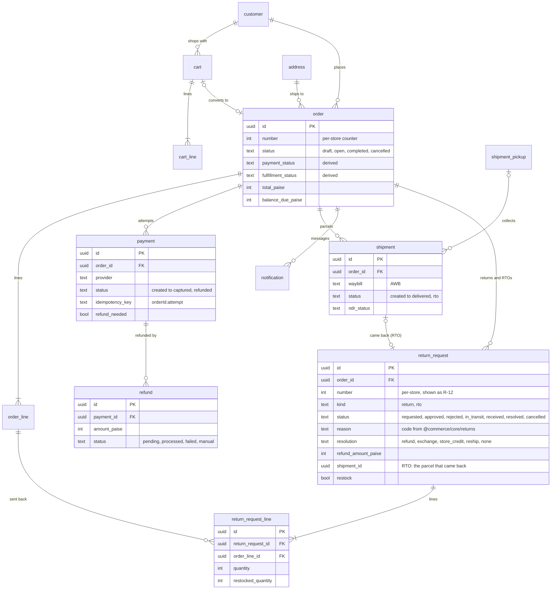
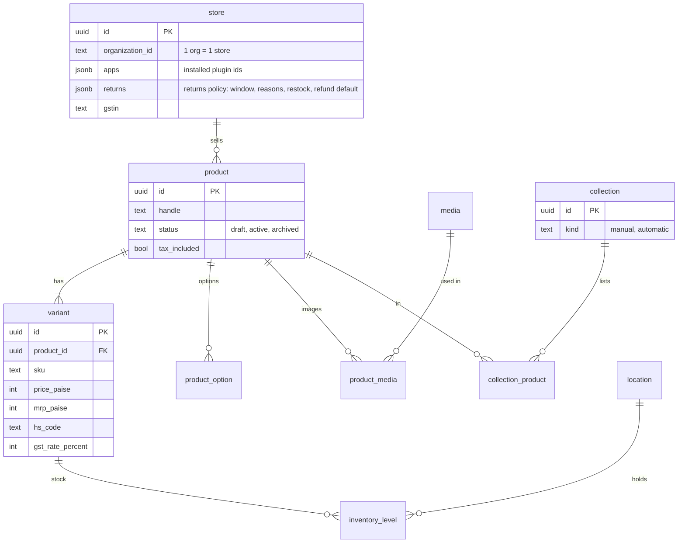
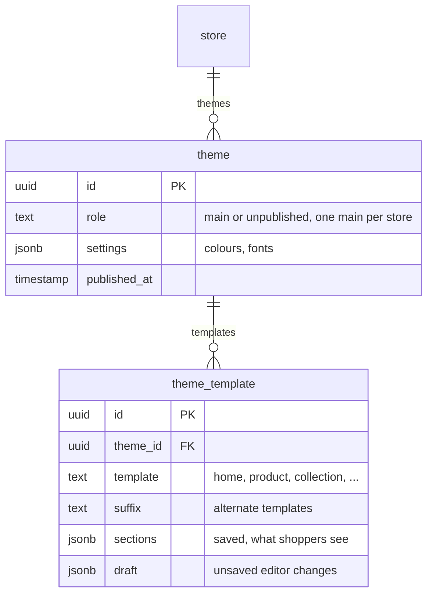
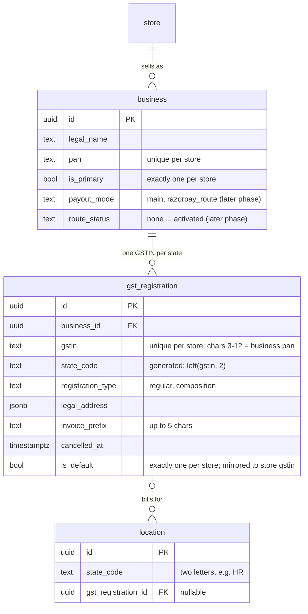

# Data model overview

Postgres 17, one database, every tenant table carrying `store_id` and row-level security
(RLS). Migrations live in `packages/db/drizzle` (SQL, `0068` at the time of writing), generated
from the Drizzle schema files in `packages/db/src` (`schema.ts` plus feature schemas such as
`marketing-schema.ts`; auth tables are separate, see below) and each app's own `schema.ts`.

## The main tables

The commerce core, from `packages/db/src/schema.ts`. Money is always integer paise
(`price_paise`, `total_paise`), ids are UUIDv7 generated in the app, and every table here also
has `store_id` (left off the diagrams to keep them readable).

<Tabs items={['Orders and money', 'Catalogue', 'Themes', 'Businesses and GST']}>
<Tabs.Tab>



</Tabs.Tab>
<Tabs.Tab>



</Tabs.Tab>
<Tabs.Tab>



</Tabs.Tab>
<Tabs.Tab>

GST is registered per PAN per state, so one store can hold several GSTINs, and a warehouse may
belong to a different legal business. Added in migration `0080_gst_registrations` (phase 1:
recorded and linked only; tax and invoices still read `store.gstin`). Rules:
`packages/core/src/tax/registrations.ts`.



- **PAN must match.** A GSTIN's characters 3 to 12 are the holder's PAN; the service refuses a
  GSTIN whose PAN is not its business's (`PAN_MISMATCH`). The database cannot check this across
  tables, so only `addRegistration` inserts rows.
- **`store.gstin` is a mirror.** It always equals the default registration's GSTIN, written only
  by `mirrorStoreGstin`. Settings → Taxes & GST and Settings → General go through
  `adoptStoreGstin`: with no registration yet a GSTIN saved there becomes the first one; after
  that a different GSTIN is refused (`MANAGED_ELSEWHERE`).
- **A location bills under its own state's GSTIN** (`STATE_MISMATCH` otherwise). Cancelling a
  registration unlinks its locations and hands the default to the oldest active GSTIN of the
  main business.
- **Backfill.** 0080 creates one primary business and one default registration for each store
  whose `store.gstin` is well formed (legal name and address from the GST invoices app's seller
  block, else the store). Stores without a GSTIN get neither: a business needs a PAN.

</Tabs.Tab>
</Tabs>

Around these sit the side tables the diagrams leave out: `payment_event` (webhook dedupe,
unique on `store_id, provider, event_id`), `shipment_webhook_event`, `outbox_event` (domain
events written in the same transaction as the change), `order_note`, `discount` and
`discount_usage`, `gift_card` and its transactions, `shipping_zone` / `shipping_rate`,
`purchase_order`, `transfer`, `page`, `navigation_menu`, `store_domain`, metaobjects and
metafields, `role` / `role_permission` / `store_member` / `store_invitation`, and the marketing
tables in `marketing-schema.ts`.

### Returns and RTO

`return_request` holds both a shopper's return (`kind = return`) and a parcel the courier brought
back undelivered (`kind = rto`, opened by `applyTracking` when a shipment turns `rto`; a partial
unique index on `shipment_id` keeps it to one per shipment). `return_request_line` says which
order lines and how many units, and how many were put back in stock. Each step has its own
timestamp (`requested_at`, `approved_at`, `rejected_at`, `pickup_arranged_at`, `received_at`,
`resolved_at`), which is what the status timeline reads. Refunds, store credit (a `gift_card`)
and exchange drafts are ordinary rows elsewhere, linked back by id (`refund_ids`,
`gift_card_id`, `exchange_order_id`, `reship_shipment_id`). The policy lives on `store.returns`
(`ReturnPolicySchema` in `@commerce/core/returns`). Received customer returns count toward the
order's derived `fulfillment_status` (`returned` once every unit is back). Every change is owned by
`packages/core/src/returns/*` and writes its outbox event (`return.requested`, `return.approved`,
`return.rejected`, `return.received`, `return.refunded`, `order.rto`) in the same transaction.

### Status columns are text with a CHECK

Status columns are `text` with a fixed value list and a CHECK constraint, not Postgres enums,
so adding a value is a plain migration. The order's `payment_status` and
`fulfillment_status` are **derived** by `recomputeOrderStatuses` from payments, refunds and
shipments, and stored only for filtering. Never write them directly; see
[Request flow](/developer-docs/building/request-flow#3-a-shopper-checks-out-and-pays).

## Multi-tenancy

- Almost every table has a `store_id uuid` column.
- Every tenant migration ends with `SELECT apply_store_rls();`, which enables **and forces**
  RLS on the table and adds the standard `store_isolation` policy: rows are only visible when
  `store_id = current_setting('app.store_id')::uuid`.
- The app sets that setting per transaction with `withStore()`
  (`packages/db/src/with-store.ts`), so a query without a `WHERE store_id = …` clause still
  can't cross tenants. The database enforces it, not application code.
- The only sanctioned way across stores is a `SECURITY DEFINER` function that returns ids:
  `resolve_host`, `resolve_store_for_organization`, `stores_with_open_shipments` and the other
  `stores_with_…` functions the worker uses.

## Two roles

- **`DATABASE_URL`**: the `app` role, `NOBYPASSRLS`, used by the apps at runtime.
- **`DATABASE_URL_OWNER`**: the owner role, full schema access: migrations, seeds, RLS policy
  creation, `scripts/backup-db.ts` (an RLS-restricted dump would be incomplete) and the key
  rotation scripts.

## Platform-level tables

Auth tables (`packages/db/src/auth-schema.ts`: `user`, `session`, `account`, `verification`,
`organization`, `member`, `invitation`) are platform-level: no `store_id`, no RLS. Better Auth
owns them exclusively. Organisations map to stores (one organisation = one store); members map
to store staff.

## Adding a table

<Steps>

### Write the schema

Add the Drizzle table in `packages/db/src`, or in a plugin's own `schema.ts` listed in
`packages/db/drizzle.config.ts` (so its migration joins the one chain). Give it
`storeId: storeId()` and an app-generated `id: id()`.

### Generate the migration

`bun run db:generate` produces the SQL in `packages/db/drizzle`.

### End it with RLS

Every tenant table's migration ends with `SELECT apply_store_rls();`. The RLS coverage test in
`packages/db` fails CI for a table without the policy.

### Apply it

`bun run db:migrate` against the dev database.

</Steps>

## Seeding

```sh filename="Terminal"
bun run db:seed                   # real Waimers catalogue (72 products)
bun run db:seed:demo               # 60+ orders, customers, drafts, abandoned carts
bun run db:seed:demo:collections
bun run db:seed:navigation
bun run db:seed:shipping
bun run db:seed:back-in-stock
```

See [Running locally](/developer-docs/operations/running-locally) for the full setup sequence.

## Related guides

<RelatedGuides ids={['request-flow', 'architecture', 'dev-security', 'first-app']} />
