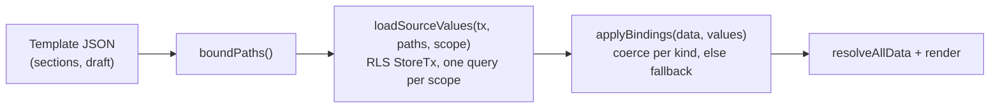

# Dynamic sources

A section or block setting in the theme editor can read its value from store data at render
time instead of holding it: the product's title, a metafield, the store logo, a metaobject
entry's field. This is Shopify's "Connect dynamic source" in the theme editor
([Shopify Help: dynamic sources](https://help.shopify.com/en/manual/online-store/themes/customizing-themes/add-content/dynamic-sources),
[Shopify dev docs: dynamic sources](https://shopify.dev/docs/storefronts/themes/architecture/settings/dynamic-sources)).
Two deliberate differences: we keep the typed-in value as a **fallback** when the source is
empty, and we store a structured binding instead of a Liquid string.

No migration: bindings live in the section props that `theme_template.sections` / `draft`
already store.

## Where the code lives

| Piece | File |
| --- | --- |
| Binding format, source paths, compatibility table, validation (pure, browser-safe) | `packages/core/src/dynamic-sources/format.ts` (`@commerce/core/dynamic-sources`) |
| `applyBindings`: a loaded value in the shape its setting wants, else the fallback (pure) | `packages/core/src/dynamic-sources/resolve.ts` (same entry) |
| Source catalog for a template (what the picker lists and Save accepts) | `packages/core/src/dynamic-sources/catalog.ts` |
| Server loader under RLS, catalog loader, Save check | `packages/core/src/dynamic-sources/service.ts` |
| Storefront resolution | `apps/storefront/src/lib/template-render.tsx` (`renderTemplate`, option `sources`) |
| API | `themes.templates.sources`, `themes.templates.sourceValues` in `packages/api/src/routers/themes.ts` |
| Editor button, picker, chip | `apps/admin/src/components/themes/customize/dynamic-source-{field,picker,chip}.tsx` |
| Editor preview resolution | `dynamic-source-section.tsx`, wired in `apps/admin/src/lib/customize-config.tsx` |
| Field wiring | `withDynamicSources()` in `apps/admin/src/lib/customize-dynamic-fields.ts`, applied to Puck's `fieldTypes` |
| Copy | `apps/admin/src/data/dynamic-sources.ts` |

## Binding format

A connected setting's value is replaced by a binding object, anywhere inside a section's props
(top-level, inside an object field, inside an array item):

```json
{
  "type": "ImageBanner",
  "props": {
    "id": "banner-1",
    "heading": {
      "$source": "product.metafields.custom.material",
      "kind": "text",
      "fallback": "Made to last"
    },
    "image": {
      "$source": "product.featured_image",
      "kind": "image",
      "fallback": { "url": "https://cdn.example/banner.jpg", "alt": "Banner" }
    }
  }
}
```

- `$source`: the source path (below). Any object with a string `$source` is a binding.
- `kind`: the setting's own type, which decides how the value is shaped: `text`, `richtext`,
  `image`, `link`, `number` or `color`.
- `fallback`: what the merchant had typed in before connecting. It renders whenever the source
  is empty, and disconnecting puts it back. Absent when the setting was empty.

## Source paths

| Path | Type | Templates |
| --- | --- | --- |
| `product.title`, `.vendor`, `.type`, `.category` | single line text | product |
| `product.price`, `.compare_at_price` | money (paise; cheapest live variant, compare-at only inside the sale window) | product |
| `product.description` | rich text | product |
| `product.featured_image`, `.images.1` … `.images.3` | file (image) | product |
| `product.url` | url (`/products/<handle>`) | product |
| `product.metafields.<namespace>.<key>` | the definition's type | product |
| `collection.title`, `.description`, `.image`, `.url` | as above | collection |
| `collection.metafields.<namespace>.<key>` | the definition's type | collection |
| `shop.name`, `.email`, `.phone` | single line text | all |
| `shop.address` | multi line text | all |
| `shop.logo` | file (live theme's logo) | all |
| `metaobjects.<type>.<handle>.<key>` | the field's type | all, header and footer included |

`product.category` is the leaf name from the vendored Shopify Product Taxonomy (now in
`packages/core/src/catalog/product-taxonomy.json`, MIT, see `THIRD_PARTY_NOTICES.md`).

Only definitions with **Storefront access** and active metaobject entries are offered or
resolved. List metafields, `boolean`, `group` and `metaobject_reference` fields are not
offered: no setting can show them (a group's rows wait for Content list loops, CMS PR3). The
path `metaobjects.<type>.<handle>.<key>` is unchanged by the CMS PR2 field types; each new type
simply has more settings it fits (below). Value shapes per type:
[Content types](./content-types#field-types-and-stored-values).

## Type compatibility

`COMPATIBLE` in `format.ts` is the one table; the picker filters by it (`optionsFor`) and Save
checks it.

| Setting kind | Accepts |
| --- | --- |
| `text` (text, textarea) | single/multi line text, integer, decimal, money (formatted `₹1,299`, a money field in its own currency), date (`12 March 2026`), date and time (`2 October 2026 at 10:00 am`, in the store's time zone), url, choice, rating (`4.5/5`), measurement (`1.5 kg`) |
| `richtext` | rich text, single/multi line text |
| `image` (`{ url, alt }` objects) | file |
| `link` (`{ label, href }` objects) | url, button link, product / variant / collection / page / blog post reference |
| `url` (link picker text fields) | the same as `link` |
| `number` | integer, decimal, rating (its value) |
| `color` (text fields named `*colour*`/`*color*`) | colour; single line text, used only when it is a CSS colour |

Images and links keep the fallback's other keys (alt text, button label). Image and link URLs
must be `http(s)://` or a site path; anything else falls back. A reference links to its
storefront page: `/products/<handle>`, `/collections/<handle>`, `/pages/<handle>`,
`/blogs/<blog>/<handle>`, and a variant to `/products/<handle>?variant=<id>`. A **button link**
field's own words replace the button label; a record's title only fills an empty label.
Select, radio, array and plain object fields cannot be connected.

## Resolution



`renderTemplate` does this per request, before Puck's `resolveAllData`, on the store's
`withStore` transaction. The product page passes `sources: { productId }` and the collection
page `sources: { collectionId }`; other routes resolve only `shop.*` and `metaobjects.*`. A
path the request cannot answer is absent from the values, so its fallback renders. When a
template holds no binding, nothing is loaded.

In the editor, `DynamicSourceSection` wraps each section's render, fetches values for the
product or collection chosen in the preview's resource picker
(`themes.templates.sourceValues`, cached per resource and path) and applies them the same way.
Blocks' `resolveData` gets the fallbacks (`applyBindings(props)` with no values), and any
connected prop it hands back unchanged is restored, so resolving never disconnects a setting.

## Validation

- **Draft autosave** (`saveTemplateDraft`): `bindingProblems(data, template)` checks the shape,
  that the path parses, that the template may read that scope, and fixed-field compatibility.
- **Save** (`commitTemplateDrafts`): `assertTemplateBindings` loads the store's catalog for each
  template that holds a binding and refuses any source that doesn't exist (a deleted metafield,
  a hidden metaobject) or doesn't fit. The router answers `BAD_REQUEST` with messages such as
  `Image banner › heading is connected to product.metafields.custom.fabric, which no longer exists`,
  which the editor shows as a toast.

## Lists (loops)

A repeatable field (an `array`: FAQ questions, quotes, logos, people, photos) can be filled from
a list in the store instead of rows typed in the editor. The array's value becomes a loop
(`packages/core/src/dynamic-sources/loops.ts`, pure):

```json
{
  "$loop": {
    "source": "metaobject:faq",
    "limit": 6,
    "map": {
      "question": { "from": "question", "kind": "text" },
      "answer": { "from": "answer", "kind": "richtext" }
    }
  },
  "fallback": [{ "question": "Typed before linking", "answer": "…" }]
}
```

- `source`: `metaobject:<type>` (active entries of a storefront-visible content type, oldest
  first) or `collection:<handle>.products` (the collection's visible products, in its order).
- `limit`: rows drawn, capped at `LOOP_MAX` (50).
- `map`: which field of each row reads which field of each entry (its field key, or `handle`) or
  product (`title`, `price`, `compare_at_price`, `vendor`, `type`, `featured_image`, `url`), and
  the setting kind it is coerced to (the same coercion single-value bindings use).
- `fallback`: the rows typed before linking. They render when the list is empty or cannot be
  read, and are what "Unlink" restores (`unlinkLoop`).

The storefront renderer (`template-render.tsx`) finds loops (`boundLoops`), loads their rows in
one pass per content type and collection (`loadLoopValues` in `loop-service.ts`, under the
request's RLS; products come from the storefront's own `collectionCards`, so visibility and order
are the catalogue's), then `applyLoops` swaps each loop for its rows. A row keeps the first
fallback row's other settings, so unmapped fields (an icon, a rating) still show. Loops run
before single-value bindings. `applyBindings` on its own (the editor, no store) shows the
fallback rows, so a section never receives the loop object. Save refuses a loop over an unknown
source or a content type the store no longer shows (`loopProblems`).

### In the editor

Every repeatable field whose items have at least one field that can take a value (text, rich
text, image, link, number) shows **Use content from…** under its rows
(`customize-array-field.tsx`). The dialog (`loop-dialog.tsx`) lists the content types and
collections a list can read (`themes.templates.loopSources`), a row limit, and what each item
field shows; `guessMap` (`lib/customize-loops.ts`) fills a first map by name and meaning
("question" for a heading, "photo" for an image), compatible types only. Fields set to Nothing
are stored as `from: ""` and are emptied on every row. While linked, the field shows
`loop-linked-panel.tsx` (source, rows right now, what each row shows, **Change**, **Unlink**)
instead of the editable rows, and the Sections tree offers no add or remove for it. The canvas
fills the rows from `themes.templates.loopValues` (`DynamicSourceSection`, cached per source and
limit); collection products there come from `previewCollectionProducts` (active products in the
collection's order), the storefront uses its own catalogue loader.

## Adding a source

1. Add the field to `PRODUCT_SOURCE_FIELDS`, `COLLECTION_SOURCE_FIELDS` or `SHOP_SOURCE_FIELDS`
   with its type.
2. Load it in `productValues` / `collectionValues` / `shopValues` in `service.ts`.
3. Name it in `apps/admin/src/data/dynamic-sources.ts` (the `satisfies` there fails the typecheck
   until you do).
4. Add a case to `format.test.ts` and, for the loader, `service.test.ts` (database).

## Tests

- `packages/core/src/dynamic-sources/format.test.ts` (no database): path parsing, the
  compatibility table, one coercion case per source type, fallback, validation, catalog.
- `packages/core/src/dynamic-sources/service.test.ts` (database): values per source, RLS,
  end-to-end fallback, Save's check.
