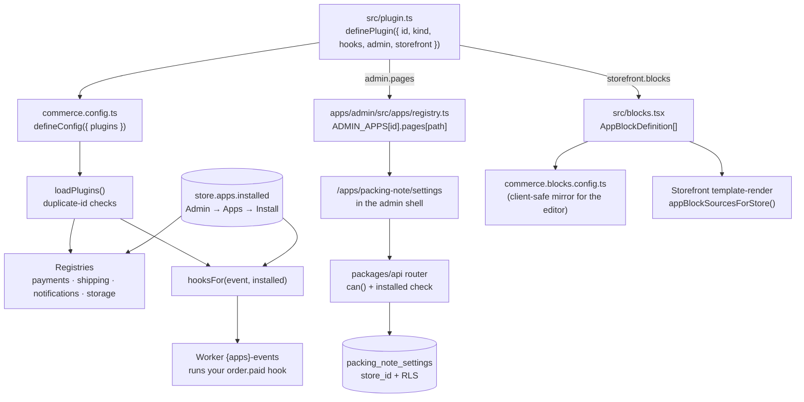

# Build your first app in 15 minutes

You'll build **Packing note**, a small built-in app that does four real things, each through
the actual SDK in `packages/plugins`:

1. A **manifest** that makes it installable from **Admin → Apps**.
2. A **settings page** in the admin, backed by the app's own table.
3. An **`order.paid` hook** that adds a note to each paid order's timeline ("Add a
   handwritten thank-you card"), so your packing team sees it.
4. An **app block**, "Packed with care", merchants can drop onto any page from the theme
   editor's **Apps** tab.

`packages/plugin-back-in-stock` follows exactly this shape and is the reference to compare
against. The full field-by-field SDK reference is [Plugins SDK and app blocks](/developer-docs/building/plugins).

## How an app plugs in



Everything on the manifest only runs for stores that installed the app. The core plugin is
always installed; yours starts uninstalled everywhere.

## Build it

<Steps>

### Create the package (1 min)

```text
packages/plugin-packing-note/
  package.json
  src/plugin.ts       the manifest
  src/schema.ts       the settings table
  src/settings.ts     zod schema + load/save
  src/hooks.ts        the order.paid hook
  src/blocks.tsx      the app block (no DB imports)
  src/server.ts       server entry the API imports
  src/index.ts        re-exports
```

```json filename="packages/plugin-packing-note/package.json"
{
  "name": "@commerce/plugin-packing-note",
  "version": "0.0.0",
  "private": true,
  "type": "module",
  "exports": {
    ".": "./src/index.ts",
    "./blocks": "./src/blocks.tsx",
    "./schema": "./src/schema.ts",
    "./server": "./src/server.ts"
  },
  "dependencies": {
    "@commerce/db": "workspace:*",
    "@commerce/plugins": "workspace:*",
    "drizzle-orm": "^0.45.2",
    "zod": "^4.6.5"
  },
  "peerDependencies": {
    "react": "^19.0.0"
  }
}
```

Keep the `drizzle-orm`/`zod` ranges identical to `packages/plugin-back-in-stock/package.json`
so the workspace resolves one copy of each.

### Write the settings table (2 min)

Every app table carries `store_id` so `apply_store_rls()` isolates it like a core table.

```ts filename="src/schema.ts"
import { newId, store } from '@commerce/db'
import { jsonb, pgTable, timestamp, uniqueIndex, uuid } from 'drizzle-orm/pg-core'

export const packingNoteSettings = pgTable(
  'packing_note_settings',
  {
    id: uuid('id').primaryKey().$defaultFn(newId),
    storeId: uuid('store_id')
      .notNull()
      .references(() => store.id),
    settings: jsonb('settings').notNull().default({}),
    updatedAt: timestamp('updated_at', { withTimezone: true }).notNull().defaultNow(),
  },
  (t) => [uniqueIndex('packing_note_settings_store').on(t.storeId)],
)
```

```ts filename="src/settings.ts"
import type { StoreTx } from '@commerce/db'
import { eq } from 'drizzle-orm'
import { z } from 'zod'
import { packingNoteSettings } from './schema'

export const PackingNoteSettingsSchema = z.object({
  enabled: z.boolean().default(true),
  text: z.string().max(280).default('Add a handwritten thank-you card.'),
})
export type PackingNoteSettings = z.infer<typeof PackingNoteSettingsSchema>

export async function loadSettings(tx: StoreTx, storeId: string): Promise<PackingNoteSettings> {
  const [row] = await tx
    .select({ settings: packingNoteSettings.settings })
    .from(packingNoteSettings)
    .where(eq(packingNoteSettings.storeId, storeId))
  const parsed = PackingNoteSettingsSchema.safeParse(row?.settings ?? {})
  return parsed.success ? parsed.data : PackingNoteSettingsSchema.parse({})
}

export async function saveSettings(
  tx: StoreTx,
  storeId: string,
  patch: Partial<PackingNoteSettings>,
): Promise<PackingNoteSettings> {
  const next = PackingNoteSettingsSchema.parse({ ...(await loadSettings(tx, storeId)), ...patch })
  await tx
    .insert(packingNoteSettings)
    .values({ storeId, settings: next, updatedAt: new Date() })
    .onConflictDoUpdate({
      target: packingNoteSettings.storeId,
      set: { settings: next, updatedAt: new Date() },
    })
  return next
}
```

Add the schema to the one migration chain, then generate the migration and end it with RLS:

```ts filename="packages/db/drizzle.config.ts" {4}
schema: [
  // ...core and other apps
  '../plugin-back-in-stock/src/schema.ts',
  '../plugin-packing-note/src/schema.ts',
],
```

```sh filename="Terminal"
bun run db:generate        # then append SELECT apply_store_rls(); to the new SQL file
bun run db:migrate
```

The RLS coverage test in `packages/db` fails if you forget `apply_store_rls()`.

### Write the hook (2 min)

Hooks run in the worker on the `{apps}-events` queue, **at least once** per (order, event), so
they must be idempotent. `ctx.inStore` gives you a transaction under the store's RLS.

```ts filename="src/hooks.ts"
import { orderNote } from '@commerce/db'
import type { AppHook } from '@commerce/plugins'
import { and, eq } from 'drizzle-orm'
import { loadSettings } from './settings'

export const onOrderPaid: AppHook = async (ctx, { orderId }) => {
  const settings = await ctx.inStore((tx) => loadSettings(tx, ctx.storeId))
  if (!settings.enabled || !settings.text.trim()) return
  await ctx.inStore(async (tx) => {
    // Idempotent: a retried job finds the note it already wrote.
    const [existing] = await tx
      .select({ id: orderNote.id })
      .from(orderNote)
      .where(and(eq(orderNote.orderId, orderId), eq(orderNote.body, settings.text)))
    if (existing) return
    await tx.insert(orderNote).values({ storeId: ctx.storeId, orderId, body: settings.text })
  })
  ctx.log(`packing note added to ${orderId}`)
}
```

`order.paid` fires once the amount due at checkout is captured, from every path that marks an
order paid (webhook, client confirm, "Mark as paid"), through the transactional outbox.

### Write the app block (2 min)

Blocks are typed loosely so `@commerce/plugins` never depends on Puck or React; the type must
be namespaced `<pluginId>/<Name>`. Keep this file free of DB imports: the admin editor imports
it in the browser.

```tsx filename="src/blocks.tsx"
import type { AppBlockDefinition } from '@commerce/plugins'

type PackedWithCareProps = { heading: string; text: string }

function render({ heading, text }: PackedWithCareProps) {
  return (
    <section className="page-width py-8 text-center">
      <h2 className="text-xl font-semibold">{heading}</h2>
      <p className="mt-2 opacity-80">{text}</p>
    </section>
  )
}

export const packingNoteBlocks: AppBlockDefinition[] = [
  {
    type: 'packing-note/PackedWithCare',
    label: 'Packed with care',
    description: 'A short promise about how you pack every order.',
    icon: 'FileText',
    fields: {
      heading: { type: 'text', label: 'Heading' },
      text: { type: 'textarea', label: 'Text' },
    },
    defaultProps: {
      heading: 'Packed by hand in Jaipur',
      text: 'Every order is checked, wrapped and packed by our team within 24 hours.',
    },
    render,
  },
]
```

For anything bigger, write the component in `packages/blocks/src/app-blocks/*` (it gets the
same file-structure checks as every block) and keep `blocks.tsx` to fields and wiring, like the
three shipped blocks do. A block never fetches its own data; the storefront route passes it
context through `puck.metadata.appBlockContext`.

### Write the manifest (1 min)

```ts filename="src/plugin.ts"
import { definePlugin } from '@commerce/plugins'
import { packingNoteBlocks } from './blocks'
import { onOrderPaid } from './hooks'

export const PACKING_NOTE_ID = 'packing-note'

export const packingNotePlugin = definePlugin({
  id: PACKING_NOTE_ID,
  name: 'Packing note',
  version: '0.1.0',
  kind: 'builtin',
  category: 'operations',
  description: 'Adds your packing instructions to every paid order, and a "Packed with care" block.',
  provides: {},
  hooks: { 'order.paid': onOrderPaid },
  admin: {
    icon: 'FileText',
    pages: [{ path: '', title: 'Settings', navLabel: 'Settings', icon: 'Settings' }],
  },
  storefront: { blocks: packingNoteBlocks },
})
```

```ts filename="src/server.ts"
export * from './plugin'
export * from './schema'
export * from './settings'
```

```ts filename="src/index.ts"
export * from './plugin'
export * from './schema'
export * from './settings'
```

`definePlugin` throws at import time if the id isn't lowercase-and-dashes, `name` or `version`
is empty, `kind` isn't `'builtin'` or `'connection'`, or a block type isn't namespaced
`packing-note/…`. `provides` is required, but `{}` is fine for an app with no providers.

### Register it (2 min)

```ts filename="commerce.config.ts"
import { packingNotePlugin } from '@commerce/plugin-packing-note'

export default defineConfig({
  plugins: [/* ...existing plugins */ packingNotePlugin],
})
```

```ts filename="commerce.blocks.config.ts"
import { packingNoteBlocks } from '@commerce/plugin-packing-note/blocks'

export const APP_BLOCK_SOURCES: AppBlockSource[] = [
  // ...existing entries
  { id: 'packing-note', name: 'Packing note', icon: 'FileText', blocks: packingNoteBlocks },
]
```

Add `"@commerce/plugin-packing-note": "workspace:*"` to the root `package.json` and to
`apps/admin`, `apps/storefront`, `apps/worker` and `packages/api`, the same places
`@commerce/plugin-back-in-stock` appears, then `bun install`. Two plugins with the same id fail
at boot with a message naming both.

### Add the API router (2 min)

App procedures live in `packages/api/src/routers/<app>.ts`, call the plugin's `./server` entry,
and sit behind `can()` and an installed check. The API depends on the plugin, never the other
way round.

```ts filename="packages/api/src/routers/packing-note.ts"
import { permissions } from '@commerce/core'
import type { StoreTx } from '@commerce/db'
import {
  loadSettings,
  PACKING_NOTE_ID,
  PackingNoteSettingsSchema,
  saveSettings,
} from '@commerce/plugin-packing-note/server'
import { ORPCError } from '@orpc/server'
import { can } from '../procedures'
import { getStoreApps } from '../services/apps.service'

type Ctx = { tx: StoreTx; scope: { storeId: string } }

async function requireInstalled(context: Ctx) {
  const apps = await getStoreApps(context.tx, context.scope.storeId)
  if (!apps.installed.includes(PACKING_NOTE_ID)) {
    throw new ORPCError('PRECONDITION_FAILED', { message: 'Install the Packing note app first' })
  }
}

export const packingNoteRouter = {
  settings: {
    get: can(permissions.SETTINGS_READ).handler(async ({ context }) => {
      await requireInstalled(context)
      return loadSettings(context.tx, context.scope.storeId)
    }),
    save: can(permissions.SETTINGS_MANAGE)
      .input(PackingNoteSettingsSchema.partial())
      .handler(async ({ context, input }) => {
        await requireInstalled(context)
        return saveSettings(context.tx, context.scope.storeId, input)
      }),
  },
}
```

Mount it in `packages/api/src/routers/_app.ts` as `packingNote: packingNoteRouter`.

### Add the admin page (3 min)

Copy lives in `apps/admin/src/data/packing-note.ts`; the component follows the repo's file
structure (hooks → handlers → early returns → render) and uses the admin kit.

```tsx filename="apps/admin/src/components/apps/packing-note/settings-page.tsx"
'use client'

import { Button } from '@commerce/ui/shadcn/button'
import { Label } from '@commerce/ui/shadcn/label'
import { Switch } from '@commerce/ui/shadcn/switch'
import { Textarea } from '@commerce/ui/shadcn/textarea'
import { useEffect, useState } from 'react'
import { toast } from 'sonner'
import DataCard from '@/components/layout/data-card'
import { packingNoteContent as copy } from '@/data/packing-note'
import { api } from '@/lib/api-client'

type Settings = Awaited<ReturnType<typeof api.packingNote.settings.get>>

export default function PackingNoteSettingsPage() {
  // Hooks
  const [form, setForm] = useState<Settings | null>(null)
  const [busy, setBusy] = useState(false)

  useEffect(() => {
    api.packingNote.settings.get().then(setForm)
  }, [])

  // Event handlers
  const handleSave = async () => {
    if (!form) return
    setBusy(true)
    try {
      setForm(await api.packingNote.settings.save(form))
      toast.success(copy.saved)
    } finally {
      setBusy(false)
    }
  }

  // Early returns
  if (!form) return null

  return (
    <DataCard title={copy.title}>
      <div className="flex flex-col gap-4 p-4">
        <div className="flex items-center justify-between">
          <Label htmlFor="pn-enabled">{copy.enabled}</Label>
          <Switch
            id="pn-enabled"
            checked={form.enabled}
            onCheckedChange={(enabled) => setForm({ ...form, enabled })}
          />
        </div>
        <Label htmlFor="pn-text">{copy.text}</Label>
        <Textarea
          id="pn-text"
          value={form.text}
          onChange={(e) => setForm({ ...form, text: e.target.value })}
        />
        <Button disabled={busy} onClick={handleSave} className="self-end">
          {copy.save}
        </Button>
      </div>
    </DataCard>
  )
}
```

Register it under the manifest's page path in `apps/admin/src/apps/registry.ts`:

```ts filename="apps/admin/src/apps/registry.ts"
import PackingNoteSettingsPage from '@/components/apps/packing-note/settings-page'

export const ADMIN_APPS: Record<string, AdminApp> = {
  // ...existing apps
  'packing-note': { pages: { '': PackingNoteSettingsPage } },
}
```

The keys of `pages` must equal the manifest's `AppPage.path` values (`''` is the app root at
`/apps/packing-note`). `admin.icon` must be a name in that file's `ICONS` map, otherwise it
falls back to `Puzzle`.

### Try it (2 min)

1. Restart `bun run dev`. **Admin → Apps** lists **Packing note** under Built-in apps.
2. **Install** it. **Packing note** appears under **Apps** in the sidebar; open it, change the
   text, **Save**.
3. Place a test order on the storefront and pay it (or **Mark as paid** in the admin). Within
   a few seconds the order's **Timeline** shows your note.
4. **Online Store → Themes → Customize → Add → Apps**: **Packed with care** is there, grouped
   "by Packing note". Add it, **Save**, and view the page on the storefront.

</Steps>

<Callout type="info">
  **Uninstall to test the edges.** Uninstall the app: the sidebar entry goes, the router
  answers `PRECONDITION_FAILED`, the hook stops running, and a page that already has the block
  keeps loading (the editor shows an inert "This app is off" placeholder, the storefront renders
  nothing). Reinstall and everything, including your saved settings, comes back.
</Callout>

## Tests to add

- **Hook idempotency**: run `onOrderPaid` twice for one order and assert one `order_note` row.
- **Settings**: `saveSettings` merges a partial patch and rejects text over 280 characters.
- **Block**: render `packing-note/PackedWithCare` with its `defaultProps`, the way
  `packages/blocks/test/render.test.tsx` covers the shipped blocks.
- Run `bun run test:sweeps`: `no-orphans` flags exports nothing imports, and
  `client-imports-server` catches a server-only import in a `'use client'` module.

## Common problems and fixes

| Problem | Why it happens | Fix |
| --- | --- | --- |
| `plugin "packing-note" needs kind: 'builtin' or 'connection'` at boot | `kind` missing. | Every manifest must say which Apps section it's in. |
| `app block "PackedWithCare" … must be namespaced` | Block type lacks the plugin id. | Use `packing-note/PackedWithCare`. |
| Block missing from the editor's Apps tab | Not in `commerce.blocks.config.ts`, or app not installed. | Add the entry; install the app for the store. |
| Hook never runs | App not installed for that store, or the worker isn't running. | Install it; run `bun run dev` (it starts the worker on 4100). |
| Settings page shows "install first" | The admin route checks `apps.list` before rendering. | Install the app. |
| Migration applied but queries return nothing | `apply_store_rls()` forgotten, or querying outside `withStore`. | Add it to the migration; use `ctx.inStore` / `context.tx`. |

## Related guides

<RelatedGuides ids={['plugins', 'request-flow', 'data-model', 'running-locally']} />
