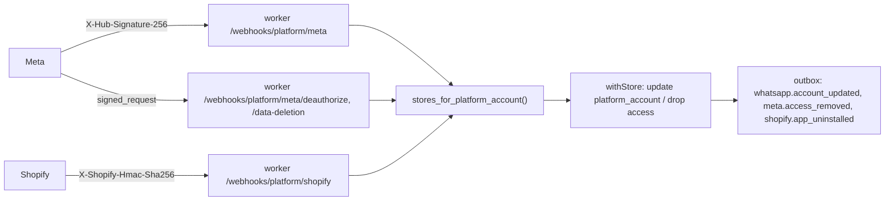

# Platform apps

Some connections need an app that **the platform owns** on the other side, once per deployment,
which every store then connects through: one Meta app, one Shopify app, one Google OAuth client.
This page is how they fit together. The research behind the choice and the ranking is
`docs/research/2026-10-23-platform-apps.md`; the owner's step-by-step checklist (accounts,
verification, review text, screencast scripts) is `docs/handoff/changes/2026-10-23-platform-apps.md`.

| Platform app | Merchant sees | Code | Env keys (admin + worker) |
|---|---|---|---|
| Meta Business app, Login for Business "catalog" configuration | Sales channels → Instagram / Facebook / WhatsApp → Connect | `packages/core/src/sales-channels/` | `META_APP_ID`, `META_APP_SECRET`, `META_LOGIN_CONFIG_ID` |
| Same app, WhatsApp Embedded Signup v4 configuration | Apps → WhatsApp → Connect with Facebook | `packages/core/src/platform-apps/whatsapp-signup.ts`, `apps/admin/src/lib/facebook-sdk.ts` | `META_WHATSAPP_CONFIG_ID` |
| Same app, webhooks and deletion callbacks | WhatsApp account health on the WhatsApp page | `packages/core/src/platform-apps/meta-callbacks.ts`, `apps/worker/src/platform-webhooks.ts` | `META_WEBHOOK_VERIFY_TOKEN` |
| Shopify "Koomerce Migration" app (`integrations/shopify/shopify.app.toml`) | Shopify importer → Connect → Install the Koomerce app | `packages/plugin-shopify-import/src/app-install.ts`, `app-webhooks.ts` | `SHOPIFY_APP_CLIENT_ID`, `SHOPIFY_APP_CLIENT_SECRET` |
| Google OAuth client with Merchant API | Sales channels → Google → Connect | `packages/core/src/sales-channels/google-merchant.ts` | `GMC_GOOGLE_CLIENT_ID`, `GMC_GOOGLE_CLIENT_SECRET` |

Every key blank keeps the old way in (a request, a pasted token, a Dev Dashboard app), so a
deployment without the apps works as before.

## Which store is this callback for?

Platform callbacks name an outside account, never our store: a Facebook user id (deauthorize, data
deletion), a WhatsApp Business account id (WhatsApp webhooks), a `shop.myshopify.com` (Shopify
webhooks). Connecting writes a `platform_account` row (`linkPlatformAccount`, migration `0153`,
RLS) and callbacks find the stores with the SECURITY DEFINER `stores_for_platform_account()`
(`storesForPlatformAccount` in `@commerce/db`), then work inside `withStore` as usual. The row also
keeps what the platform last said (`status`, `detail`, `last_event_at`), which the WhatsApp page
shows.

## Signatures

`packages/core/src/platform-apps/signatures.ts`, all constant-time, all answer `false`/`null`
instead of throwing:

- `verifyMetaSignature(raw, header, appSecret)`: `sha256=<hex HMAC-SHA256 of the raw body>`.
- `parseMetaSignedRequest(signed, appSecret)`: `<base64url sig>.<base64url JSON>`, `HMAC-SHA256`.
- `verifyShopifyWebhook(raw, header, clientSecret)`: base64 HMAC-SHA256 of the raw body.
- `verifyShopifyQueryHmac(params, clientSecret)`: the OAuth redirect's `hmac` over the other
  parameters, sorted (plain or URL-encoded values, since Shopify's libraries differ).

The worker reads the raw body before parsing. A bad Meta signature gets the usual 400; a bad
Shopify HMAC gets **401**, which Shopify's review checks. Verified events Meta or Shopify send that
we do not handle are acknowledged with 200 so they are not retried.

## WhatsApp Embedded Signup v4

1. The page loads Meta's JS SDK on demand (our nonce-trusted bundle adds the script, so the
   admin's `strict-dynamic` CSP allows it) and calls `FB.login` with the signup `config_id`,
   `response_type: 'code'`, `override_default_response_type: true`, `extras: { setup: {} }`.
2. The popup posts `WA_EMBEDDED_SIGNUP` (`FINISH…` with `waba_id`, `phone_number_id`; `CANCEL`;
   `ERROR`) from a `*.facebook.com` origin; `FB.login` returns a `code` that lives 30 seconds.
3. `platformApps.completeWhatsapp` → `completeWhatsappSignup`: code → business token (no
   `redirect_uri`), `POST /{waba}/subscribed_apps`, `POST /{phone}/register` with a six-digit PIN
   (kept encrypted on the account row, reused for the same number), then the number's name and
   quality. A refused registration still connects and the page says how to finish it.
4. The result is saved as the store's WhatsApp channel settings through
   `prepareProviderSettings` (the token encrypted like a pasted one) and the channel is enabled.

## Meta Login for Business and system user tokens

With `META_LOGIN_CONFIG_ID`, `metaAuthorizeUrl` sends `config_id` instead of `scope`, and
`metaExchangeCode` keeps the business integration system user token as it is (no 60-day
exchange, `expires_at` null), so Meta channels stop expiring. `metaDiscover` also reads `/me` and
the Facebook user is linked for the deletion callbacks. Graph version: `META_GRAPH_VERSION`
(`v26.0`); the WhatsApp channel package pins the same.

## Shopify migration app

- `shopifyImport.startAppInstall({ shopDomain })` → `https://{shop}/admin/oauth/authorize` with
  every importer scope and a state signed with `SETTINGS_SECRET` (store, shop, nonce, 30 min).
- `/api/apps/shopify-import/oauth/callback` → `shopifyImport.completeAppInstall`: Shopify's
  `hmac`, the state for this signed-in store, the shop matching, then the code exchange with
  `expiring=1` (about an hour of access and a 90-day refresh token). Saved as connection mode
  `app`; `clientFor` refreshes before expiry and saves the new refresh token every time.
- Webhooks: `app/uninstalled` and `shop/redact` drop the shop's access from every store linked to
  it (imported data stays); `customers/data_request` and `customers/redact` are acknowledged
  (the app keeps no copy of Shopify customers outside the merchant's own store).
- The app config lives in `integrations/shopify/shopify.app.toml`, pushed with Shopify CLI by the
  owner. Admin API version for the importer: `SHOPIFY_API_VERSION` (still `2025-07`, which
  Shopify serves as its oldest supported version; bump with a live check).

## Rejected items (Google and Meta)

After a successful push the sync asks what the platform refused (`verdicts.ts`): Google's
`reports:search` over `product_view` where `aggregated_reporting_context_status =
'NOT_ELIGIBLE_OR_DISAPPROVED'`, Meta's catalog items with `review_status = 'rejected'`. The count
and up to ten items land on the channel state (`sync.rejected`, `sync.rejectedItems`) and the
channel page lists them. Best effort: a failure here never fails the sync.

## Events for automations

These outbox types have no consumer yet; they exist so automations can subscribe:
`channel.sync_failed` (`platform`, `platformStatus` error/expired, `message`),
`whatsapp.account_updated` (`externalId`, `platformStatus`, `message`), `meta.access_removed`,
`shopify.app_uninstalled` (`externalId` = the shop).

## Tests

Every platform is a fake `fetch`: `packages/core/src/platform-apps/platform-apps.test.ts`
(signatures, signup calls, webhook mapping), `packages/core/src/sales-channels/sync.test.ts`
(platform accounts, deletion, WhatsApp webhooks, rejected items, the failure event),
`packages/plugin-shopify-import/test/app-install.test.ts` (install URL, callback checks, token
refresh rotation, uninstall), `apps/worker/src/platform-webhooks.test.ts` (routes, signatures,
401 on a bad Shopify HMAC).
