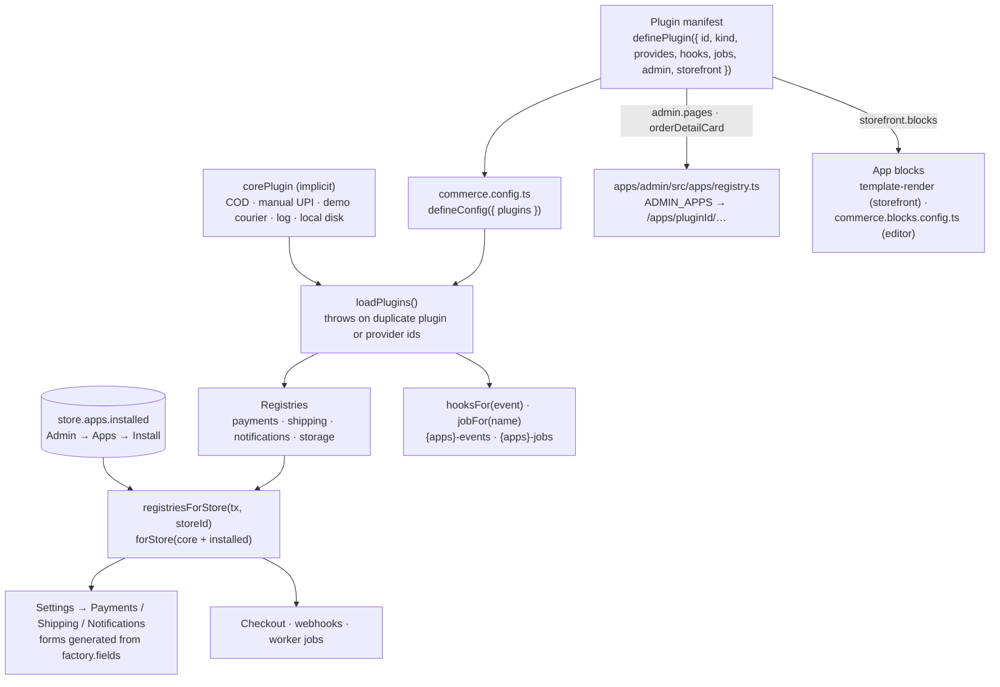

> Moved from `docs/plugins.md`. This is the source of truth.

# Writing a plugin

Payment gateways, couriers and notification channels are plugins. The platform
never imports an adapter directly: `commerce.config.ts` lists plugins, each
store installs the ones it wants from **Admin → Apps**, and the installed
plugins' providers show up under **Settings → Payments / Shipping /
Notifications**. Nothing about a provider is hard-coded in the admin — the
form is generated from the fields your factory declares.

```
commerce.config.ts          which plugins this deployment ships
packages/plugins            definePlugin, defineConfig, loadPlugins
packages/payments           PaymentProvider contract + conformance suite
packages/shipping           ShippingProvider contract + conformance suite
packages/notifications      NotificationChannel contract + conformance suite
packages/storage            StorageProvider contract (presigned uploads) + conformance suite
packages/*-razorpay etc.    reference adapters, one package each
```

New to the SDK? [Build your first app in 15 minutes](/developer-docs/building/first-app) walks
through a manifest, settings page, hook and app block end to end. This page is the reference.

## How a plugin plugs in



## 1. Package layout

A plugin is an npm package (workspace or published) that exports a manifest.

```
packages/shipping-fedex/
  package.json        depends on @commerce/shipping and @commerce/plugins
  src/fedex.ts        the provider + its factory
  src/plugin.ts       the manifest
  src/index.ts        re-exports
  test/fedex.test.ts  offline tests + the conformance suite
```

```json filename="package.json"
{
  "name": "@commerce/shipping-fedex",
  "type": "module",
  "exports": { ".": "./src/index.ts" },
  "dependencies": {
    "@commerce/plugins": "workspace:*",
    "@commerce/shipping": "workspace:*"
  }
}
```

Published to npm, the dependencies become the released versions and the
merchant adds your package to their deployment's `commerce.config.ts`.

## 2. The provider and its factory

Each kind has a contract and a factory type. The factory is what the registry
holds: `fields` drive the settings form, `validateConfig` runs on save, and
`create` builds a provider from one store's decrypted config.

A payment adapter can offer a second method on the same gateway account (Razorpay's
"UPI — confirmed automatically" QR method next to Razorpay Checkout): give its factory
`credentialsFrom: 'razorpay'` to reuse that provider's saved keys, and its provider
`webhookId = 'razorpay'` so it answers on the gateway's one webhook URL and shares its
event dedupe.

Payment factories have a few optional hooks the easy-setup screens use:

- `methods`: the ways to pay the gateway can take (`upi`, `card`, `netbanking`, `wallet`,
  `emi`). The merchant's "Shoppers can pay with" row arrives on `createPayment` as
  `input.methods`, in order; show only those where the gateway allows it (Razorpay Checkout
  `config.display` blocks, Cashfree `order_meta.payment_methods`).
- `testConnection()` on the provider: a read-only key check for the Connect page's "Test
  connection" button. It must not create anything on the gateway.
- `refreshCredentials(saved, now)`: renews short-lived tokens (Razorpay OAuth) before use;
  return the fields to overwrite, or `null`. The platform encrypts and saves them.
- `hidden: true` on a `ProviderField`: written by the platform (OAuth tokens), never shown in a
  form. Secret-looking keys still need `secret: true`.
- `refund(paymentId, amount, note, context)`: `context.providerRef` is the gateway order id,
  for gateways that refund per order (Cashfree).

`packages/payments-cashfree` is a compact example of the whole contract: order creation,
raw-body webhook verification with a timing-safe compare, status polling and refunds, with every
network call mocked in its tests.

Cashfree specifics worth knowing (checked against Cashfree's official Node SDK, `cashfree-pg`,
because their docs site is blocked from our build machines; sources are listed at the top of
`cashfree.ts`):

- **Hosts**: `mode: 'test'` calls `https://sandbox.cashfree.com/pg`, `mode: 'live'` calls
  `https://api.cashfree.com/pg`. Every request sends `x-client-id`, `x-client-secret` and
  `x-api-version: 2026-01-01`; order creation also sends `x-idempotency-key` (a UUID derived
  from our `<orderId>:<attempt>` key, so a retry reuses it).
- **Webhooks**: Cashfree signs with the same Secret Key as the API (there is no separate webhook
  secret): base64 HMAC-SHA256 of `x-webhook-timestamp` followed by the raw body. We also refuse
  a timestamp more than 15 minutes from our clock (`CASHFREE_WEBHOOK_TOLERANCE_MS`) so a captured
  request can't be replayed; a refused webhook is safe because the unpaid-order expiry asks
  Cashfree for the status first. A worker with a badly wrong clock will refuse every webhook, so
  keep NTP on.
- **No webhook to register**: `notify_url` goes on each order (`order_meta.notify_url`), and only
  when it is https. On localhost the order is confirmed by `fetchStatus` instead.
- **EMI**: our `emi` method maps to Cashfree's `paylater`, `cardlessemi`, `dcemi` and `ccemi`
  codes. The EMI & pay later app and the older product-page EMI hint both treat Cashfree like
  Razorpay (`gatewayOffersEmi` in `@commerce/core/payment-methods`).

```ts filename="src/fedex.ts"
import {
  CourierError,
  courierFetch,
  courierJson,
  type ShippingProvider,
  type ShippingProviderFactory,
} from '@commerce/shipping'

export type FedexConfig = {
  accountNumber: string
  apiKey: string
  apiSecret: string
  originPincode: string
}

export class FedexProvider implements ShippingProvider {
  readonly id = 'fedex'
  readonly label = 'FedEx'
  constructor(private readonly config: FedexConfig) {}

  async checkServiceability(q) { /* GET rates, map to Serviceability */ }
  async createShipment(input) { /* POST ship, return { waybill, labelUrl, providerRef } */ }
  async track(waybill) { /* map FedEx scan codes to the normalised status */ }
  async cancel(waybill) { /* ... */ }
  async verifyCredentials() { /* one cheap authenticated call */ }
  // Optional. Checkout prices shipping from the merchant's zones and rates
  // (Settings → Shipping → Shipping rates, `@commerce/core/shipping-rates`), so a
  // courier that only answers serviceability (Delhivery) leaves this out. The admin's
  // Create shipment flow (`shipments.quote` → `compareCourierRates`) asks it and
  // serviceability at once: without it the courier is still listed, as "Rate on booking";
  // a throw or a `serviceable: false` becomes that courier's own row, never the others'.
  async quoteRate(q) { /* { pricePaise, minTransitDays, maxTransitDays } or null */ }
}

export const fedexFactory: ShippingProviderFactory<FedexConfig> = {
  id: 'fedex',
  label: 'FedEx',
  fields: [
    { key: 'accountNumber', label: 'Account number', required: true },
    { key: 'apiKey', label: 'API key', secret: true, required: true },
    { key: 'apiSecret', label: 'API secret', secret: true, required: true },
    { key: 'originPincode', label: 'Pickup PIN code', required: true },
  ],
  validateConfig(raw) {
    const r = (raw ?? {}) as Partial<FedexConfig>
    const missing = ['accountNumber', 'apiKey', 'apiSecret', 'originPincode'].filter(
      (k) => !r[k as keyof FedexConfig],
    )
    return missing.length
      ? { ok: false, errors: [`missing ${missing.join(', ')}`] }
      : { ok: true, config: r as FedexConfig }
  },
  create: (config) => new FedexProvider(config),
}
```

Rules that keep every adapter interchangeable:

- **Ids are lowercase slugs** and stable forever — they are stored in orders.
- **Fields marked `secret: true` are encrypted at rest** and masked in the admin
  (`••••1234`). Validators see a placeholder for them, so only check presence.
- **Throw `CourierError` for transport/auth failures**; return
  `serviceable: false` for a genuine "no". The platform falls back on the first
  and tells the shopper the second.
- **Never call `Date.now()` for delivery dates.** Return transit days; the
  platform's calendar (`@commerce/shipping` `delivery-date.ts`) turns them into
  a date in the store's timezone with cutoff and holidays applied.
- **Say where you deliver.** `coverage` on the provider is `domestic` (the default: Indian
  PIN codes only), `international` (exports only: `packages/shipping-dhl-express` and
  `packages/shipping-fedex`, the real versions of this sketch) or `both`. The rate table
  never asks a courier about a country it does not cover, and the storefront's PIN-code
  estimate never asks an export-only one. Rate and serviceability queries carry
  `destinationCountry` (ISO alpha-2, absent means India) and `destinationCity`; shipment lines
  carry `hsCode`, `countryOfOrigin`, `sku` and `unitWeightGrams`, the input carries
  `dimensionsCm` and `exporterGstin`. `customsLines` in `@commerce/shipping` checks the HS
  codes and shares out the parcel weight.
- **A courier that answers with PDFs, not a link,** returns them as `documents` (base64,
  `label` / `commercial_invoice`); the platform joins them label-first into one file in the
  store's storage and records that as `labelUrl`.
- Payments: `createPayment` returns a `CheckoutSession` of kind `client`,
  `redirect`, `manual` or `none`; `parseWebhook` must verify the signature with
  a constant-time compare and return a stable `eventId` for deduplication.
- Payment fees: put the gateway's fee and how the shopper paid on the capture
  event (`charges: PaymentCharges`: `feePaise` GST included, `feeTaxPaise` the
  GST inside it, `method` a `PaymentMethodDetail`), use `null` for a fee the
  gateway has not worked out yet, never a guess. A fee that arrives later can
  come as a `payment.charges` event, or from the optional read-only
  `fetchCharges`, which the worker's fee sync calls. Leave out a fee the
  shopper bore. See [Data model › Gateway fees](/developer-docs/core-concepts/data-model#gateway-fees).
- Notifications: `send` returns `{ ok, providerRef?, error? }`; never throw for
  a rejected recipient.

## 3. The manifest

```ts filename="src/plugin.ts"
import { definePlugin } from '@commerce/plugins'
import { fedexFactory } from './fedex'

export const fedexPlugin = definePlugin({
  id: 'fedex',
  name: 'FedEx',
  version: '0.1.0',
  kind: 'connection',
  category: 'shipping',
  company: 'FedEx',
  description: 'Rates, labels and tracking on your FedEx account.',
  access: {
    resources: [
      { resource: 'shipments', level: 'read-write', why: 'Creates shipments, prints labels, tracks parcels' },
      { resource: 'customers', level: 'read', why: 'Name, phone and address, for the parcel only' },
    ],
    shares: [{ when: 'Sent per shipment', what: 'Ship-to name, address and phone, parcel weight and size' }],
  },
  provides: { shipping: [fedexFactory] },
})
```

### `kind`, required on every manifest

The Apps gallery (Admin → Apps) is split into two sections, and every plugin
must say which one it belongs in:

- **`'builtin'`** — a feature we designed that runs inside the platform with no
  outside account: back-in-stock, GST invoices, Shopify import, the core
  plugin (COD, demo courier, log channel, local file storage). Merchants
  "install" it, no company to sign up with.
- **`'connection'`** — links the store to another company's service and needs
  that company's account: a storage bucket (R2, S3), a payment gateway
  (Razorpay), a courier (Delhivery), a message channel (SES, WhatsApp). A
  `connection` plugin should also set `company` (e.g. `'Cloudflare'`,
  `'Razorpay'`, `'Meta'`) — the Apps card shows "by \<company\>" — and a
  `category` from the standard set used for the Connections filter chips:
  `storage | payments | shipping | messages | analytics | marketing`.

`builtin` plugins keep freeform categories (`invoicing`, `migration`,
`marketing`, ...) since they aren't filtered by the standard set.

There is no default: `definePlugin` throws if `kind` is missing or not one of
the two values, so a new plugin cannot land in the wrong section by omission.

A plugin may provide several kinds at once (`payments`, `shipping`,
`notifications`, `storage`) — an aggregator like Shiprocket would list couriers
under `shipping` and its COD remittance under `payments`.

If the app adapts code from an open-source project, credit it in the manifest. The Apps card
shows "Built with \<project\> (\<licence\>)" linking to the source, so merchants see it when they
install. Keep the full licence text too, per `THIRD_PARTY_NOTICES.md`.

```ts
credits: [
  { name: 'invoicely', url: 'https://github.com/legions-developer/invoicely', license: 'MIT',
    note: 'Invoice templates and the live preview editor' },
],
```

### `access`, required on every manifest

Before a merchant installs an app they see what it can reach, and after it is installed the
Installed apps list ("Can access") and its permissions sheet show the same thing. Declare it
honestly from what the code does, never more and never less:

- **`resources`**: each store resource the app touches (`orders`, `order-events`, `customers`,
  `products`, `inventory`, `shipments`, `payments`, `refunds`, `invoices`, `reviews`,
  `collections`, `discounts`, `gift-cards`, `store-pages`, `content`, `files`, `store-settings`,
  `visits`), its `level` (`read`, `write` or `read-write`) and a plain `why` line. A resource may
  appear once.
- **`summary`** (optional): a few words shown after the level, e.g. `makes invoices`.
- **`shares`** (optional): what leaves the platform for the outside service, as
  `{ when, what }` rows (`Sent per shipment` → `Ship-to address, phone…`). Leave it out when
  nothing is sent anywhere.

An app that keeps its own connection in `store.apps.settings[id]` instead of a provider (Search
Console, Umami) also sets `setupState(settings)`, returning `{ connected, problem }`, so the
Installed list can show Connected, Needs setup or Error.

### Storage providers

`@commerce/storage` is the contract for where uploads live. The browser asks
the API for a presigned request, PUTs the bytes straight to the store, then
confirms; a provider only signs (`presignUpload`), names (`publicUrl`) and
deletes. `packages/core/src/providers/local-storage.ts` is the built-in local
disk provider (part of the `core` plugin, `kind: 'builtin'`) — every
deployment has it and it is the default when a store has no storage
Connection installed, writing under `LOCAL_STORAGE_DIR` (default
`./.data/uploads`, gitignored) and serving through the admin's `/uploads/*`
route. See `packages/storage-r2` and `packages/storage-s3` for the
S3-compatible references (Cloudflare R2 and Amazon S3), each a
`kind: 'connection'` plugin a merchant installs and connects when they want
files on their own bucket. Both share `packages/storage-s3-compat`
(`S3CompatProvider`, the S3 client and presigning) so a CORS/presigning fix
lands once for every S3-compatible connector — a new one (GCS, Bunny) only
needs its own endpoint construction and `verifyCredentials` message. When a
store switches its storage Connection,
Admin → Apps → \<connection\> offers "Move existing files to \<connection\>",
a resumable worker job (`packages/core/src/media/migrate.ts`) that copies each
file, verifies the copy, then only deletes the original once verified.

Storage providers also implement `put({ key, body, contentType })` and
`get(key)` for files the server generates (invoice PDFs). Keys under
`stores/<id>/private/` are never linked publicly; they are read back with
`get` behind a signed route. Run the conformance suite with
`offlineObjects: true` when the provider can round-trip without credentials.

## 4. Tests

Run the conformance suite from your own test file; it checks the behaviour
every provider must share. Offline checks always run; live checks only when
you pass `live: true` with sandbox credentials from the environment.

```ts filename="test/fedex.test.ts"
import { describeShippingProvider } from '@commerce/shipping'
import { fedexFactory } from '../src'

describeShippingProvider('fedex', {
  create: () => fedexFactory.create({ /* fake config */ }),
  live: Boolean(process.env.FEDEX_API_KEY),
})
```

Mock `fetch` for the rest: one test per API call, plus the tampered/expired
cases for webhooks.

### Gateways that don't sign webhooks

Some gateways send no signature. Decentro (`packages/payments-decentro`) is the
worked example: its callbacks carry custom headers the merchant registers with
Decentro support, so the adapter checks a shared secret in `x-webhook-token`
with a timing-safe compare, fails closed when no secret is saved, and also
rejects a body whose `consumer_urn` is another merchant's. Two optional
provider members exist for gateways like it:

- `webhookAck`: fields merged into the worker's 200 reply. Decentro retries a
  callback unless the reply carries `{ "response_code": "CB_S00000" }`.
- `refundViaPayout(input)`: a refund sent as a fresh UPI payout (Decentro
  Payouts v3) when a refund to source isn't possible. It needs the shopper's
  UPI ID; the order refund flow doesn't call it yet.

Anything the gateway's docs don't confirm stays out of the adapter and is
listed in the PR (for Decentro: the refund-status callback format).

## 5. Ship it

1. Add the package to `commerce.config.ts`:

   ```ts
   import { fedexPlugin } from '@commerce/shipping-fedex'
   export default defineConfig({ plugins: [razorpayPlugin, delhiveryPlugin, fedexPlugin] })
   ```

   Two plugins with the same id, or two providers with the same id in one
   kind, fail at boot with a message naming both.

2. Restart the apps. **Admin → Apps** now lists FedEx; a merchant installs it
   for their store and fills the credentials under **Settings → Shipping**.
   Uninstalling removes it from the enabled list but keeps the credentials, so
   reinstalling restores the setup.

3. Publish to npm (`@yourorg/commerce-plugin-fedex` or similar). Consumers add
   it to their config exactly the same way.

## 6. Apps: hooks, jobs, admin and shopper surfaces

A plugin does not have to provide a gateway or a courier. An *app* reacts to
orders and adds screens. `packages/plugin-gst-invoices` is the worked example.
Everything below is optional on the manifest and only ever runs for stores
that installed the app from Admin → Apps.

| Field | What it does |
| --- | --- |
| `category` | Badge on the Apps page, e.g. `invoicing`. |
| `hooks` | `order.paid`, `order.fulfilled`, `order.delivered`, `refund.created`. Run in the worker on the `{apps}-events` queue, at least once per (order, event) or (refund, event): **make them idempotent**. `order.paid`/`order.fulfilled` fire from the `payment_received`/`order_shipped` notifications, so every path that marks an order paid or shipped is covered; `order.delivered` fans out from the `order.delivered` outbox row (courier tracking or "mark delivered"); `refund.created` is queued by the refund route. |
| `jobs` | Named background jobs the app queues for itself with `enqueueAppJob(context.appJobs, { storeId, pluginId, name, data })`. They run on `{apps}-jobs` with the same context as hooks. |
| `orderLinks` | Links on the shopper's order page and in order emails (`ctx.surface` says which). Failures are swallowed. |
| `emailAttachments` | Files attached to one order email (`{ orderId, template }`). A failure fails the notification job so it retries. SES sends them; other channels ignore them. |
| `productFields` | Variant fields the product form shows when installed. Keys are platform columns (`hsCode`, `gstRatePercent`), so apps never alter core tables. |
| `admin.icon` | Icon name (from the admin icon set) for the sidebar entry and the app header. |
| `admin.pages[]` | `{ path, title, navLabel?, icon? }`. Each page renders at `/apps/<pluginId>/<path>` inside the admin shell with the app header (icon and name) and tabs for every page that has a `navLabel`. `path: ''` is the app root, which the sidebar links to. Dynamic segments use `[name]`, e.g. `invoices/[id]`. |
| `admin.orderDetailCard` | Adds a card to the order detail page. |

Hooks and jobs get an `AppHookContext`: `inStore(fn)` (a transaction under
the store's RLS), `storage()` (the store's provider, now with server-side
`put`/`get`), `notify(...)` (send an order email with attachments through the
store's channels), `settingsSecret` (for signing links), `storefrontUrl` (the store's own
origin: its live primary domain, `STOREFRONT_URL` only as the fallback; see
[custom domains](/developer-docs/building/custom-domains)), `log`, and, in the worker, `processMedia(mediaId)` (queue an image the app stored as
`processing` for the [media pipeline](/developer-docs/building/media-pipeline); idempotent
per media id, throws if the queue is unreachable).

**Admin placement (Shopify model).** Installed apps never mount inside
Settings. Each installed app with pages gets an entry under **Apps** in the
sidebar (its icon and name, linking to its root page) and owns everything
under `/apps/<pluginId>/...`; the `/apps` page stays the install and manage
list. The manifest only *declares* pages and the order card, so server code
never imports React. The components are registered in
`apps/admin/src/apps/registry.ts` (`ADMIN_APPS[pluginId].pages[path]` and
`.OrderCard`), keyed by the manifest page path, and each page receives its
dynamic segments as `params`. They live in the admin app because they use the
admin kit and API client.

**API.** App procedures live in `packages/api/src/routers/<app>.ts` and call
the plugin's `./server` entry, behind `can()` and an installed check. The API
depends on the plugin, never the other way round.

**Tables.** An app that needs tables exports them from its own `schema.ts`,
listed in `packages/db/drizzle.config.ts`, so its migration joins the one
chain in `packages/db/drizzle`. Every table carries `store_id` and the
migration ends with `SELECT apply_store_rls();` (the RLS coverage test fails
otherwise).

**Settings without a table.** An app with only a few switches keeps them in
the store's existing `store.apps` JSON instead of its own table, so it needs
no migration: `appSettingsOf(apps, pluginId)` reads its entry and
`withAppSettings(apps, pluginId, value)` writes it (`@commerce/core`,
`packages/core/src/apps/settings.ts`). The app validates its own entry with
zod; install and uninstall keep it, so a reinstall restores the setup.
The core plugin uses the same slot under the id `core`: Settings › Taxes &
GST keeps its composition and prices-include-GST switches at
`store.apps.settings.core.tax` (`parseStoreTax` / `withStoreTax` in
`@commerce/core/tax-settings`).
`packages/plugin-emi` (EMI & pay later) is the worked example: a pure
`./offer` entry (schema, readiness, offer maths) shared by the admin page,
the API service (`packages/api/src/services/emi.service.ts`) and the
storefront. Write a save schema out field by field rather than
`Schema.partial()`: in zod 4 `.partial()` still fills defaults, so a partial
save would reset the fields it left out. Its block (`EmiOffersBlock`) loads
Razorpay's hosted Affordability Widget script with only the public key id,
never vendoring it; `packages/blocks/src/app-blocks/razorpay-affordability.ts`
holds the loader, the one-widget-per-page rule and the dark-theme check, and
its tests fake the DOM so nothing is fetched.

`packages/plugin-forms` (Forms) is the smallest app that owns a table and has no block: its
`contact_message` table, a `saveContactMessage` service that writes the row and an outbox event
(`contact.message_received`) in one transaction, and one admin page (Submissions). The storefront
route `/theme-actions/contact` calls it only when the store installed the app
(`formsInstalled` in `apps/storefront/src/lib/forms-context.ts`); the worker's notifications
consumer emails the store's contact address with the core `contact_message` template through
`deliverToStoreContact`. Core never imports the app: the outbox event carries only the message id.

`packages/plugin-reviews` (Reviews) is the fullest worked example of an app with its own
tables, a storefront surface and emails:

- **Tables** (`schema.ts`, migration `0091_reviews`, all under RLS): `review` (product,
  optional order and customer, rating 1-5, title, body, reviewer name, private reviewer
  email, `status` pending/published/hidden, `held_reason`, `verified_buyer`, `source`
  storefront/judgeme, `external_id` unique per store, `helpful_count`, `reply`/`reply_at`,
  `featured`), `review_media` (a `media` row, or a Judge.me `source_url` until the copy job
  fetched it) and `review_request` (one per order and product: `due_at`, `sent_at`,
  `reminder_sent_at`, `reviewed_at`, `opted_out_at`). Settings live in `store.apps` under
  `reviews` (`./settings`, pure and client-safe).
- **Ratings** are worked out from published reviews on every read (`ratingSummaries`), so
  approve, hide, delete and import never leave a stale average.
- **Storefront**: the product page hands the Zero Drift Product reviews section
  `appBlockContext.reviews` (`apps/storefront/src/lib/reviews.ts`); the widget
  (`packages/blocks/src/components/reviews/*`) posts to `/reviews/photo`, `/reviews/submit` and
  `/reviews/helpful` (`apps/storefront/src/lib/review-actions.ts`). The store comes from the
  hostname, never the body; each endpoint is rate-limited per IP and store; the form has a
  honeypot (`review_website`); photos go through `saveImageForProcessing` (core) and the media
  pipeline, which strips GPS, and come back as signed tokens so a review only attaches photos
  the same visitor uploaded. **Verified buyer** means the shopper's account, or the order of a
  signed review request link (`?review=`), holds an order with the product.
- **Emails**: the app's `order.delivered` hook plans `review_request` rows; the worker's
  `{reviews}-requests` sweep (`apps/worker/src/reviews.ts`, stores from the SECURITY DEFINER
  `stores_with_due_review_requests()`) writes one `review.request_due` outbox row per order, the
  relay queues `review_request` / `review_reminder`, and the notifications worker sends them with
  core's `deliverEmailTo`. The first store reply writes `review.replied` (`review_reply`).
  Each email carries a signed stop link (`/reviews/unsubscribe`).
- **Judge.me import** (`judgeme.ts`): reads the export by column name, matches by SKU then
  handle, skips rows whose external id is already here, and queues the `copy-photos` app job,
  which fetches each photo through `@commerce/core/safe-fetch` only.
- **Imported themes**: `reviewsLiquidSource` feeds `storeLiquidData`'s `reviews` option, which
  adds Shopify's `reviews.rating` / `reviews.rating_count` product metafields and Judge.me's
  `shop.metafields.judgeme.*` (see the theme import page).

`packages/plugin-umami` (Umami) is the worked example of a `connection` app with no provider
kind and no table:

- **Settings** in `store.apps` under `umami` (`./settings`, pure and client-safe): the Umami
  address, website id, `waitForConsent`, and the API key as an `encryptSecret` blob that never
  leaves the server (the admin sees `hasApiKey` only). `bun run rotate-secrets` re-encrypts it
  with the rest (`rotateAppSettings` walks every encrypted value under `store.apps.settings`),
  so any app may keep an `encryptSecret` string in its settings entry.
- **Outbound calls** (`./client`): the merchant's Umami address goes through
  `@commerce/core/safe-fetch` (public https hosts only; `safeFetch` now takes `method`,
  `headers` and `body`, and drops headers on a redirect to another origin). The platform's own
  Umami on a private network or over http is listed in `UMAMI_TRUSTED_ORIGINS`.
- **Storefront**: `apps/storefront/src/lib/umami.ts` reads the tracker from the store row and
  `ConsentManager` renders `UmamiScript` (`next/script` with the request nonce) once
  `umamiAllowed` says so: after a yes to analytics, or until a no when the store does not wait.
- **Admin**: `api.umami.settings.{get,save,test,createWebsite}` for the app page, and
  `api.umami.report({ range })` for the Analytics page's `VisitorsSection`, which always gets a
  drawable state (`not-installed`, `not-connected`, `error`, `ready`), never a thrown error.
  `./report` normalises Umami 3 and Umami 2 answers (`path` vs `url` metric names, flat figures
  vs `{ value, prev }`).

`packages/plugin-search-console` (Google Search Console, id `google-search-console`) is the
worked example of a per-store **OAuth** connection with a daily background pull:

- **Connect**: `api.searchConsole.connectStart` returns Google's consent URL (scope `webmasters`,
  `access_type=offline`, PKCE S256). The `state` is HMAC-signed with `SETTINGS_SECRET` and
  carries the store id and a nonce; the PKCE verifier is derived from the nonce with the secret,
  so nothing is stored between the redirect and the callback. Google returns to
  `apps/admin/src/app/api/apps/google-search-console/oauth/callback`, which calls
  `searchConsole.connectComplete` (`settings.manage`). The refresh token is kept as an
  `encryptSecret` blob in `store.apps.settings['google-search-console']`; disconnect revokes it
  at Google and deletes it. The OAuth client is `GSC_GOOGLE_CLIENT_ID`/`_SECRET`, or the merchant
  sign-in client when those are blank.
- **Google calls** (`./google`): plain `fetch` to the OAuth endpoints and the Search Console API
  (`sites.list`, `searchAnalytics.query`, `sitemaps.list`, `sitemaps.submit`), 20 s timeouts,
  `SearchConsoleError` (`GOOGLE_AUTH` = connect again, `GOOGLE_API` = Google's own words).
- **Data**: core owns the table (`search_console_row`, migration 0119) and every query
  (`packages/core/src/search-console/service.ts`), because the SEO report and the product page
  read it too and core cannot import a plugin. `./server`'s `syncSearchConsole` reads the
  settings in one transaction, asks Google outside any (the app role's idle-in-transaction
  timeout), and replaces the rows in another, only if the connection did not change meanwhile.
  The worker's hourly `{search-console}-sweep` queues the app's `sync` job for stores whose last
  try is over 20 hours old (`stores_with_search_console_due()`); "Refresh now" runs the same
  sync in the request, at most every 15 minutes.
- **Shared rules** (`@commerce/core/search-console`, pure): URL → path (`/collections/x/products/y`
  is the product), adding rows up (position weighted by impressions), "almost page 1"
  (position 8–20, 100+ views) and "low click rate" thresholds. `searchStatsForProduct(tx,
  storeId, productId)` feeds the product card; `loadSeoReport(tx, storeId)` adds `low_ctr` and
  `almost_page_one` issues, which never lower the score. The same module registers the stored
  per-page searches with `setSearchQueriesSource` (`seo/search-queries.ts`), so "Suggest
  keywords" grounds its suggestions in real Google searches once the app is connected.

## 7. Storefront app blocks

An app can add sections merchants pick from the theme editor's Add panel →
**Apps** tab, the same way Shopify's app blocks work. `packages/plugin-back-in-stock`
(the "Notify me" block) and `packages/shipping-delhivery`/`packages/shipping-shiprocket`/
`packages/shipping-rapidshyp` (the "Delivery checker" block) are the worked examples; `packages/core`'s
own pre-order countdown block shows the pattern for a feature with no
separate plugin package.

```ts filename="src/blocks.tsx"
import { NotifyMeBlock, type NotifyMeBlockContext } from '@commerce/blocks'
import type { AppBlockDefinition } from '@commerce/plugins'
import { notifyMeBlockCopy as copy } from './copy'

function render(props: { buttonLabel: string; helperText: string; align: 'left' | 'center' }
    & { puck?: { metadata?: Record<string, unknown> } }) {
  const context = (props.puck?.metadata?.appBlockContext as
    { notifyMe?: NotifyMeBlockContext } | undefined)?.notifyMe
  return <NotifyMeBlock {...props} context={context} copy={copy} />
}

export const backInStockBlocks: AppBlockDefinition[] = [{
  type: 'back-in-stock/NotifyMe',        // '<pluginId>/<Name>', enforced by definePlugin
  label: 'Notify me',
  icon: 'Bell',
  fields: { buttonLabel: { type: 'text', label: 'Button label' }, /* ... */ },
  defaultProps: { buttonLabel: copy.buttonLabel, helperText: copy.helperText, align: 'left' },
  render,
}]
```

```ts filename="src/plugin.ts"
export const backInStockPlugin = definePlugin({
  id: 'back-in-stock',
  // ...
  storefront: { blocks: backInStockBlocks },
})
```

**Shape.** `AppBlockDefinition` (`@commerce/plugins`): `type` (must start
`<pluginId>/`), `label`, `description?`, `icon?`, Puck `fields` +
`defaultProps`, `render`, and an optional `resolveData`. It is typed loosely
(`unknown` render/fields) so `@commerce/plugins` never has to depend on Puck
or React — `@commerce/blocks`'s `buildAppBlocks` (`packages/blocks/src/app-blocks.tsx`)
re-types them into real Puck `ComponentConfig`s when it assembles the live
config from a deployment's plugins and one store's enabled ids. Prefer
writing the actual block component in `packages/blocks/src/app-blocks/*` (it
gets the same file-structure checks as every other block there) and having
your plugin's `blocks.tsx` just wire fields/copy/context onto it, the way all
three shipped blocks do.

**Context, not fetching.** A block cannot load its own data (no DB access,
no Next.js server actions of its own) — the storefront route hands it
whatever it needs through `puck.metadata.appBlockContext`, keyed by a name
the block picks (`notifyMe`, `preorderCountdown`, `deliveryChecker`, `emiOffers`), the
same pattern `SectionMetadata.renderers` already uses for the dynamic
sections. Bind server actions into it the way `newsletterAction` is bound:
`action: notifyMeAction.bind(null, storeId)`. Read the context defensively —
`undefined` when the block is on a template the route never populated (e.g.
"Notify me" added to a page instead of the product page) — and draw nothing.

**Enabled plugins only.** `createBlocksConfig` takes `(loadProducts, options,
appBlockSources, enabledAppIds)`. `appBlockSources` is every plugin the
deployment ships (`AppBlockSource[]`: `id`, `name`, `icon?`, `blocks?`);
`enabledAppIds` is the ids one store installed (always includes `core`). The
builder (`buildAppBlocks`, pure and unit-tested in `packages/blocks/test/app-blocks.test.ts`)
puts only enabled blocks into `categories.apps` and the returned config's
`appBlockOwners` (the Add panel's "by \<app\>" grouping); a disabled or
uninstalled app's block still gets a component — an inert "This app is off"
placeholder — so a template that already placed it keeps loading instead of
crashing the editor, and the storefront's existing "no component for this
type" guard (`template-render.tsx`) makes an unlisted type render nothing. A
block whose `type` collides with another plugin's, or is not namespaced
`<pluginId>/<Name>`, throws at config-build time (and `definePlugin` already
rejects the same within one manifest).

**Two call sites, because of the database boundary.** The storefront route
(`apps/storefront/src/lib/template-render.tsx`) builds `appBlockSources` from
the real, enabled `PluginManifest[]` (`appBlockSourcesForStore` in
`packages/core/src/plugins/registries.ts`) — it already runs on the server.
The admin theme editor cannot: it is a `'use client'` tree, and a real
manifest's `provides`/`hooks` pull in `@commerce/core`'s database driver (the
lint rule that blocks a client module importing `@commerce/core`'s barrel).
So the repo keeps a second, client-safe list, **`commerce.blocks.config.ts`**
(root, sibling to `commerce.config.ts`): one entry per block-shipping plugin,
importing each one's block array from a DB-free subpath (`./blocks`, or
`@commerce/core/preorder-block` for the core plugin) instead of the plugin's
full manifest. `apps/admin/src/lib/customize-config.tsx` passes it to
`createBlocksConfig` with the ids `api.apps.list()` says are installed.
**Keep both in sync**: when you add a block, both the manifest
(`storefront.blocks`) and, if the admin editor needs to preview it,
`commerce.blocks.config.ts` must point at the *same* block array — never
write the block twice.

**Multiple apps, one block.** `packages/shipping-delhivery`, `packages/shipping-shiprocket`
and `packages/shipping-rapidshyp` each ship a "Delivery checker" block
(`delhivery/DeliveryChecker`, `shiprocket/DeliveryChecker`, `rapidshyp/DeliveryChecker`) that
reuses the storefront's one shipping estimate path (`estimateForPincode`) via a bound
`estimate` action in `appBlockContext.deliveryChecker` — none of the blocks call
their courier directly. Because the types are namespaced per plugin they never
collide, so with more than one courier installed a merchant sees one "Delivery
checker" card per app in the Add panel; any of them gives the same answer
(there is one active shipping provider per store), so only one needs to be
added to a page.

**Tests.** The builder itself is covered in `packages/blocks/test/app-blocks.test.ts`
(enabled vs disabled, namespacing, collisions rejected) and each shipped
block's render with default/idle props in `packages/blocks/test/render.test.tsx`,
including that a disabled source's placeholder renders instead of the real
block.
