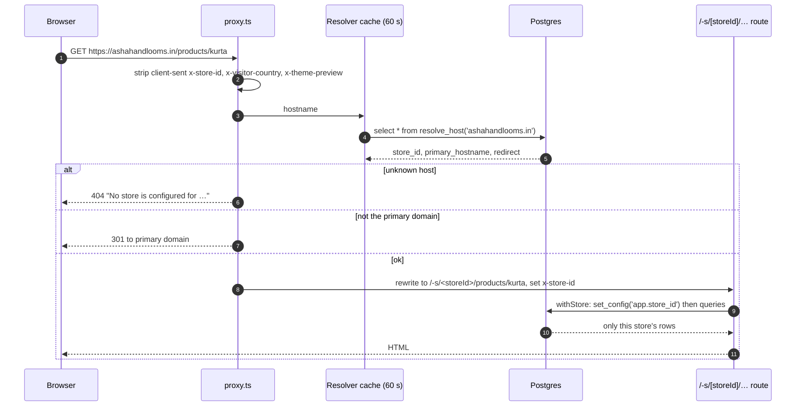
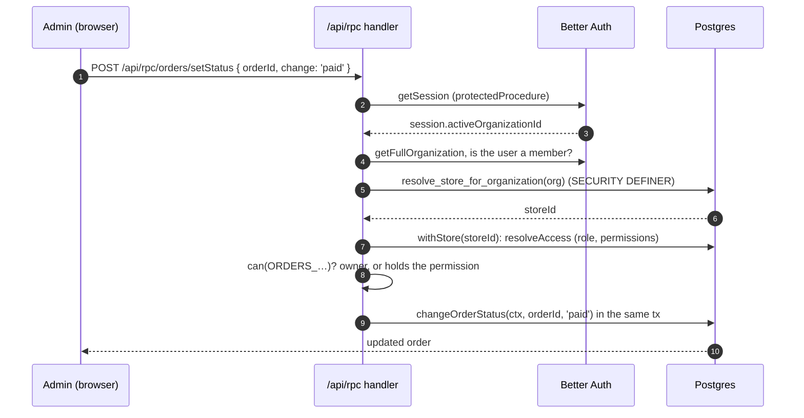
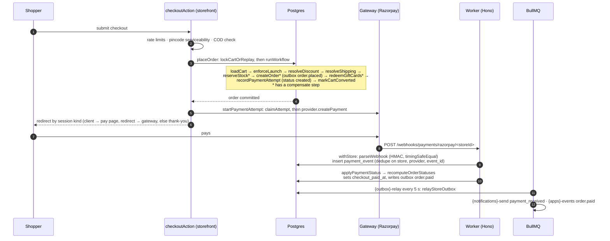

# Request flow

A walkthrough of what actually happens, in code, when a shopper loads a page, a merchant
clicks a button, and an order gets paid. Every name below is a real function or table; the
[Architecture](/developer-docs/building/architecture) page has the big picture and the
[Data model](/developer-docs/building/data-model) the tables.

## Store isolation in one picture

Every tenant query runs inside `withStore(db, storeId, fn)` (`packages/db/src/with-store.ts`):
a transaction that first runs `select set_config('app.store_id', storeId, true)`. The
`store_isolation` RLS policy on every tenant table compares `store_id` to that setting, and the
runtime role `app` is `NOBYPASSRLS`. A query that forgets `where store_id = …` still can't see
another store's rows. The only way across stores is a `SECURITY DEFINER` function that returns
ids.

```mermaid
flowchart TD
  req["Request<br/>(host header, session or job payload)"] --> resolve{"Which store?"}
  resolve -->|storefront| host["resolve_host(hostname)<br/>SECURITY DEFINER"]
  resolve -->|admin| org["resolve_store_for_organization(org)<br/>SECURITY DEFINER"]
  resolve -->|worker job| payload["storeId in the job payload<br/>or stores_with_…() id lists"]
  host --> ws["withStore(db, storeId, fn)<br/>BEGIN · set_config('app.store_id', storeId, true)"]
  org --> ws
  payload --> ws
  ws --> q["Queries as role app<br/>(NOBYPASSRLS)"]
  q --> rls{"RLS policy store_isolation<br/>store_id = current_setting('app.store_id')"}
  rls -->|match| rows(["This store's rows"])
  rls -->|no match| none(["Invisible"])
```

## 1. A shopper loads a page

`apps/storefront/src/proxy.ts` (Next.js 16's renamed middleware) runs first:

- `createStoreResolver` caches hostnames (unknown ones too) for `ttlMs: 60_000`.
- `routeForStore` (`apps/storefront/src/lib/routing.ts`) refuses paths that already start
  with `/-s` or `/-p`, passes `/_next/` and `/api/` through, and rewrites to `/-p/<storeId>`
  while the storefront password is on.
- Server code in the storefront wraps `withStore` as `inStore`
  (`apps/storefront/src/lib/store-context.ts`).

## 2. A merchant clicks a button

The admin talks to one oRPC handler, `apps/admin/src/app/api/rpc/[[...rest]]/route.ts`
(`RPCHandler(appRouter)`, prefix `/api/rpc`). Routers are mounted in
`packages/api/src/routers/_app.ts`, so "Mark as paid" is `POST /api/rpc/orders/setStatus`.

Failure at each step has its own error: no active organisation → `PRECONDITION_FAILED`, not a
member → `FORBIDDEN` "Not a member of this store", no store → `NOT_FOUND`, missing permission
→ `FORBIDDEN` "Your role does not allow …". Procedures are built with `storeProcedure` (no
permission) or `can(permission)` (`packages/api/src/procedures/store.ts`).

## 3. A shopper checks out and pays

Things worth knowing:

- **The order commits before the gateway is called.** A gateway error marks the attempt
  `failed` and the order stays placed; the shopper can retry (a new attempt row,
  `<orderId>:<attempt>` idempotency key).
- **`lockCartOrReplay`** takes `SELECT … FOR UPDATE` on the cart; a second submit of a
  converted cart returns the existing order (`replayed: true`) instead of a duplicate.
- **Every capture goes through `applyPaymentStatus`** (`packages/core/src/payments/confirm.ts`):
  webhook, client confirm, "Mark as paid", expiry reconciliation. Attempt statuses only move
  forward (`nextPaymentStatus`: created → pending → authorized → captured → refunded).
- **Order statuses are derived, never set.** `recomputeOrderStatuses`
  (`packages/core/src/order/recompute.ts`) is the only writer of `payment_status` and
  `fulfillment_status`, and moves `status` between `open` and `completed`.
- **Side effects go through the outbox.** `outbox_event` rows are written in the same
  transaction as the state change; the relay maps them to notification templates
  (`order.paid` → `payment_received`, `order.fulfilled` → `order_shipped`, …) and app hooks.

## 4. The worker's clock

`apps/worker/src/index.ts` registers these repeatable jobs (`upsertJobScheduler`). Each one
finds work across stores through a `SECURITY DEFINER` id list, then opens its own `withStore`
per store.

| Queue | Every | What it does |
| --- | --- | --- |
| `{outbox}-relay` | 5 s (plus nudges) | `relayStoreOutbox`: outbox rows → notifications, app events, restock alerts |
| `{payments}-unpaid-expiry` | 60 s | `expireUnpaidOrders` (asks the gateway first) and manual-transfer follow-ups |
| `{payments}-preorder-balance` | 60 s | `runBalanceSchedule`: request, remind, expire pre-order balances |
| `{marketing}-tick` | 30 s | Starts due campaigns, enrols and advances automations |
| `{shipping}-track` | 30 min | Polls courier tracking for open shipments (`stores_with_open_shipments()`) |
| `{domains}-verify` | 2 min | Verifies pending custom domains |
| `{system}-heartbeat` | 60 s | Logs a heartbeat |

On-demand queues: `{notifications}-send`, `{apps}-events`, `{apps}-jobs`, `{marketing}-send`,
`{back-in-stock}-restock`. The worker's HTTP side (Hono) serves
`POST /webhooks/payments/:provider/:storeId`, `POST /webhooks/shipments/:provider/:storeId`
(both rate limited per IP, 120 per minute) and `GET /health`.

## Common pitfalls

| Pitfall | What happens | Do this instead |
| --- | --- | --- |
| Querying outside `withStore` | RLS returns zero rows (no `app.store_id`), which looks like missing data. | Always resolve `storeId` first, then `withStore`. |
| Deriving `storeId` from a row fetched without one | Breaks sharding rule 3 and can leak across stores. | Get it from the host, the session's organisation, or the job payload. |
| Enqueueing a job after commit | "Committed but never enqueued" if the process dies. | Write an `outbox_event` in the same transaction. |
| Setting `payment_status` directly | The next recompute overwrites it. | Change the underlying payment, refund or shipment row, then `recomputeOrderStatuses`. |

## Related guides

<RelatedGuides ids={['architecture', 'data-model', 'first-app', 'dev-security']} />
