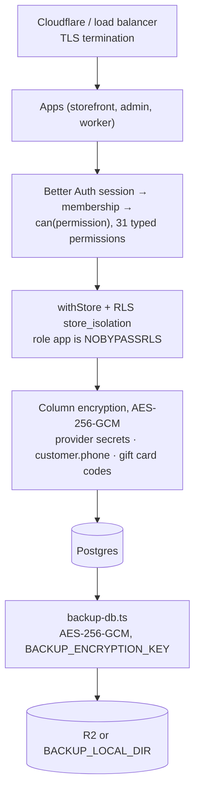

# Security

A summary for browsing. The source of truth is
[`docs/security/data-protection.md`](https://github.com/Viora-Tech/e-commerce/blob/main/docs/security/data-protection.md)
in the repo, next to the scripts it documents, and it wins if the two ever disagree. The
merchant-facing version is [Security and data protection](/merchant-guide/money/security).

## The layers

## What is encrypted at rest

| Data | How | Where |
| --- | --- | --- |
| Provider credentials (Razorpay `key_secret`, courier tokens, SES and WhatsApp secrets, R2 secret) | Fields marked `secret: true` on a `ProviderField`; any key matching `/secret\|token\|password/i` as a safety net | `packages/core/src/settings/secrets.ts` |
| `customer.phone` | AES-256-GCM plus an HMAC-SHA256 blind index (`customer.phone_index`) for equality search | `packages/core/src/customers/phone-crypto.ts` |
| Shopify importer token, gift card codes | Same primitive, used directly | `shopify_import_connection.access_token`, `gift_card.code_cipher` |
| Backups | Streamed, chunked AES-256-GCM (4 MiB chunks), `CMBK` format | `packages/backup/src/crypto.ts` |

The primitive is `packages/core/src/secrets.ts`: the key is SHA-256 of `SETTINGS_SECRET`, and
ciphertext is stamped `v2.<keyId>.<iv>.<tag>.<ct>` so decryption knows which key to use. GCM's
tag makes tampered or truncated ciphertext fail loudly.

**Deliberately plaintext**: `address.phone`, `customer_address.phone`, `cart.phone`,
`customer.default_address`, `marketing_automation_run.phone` (printed on labels and invoices,
or short-lived), and city, state and pincode (used in filters, GST state split and reports).
The source doc explains each one.

**Search trade-off**: phone search is equality on the blind index, not `ILIKE`. A 4+ digit query
switches the admin customer search to index matching, so "987" no longer finds "9876543210".

## Keys

| Variable | Encrypts | Notes |
| --- | --- | --- |
| `SETTINGS_SECRET` | Provider credentials, `customer.phone` | 16+ chars. Dev/test fall back to `dev-only-settings-secret`; never rely on it elsewhere. |
| `SETTINGS_SECRET_PREVIOUS` | Nothing; decrypt-only | Comma-separated retired keys, only during a rotation. |
| `BACKUP_ENCRYPTION_KEY` | Backup archives | Separate on purpose. Production refuses to write an unencrypted backup without it. |

Keep all three in the deployment's secret store, never in the repo.

## Rotating `SETTINGS_SECRET`

<Steps>

### Generate a new secret

`openssl rand -hex 32`.

### Deploy with both keys

Set `SETTINGS_SECRET_PREVIOUS` to the current value and `SETTINGS_SECRET` to the new one. Both
decrypt; only the new one encrypts.

### Re-encrypt everything

`bun run rotate-secrets` (dry run), then `--apply`. Covers provider settings, gift card codes,
Shopify import tokens and customer phones (with their search index), one store per
transaction. Settings blobs are also re-encrypted on their own whenever they are saved.

### Retire the old key

When a dry run reports zero values left, remove `SETTINGS_SECRET_PREVIOUS` and redeploy.
Full runbook: [Key rotation](/developer-docs/operations/key-rotation).

</Steps>

## Access control

- **RLS** on every tenant table; see [Request flow](/developer-docs/building/request-flow).
- **Two DB roles**: `app` (runtime, RLS-restricted) and `owner` (migrations, backup/restore,
  rotation scripts). Application code never runs as `owner`.
- **Permissions**: `can(permission)` gates (almost) every oRPC procedure. `CUSTOMERS_READ`
  gates seeing a phone number at all; `CUSTOMERS_WRITE` gates changing one.
- **OTPs and sessions** are hashed before storage (`packages/core/src/accounts/auth.ts`).
- **Guardrails**: the `secret-fields` sweep fails the build if a connector adds a
  credential-looking field without `secret: true`
  ([Guardrails and sweeps](/developer-docs/building/guardrails)).
- **Webhooks**: payment and shipment webhooks verify signatures (constant-time compare), are
  deduplicated per `(store_id, provider, event_id)`, and are rate limited per IP. Every
  rejection (malformed or unknown store id, a provider the store has not enabled, a bad
  signature or token) gets the same `400 {"ok":false}` (`apps/worker/src/webhook-reply.ts`),
  so the endpoints cannot be used to find stores or the gateways they use; the reason is in the
  worker log only.
- **Client IP**: per-IP limits believe `cf-connecting-ip` only with `TRUSTED_PROXY=cloudflare`,
  which is only safe once the origin is firewalled to Cloudflare's ranges
  ([Deployment](/developer-docs/operations/deployment), "Lock the origin to Cloudflare"). Never
  `x-forwarded-for`.
- **Server actions** on the storefront take the store from the request's hostname
  (`requestStoreId`), never from an argument; `scripts/sweeps/storefront-action-store.test.ts`
  fails the build otherwise.
- **Script CSP**: both apps send a per-request nonce policy from `proxy.ts`
  (`script-src 'self' 'nonce-…' 'strict-dynamic'`, `object-src 'none'`, `base-uri 'self'`;
  `apps/*/src/lib/csp.ts`), enforced in production and report-only in development. Next's
  scripts, the theme script and the GA4 / Tag Manager / Meta loaders carry the nonce (read it
  with `headers().get('x-nonce')`); scripts those load, and gateway checkout scripts added at
  runtime, are trusted through `'strict-dynamic'`. A new inline script needs the nonce.
- **Dev sign-in codes**: `/api/dev/otp` answers 404 in any production build, whatever
  `DEV_LOGIN_OTP` says.
- **CI**: every action in `.github/workflows` is pinned to a commit SHA with the release as a
  comment (`scripts/sweeps/pinned-actions.test.ts`).

## DPDP Act, 2023

Consent is recorded (`customer.accepts_marketing`, `accepts_whatsapp`,
`marketing_consent_at`/`_source`, `unsubscribed_at`); access and correction go through the
admin customer page and the shopper's account page; `deleteCustomer` refuses while orders
reference the customer (tax retention). There is **no automated breach detection** yet. Not
legal advice; details in the source doc.

## Related guides

<RelatedGuides ids={['request-flow', 'data-model', 'security', 'architecture']} />
