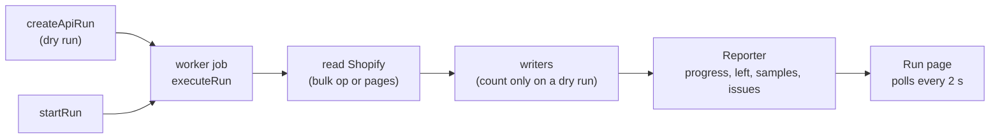

# Shopify importer

`packages/plugin-shopify-import` is a built-in app (`shopify-import`). It reads a Shopify store
over the Admin GraphQL API (`2025-07`, `shopify-client.ts`) or from Shopify's three CSV exports,
and writes our records. Admin pages: `apps/admin/src/components/apps/shopify-import/`, copy in
`data/shopify-import.ts` with the Hindi overlay `data/hi/shopify-import.ts`. API:
`packages/api/src/routers/shopify-import.ts`.

## A run

- `shopify_import_run` holds the chosen `resources`, `dry_run`, `progress` (per resource
  counters plus `left`), `preview` samples and the run error; `shopify_import_issue` one row per
  record problem; `shopify_import_mapping` maps every Shopify id to ours per resource. All carry
  `store_id` and run under `apply_store_rls()`.
- **Idempotent**: every writer looks up the mapping first, then a natural key (handle, code,
  `namespace.key`, entry handle), and updates in place. A re-run never duplicates.
- **Batched and resumable**: readers are async generators of pages; the reporter flushes at
  most every 1.5 s. A failed run is safe to start again from the run page.
- A dry run never downloads or writes; references to things the same run would create are
  assumed to resolve (placeholder ids), so the preview counts match the real run.

## Preview snapshot: Import now reuses the preview

`startRun` flips the same `shopify_import_run` row from preview to import, so the import finds
the preview's copy on its own row (`src/snapshot.ts`, migration `0087_shopify_import_snapshot`).

- **Preview (record).** `SnapshotSession.read` passes every batch through to the (counting)
  writers and gzips it into JSONL as it goes; at the end of each resource it stores
  `stores/<store>/private/imports/<run>/snapshot/<resource>.jsonl.gz` through the store's
  storage provider. A completed preview saves `snapshot` (`{ takenAt, streams: { resource:
  { key, count } } }`) and `snapshot_taken_at`. `takenAt` is when the preview **started**, so
  anything Shopify changed while it read is caught later. A failed preview keeps nothing.
- **Import (reuse).** When the snapshot is under 24 h old (`SNAPSHOT_FRESH_MS`), each resource
  that has a stream reads it instead of Shopify, then asks Shopify for
  `updated_at:>'<takenAt − 1 min>'` through the paged query (no bulk export) and merges by
  Shopify id, the changed copy winning, new records appended. Products also read every
  variant's stock with one light `productVariants` query (`api-stock.ts`): Shopify does not
  move a product's `updated_at` when stock changes. `snapshot_use` (`{ takenAt, changes,
  reused }`) drives "Using the preview from … + N changes since" on the run page.
- **Covered:** `SNAPSHOT_RESOURCES` = products, collections, customers, orders, pages, articles,
  files. **Read in full every time:** menus and redirects (no update filter), metaobjects and
  metafields (definitions have no update filter and values do not move the owner's
  `updated_at`), discounts (use counts change without an update) and gift cards (no
  `updated_at` filter; balances move).
- **Not seen by a delta:** records deleted on Shopify after the preview still import (within
  the 24 h window); a re-run after that cleans nothing up either, as before.
- **Cleanup.** A completed import deletes the copy (`dropSnapshot`); a failed one keeps it for
  Try again. `cleanupSnapshots` removes this store's copies older than 7 days at the start of
  every run, and the worker's hourly `{imports}-snapshot-cleanup` job
  (`apps/worker/src/import-snapshots.ts`) finds stores with old copies through
  `stores_with_stale_import_snapshots(cutoff)` (SECURITY DEFINER, ids only) and runs the
  importer's `cleanup-snapshots` app job for each.

## Memory

A run never holds a whole resource. Bulk results stream: `streamBulkRoots` (`bulk.ts`)
reassembles one top-level record at a time from the JSONL download (Shopify writes nested
records after their parent; one that arrives after its parent was handed on stops the read with
`BulkUnavailableError` rather than import an order without its lines) and hands on 50 at a time.
A failure before the first batch falls back to paged reading (`bulkOrPaged`), after it the run
fails. Snapshots are written gzipped batch by batch and read back line by line; only the
changes since the preview are held whole to merge. Extra-field values (`api-metafields.ts`) are
still collected per owner type.

## Batched writes

Products, customers and orders are written a batch per transaction (`writeBatch` in
`runtime.ts`; 25 products, 200 customers, 100 orders): one `set_config`/commit per batch,
customers inserted in one multi-row statement, each order's lines in one statement, mappings
in one `saveMappings` upsert per batch. Product images are copied before the transaction. If
anything in a batch throws, the transaction rolls back (and the orders' placeholder-item cache
is restored) and every record of the batch goes through the one-record writer, so a bad record
reports exactly the issue it always did and the rest still land. A customer that shares a
Shopify id, email, phone or matched row with an earlier one in the same batch is written after
the commit, as one-at-a-time writes would see it. Product variants still go through core's
`createProduct`/`updateProduct` (shared with the admin editor), unchanged.

## A run whose worker died

- **Job ids.** The router queues each start of a run as its own job (`runJobKey`: run id plus
  the row's `updatedAt`). BullMQ ignores an add whose id it still holds, even for a failed job,
  so a fixed id left Try again waiting forever. A double click never reaches the queue twice:
  `startRun` refuses a run that is queued or running.
- **Failed for good.** The app-jobs worker listens for `failed`; when the failure is final (the
  last attempt, or "stalled more than allowable limit" after the process died, e.g. an OOM
  kill) it runs the plugin's `jobFailed.run` handler (`dispatchAppJobFailure`, new optional
  `jobFailed` on the plugin manifest), which marks the run `failed` with a plain reason.
- **Backstop.** `executeRun` touches the row every minute while it runs; `getRun`, `listRuns`
  and `startRun` fail a `running` run silent for 10 minutes, so the page shows Try again even
  if the failure event was lost.

## Before you import (pre-import checks)

`preflightChecks` (`src/preflight.ts`, API `shopifyImport.preflight`) returns
`{ id, status: ok | warn | block, resource?, detail?, title, help, fixHref }` for the chosen
resources. The connect page shows it under "What to import" and the run page shows it on a
finished preview (`preflight-card.tsx`; copy keyed by `id` in `data/shopify-import.ts` →
`preflight`, Hindi overlay too).

- **`storage`** (warn): a resource that copies images or files is chosen while uploads go to
  the local folder fallback in production. Fix link: `/content/files/storage`.
- **`scope`** (block, per resource): the token lacks a scope in `RESOURCE_SCOPES`. Only that
  resource is unticked and disabled; the rest can still be previewed. **`connection`** (block,
  no resource): the scope check itself failed; Preview is disabled.
- **`all_orders`** (warn): orders chosen without `read_all_orders` (last 60 days only).
- **`needs_products`** / **`needs_customers`** (warn): orders, collections, discounts or extra
  fields chosen with no products chosen or imported before; gift cards without customers.

At the start of every real import that copies media, the worker writes and deletes
`stores/<store>/private/imports/<run>/write-test.txt`. If storage refuses, the run records
**one** issue ("Storage isn't writable: … Images and files were skipped."), swaps the media
host for one that copies nothing, and files are counted skipped with `left` reason
`storage_unwritable` — instead of one EACCES issue per image (the test-server incident: 2,409
files and ~2,100 product images).

## Retry only what was missed

Issues carry `source_id` (the record's import key: Shopify GID, or the CSV key such as
`handle:tee`) and `kind` (`record`, `media`, `file`) when a retry could fix them; problems a
retry would only repeat (unsupported types, skipped orders, parse errors) have none.
`getRun` returns `retryable` (distinct resource + source id).

- **Retry the N that were missed** (`createRetryRun`, API `shopifyImport.retryRun`) creates a
  new real import with `retry_of` = the finished import and `resources` = those with
  retryable issues. `executeRun` loads the keys (`retryTargets`) and reads only those:
  - from the snapshot when it is still fresh (an import with retryable issues keeps its copy,
    and the retry takes it over), plus anything changed since (`updated_at` search, filtered
    to the keys);
  - otherwise from Shopify by id through the same paged queries and mappers, with Shopify's
    `id:` search (`id:12 OR id:13`, 50 per query). We use the search filter instead of
    `nodes(ids:)` so variants past the first page, collection members and every mapper stay
    exactly the code a full read uses.
  - menus, redirects, discounts and gift cards are read in full and filtered to the keys;
    metaobjects and metafields (they link to each other) are re-run in full; CSV runs re-read
    the file and keep only the missed rows.
- A `media` issue retries its product (or collection, article): the record is written again
  with its full image list, and the media host only downloads images it has not copied yet,
  so only the failed images are fetched.
- The previous run keeps its report; the retry reports only what it retried. **Import
  everything again** (secondary button) is the old full re-run.

## Order of resources

`IMPORT_RESOURCES` (`src/client.ts`) is also the write order: products, collections, customers,
orders, pages, articles, menus, redirects, **files, metaobjects, metafields, discounts,
gift_cards**. Files come before entries and extra fields (they link to files), entries before
extra fields (they link to entries), products and collections before discounts, customers
before gift cards. Each of the last five runs through `optional()` in `run.ts`: a refused scope
(`ShopifyError` kind `scope`) ends that resource with an issue naming the scope instead of
failing the run.

## Import everything (files, content, extra fields, discounts, gift cards)

| Module | Reads | Writes |
| --- | --- | --- |
| `api-files.ts`, `write-files.ts` | `files` (MediaImage, GenericFile, Video, ExternalVideo, Model3d) | Media library through the shared media host (`media.ts`): one download per source URL, images queued for the pipeline. Videos: the largest mp4 rendition under `VIDEO_MAX_UPLOAD_BYTES`. |
| `api-metaobjects.ts`, `write-metaobjects.ts` | `metaobjectDefinitions`, `metaobjects(type:)` | `metaobject_definition` / `metaobject` through core's `createDefinition`, `updateDefinition`, `createEntry`, `updateEntry` (so every value is validated). |
| `api-metafields.ts`, `write-metafields.ts` | `metafieldDefinitions(ownerType:)`, product and collection metafields (bulk op, paged fallback) | `metafield_definition` / `metafield` through `createMetafieldDefinition` and `setMetafields`. |
| `api-discounts.ts`, `write-discounts.ts` | `discountNodes` (every union member), extra codes via `codeDiscountNode` | `discount`, validated with `DiscountInputSchema`; one row per code. |
| `api-gift-cards.ts`, `write-gift-cards.ts` | `giftCards` | `gift_card` through `issueGiftCard`, `changeGiftCardBalance`, `updateGiftCard`. |

**Field types** (`field-values.ts`, `field-plans.ts`): Shopify types map onto our 12
(`FIELD_TYPES` in `@commerce/core/metaobjects`). `single_line_text_field`, `color` and `id` →
`single_line_text`; `multi_line_text_field` → `multi_line_text`; `rich_text_field` →
`rich_text` (Shopify's rich text JSON is rendered to HTML, then read by `html.ts` into Lexical);
`number_integer`, `number_decimal`, `boolean`, `date`, `url` as they are; `date_time` → `date`
(lossy, reported as `time_dropped`); `link` → `url` (`link_label`); `file_reference` → `file`;
`product_reference`, `collection_reference`, `metaobject_reference` as they are; `list.*` keeps
the list flag. Everything else (money, rating, weight, volume, dimension, json,
variant/page/customer/mixed references) is `field_type`, reported per field and never dropped
quietly. Keys and namespaces are made ours with `keyFromName` (`size-guide` → `size_guide`).
Only Shopify's `choices` validation is kept; `required` is not copied (a value we had to leave
out would block the entry).

**References** (`references.ts`) resolve Shopify ids through the mapping: products,
collections, entries, and files (a file not imported yet is fetched with `node(id:)` and copied
then). Content types are written in two passes (links to types not made yet are added in the
second), entries in two passes (entries that linked to entries not written yet are revisited
after all are written).

**Metafield owners**: only products and collections have extra fields here. For variants,
customers, orders, pages, articles, blogs, shop, locations and companies the importer reads
each owner type's definitions and reports `metafieldsCount` as `metafield_owner` ("40 extra
field values on customers"). SEO metafields (`global.title_tag`, `global.description_tag`) are
skipped: pages and articles already import them as SEO.

**Discounts**: `refusal()` lists what our model cannot express: Bxgy, app discounts, customer
or segment selection, minimum quantity, variant-level items, `appliesOnEachItem` amounts,
free shipping limited by country (anything but India) or max shipping price, more than 100
products or collections. Codes must match `[A-Za-z0-9-]{2,40}`. `usedCount` takes Shopify's
`asyncUsageCount` (never lowered on a re-run).

**Gift cards**: the Admin API returns only `lastCharacters`, never the code. A live card with a
balance and a customer gets a new generated code (`issueGiftCard`, so stored hashed and
encrypted), linked to the customer, `delivered_at` left empty for the merchant to send with
Resend; reported as `gift_card_code`. No customer, empty, disabled, expired, over the
₹2,00,000 cap or another currency stay behind with their reason. A re-run adjusts the balance
to Shopify's with an `adjustment` transaction unless the card has a `debit` here.

## What stays behind: `left`

`Reporter.leave(resource, reason, count, detail)` sums by reason into `progress[resource].left`
(`LeftBehind[]`, reasons in `LEFT_BEHIND_REASONS`). It is a code, not text, so the admin's
**What stays in Shopify** card (`run-left-card.tsx`) says it in English or Hindi
(`data/shopify-import.ts` → `left.reasons`). Per-record detail still goes to the issue list.

## Scopes

`REQUIRED_SCOPES` / `ALL_SCOPE_HANDLES` in `src/client.ts`; **Test connection** compares them
with `currentAppInstallation.accessScopes`. New in this round: `read_files`,
`read_metaobject_definitions`, `read_metaobjects`, `read_discounts`, `read_gift_cards`.

## Tests

`packages/plugin-shopify-import/test/import-everything.test.ts` runs a preview, an import and a
re-run against a fake Admin API (`test/fixtures/everything.ts`): no real Shopify calls, no real
downloads. It checks the counts and `left` reasons of the preview, every written row, the
second-pass links, and that a re-run updates instead of duplicating; a second test refuses the
gift card scope and expects the rest to import.

`test/snapshot.test.ts` uses a stateful fake (`test/fixtures/fake-shopify.ts`) that answers bulk
exports and `updated_at` searches: the preview keeps its copy, a fresh copy means no bulk
export and only "changed since" queries, a 25-hour-old copy means a full read, changes merge
by id (stock read fresh), batches fall back to one record at a time with the same issue,
re-runs never duplicate, and week-old copies are cleaned up. `test/run-recovery.test.ts`
covers the dead-worker cases and job ids. `test/retry-and-preflight.test.ts` covers the
pre-import checks, the storage write test (one issue, no per-image errors), and retries: only
the missed records (from the copy plus changes, or by `id:` when the copy is too old; the fake
asserts which ids were asked for) and only the failed images. `test/benchmark.test.ts` times a preview and import
of 2,000 customers and 500 orders (`SHOPIFY_IMPORT_BENCH=1`).
