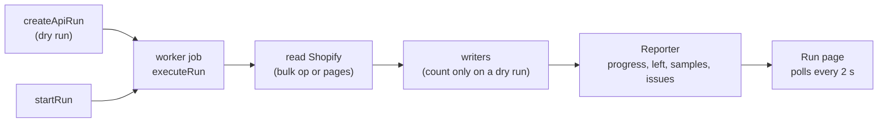

# Shopify importer

`packages/plugin-shopify-import` is a built-in app (`shopify-import`). It reads a Shopify store
over the Admin GraphQL API (`2025-07`, `shopify-client.ts`) or from Shopify's three CSV exports,
and writes our records. Admin pages: `apps/admin/src/components/apps/shopify-import/`, copy in
`data/shopify-import.ts` with the Hindi overlay `data/hi/shopify-import.ts`. API:
`packages/api/src/routers/shopify-import.ts`.

## A run

- `shopify_import_run` holds the chosen `resources`, `dry_run`, `progress` (per resource
  counters plus `left`), `preview` samples and the run error; `shopify_import_issue` one row per
  record problem; `shopify_import_mapping` maps every Shopify id to ours per resource. All carry
  `store_id` and run under `apply_store_rls()`.
- **Idempotent**: every writer looks up the mapping first, then a natural key (handle, code,
  `namespace.key`, entry handle), and updates in place. A re-run never duplicates.
- **Batched and resumable**: readers are async generators of pages; the reporter flushes at
  most every 1.5 s. A failed run is safe to start again from the run page.
- A dry run never downloads or writes; references to things the same run would create are
  assumed to resolve (placeholder ids), so the preview counts match the real run.

## Order of resources

`IMPORT_RESOURCES` (`src/client.ts`) is also the write order: products, collections, customers,
orders, pages, articles, menus, redirects, **files, metaobjects, metafields, discounts,
gift_cards**. Files come before entries and extra fields (they link to files), entries before
extra fields (they link to entries), products and collections before discounts, customers
before gift cards. Each of the last five runs through `optional()` in `run.ts`: a refused scope
(`ShopifyError` kind `scope`) ends that resource with an issue naming the scope instead of
failing the run.

## Import everything (files, content, extra fields, discounts, gift cards)

| Module | Reads | Writes |
| --- | --- | --- |
| `api-files.ts`, `write-files.ts` | `files` (MediaImage, GenericFile, Video, ExternalVideo, Model3d) | Media library through the shared media host (`media.ts`): one download per source URL, images queued for the pipeline. Videos: the largest mp4 rendition under `VIDEO_MAX_UPLOAD_BYTES`. |
| `api-metaobjects.ts`, `write-metaobjects.ts` | `metaobjectDefinitions`, `metaobjects(type:)` | `metaobject_definition` / `metaobject` through core's `createDefinition`, `updateDefinition`, `createEntry`, `updateEntry` (so every value is validated). |
| `api-metafields.ts`, `write-metafields.ts` | `metafieldDefinitions(ownerType:)`, product and collection metafields (bulk op, paged fallback) | `metafield_definition` / `metafield` through `createMetafieldDefinition` and `setMetafields`. |
| `api-discounts.ts`, `write-discounts.ts` | `discountNodes` (every union member), extra codes via `codeDiscountNode` | `discount`, validated with `DiscountInputSchema`; one row per code. |
| `api-gift-cards.ts`, `write-gift-cards.ts` | `giftCards` | `gift_card` through `issueGiftCard`, `changeGiftCardBalance`, `updateGiftCard`. |

**Field types** (`field-values.ts`, `field-plans.ts`): Shopify types map onto our 12
(`FIELD_TYPES` in `@commerce/core/metaobjects`). `single_line_text_field`, `color` and `id` →
`single_line_text`; `multi_line_text_field` → `multi_line_text`; `rich_text_field` →
`rich_text` (Shopify's rich text JSON is rendered to HTML, then read by `html.ts` into Lexical);
`number_integer`, `number_decimal`, `boolean`, `date`, `url` as they are; `date_time` → `date`
(lossy, reported as `time_dropped`); `link` → `url` (`link_label`); `file_reference` → `file`;
`product_reference`, `collection_reference`, `metaobject_reference` as they are; `list.*` keeps
the list flag. Everything else (money, rating, weight, volume, dimension, json,
variant/page/customer/mixed references) is `field_type`, reported per field and never dropped
quietly. Keys and namespaces are made ours with `keyFromName` (`size-guide` → `size_guide`).
Only Shopify's `choices` validation is kept; `required` is not copied (a value we had to leave
out would block the entry).

**References** (`references.ts`) resolve Shopify ids through the mapping: products,
collections, entries, and files (a file not imported yet is fetched with `node(id:)` and copied
then). Content types are written in two passes (links to types not made yet are added in the
second), entries in two passes (entries that linked to entries not written yet are revisited
after all are written).

**Metafield owners**: only products and collections have extra fields here. For variants,
customers, orders, pages, articles, blogs, shop, locations and companies the importer reads
each owner type's definitions and reports `metafieldsCount` as `metafield_owner` ("40 extra
field values on customers"). SEO metafields (`global.title_tag`, `global.description_tag`) are
skipped: pages and articles already import them as SEO.

**Discounts**: `refusal()` lists what our model cannot express: Bxgy, app discounts, customer
or segment selection, minimum quantity, variant-level items, `appliesOnEachItem` amounts,
free shipping limited by country (anything but India) or max shipping price, more than 100
products or collections. Codes must match `[A-Za-z0-9-]{2,40}`. `usedCount` takes Shopify's
`asyncUsageCount` (never lowered on a re-run).

**Gift cards**: the Admin API returns only `lastCharacters`, never the code. A live card with a
balance and a customer gets a new generated code (`issueGiftCard`, so stored hashed and
encrypted), linked to the customer, `delivered_at` left empty for the merchant to send with
Resend; reported as `gift_card_code`. No customer, empty, disabled, expired, over the
₹2,00,000 cap or another currency stay behind with their reason. A re-run adjusts the balance
to Shopify's with an `adjustment` transaction unless the card has a `debit` here.

## What stays behind: `left`

`Reporter.leave(resource, reason, count, detail)` sums by reason into `progress[resource].left`
(`LeftBehind[]`, reasons in `LEFT_BEHIND_REASONS`). It is a code, not text, so the admin's
**What stays in Shopify** card (`run-left-card.tsx`) says it in English or Hindi
(`data/shopify-import.ts` → `left.reasons`). Per-record detail still goes to the issue list.

## Scopes

`REQUIRED_SCOPES` / `ALL_SCOPE_HANDLES` in `src/client.ts`; **Test connection** compares them
with `currentAppInstallation.accessScopes`. New in this round: `read_files`,
`read_metaobject_definitions`, `read_metaobjects`, `read_discounts`, `read_gift_cards`.

## Tests

`packages/plugin-shopify-import/test/import-everything.test.ts` runs a preview, an import and a
re-run against a fake Admin API (`test/fixtures/everything.ts`): no real Shopify calls, no real
downloads. It checks the counts and `left` reasons of the preview, every written row, the
second-pass links, and that a re-run updates instead of duplicating; a second test refuses the
gift card scope and expects the rest to import.
