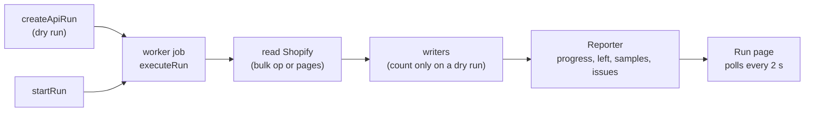

# Shopify importer

`packages/plugin-shopify-import` is a built-in app (`shopify-import`). It reads a Shopify store
over the Admin GraphQL API (`2025-07`, `shopify-client.ts`) or from Shopify's three CSV exports,
and writes our records. Admin pages: `apps/admin/src/components/apps/shopify-import/`, copy in
`data/shopify-import.ts` with the Hindi overlay `data/hi/shopify-import.ts`. API:
`packages/api/src/routers/shopify-import.ts`.

## A run

- `shopify_import_run` holds the chosen `resources`, `dry_run`, `progress` (per resource
  counters plus `left`), `preview` samples and the run error; `shopify_import_issue` one row per
  record problem; `shopify_import_mapping` maps every Shopify id to ours per resource. All carry
  `store_id` and run under `apply_store_rls()`.
- **Idempotent**: every writer looks up the mapping first, then a natural key (handle, code,
  `namespace.key`, entry handle), and updates in place. A re-run never duplicates.
- **Batched and resumable**: readers are async generators of pages; the reporter flushes at
  most every 1.5 s. A failed run is safe to start again from the run page.
- A dry run never downloads or writes; references to things the same run would create are
  assumed to resolve (placeholder ids), so the preview counts match the real run.

## Preview snapshot: Import now reuses the preview

`startRun` flips the same `shopify_import_run` row from preview to import, so the import finds
the preview's copy on its own row (`src/snapshot.ts`, migration `0087_shopify_import_snapshot`).

- **Preview (record).** `SnapshotSession.read` passes every batch through to the (counting)
  writers and gzips it into JSONL as it goes; at the end of each resource it stores
  `stores/<store>/private/imports/<run>/snapshot/<resource>.jsonl.gz` through the store's
  storage provider. A completed preview saves `snapshot` (`{ takenAt, streams: { resource:
  { key, count } } }`) and `snapshot_taken_at`. `takenAt` is when the preview **started**, so
  anything Shopify changed while it read is caught later. A failed preview keeps nothing.
- **Import (reuse).** When the snapshot is under 24 h old (`SNAPSHOT_FRESH_MS`), each resource
  that has a stream reads it instead of Shopify, then asks Shopify for
  `updated_at:>'<takenAt − 1 min>'` through the paged query (no bulk export) and merges by
  Shopify id, the changed copy winning, new records appended. Products also read every
  variant's stock with one light `productVariants` query (`api-stock.ts`): Shopify does not
  move a product's `updated_at` when stock changes. `snapshot_use` (`{ takenAt, changes,
  reused }`) drives "Using the preview from … + N changes since" on the run page.
- **Covered:** `SNAPSHOT_RESOURCES` = products, collections, customers, orders, pages, articles,
  files. **Read in full every time:** menus and redirects (no update filter), metaobjects and
  metafields (definitions have no update filter and values do not move the owner's
  `updated_at`), discounts (use counts change without an update) and gift cards (no
  `updated_at` filter; balances move).
- **Not seen by a delta:** records deleted on Shopify after the preview still import (within
  the 24 h window); a re-run after that cleans nothing up either, as before.
- **Cleanup.** A completed import deletes the copy (`dropSnapshot`); a failed one keeps it for
  Try again. `cleanupSnapshots` removes this store's copies older than 7 days at the start of
  every run, and the worker's hourly `{imports}-snapshot-cleanup` job
  (`apps/worker/src/import-snapshots.ts`) finds stores with old copies through
  `stores_with_stale_import_snapshots(cutoff)` (SECURITY DEFINER, ids only) and runs the
  importer's `cleanup-snapshots` app job for each.

## Memory

A run never holds a whole resource. Bulk results stream: `streamBulkRoots` (`bulk.ts`)
reassembles one top-level record at a time from the JSONL download (Shopify writes nested
records after their parent; one that arrives after its parent was handed on stops the read with
`BulkUnavailableError` rather than import an order without its lines) and hands on 50 at a time.
A failure before the first batch falls back to paged reading (`bulkOrPaged`), after it the run
fails. Snapshots are written gzipped batch by batch and read back line by line; only the
changes since the preview are held whole to merge. Extra-field values (`api-metafields.ts`) are
still collected per owner type.

## Batched writes

Products, customers and orders are written a batch per transaction (`writeBatch` in
`runtime.ts`; 25 products, 200 customers, 100 orders): one `set_config`/commit per batch,
customers inserted in one multi-row statement, each order's lines in one statement, mappings
in one `saveMappings` upsert per batch. Product images are copied before the transaction. If
anything in a batch throws, the transaction rolls back (and the orders' placeholder-item cache
is restored) and every record of the batch goes through the one-record writer, so a bad record
reports exactly the issue it always did and the rest still land. A customer that shares a
Shopify id, email, phone or matched row with an earlier one in the same batch is written after
the commit, as one-at-a-time writes would see it. Product variants still go through core's
`createProduct`/`updateProduct` (shared with the admin editor), unchanged.

## A run whose worker died

- **Job ids.** The router queues each start of a run as its own job (`runJobKey`: run id plus
  the row's `updatedAt`). BullMQ ignores an add whose id it still holds, even for a failed job,
  so a fixed id left Try again waiting forever. A double click never reaches the queue twice:
  `startRun` refuses a run that is queued or running.
- **Failed for good.** The app-jobs worker listens for `failed`; when the failure is final (the
  last attempt, or "stalled more than allowable limit" after the process died, e.g. an OOM
  kill) it runs the plugin's `jobFailed.run` handler (`dispatchAppJobFailure`, new optional
  `jobFailed` on the plugin manifest), which marks the run `failed` with a plain reason.
- **Stuck, worker alive.** The `Reporter` keeps `lastActivity`: a record counted, an issue, a
  chunk of a copy arriving, a Shopify answer (the client's fetch is wrapped, so bulk-export
  polls count). When nothing moved for `STUCK_MS` (10 minutes, `run.ts`) the watchdog aborts the
  run's signal (every copy in flight stops), the run is marked `failed` with "The import stopped
  moving…", and the reporter is closed so work still unwinding writes nothing.
- **Backstop.** `executeRun` touches the row every minute, but only while the run is getting
  somewhere (a heartbeat alone no longer keeps a stuck run alive); `getRun`, `listRuns` and
  `startRun` fail a `running` run silent for 10 minutes, so the page shows Try again even if
  the failure event was lost.

## Before you import (pre-import checks)

`preflightChecks` (`src/preflight.ts`, API `shopifyImport.preflight`) returns
`{ id, status: ok | warn | block, resource?, detail?, title, help, fixHref }` for the chosen
resources. The connect page shows it under "What to import" and the run page shows it on a
finished preview (`preflight-card.tsx`; copy keyed by `id` in `data/shopify-import.ts` →
`preflight`, Hindi overlay too).

- **`storage`** (warn): a resource that copies images or files is chosen while uploads go to
  the local folder fallback in production. Fix link: `/content/files/storage`.
- **`scope`** (block, per resource): the token lacks a scope in `RESOURCE_SCOPES`. Only that
  resource is unticked and disabled; the rest can still be previewed. **`connection`** (block,
  no resource): the scope check itself failed; Preview is disabled.
- **`all_orders`** (warn): orders chosen without `read_all_orders` (last 60 days only).
- **`needs_products`** / **`needs_customers`** (warn): orders, collections, discounts or extra
  fields chosen with no products chosen or imported before; gift cards without customers.

At the start of every real import that copies media, the worker writes and deletes
`stores/<store>/private/imports/<run>/write-test.txt`. If storage refuses, the run records
**one** issue ("Storage isn't writable: … Images and files were skipped."), swaps the media
host for one that copies nothing, and files are counted skipped with `left` reason
`storage_unwritable` — instead of one EACCES issue per image (the test-server incident: 2,409
files and ~2,100 product images).

## Retry only what was missed

Issues carry `source_id` (the record's import key: Shopify GID, or the CSV key such as
`handle:tee`) and `kind` (`record`, `media`, `file`) when a retry could fix them; problems a
retry would only repeat (unsupported types, skipped orders, parse errors) have none.
`getRun` returns `retryable` (distinct resource + source id).

- **Retry the N that were missed** (`createRetryRun`, API `shopifyImport.retryRun`) creates a
  new real import with `retry_of` = the finished import and `resources` = those with
  retryable issues. `executeRun` loads the keys (`retryTargets`) and reads only those:
  - from the snapshot when it is still fresh (an import with retryable issues keeps its copy,
    and the retry takes it over), plus anything changed since (`updated_at` search, filtered
    to the keys);
  - otherwise from Shopify by id through the same paged queries and mappers, with Shopify's
    `id:` search (`id:12 OR id:13`, 50 per query). We use the search filter instead of
    `nodes(ids:)` so variants past the first page, collection members and every mapper stay
    exactly the code a full read uses.
  - menus, redirects, discounts and gift cards are read in full and filtered to the keys;
    metaobjects and metafields (they link to each other) are re-run in full; CSV runs re-read
    the file and keep only the missed rows.
- A `media` issue retries its product (or collection, article): the record is written again
  with its full image list, and the media host only downloads images it has not copied yet,
  so only the failed images are fetched.
- The previous run keeps its report; the retry reports only what it retried. **Import
  everything again** (secondary button) is the old full re-run.

## What's left to import, and "Import remaining"

The importer's main page (`remaining-card.tsx`, API `shopifyImport.status`) shows one row per
type plus **Product images**: In Shopify, Here, Status (Done / N missing / N not copied / Never
imported / Not checked yet) and a button per row (Import N, Copy images, Copy files).
`remainingStatus` (`src/status.ts`):

- **In Shopify:** Shopify's own count where the Admin API has one (`productsCount`,
  `collectionsCount`, `customersCount`, `ordersCount`, `pagesCount`, `discountNodesCount`,
  `giftCardsCount`, `urlRedirectsCount`, each `limit: null`, each its own query so one the token
  or API version refuses is just left out). Cached 3 minutes per store. Otherwise the newest of:
  a preview's total, the copy a preview kept (`snapshot.streams[type].count`, it moves to the
  import that reads it), or the totals of the latest *full* import (completed, not "Import
  remaining", not a retry). A started preview becomes the import on the same row, so after an
  import its totals are often the only count left (`countedFrom: 'import'`).
- **Never Done without a number** (#272): Shopify's number unknown and nothing missing reads
  **Not checked yet** with a **Run a preview** button, never Done.
- **Here:** the import mapping count for types with one row per record; redirects and extra
  fields use the last import's created + updated + skipped.
- **Missing:** the larger of the open problems on the type's latest import (record problems,
  or that import's `failed` count, so imports from before issue keys still count) and Shopify's
  count minus here minus what can never come over (`skipped`, except storage-unwritable skips).
- **Product images:** In Shopify is `progress.products.images`, counted by previews *and* real
  imports (`writeProducts`); Here is `product_media` rows of imported products; missing is the
  larger of that gap and the latest products import's image problems (kind `media`, or the
  older "Image … was not copied" message with no key). For an older import with no image count,
  In Shopify is Here + those problems (a floor). The row always shows.
- **Import remaining** (`createRemainingRun`, API `importRemaining`, migration
  `0088_shopify_import_only_missing` adds `shopify_import_run.only_missing`) creates one real
  import of the chosen types (all with something missing, or one row's). It takes over a
  preview copy under a day old. `remainingFilter` keeps a record when it has no mapping, an
  open problem on its type's latest import, or (products) images not all here: an image source
  with no stored copy (the `media` mapping, keyed by source URL) or fewer `product_media` rows
  than Shopify's images. So **Copy images** (an "Import remaining" of products) works without
  issue keys, and the media host downloads only images not copied yet; **Copy files** copies
  Files with no `files` mapping, and a file whose URL was already copied (as a product image,
  say) is linked, not downloaded again. Redirects, extra fields and content types are rewritten
  in full (no per-record mapping, idempotent). Redirects already here with the same target
  count as updated; one the merchant set by hand is kept (`left` reason `redirect_manual`).

## Stop import

A queued or running run has **Stop import** (`run-stop-button.tsx`, API `shopifyImport.stop`,
Apps: manage). Migration `0089_shopify_import_stop` adds `shopify_import_run.stop_requested_at`,
`stopped_by` and the `cancelled` status. `requestStop` (`src/service.ts`): a queued run is
cancelled at once and its BullMQ job removed (`removeAppJob` in `@commerce/core`); a running
one gets `stop_requested_at`, which `executeRun` polls every 3 s and turns into an abort of the
run's signal: readers stop between batches and records (`ctx.signal`), copies in flight abort,
and the run ends `cancelled`. If the worker never answers, the next read marks it `cancelled`
60 s after the request (`STOP_GRACE_MS`), and a job that wakes later sees `cancelled` and does
nothing. Run again, Retry and Import remaining work after a stop; what was imported stays.

## Run page: current step and problems by cause

While a run is going, the status card shows the step it is on ("Files: 1,240 of 2,300") with a
bar (`run-current-step.tsx`). Problems are grouped (`issueGroups`, `src/issue-groups.ts`,
API `shopifyImport.issueGroups`) by cause: storage (any type, one line, link to
`/content/files/storage`), scope (link to the connect page), order number taken, image, file,
record, note. Each line has the count, the types, one example message and how many *records* a
retry brings over, the same unit as "N records to retry" ("77 images can be retried with the
23 records they belong to"); the per-record table is behind **Show every record**.

## Copy speed and memory

Files are copied 12 at a time, each product's images 10 at a time, products' images prepared 3
products at a time; one limiter in the media host (`createLimiter`, 16 copies in flight) caps
them all together.

- **Sizes come from the bytes, never the headers.** `fetch` decompresses a gzip/br response but
  leaves the compressed length in `content-length`, so that header is only used to refuse an
  oversized file early, and only when the response is not encoded. The import's own limits
  (`src/limits.ts`, #273): images 50 MB, videos 1 GB (a browser upload stays at 10 MB / 100
  MB). Images are read whole and stored with one `put` of their exact `byteLength`. A response
  whose type is not one we take is recognised from its first bytes (`peek` +
  `sniffContentType` in `src/media-streams.ts`), so an mp4 sent as `octet-stream` still
  streams. Videos stream into the bucket (`StorageProvider.putStream`, no size argument; R2/S3
  use `@aws-sdk/lib-storage` `Upload`: 8 MB parts, 2 in flight, 4 videos at once, a body under
  one part goes as a single exact PUT).
- **Byte budget.** Whole-read copies reserve their stated size (or the 50 MB cap when the
  source does not say) from one budget per import (`BUFFER_BUDGET_BYTES`, 96 MB,
  `createByteBudget`) before reading and give it back once stored, so 16 copies in flight
  never hold 16 x 50 MB. Waiting for budget or a stream slot pauses the copy's deadlines.
- **No stream piping.** The worker runs on Bun; `pipeThrough` on the video path threw
  "undefined is not a function" inside Bun's pipe internals at the end of the Files step and
  killed the worker. Bodies are read with our own readers (`metered`), the snapshot reader
  feeds gunzip directly, and the worker logs (does not exit on) `uncaughtException` /
  `unhandledRejection`.
  Before 2026-10-05 this was one PUT piping the stream with the download's `content-length`:
  a length mismatch or a body that broke part way left the SDK waiting forever (it pipes the
  body and never ends the request), which deadlocked the products step (#266).
- **Every copy ends.** Each attempt has an overall deadline (60 s; 30 minutes once a video
  starts streaming) and an idle one (30 s without a byte), both aborting one signal that ends
  the download (`safeFetch`'s `signal`) and the write (`put`/`putStream` `signal`), and the
  attempt is raced against it so the slot is freed even if something ignores the signal. The
  S3 client has `connectionTimeout` 10 s and `requestTimeout` 5 minutes with
  `throwOnRequestTimeout` (`S3_COMPAT_TIMEOUTS`) for every other caller.
- **Retries.** Timeouts, dropped connections, 408/429/5xx and bucket errors are tried twice
  more (after 1 s, then 3 s). Refusals (`BlockedUrlError` from `safeFetch`, other 4xx, too
  large, unsupported type) are not. What still fails is an issue ("Image … was not copied: timed
  out: no data for 30 s (tried 3 times)") carrying the record's key, so **Retry the N that were
  missed** picks it up. The media row is written only after the object is stored.
- **Progress.** `progress.<resource>.copied` / `notCopied` count copies as they settle and are
  flushed (throttled) each time, and each batch's total is flushed before its copies start, so
  a long products step never shows `{}`.

## Order of resources

`IMPORT_RESOURCES` (`src/client.ts`) is also the write order: products, collections, customers,
orders, pages, articles, menus, redirects, **files, metaobjects, metafields, discounts,
gift_cards**. Files come before entries and extra fields (they link to files), entries before
extra fields (they link to entries), products and collections before discounts, customers
before gift cards. Each of the last five runs through `optional()` in `run.ts`: a refused scope
(`ShopifyError` kind `scope`) ends that resource with an issue naming the scope instead of
failing the run.

## Import everything (files, content, extra fields, discounts, gift cards)

| Module | Reads | Writes |
| --- | --- | --- |
| `api-files.ts`, `write-files.ts` | `files` (MediaImage, GenericFile, Video, ExternalVideo, Model3d) | Media library through the shared media host (`media.ts`): one download per source URL, images queued for the pipeline. Videos: the largest mp4 rendition under `VIDEO_MAX_UPLOAD_BYTES`. |
| `api-metaobjects.ts`, `write-metaobjects.ts` | `metaobjectDefinitions`, `metaobjects(type:)` | `metaobject_definition` / `metaobject` through core's `createDefinition`, `updateDefinition`, `createEntry`, `updateEntry` (so every value is validated). |
| `api-metafields.ts`, `write-metafields.ts` | `metafieldDefinitions(ownerType:)`, product and collection metafields (bulk op, paged fallback) | `metafield_definition` / `metafield` through `createMetafieldDefinition` and `setMetafields`. |
| `api-discounts.ts`, `write-discounts.ts` | `discountNodes` (every union member), extra codes via `codeDiscountNode` | `discount`, validated with `DiscountInputSchema`; one row per code. |
| `api-gift-cards.ts`, `write-gift-cards.ts` | `giftCards` | `gift_card` through `issueGiftCard`, `changeGiftCardBalance`, `updateGiftCard`. |

**Field types** (`field-values.ts`, `field-plans.ts`): Shopify types map onto our 12
(`FIELD_TYPES` in `@commerce/core/metaobjects`). `single_line_text_field`, `color` and `id` →
`single_line_text`; `multi_line_text_field` → `multi_line_text`; `rich_text_field` →
`rich_text` (Shopify's rich text JSON is rendered to HTML, then read by `html.ts` into Lexical);
`number_integer`, `number_decimal`, `boolean`, `date`, `url` as they are; `date_time` → `date`
(lossy, reported as `time_dropped`); `link` → `url` (`link_label`); `file_reference` → `file`;
`product_reference`, `collection_reference`, `metaobject_reference` as they are; `list.*` keeps
the list flag. Everything else (money, rating, weight, volume, dimension, json,
variant/page/customer/mixed references) is `field_type`, reported per field and never dropped
quietly. Keys and namespaces are made ours with `keyFromName` (`size-guide` → `size_guide`).
Only Shopify's `choices` validation is kept; `required` is not copied (a value we had to leave
out would block the entry).

**References** (`references.ts`) resolve Shopify ids through the mapping: products,
collections, entries, and files (a file not imported yet is fetched with `node(id:)` and copied
then). Content types are written in two passes (links to types not made yet are added in the
second), entries in two passes (entries that linked to entries not written yet are revisited
after all are written).

**Metafield owners**: only products and collections have extra fields here. For variants,
customers, orders, pages, articles, blogs, shop, locations and companies the importer reads
each owner type's definitions and reports `metafieldsCount` as `metafield_owner` ("40 extra
field values on customers"). SEO metafields (`global.title_tag`, `global.description_tag`) are
skipped: pages and articles already import them as SEO.

**Discounts**: `refusal()` lists what our model cannot express: Bxgy, app discounts, customer
or segment selection, minimum quantity, variant-level items, `appliesOnEachItem` amounts,
free shipping limited by country (anything but India) or max shipping price, more than 100
products or collections. Codes must match `[A-Za-z0-9-]{2,40}`. `usedCount` takes Shopify's
`asyncUsageCount` (never lowered on a re-run).

**Gift cards**: the Admin API returns only `lastCharacters`, never the code. A live card with a
balance and a customer gets a new generated code (`issueGiftCard`, so stored hashed and
encrypted), linked to the customer, `delivered_at` left empty for the merchant to send with
Resend; reported as `gift_card_code`. No customer, empty, disabled, expired, over the
₹2,00,000 cap or another currency stay behind with their reason. A re-run adjusts the balance
to Shopify's with an `adjustment` transaction unless the card has a `debit` here.

## What stays behind: `left`

`Reporter.leave(resource, reason, count, detail)` sums by reason into `progress[resource].left`
(`LeftBehind[]`, reasons in `LEFT_BEHIND_REASONS`). It is a code, not text, so the admin's
**What stays in Shopify** card (`run-left-card.tsx`) says it in English or Hindi
(`data/shopify-import.ts` → `left.reasons`). Per-record detail still goes to the issue list.

## Scopes

`REQUIRED_SCOPES` / `ALL_SCOPE_HANDLES` in `src/client.ts`; **Test connection** compares them
with `currentAppInstallation.accessScopes`. New in this round: `read_files`,
`read_metaobject_definitions`, `read_metaobjects`, `read_discounts`, `read_gift_cards`.

## Tests

`packages/plugin-shopify-import/test/import-everything.test.ts` runs a preview, an import and a
re-run against a fake Admin API (`test/fixtures/everything.ts`): no real Shopify calls, no real
downloads. It checks the counts and `left` reasons of the preview, every written row, the
second-pass links, and that a re-run updates instead of duplicating; a second test refuses the
gift card scope and expects the rest to import.

`test/snapshot.test.ts` uses a stateful fake (`test/fixtures/fake-shopify.ts`) that answers bulk
exports and `updated_at` searches: the preview keeps its copy, a fresh copy means no bulk
export and only "changed since" queries, a 25-hour-old copy means a full read, changes merge
by id (stock read fresh), batches fall back to one record at a time with the same issue,
re-runs never duplicate, and week-old copies are cleaned up. `test/run-recovery.test.ts`
covers the dead-worker cases and job ids. `test/retry-and-preflight.test.ts` covers the
pre-import checks, the storage write test (one issue, no per-image errors), and retries: only
the missed records (from the copy plus changes, or by `id:` when the copy is too old; the fake
asserts which ids were asked for) and only the failed images. `test/benchmark.test.ts` times a preview and import
of 2,000 customers and 500 orders (`SHOPIFY_IMPORT_BENCH=1`).

## Files: only what is used

By default the Files step copies a picture or video only when something imported uses it (`FileUsage` in `file-usage.ts`). While products, collections, pages and articles are read, the file names in their images and HTML are noted; a file whose name was noted, or that an earlier import already copied, is copied. The rest are skipped with the left-behind reason `unused_file`. "Also import unused files" on the connect page sets `shopify_import_run.include_unused_files` (migration 0112) and copies everything. A run that reads none of products, collections, pages or articles cannot tell what is used and copies every file it is given. Extra-field and content-entry links to files are still copied on demand by the reference resolver, and videos used only by a theme are copied by the theme import.

The Files step ends with `progress.files.estimate` (`FilesEstimate`): counts of pictures, videos, other files and unused files, and the size they take **after optimizing**. A picture is its master (long edge capped at 2560 px, bytes scaled by area) plus an AVIF and a WebP at each of `VARIANT_WIDTHS` up to the master's width (about 0.8 of the master in all); a video is its chosen mp4, the phone copy and a 200 KB poster. The preview shows it as "N pictures · N videos, about X GB after optimizing". It is an estimate, not a promise.
