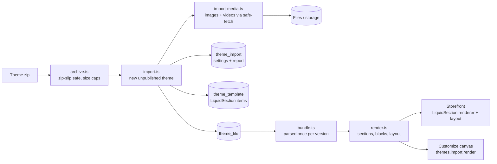

# Shopify theme import and the Liquid engine

Merchants upload the theme zip Shopify emails them (Online Store → Themes → **Import Shopify
theme**). The rule the owner set: **copy the look exactly, run every function on our own
features**, and say in plain words what changed. One owner module does all of it:
`packages/core/src/theme-import/` (server entry `index.ts`, browser-safe half
`@commerce/core/theme-import` → `client.ts`).

## Pipeline

| Step | File | What it does |
| --- | --- | --- |
| Read the zip | `archive.ts` | fflate `unzipSync` with a filter that checks the zip directory before inflating: 50 MB zip, 120 MB unpacked, 15 MB per file, 4,000 files. Paths with `..`, absolute paths, drive letters or NUL are dropped, not cleaned. Only theme folders and known file types are kept; everything else is listed as skipped. Nothing is executed. |
| Store | `import.ts` | A **new** unpublished theme "`<name> (imported)`" (the live theme is never touched). Every file goes to `theme_file` (text as UTF-8, binary as base64, with a checksum). `theme_import` keeps the theme's settings (`settings_data.json` current), `theme_info` and the report. Migration `0085_shopify_theme_import`, both tables under RLS. |
| Copy media | `import-media.ts` | The address is the typed one, else the connected Shopify importer store (`shopify_import_connection`). Before any download, `findImportedMedia` reuses files the importer already copied: `shopify_import_mapping` rows of resource `media` (image CDN address, matched by file name) and `file_name` (the Shopify file name, written by the importer for videos from now on; re-run the importer once to fill it for older imports). Only what is still missing is downloaded. `shopify://shop_images/x` → `https://<host>/cdn/shop/files/x` through `@commerce/core/safe-fetch` (public addresses only, redirects re-checked, bytes capped); oversized originals are asked for again at 3000, 2000 and 1400 px. Shopify Files videos have no address derivable from their name, so the live home page is read once and the n-th video setting of a section is matched to the n-th `<video>` inside `#shopify-section-…__<key>`. Copies land in storage and Files (`media` rows). |
| Templates | `import.ts`, `fields.ts` | `templates/index.json` → our `home`, `sections/header-group.json` → `header`, `footer-group.json` → `footer`. Each section becomes one Puck item of type `LiquidSection`: `sectionType`, `sectionKey`, `_name` (the schema name, shown in Customize), its settings at the top level (`settingPropKey` prefixes reserved ids) and `blocks: [{ id, type, disabled, settings }]`. Image settings are stored as `{ url, alt, width, height }`, Shopify links as our paths, handles as handles. |
| Report | `import-report.ts`, `report.ts`, `swap.ts` | Every section file: where it is placed, what it relies on (swap table), app blocks, main templates, LiquidJS parse errors → `imported`, `replaced`, `unavailable`, `unsupported`. Plus menus, collections, products and blogs the imported pages name that this store lacks, images and videos copied or not, skipped files. Copy (English and Hindi) lives in `apps/admin/src/data/theme-import.ts` keyed by reason. |

## The engine

`engine.ts` creates one LiquidJS (MIT) instance per theme version: snippets are served from
memory (`templates` option, no file system), `ownPropertyOnly`, and render limits (20 s, which
includes data loads; parse and memory caps). Shopify-only tags:

| Tag | Here |
| --- | --- |
| `form` | Draws the theme's form; posts to `/theme-actions/<action>` (cart-add, newsletter, contact, localization) or our pages (login, account). Inner `form` object reads like Shopify's, `posted_successfully?` from `?form_posted=` after our handler redirects back. |
| `style`, `stylesheet`, `javascript` | Inline `<style>` / `<script>` (nonce added on the storefront). |
| `section`, `sections` | Static sections render in place; groups leave markers in the layout the storefront fills with its own header and footer templates. |
| `content_for 'blocks'` / `'block'` | Theme blocks from `blocks/*.liquid`. |
| `paginate` | One page (collections hand themes up to 50 products), with the `paginate` object. |
| `schema`, `doc`, `layout` | Ignored at render. |

Filters (`filters.ts`, values in `filter-values.ts`): `t` (locale files, plurals, interpolation,
visible "Translation missing"), `asset_url` (versioned `/theme-assets/<theme>/<file>?v=<checksum>`),
`image_url` / `image_tag` (sizes kept from the image, so `width`/`height` match), `img_url`,
`stylesheet_tag`, `script_tag`, `preload_tag`, `money` and friends (INR through `@commerce/money`,
or a Shopify `money_format` when one is configured), `placeholder_svg_tag`, `json` (escapes `<`),
`font_face` / `font_url` / `font_modify` (families loaded from Google Fonts by the layout),
colour maths (`color_lighten`, `color_mix`, `color_contrast`…), link and URL helpers,
`time_tag`, `date` with Shopify's named formats, `payment_type_svg_tag` (our own simple marks),
`video_tag`, `external_video_tag`. Unknown filters pass their input through.

### Objects on our data

`drops.ts`, `resource-drops.ts` and `page-context.ts` map our records onto Shopify's shapes:
`shop`, `settings` (typed by `settings_schema.json`: fonts, colours, colour schemes, images),
`section` / `block`, `product` / `variant` (prices in paise as Shopify's subunits; ids are
**whole numbers** from the UUID v7, `numeric-id.ts`, because themes write
`"id": {{ variant.id }}` into JSON; `/theme-actions/cart-add` turns them back with
`resolveThemeVariantId`), `collection(s)`, `all_products`, `linklists`, `blogs`, `pages`, `cart`,
`routes` (our paths), `request`, `localization` (India, INR), `template`. Resources read as their
handle when used as a key (`collections[section.settings.collection]`). Our built-in pre-order
shows up as a selling plan group named "Pre-order", which is how pre-order apps mark products on
Shopify. Menu links carry `link.object` (the collection, product, page or blog of their path). Metafields and metaobjects read our custom data, see below.

### Metafields and metaobjects

The Shopify importer copies metafields into our **extra fields** (product and collection owners)
and metaobjects into **content types and entries**, storing Shopify's `namespace` and `key` (and
metaobject types) through `keyFromName` (lower snake case). `custom-drops.ts` maps them back the
same way, so `product.metafields.custom['size-guide']` finds `custom.size_guide`.

| Liquid | Here |
| --- | --- |
| `product.metafields.<ns>.<key>`, `collection.metafields…` | A metafield: `.value`, `.type` (Shopify's name, `list.` for lists), `.list?`; printed on its own like Shopify prints it (text as text, references as `gid://shopify/…`, lists and objects as JSON). Other properties read through to the value (`feature.image.width`). |
| `.value` by type | Text, number, boolean, date and URL as is; colour → colour object; rich text → HTML; money → `{ amount, currency }` that `money` formats; rating → `{ rating, scale_min, scale_max }`; measurement → `{ value, unit }` with type `weight` / `dimension` / `volume`; link → `{ text, url }`; file → image (works with `image_url`) or `{ url, media_type: 'generic_file' }`; product, collection, page, variant, blog post and entry links → the same drops themes get everywhere; group → rows (`json`); lists → arrays. |
| `metaobjects.<type>` and `shop.metaobjects.<type>` | `.values` (published entries, oldest first, up to 250), `.values_count`, `[handle]`; each entry exposes its fields (`entry.title.value`) and `system.id` / `handle` / `type`. |
| `variant`, `page`, `article`, `blog`, `shop` metafields | Blank: we keep no extra fields on those owners yet (the importer only counts them). |

Only definitions with storefront access, active entries and published targets are read, under the
store's RLS. Loading goes through the request cache: every owner asked for in a pass is one
query per owner type (`custom-data.ts`, `loadMetafields`), each content type one query, and entry
links are followed three levels deep in the same load; files, products, collections, pages,
posts and variants they point at are one query per kind.

### Synchronous passes

LiquidJS's async mode creates a promise per value; React's development server tracks every
promise in a Server Component, which made a home page take 20 s. Renders are therefore
**synchronous**: `cache.ts` answers from memory and notes anything not loaded, the section is
rendered again after one batched load, up to five passes (`render.ts`, `renderUntilComplete`).
A home page is about 1 s in dev and two passes per section.

## Where it renders

- **Storefront.** `apps/storefront/src/lib/liquid-theme.ts`: when the request's theme (live, or a
  verified preview) has a `theme_import` row, `renderTemplate` renders every `LiquidSection` in the
  open transaction and the `LiquidSection` renderer places it inside Shopify's own wrapper
  (`
`, ids shaped like
  Shopify's because themes key CSS on them). The store layout draws the theme's
  `layout/theme.liquid` head (stylesheets, CSS variables), the body markup before the header group
  and after the footer group (icon sprites, cart drawer, scripts), with the request's CSP nonce on
  every `<script>`. Our own pages (product, cart, search, account) render inside the theme's header
  and footer. The checkout (`/checkout` and everything under it) never does: the layout drops the
  theme's shell, header and footer there (`liquidLayoutForPath`, `lib/checkout-path.ts`), so the
  theme's CSS cannot restyle it and its scripts cannot rewrite it before React hydrates (Zero
  Drift's `reveal.js` wraps every `main h1`–`h3` in a span, which threw hydration error #418).
  Assets: `/theme-assets/<theme>/<file>` (route `-s/[storeId]/theme-assets/[themeId]/[file]`),
  cached for a year when `?v=` matches, CORS-open for the canvas, SVG sandboxed.
- **Customize.** `themes.import.editor` returns schemas, the schema locale, colour schemes and the
  theme's head; `use-liquid-theme.ts` turns each `` into Puck fields
  (`liquidSectionFields`: text, textarea/richtext, number/range, select/radio, checkbox, image,
  colour, colour scheme, product/collection/blog/page/menu handles) passed through
  `metadata.liquid`; `LiquidSection.resolveFields` picks the section's own. Blocks are one array
  field whose item fields depend on the block type (`customize-liquid-blocks.ts`). The canvas
  asks `themes.import.render` for HTML (batched, `liquid-canvas.ts`) with **scripts and inline
  handlers removed** — the canvas shares the admin's origin. The iframe gets the theme's head
  instead of our theme CSS (`preview-frame.tsx`).

## Behaviour swap

The theme's JavaScript runs on the storefront for its look (sliders, reveals, marquees). Calls it
makes to Shopify go to our features instead (`apps/storefront/src/lib/liquid-shim.ts`, inline
before any theme script). This is not an emulation of Shopify's API; each call becomes one of ours.

| Shopify | Here |
| --- | --- |
| Add to cart forms, `/cart/add(.js)` | `/theme-actions/cart-add` → our cart (`addLineAction`), then the cart page |
| `/cart.js` | `/theme-actions/cart`: count and total from our cart |
| `/cart/change.js`, `/cart/update.js`, `/cart/clear.js`, cart drawer refresh | Our cart page |
| Section rendering (`?section_id=`, `?sections=`) | `/theme-actions/section`: the theme's own section rendered by our engine with the collection or product of the path (lazy tabs and carousels) |
| `/search/suggest`, `/recommendations/products` | Empty answers; the search box submits to our search page |
| `Shopify.customerPrivacy` (cookie banner) | Our consent cookie: the theme's banner asks when we would, its answer goes to `ConsentManager` (`commerce:consent` event) which stores it and loads the allowed tags |
| Newsletter form (`form 'customer'`) | `/theme-actions/newsletter` → `subscribeAction` (double opt-in) |
| Contact form | Not available yet (redirects back) |
| Checkout | Ours, never themed: no theme CSS, scripts, header or footer on `/checkout/*` |
| Customer account forms | Our account pages |
| App blocks (`@app`), app data (Judge.me metafields) | Left out / hidden; listed in the report |
| Metafields, metaobjects | Our extra fields (products, collections) and content types; app namespaces stay blank until an app fills them |
| Pre-order apps | Our pre-order as a "Pre-order" selling plan group |

The same table, in code, is `swap.ts` (`SWAP_TABLE`), which also detects each row in a section's
Liquid for the report.

## Tests

`packages/core/src/theme-import/engine.test.ts` (no database) and `import.test.ts` (database,
fake fetch and DNS, `MemoryStorageProvider`) run on the fixture theme in
`packages/core/test/theme-import-fixture.ts`. No test touches the network or the owner's theme.

## Not yet

- Product, collection and other resource templates from the theme (they use our pages today).
- Editing the theme's own settings (`settings_schema.json`) in Customize; adding new sections
  from the theme in the Add panel.
- A cart drawer that refreshes in place, predictive search results in the theme's look, a home
  for contact form messages.
