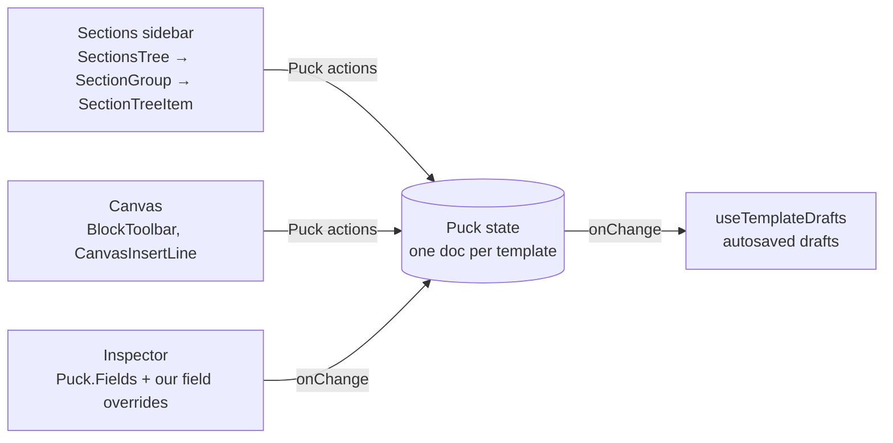

# Theme editor

Online Store → Themes → **Customize** (`apps/admin/src/components/themes/customize/*`, copy in
`apps/admin/src/data/customize.ts`) is a Shopify-style editor on top of
[Puck](https://puckeditor.com) 0.23 (`@puckeditor/core`, MIT). Puck is the engine: one document
per template, with the header and footer groups as extra root zones (`root:header`,
`root:footer`, see `lib/customize-doc.ts`), so the sidebar, the canvas, the inspector and undo
all share one Puck state. Every change the editor makes is a Puck action (`insert`, `replace`,
`reorder`, `duplicate`, `remove`, `setUi`), which is what keeps undo a single history.



## Themes page

Online Store → Themes (`components/themes/themes-library.tsx`, Figma "Online store / Themes",
309:19887) lists the live theme in `CurrentThemeCard` and the rest in `ThemeLibraryRow`s.
`themes.list` returns each theme with three facts read once per list (`libraryFacts` in
`packages/api/src/routers/themes.ts`): `imported`, `hasDraft` (any `theme_template.draft`, the
"Unsaved changes" chip) and `sectionCount` (an imported theme's `sections/*.liquid`; our own
themes show how many sections the Add panel offers, counted from `SECTION_CATEGORIES` on the
server page).

"Last saved by" is `theme.updated_by`: the member's name (or email) written by create,
duplicate, rename, settings saves and `templates.commit` (which also bumps `updated_at` through
`touchTheme`, so a content-only Save moves the theme up the library).

### Thumbnails

There is no headless browser in the stack, and none is needed: the Customize canvas is a
same-origin iframe already drawing the home page. `lib/capture-theme-thumbnail.ts` draws its top
16:10 into a 640 × 400 webp with modern-screenshot (the library "Report a bug" uses), leaving
out Puck's overlays and every node below the fold, with a 4 s cap per image or font.
`lib/use-theme-thumbnail.ts` sends it to `themes.thumbnail`:

- after every Save while the canvas shows the default home template at desktop width;
- once, 2.5 s after a theme with no picture opens on its saved home page, so existing themes get
  one just by being opened.

The server (`services/theme-thumbnail.service.ts`) accepts only a real WebP (RIFF/WEBP header)
up to 256 KB, writes one object per theme (`stores/<store>/themes/<theme>/thumbnail.webp`,
overwritten each time) through the store's storage provider, and stores its URL with `?v=<time>`
in `theme.thumbnail_url`. Setting the picture is not a save: `updated_at` and `updated_by` stay.
A duplicate starts with its source's picture. Until a theme has one, the live card falls back to
the scaled storefront iframe and library rows to `ThemeSwatch`.

## Sections sidebar

`SectionsTree` renders three `SectionGroup`s: **Header**, **Template**, **Footer**. Each group
heading collapses its rows. Rows are `SectionTreeItem`s inside the shared `SortableList`
(`@commerce/ui/sortable`, dnd-kit), so dragging, keyboard reordering and the lifted drag
overlay are the same as everywhere else in the admin.

A row (`section-row.tsx`) has the drag handle, a toggle for its blocks, the section's glyph and
name, the eye (hide/show, stored as `props._hidden`), and a "more" menu with **Duplicate**,
**Rename** and **Remove**. Main sections and the header and footer (`SINGLE_SECTIONS`) only get
Rename. Rename stores the merchant's name in `props._name` (`renamedProps` in
`lib/customize-insert.ts`); a blank name, or the type's own label, removes it again. Neither
`_hidden` nor `_name` is a field, so they never show in the inspector.

### Audit tab and breadcrumb

The Sections panel has a "Sections | Audit" switch (`sections-panel.tsx`). Audit
(`audit-panel.tsx`, checks in `lib/customize-audit.ts`) lists what on the open template a shopper
would trip over, in plain words: a picture with no description (`{ url, alt }` with a picture and
no alt), a button that goes nowhere (`{ label, href }` with words and no link), a section hidden
on phones and computers, a heading emptied (the Heading element, or a section whose default
heading was cleared) and theme colour pairs below 4.5:1 (`themeContrastWarnings`). Blocks hidden
with the eye are skipped. Picking a row selects the block and scrolls to it; a colour row opens
Theme settings. The inspector header shows where the selection sits, "Template › Group › Image
banner" (`inspector-breadcrumb.tsx`), and each container in it selects that container.

### Insert points

There are three ways to reach the Add section browser (`add-section-browser.tsx`) at an exact
position, and all of them end in `insertActions({ zone, index }, type, count)`: an `insert` at
that index (clamped by `clampInsertIndex`) and a `setUi` selecting the new section.
`customize-editor.tsx`'s `revealInserted` then scrolls it into view.

| Where | Component | Position |
| --- | --- | --- |
| "+ Add section" closing a group | `add-section-popover.tsx` (`variant="row"`) | end of the zone |
| Thin line above any row (hover or focus) | `add-section-popover.tsx` (`variant="line"`) | before that row |
| Line between two sections on the canvas | `canvas-insert-line.tsx` → `add-section-dialog.tsx` | before or after the section whose edge is nearest |

The canvas line is our own layer inside the preview iframe, portalled into its `body`, rather
than part of Puck's per-section overlay: Puck mounts that overlay only while its section is
hovered, so a "+" inside it would vanish as the pointer moved onto it. `edgeNear` picks the
section edge within `0.75rem` of the pointer, and `targetForEdge` turns it into `{ zone, index }`.
The click goes through `InsertContext` (`lib/customize-insert-context.ts`) to `CustomizeLayout`,
which opens the browser in a dialog in the admin document. The "+" is registered with Puck's
`registerOverlayPortal` so pressing it never starts a section drag.

### Section pictures in the Add panel

Each tile in the Add panel's Sections tab (Figma grid 369:4918) and its hover card show a real
picture of the section: drawn with its default settings and the default theme, light and dark
(`section-picture.tsx`, following the admin's mode). The pictures are files in
`apps/admin/public/section-previews/` (`<Type>.webp`, `<Type>-dark.webp`, 512 px wide, at most
40 KB, about 6 KB on average), listed with their shape in the generated
`apps/admin/src/lib/section-previews.ts`. Types without a picture keep the drawn glyph
(`section-preview.tsx`): Layout and Elements blocks, and sections that need a store to show
anything (a scroll-driven reveal, reviews, an empty rich text).

Regenerate after adding a section or changing how one looks, and commit the result:

```bash
cd apps/admin && bun run section-previews   # CHROME_PATH=/path/to/chrome if not installed in the usual place
```

`scripts/section-previews/entry.tsx` renders every addable section through
`@commerce/blocks` (`resolveAllData` then `renderBlock`, as the storefront does) with stand-in
products, collections and posts (`demo-data.ts`); `run.ts` bundles it with Bun, styles it with
the storefront's own Tailwind build, and photographs each section in a local Chrome through
puppeteer-core (dev dependency, Apache-2.0, no browser download) with reduced motion, so reveal
animations sit at their end state. `section-previews.test.ts` checks that every listed type has
both files under 40 KB.

### Starter kit sections

`packages/blocks/src/sections/kit.tsx` (`kitSections()`: heroes, logos, stats, calls to
action) and `kit-trust.tsx` (`kitTrustSections()`: features, steps, testimonials, FAQ,
comparison, plans) and `kit-story.tsx` (`kitStorySections()`: lookbook, email signup band,
timeline, team, trust badges), with the shared field helpers in `kit-fields.ts`, copy in
`src/data/kit-sections.ts` and components in `src/components/sections/kit/`, hold polished
sections for every merchant. Each is
`framed()` (shared section settings), draws its copy through the inline field helpers, reads only
theme tokens (`--color-ink`, `--color-surface`, `--color-brand`…), and keeps motion in a shared
effect under `src/effects/` that loads Motion after hydration and stands still under reduced
motion: `retro-grid`, `border-beam`, `word-rotate`, `number-ticker`, `magic-card` (adapted
from Magic UI, MIT). Shared pieces: `kit-buttons.tsx` (primary and secondary links, blank label hides one) and
`kit-media.tsx` (picture or a brand-tinted placeholder), `kit-heading.tsx` (heading and
intro) and `kit-stars.tsx` (a rating read out as words). Centre with flex, not `mx-auto`: the
theme's base CSS resets margins on plain elements, which beats Tailwind's layered utilities.
The same goes for the theme's heading classes (`.h2`, `.h3`: uppercase): a utility cannot undo
them, so copy that must not be uppercase uses sizes directly. The section frame centres text by
default, so layouts that read left to right set `text-left` themselves. The email signup band
posts to `metadata.newsletterAction`, the storefront action the Email signup section uses.

Adding one: the config in `kitSections()`, its type in `SECTION_CATEGORIES`, a description in
the admin's `data/customize.ts`, a glyph and kind (`lib/customize-puck.ts`,
`lib/customize-section-kinds.ts`), a credit in `sources.ts` and `THIRD_PARTY_NOTICES.md` when
it adapts outside code, then `bun run section-previews`. `test/library-inline.test.tsx` and
`test/kit-sections.test.tsx` cover it.

### Nested blocks (slots)

Layout blocks (Group, Columns, Grid, Tabs, Accordion, Carousel) hold other blocks in Puck
slots. The tree lists a container's slots under it with an indent guide and a disclosure
chevron (containers start open); each slot is a `SlotZoneList` whose rows are full
`SectionTreeItem`s, so nesting goes to any depth. Every row action is a Puck action on the
slot's zone (`<parentId>:<propPath>`). Details, the data shape and "My sections":
[Slots and custom sections](/developer-docs/building/custom-sections).

### Blocks

Our sections keep repeatable content (slides, columns, logos, FAQ entries) in Puck `array`
fields, not slots, so those items are the section's blocks. `sectionBlocks` reads them from the
section's props and its component's `fields`, using the field's `getItemSummary` for names.
They are listed under the row (`section-blocks.tsx`) with **Add block**, which appends the
field's `defaultItemProps` (`withBlockAdded`), and a remove button (`withBlockRemoved`), both a
single `replace` action. A section with several array fields gets a small menu to choose which
one to add to.

### Inline editing

Text drawn on the canvas is declared with the helpers in
`packages/blocks/src/sections/inline-fields.ts`: `inlineText` and `inlineTextarea` set Puck's
`contentEditable`, and `inlineRichtext` is a Puck `richtext` field (Tiptap, stored as HTML) with
only the marks our storefront allows. Puck applies them inside `array` items too.

- While editing, Puck passes those props as React nodes, not strings. A section only renders
  them; anything that needs a string (alt text, `aria-label`, splitting a heading into words) is
  a separate plain `text` field.
- Body copy is drawn with `RichCopy` (`components/rich-copy.tsx`). On the storefront the value is
  the stored string and goes through `richtextHtml` (`richtext-html.ts`): older plain strings are
  escaped into paragraphs, HTML runs through a small sanitize-html allow-list.
- Button labels use `inlineLinkField` (`framed.tsx`): the same `{ label, href }` object as
  `linkField`, with an inline label. Links whose label is only an `aria-label` (Group, Image)
  keep the plain `linkField`.
- The Rich text section and the Text element use `inlineRichtextLong`, which adds headings (h2 to
  h4), quotes and rules.
- While body copy is edited, its B/I/U and link controls join the block toolbar (below).

### Block toolbar

The selected block gets one floating toolbar (`block-toolbar.tsx`, Puck's `componentOverlay`
override), designed in Figma as "Builder / Block toolbar" (500:5981). A selected block shows its
name chip, "select container" when it sits inside a layout block, move up and down, duplicate,
delete and a more menu (hide on the page, copy; `block-toolbar-more.tsx`). While its text is being
edited, bold, italic, underline, link and clear formatting take the place of those actions. A
hovered block shows just its name in a quiet chip. Puck hands its inline rich-text menu to its own action bar, so the
`actionBar` override (`block-toolbar-format.tsx`) portals that menu into a slot at the end of
the toolbar and Puck's bar stays empty. The menu is `inline-format-menu.tsx`, which
`customize-config.tsx` sets as `renderInlineMenu` on every richtext field: Puck's B/I/U, clear
formatting and a link form that accepts what the link picker accepts (`normalisePastedUrl`) and opens in the same
tab.

- Puck mounts the overlay in the admin document laid over the canvas, so the toolbar uses admin
  tokens and follows the admin's light or dark theme.
- It rests on the block's top edge and sticks to the top of the canvas while a tall block scrolls
  under it (a block at the very top shows it just inside). New controls append at the end, so
  the buttons never shift.
- It is registered with `registerOverlayPortal` and stops its clicks, so pressing a button never
  drags the block or clears the selection. Moves use `stepActions`, so the moved block stays
  selected.
- Selected blocks get a 1px solid accent outline and hovered ones a dashed one, no tinted fill
  (`vendor-puck.css`). The bar fades in over 150 ms; reduced motion shows it at once.

Every section on the canvas uses these helpers: the Zero Drift sections (`sections/zero-drift.tsx`, one
config per section in `sections/zero-drift/`), the library and modern sections (`library.tsx`,
`modern.tsx`), Featured products, Collection grid and Rich text (`puck-config.tsx`), and the
build-your-own blocks (Tabs labels, Accordion titles, Heading, Text, Button and Badge). Containers
and media elements have no copy of their own. `test/zero-drift-sections.test.tsx` and
`test/library-inline.test.tsx` render each one with its copy swapped for React nodes to catch
string handling. Inventory: `docs/design/zero-drift-theme-port.md`.

### One rich-text store

Section body copy is stored one way: Puck's richtext HTML. The Lexical rich-text field the Rich
text section and Text element used before is retired. Docs saved with it still hold Lexical JSON
(an object, or a JSON string), and nothing is migrated in the database:

- the storefront reads it through `richtextHtml`, which converts it with `lexicalToHtml`
  (`packages/blocks/src/lexical-html.ts`) before sanitising;
- Customize converts it when a template loads (`richtextFromLexical` in `normalizeDoc`, and when a
  saved "My section" is inserted), so Puck's editor gets HTML and the next save stores HTML.
  Converting on load primes the drafts with the HTML, so opening the editor writes nothing.

The converter keeps paragraphs, h2 to h4 headings, quotes, lists, links, line breaks, rules,
images and B/I/U/S, so nothing the merchant wrote is lost: a YouTube embed becomes a link to the
video, and tables, code blocks and collapsibles keep their text. Only alignment and indents are
dropped. Images are `` with `src`, `alt`, `width` and `height`; the allow-list keeps them only
for `http(s)` or root-relative sources (never `data:`). Puck's Tiptap has no image node, so the
admin passes `@tiptap/extension-image` as `richtextExtensions` to `createBlocksConfig`, and the
long-form fields (`inlineRichtextLong`) keep pictures through an edit. Tests:
`test/lexical-html.test.ts`, `test/richtext-html.test.tsx`.

### Section settings controls

Every placed section carries the shared Section settings (`section-settings.ts`; the hero and the
announcement bar a smaller `bleed` set). In the inspector's Advanced tab they use the Figma
controls: segmented switches for width, alignment, corners and shadow, padding per screen size
behind a device switch, the colour scheme as swatch chips, and the background as "Colour |
Image", where theme colours are stored by name so they follow the scheme and dark mode
(`settings-group-body.tsx` and the controls beside it).

## Motion

All editor motion uses Motion (`motion/react`), 150 to 200 ms, easing out, never overshooting,
and switches off under `prefers-reduced-motion` (`useReducedMotion`, or `motion-reduce:` utilities
for CSS transitions):

- group expand and collapse, and a section's blocks opening, animate height and opacity;
- rows added after load slide in, and rows move with a `layout="position"` animation keyed to
  their index (so a canvas "Move up" glides; during a drag dnd-kit's own transforms apply);
- removing a section collapses it first (`deleteWithCollapse`), then dispatches `remove`;
- hover and selected highlights are colour transitions; the drag lift is `SortableOverlay`;
- on the canvas, `canvasMotionCss` (injected into the iframe) fades Puck's hover and selection
  outline in, eases sections pushed aside during a drag, and rings a new section once;
- the inspector cross-fades when the selection changes, and the link picker slides between its
  top level and a drilled-in list.

## Look and feel

The chrome (rail, sidebars, inspector, top bar, canvas dock) follows one scale, written down once
in `apps/admin/src/lib/customize-chrome.ts` so new panels pick it up instead of inventing sizes:

| Token | Value |
| --- | --- |
| Body / label / meta | 13px (`0.8125rem`) / 12px / 11px, meta and counts `tabular-nums` |
| Headings | 13px semibold, `tracking-tight`, sentence case; group headings 11px medium muted, never all caps |
| Rows | 32px (`h-8`), 8px radius, hover `bg-muted/60`, selected `bg-primary/10` plus a 2px accent bar (`before:` pseudo-element) |
| Panels | 12px radius (`rounded-xl`), hairline `border-border` |
| Focus | `CHROME_FOCUS`, a 2px inset accent ring on every button and row |
| Motion | colour transitions 150ms; heights and slides 150 to 200 ms; all off under reduced motion |

Icons are one family: Phosphor at **regular** weight, 16px in the sidebar and 14px inline. Section
glyphs come from `editorGlyphs` in `packages/ui/src/icons.tsx`; `SectionIcon` picks one per type
(`sectionGlyph`) and, with `tile="sm" | "md"`, draws it on a small tile tinted by the section's
kind (`lib/customize-section-kinds.ts`):

| Kind | Tint | Examples |
| --- | --- | --- |
| layout | `info` | Header, Footer, Multicolumn, Group, Columns |
| text | neutral | Rich text, FAQ, Testimonials |
| media | `chart-4` | Hero, Image banner, Gallery, Video |
| product | `success` | Product grid, Featured product, main product |
| app | `chart-2` | any `<app-id>/<Name>` app block |

Tints are a 12% wash of the token with the glyph in the full token colour, so light and dark read
the same. The admin font stays Satoshi (from the Figma kit).

## Data shapes

These are deliberately small and plain, so blocks render them without the editor, and so a
later "dynamic sources" binding (a `{ "$source": "…" }` object in place of a value) can sit on
the same fields.

### Links

A bare link text field (named `href`, or labelled "Link") stores the href string. A
`{ label, href }` link object stores the same string in `href`, plus an optional `newTab`:

```json
{ "label": "Shop the sale", "href": "/collections/diwali", "newTab": true }
```

| Target | Stored `href` |
| --- | --- |
| Product | `/products/<handle>` |
| Collection | `/collections/<handle>` |
| Page | `/pages/<handle>` |
| Policy | `/pages/<handle>` (a page whose handle reads as a policy, see `isPolicyHandle`) |
| Blog post | `/blogs/<blog>/<article>` |
| Home page | `/` |
| Pasted link | `https://…`, `mailto:`, `tel:`, a `/path` or `#anchor` (`normalisePastedUrl` refuses anything else, such as `javascript:`) |

`newTab` is only written when the merchant turns on "Open in a new tab", so older docs are
unchanged. Blocks spread `linkTarget(link)` (`packages/blocks/src/link.ts`) onto the `<a>`,
which adds `target="_blank" rel="noopener noreferrer"` only when `newTab === true`.

The picker (`link-picker.tsx`, `link-picker-panel.tsx`) searches every kind at once
(`searchAllLinkTargets`, a few rows per kind), drills into one kind with its own search
(`searchLinkTargets`), remembers the last five picks in this browser (`customize.link.recent`,
localStorage, `pushRecentLink`), and shows the chosen link as a chip with the target's title,
glyph and type (`parseHref` reads the stored string back). Parsing and searching are covered by
`customize-links.test.ts` and `customize-link-targets.test.ts`.

### Images

An image field (`{ url, alt }`, `imageField()` in `framed.tsx`) stores:

```json
{ "url": "https://cdn.example.com/media/keyboard.jpg", "alt": "Black keyboard", "focal": { "x": 30, "y": 62.5 } }
```

`focal` is optional: percentages from the image's top-left corner, 0 to 100, one decimal
(`packages/blocks/src/focal-point.ts`). Missing or malformed means the centre, which is how every
image rendered before. Blocks that crop an image (`HeroCarousel`, `ImageBanner`,
`ImageWithText`, `SplitHero`, `BentoGrid`, `Gallery`, `Multicolumn`) pass
`style={focalStyle(image.focal)}` to the ``, an inline `object-position` that is left out
entirely for the centre. Choosing a different picture clears `focal`, because it belonged to the
old one.

The field (`image-field.tsx`) is a large preview you can drop a file onto (uploaded through
`lib/upload.ts` with progress), **Select** for the media library dialog, editable alt text, and
Replace, Reset focal point and Remove in its "more" menu. Clicking the preview, or the arrow keys
once it has focus, sets the focal point (`focalFromPoint`, `nudgeFocal`); the click is measured
against the image itself, so the point maps onto the real picture. Previews and the library grid
render through `<Picture>` from `@commerce/blocks/media` with the media row's variants and
ThumbHash, which `listMedia` now returns. The media dialog adds a "Recently used" strip
(`media.pick.recent`, localStorage) and arrow-key movement between tiles.
