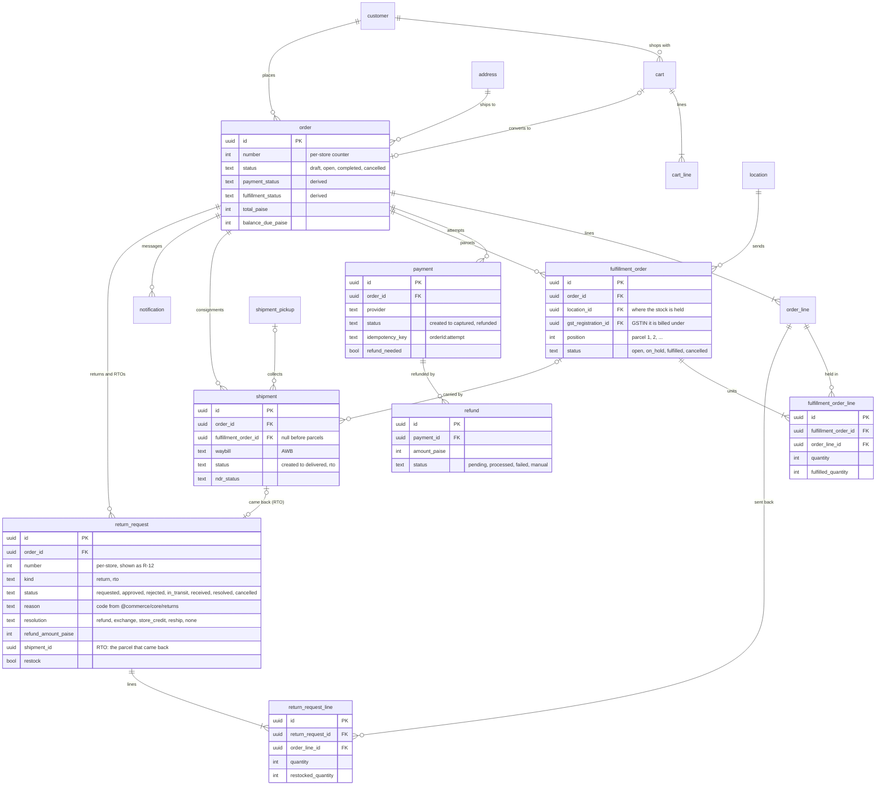
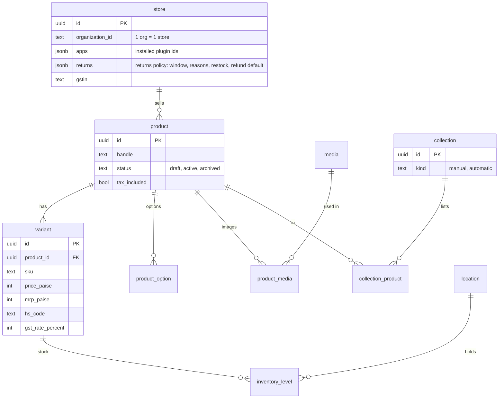
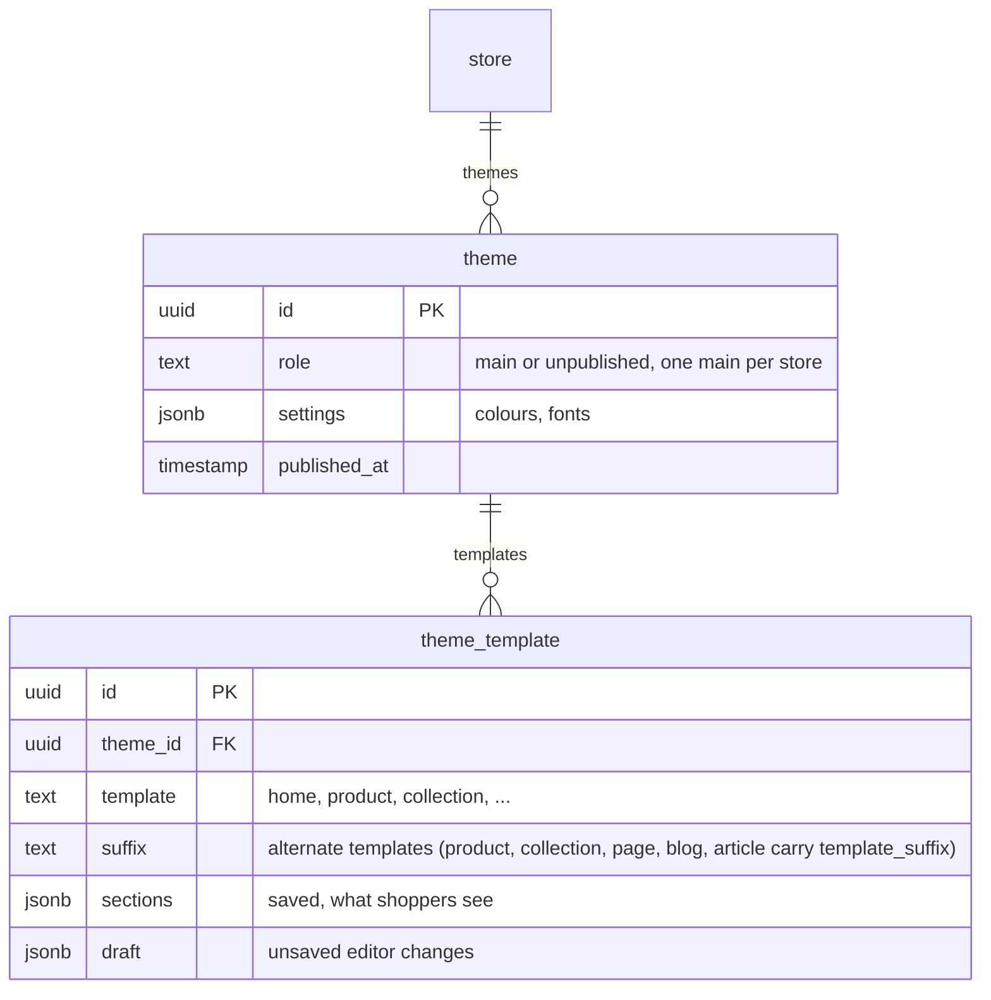
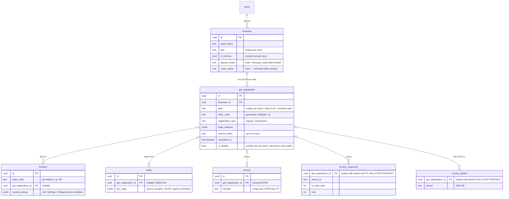

# Data model overview

Postgres 17, one database, every tenant table carrying `store_id` and row-level security
(RLS). Migrations live in `packages/db/drizzle` (SQL, `0068` at the time of writing), generated
from the Drizzle schema files in `packages/db/src` (`schema.ts` plus feature schemas such as
`marketing-schema.ts`; auth tables are separate, see below) and each app's own `schema.ts`.

## The main tables

The commerce core, from `packages/db/src/schema.ts`. Money is always integer paise
(`price_paise`, `total_paise`), ids are UUIDv7 generated in the app, and every table here also
has `store_id` (left off the diagrams to keep them readable).

<Tabs items={['Orders and money', 'Catalogue', 'Themes', 'Businesses and GST']}>
<Tabs.Tab>



</Tabs.Tab>
<Tabs.Tab>



</Tabs.Tab>
<Tabs.Tab>



</Tabs.Tab>
<Tabs.Tab>

GST is registered per PAN per state, so one store can hold several GSTINs, and a warehouse may
belong to a different legal business. Added in migration `0080_gst_registrations` (phase 1:
recorded and linked). Migration `0084_gst_phase_2_3` puts them to work: the order is billed from
its warehouse's GSTIN (phase 3) and invoices are numbered and filed per GSTIN (phase 2). Rules:
`packages/core/src/tax/registrations.ts` (registrations), `packages/core/src/tax/origin.ts`
(which GSTIN an order bills from), `packages/plugin-gst-invoices/src/registration.ts` (which
GSTIN issues a document).



- **PAN must match.** A GSTIN's characters 3 to 12 are the holder's PAN; the service refuses a
  GSTIN whose PAN is not its business's (`PAN_MISMATCH`). The database cannot check this across
  tables, so only `addRegistration` inserts rows.
- **`store.gstin` is a mirror.** It always equals the default registration's GSTIN, written only
  by `mirrorStoreGstin`. Settings → GST & invoices and Settings → Store details go through
  `adoptStoreGstin`: with no registration yet a GSTIN saved there becomes the first one; after
  that a different GSTIN is refused (`MANAGED_ELSEWHERE`).
- **A location bills under its own state's GSTIN** (`STATE_MISMATCH` otherwise). Cancelling a
  registration unlinks its locations and hands the default to the oldest active GSTIN of the
  main business.
- **Backfill.** 0080 creates one primary business and one default registration for each store
  whose `store.gstin` is well formed (legal name and address from the GST invoices app's seller
  block, else the store). Stores without a GSTIN get neither: a business needs a PAN.

#### Tax origin (phase 3)

`placeOrder` resolves the order's tax origin before it splits the GST (`taxOriginForParcels`,
ORIGIN_FALLBACK): the active GSTIN linked to the location the order's parcels ship from (with
several parcels, the one holding the most order value), else the default GSTIN, else
`store.address` with no GSTIN, exactly as before.
Prices include GST, so the origin only flips CGST + SGST and IGST; the total never changes. The
result is snapshotted on the order (`gst_registration_id`, `tax_origin`) and never recomputed.
Orders placed before 0084 have neither and bill from the default GSTIN.

With several parcels, each is taxed on its own (`computeParcelGst`,
`packages/core/src/tax/parcel-gst.ts`, PARCEL_ALLOCATION): the order discount, payment fee or
discount and shipping are shared over the parcels by goods value in whole paise, and each
parcel's share is split CGST + SGST or IGST from its own GSTIN's state (0% under a composition
GSTIN). The parcel stores its share and tax (`fulfillment_order.subtotal_paise` ...
`total_paise`, `tax_paise`, `tax_breakdown`, `tax_origin`, 0099); the order stores their sum
(`mergeOrderGst`) and is billed from the parcel holding the most value. A split order can carry
CGST + SGST and IGST together: displays use `gstRowsToShow` (`@commerce/core/gst`). With one
parcel the figures are exactly the order-level ones.

#### Documents per GSTIN (phase 2)

- `invoice`, `invoice_sequence` and `invoice_period` carry `gst_registration_id`. Rule 46(b)
  uniqueness is per GSTIN per financial year (`invoice_number_unique` on
  `coalesce(gst_registration_id, zero uuid), fy_start_year, number`), counters are per GSTIN,
  series and year, and a GSTR-1 month is filed and closed per GSTIN.
- A document is issued by the order's GSTIN (`orderIssuer`: a draft's own, else
  `order.gst_registration_id`, else the default). Credit notes and refund vouchers use the
  original document's GSTIN, even after it is cancelled (`documentIssuer`).
- **One tax invoice per parcel** (0100). `invoice.fulfillment_order_id` names the parcel a tax
  invoice bills; `invoice_order_kind_live` is unique per order, parcel and kind. The queue makes a
  draft per live parcel under the parcel's GSTIN (`enqueueOrderParcels`;
  `packages/plugin-gst-invoices/src/parcels.ts`); its document prints the parcel's units and the
  money and GST checkout stored on the parcel, or for a parcel without them its goods-value share
  of the order's discount, fee and shipping. A composition GSTIN's parcel prints a bill of supply.
  Order confirmations, packing slips and vouchers stay per order (null parcel). A receipt
  voucher's advance is cited on one parcel invoice only.
- **Credit notes per GSTIN** (0101: `invoice_refund_unique` per refund and parcel).
  `issueCreditNotes` gives a refund on an order with several issued invoices one credit note per
  invoice it reduces, from that invoice's GSTIN and on its parcel (REFUND_ALLOCATION,
  `refund-allocation.ts`): by returned value per parcel when a return lists the refund in
  `refund_ids`, else pro rata to what each invoice can still be credited; never past an invoice's
  remaining credit. One invoice behaves exactly as before. Return pickups go back to the location
  the returned value left from (`returnPickupLocation`), and a whole-order booking leaves from its
  parcel's location (`shipFromFor({ locationId })`).
- The seller block is the app's own (`settings.seller`) when it is that GSTIN's, so a
  single-GSTIN store prints what it always did; any other GSTIN prints its business's PAN name
  and its registration's legal address.
- `{GST}` in a series pattern prints the registration's `invoice_prefix`, else its state
  letters. Settings validation counts it as 5 characters against the 16-character limit.
- **Null means "no registration".** A store without any GSTIN keeps `gst_registration_id`
  null; `NULLS NOT DISTINCT` keeps one counter per series. The trigger
  `gst_registration_adopt_unassigned` hands those rows to the first registration that becomes
  default (`adopt_unassigned_gst_documents`), so the series carries on instead of restarting
  at 1. 0084's backfill runs the same function for every existing default registration.

#### Courier pickup per location

`location.courier_pickup` (`{ pickupName, contactName, phone }`, address from the location's
own columns) makes couriers collect from that location and bring returns back to it
(`shipFromFor` in `packages/core/src/shipping/ship-from.ts`). Null, the default, keeps
`store.shipping.policy.warehouse`. Bookings use the order's `tax_origin.locationId` (older
orders: the default location). `pickupName` reaches Delhivery and Shiprocket as
`pickup_location`; pickup scheduling (`schedulePickup`) still uses the store-wide name.

</Tabs.Tab>
</Tabs>

Around these sit the side tables the diagrams leave out: `payment_event` (webhook dedupe,
unique on `store_id, provider, event_id`), `shipment_webhook_event`, `outbox_event` (domain
events written in the same transaction as the change), `order_note`, `discount` and
`discount_usage`, `gift_card` and its transactions, `shipping_zone` / `shipping_rate`,
`purchase_order`, `transfer`, `page`, `navigation_menu`, `store_domain`, metaobjects and
metafields, `role` / `role_permission` / `store_member` / `store_invitation`, and the marketing
tables in `marketing-schema.ts`.

### Retention

The worker deletes or empties rows that would otherwise grow forever. Every prune runs once a day,
store by store, and these periods belong in the privacy policy (DPDP Act: keep personal data only as
long as it is needed).

| Rows | Kept | Then | Job |
|---|---|---|---|
| `cart` + `cart_line`, open, no email or phone | 30 days since `updated_at` | deleted | `{retention}-prune` |
| `cart` + `cart_line`, not converted, with an email or phone (Abandoned checkouts) | 90 days | deleted | `{retention}-prune` |
| `cart` + `cart_line`, converted | 30 days | deleted (`order.cart_id` has no foreign key) | `{retention}-prune` |
| `outbox_event`, dispatched | 30 days after `dispatched_at` | deleted (undispatched rows never) | `{retention}-prune` |
| `payment_event`, `shipment_webhook_event`, processed or failed | 180 days after `received_at` | `payload` set to `{}`, row kept | `{retention}-prune` |
| `api_activity` | 90 days | deleted | `{api}-activity-prune` |
| `automation_step_run` / finished `automation_run` | 90 days / 13 months | deleted | `{automations}-prune` |
| `pixel_event_log`, `pixel_event_day`, `order.tracking` IP and user agent | 30 days | deleted / cleared | `{pixels}-prune` |

`{retention}-prune` (`packages/core/src/retention`, `apps/worker/src/retention.ts`) runs at 03:30
India time over the stores that `stores_with_retention_due` (migration 0177, same rules) lists. It
works 500 rows per statement, each batch in its own transaction, so no lock a checkout or a webhook
might wait on is held for long; a store with a bigger backlog clears it over a few nights. A deleted
cart's recovery messages (`notification`) and marketing runs stay, with `cart_id` cleared. A table
that adds a foreign key to `cart` must be handled in `pruneCartBatch` (`retention.test.ts` lists
every such key). An emptied payment event no longer shows in the order page's payment history,
which finds events by the gateway ids inside the payload. `notification` (who was told what) is
kept.

### Parcels (fulfilment orders)

Every placed order with goods has at least one `fulfillment_order`: the units one location
holds for it, billed under that location's GSTIN (else the order's). Gift card lines belong to
none. `placeOrder` and `convertDraft` write them where they reserved the stock
(`createFulfillmentOrders` in `packages/core/src/order/fulfillment-orders.ts`); orders older than
migration 0096 got theirs from its backfill, and any order still without one gets it from
`ensureFulfillmentOrders` on its next stock move.

Stock moves go through the parcel, never the variant's selling row: packing
(`packFulfillmentOrderLines`, called by `fulfilOrderLines`, `fulfilRemainingLines` and courier
bookings) takes units out at the parcel's location, cancelling (`releaseFulfillmentOrders`) gives
unpacked units back there, and a return restocks where the line's parcel left from
(`lineLocation`). `order_line.fulfilled_quantity` stays the order-level total that
`recomputeOrderStatuses` reads; `fulfillment_order_line.fulfilled_quantity` is the same count per
parcel. A shipment carries one parcel (`shipment.fulfillment_order_id`, null for bookings made
before parcels).

### Selling from several warehouses (routing)

A location sells online when `location.fulfils_online_orders` is on and it is active; a trigger
(0098) mirrors that onto each `inventory_level.fulfils_online`, and a variant may sell from
several locations at once. Never join `inventory_level` on `variant_id` alone for "the stock":
join `sellableStock` (`packages/db/src/stock.ts`, one row per variant summed over selling
locations). A whole-variant stock edit, and any move without a parcel, uses
`primarySellingLevel` (the default location's row when it sells, else the first by
`location.priority`).

Checkout routes each order (`routeOrder`, pure, in `packages/core/src/order/routing.ts`;
ROUTING_RULES in its header): one location with everything (the buyer's state first, then
priority, then most stock), else the fewest parcels up to `store.shipping.routing.maxParcels`
(default 2), else the home location takes the rest past its stock with
`fulfillment_order.needs_transfer` set. Composition-scheme GSTINs never ship to another state
(`CannotShipToState`, "We can't deliver this item to your state yet"). Pre-order lines that no
stock covers wait in their own `on_hold` parcel at the home location.

Shoppers see a split before and after paying: `previewCartParcels`
(`packages/core/src/order/parcel-view.ts`, routing without locks) feeds the checkout's
"Ships in 2 parcels" with each warehouse's courier estimate (storefront `checkoutParcels`,
origin = the location's PIN code). `placeOrder` stores the window shown on each parcel
(`fulfillment_order.delivery_estimate`, 0104); the thank-you page, the account order page
(`ShopperOrderDetail.parcels`) and the order emails (`TemplateData.parcels`) read it back through
`orderParcelsView`. Converted drafts are billed like checkout (`taxParcels`, `parcel-tax.ts`). `routeAndReserve`
(`routing-service.ts`) locks the variants' inventory rows, routes and reserves each parcel at its
location; `placeOrder` and `convertDraft` use it.

### Returns and RTO

`return_request` holds both a shopper's return (`kind = return`) and a parcel the courier brought
back undelivered (`kind = rto`, opened by `applyTracking` when a shipment turns `rto`; a partial
unique index on `shipment_id` keeps it to one per shipment). `return_request_line` says which
order lines and how many units, and how many were put back in stock. Each step has its own
timestamp (`requested_at`, `approved_at`, `rejected_at`, `pickup_arranged_at`, `received_at`,
`resolved_at`), which is what the status timeline reads. Refunds, store credit (a `gift_card`)
and exchange drafts are ordinary rows elsewhere, linked back by id (`refund_ids`,
`gift_card_id`, `exchange_order_id`, `reship_shipment_id`). The policy lives on `store.returns`
(`ReturnPolicySchema` in `@commerce/core/returns`). Received customer returns count toward the
order's derived `fulfillment_status` (`returned` once every unit is back). Every change is owned by
`packages/core/src/returns/*` and writes its outbox event (`return.requested`, `return.approved`,
`return.rejected`, `return.received`, `return.refunded`, `order.rto`) in the same transaction.

### Purchasing and landed cost

`purchasing-schema.ts` holds `supplier`, `purchase_order` and `purchase_order_line`,
`inbound_shipment` (one Bill of Entry or container), `purchase_charge` (on an order **or** a
shipment; the service keeps it to exactly one), `purchase_charge_split` (one charge's paise on
one line) and `purchase_order_receipt` / `purchase_order_receipt_line` (accepted and rejected
units per delivery, with the landed unit cost and the variant's cost before and after).

- Money: line prices are `unit_price_minor` in the order's `currency`; `fx_rate` is
  `numeric(18,6)` INR per unit of that currency. Charges carry their own currency and rate,
  `amount_minor` ex-GST and `gst_paise` (always input credit). Amounts that can grow past
  ₹2 crore are `bigint`.
- The maths is pure and lives in `packages/core/src/inventory/landed-cost.ts`: FX to paise,
  largest-remainder splits (they sum to the charge exactly), landed unit cost
  `(goods + non-recoverable splits) / quantity`, weighted average cost and revaluation. Every
  division rounds half up (away from zero for negatives) in BigInt.
- `recost` (`costing.ts`) is called after every write that can move a cost: it splits the
  costing group (an order, or every live order in its shipment), stores the splits and each
  line's `landed_unit_cost_paise`, and revalues stock already received. A line remembers
  `costed_units` and `booked_cost_paise` (what those units added to inventory value), so a late
  charge moves the variant's `cost_paise` by the difference, applied only to the share of those
  units still on hand.
- Locks: a costing group is locked shipment row first, then its orders by id
  (`lockCostingGroup`), and a variant row before its cost is read, so concurrent receipts and
  charge edits queue instead of deadlocking.
- Migration `0094_landed_cost` moved the old `shipping_paise` / `tax_paise` into charges
  (shipping as cost, taxes as recoverable) and backfilled `unit_price_minor`; the old columns
  are no longer read or written.

#### Purchase documents (AI reading of bills)

`purchase_document` (migration `0095_purchase_documents`) is a file on a purchase order **or**
an inbound shipment (the service keeps it to exactly one, like `purchase_charge`): `kind`
(`supplier_invoice`, `bill_of_entry`, `freight_bill`, `cha_bill`, `bank_advice`, `other`),
`file_key`, name, MIME type and size, `status` (`pending` → `reading` → `ready` | `failed` →
`applied`), `extracted` (jsonb), `raw_text` (the PDF's own text layer), `error` (a code, worded
by the admin) and `applied_at` / `applied_by`.

- **Files** are private: `stores/<store>/private/purchase-documents/<id>.<ext>` through the
  store's storage adapter (`put` / `get`), served only by `purchaseDocuments.download` (an oRPC
  `File`, never a public URL). PDF, JPG, PNG, 15 MB (`document-rules.ts`, checked in the
  browser and in core).
- **Reading** runs in the worker (`{ai}-purchase-documents` queue, `apps/worker/src/purchase-documents.ts`,
  fair per store) through `readPurchaseDocument` (`packages/core/src/ai/document-read.ts`): admit
  and meter one `documentReader` call, take the PDF text with `unpdf` (or send the scan or photo
  as a file part when there is no text), and ask for the kind's zod schema
  (`packages/ai/src/purchase-documents/schema.ts`: supplier invoice, Bill of Entry, service bill;
  every field is `{ value, confidence }`). `AI_PROVIDER=mock` answers with fixed fixtures per
  shape. The API's `read` is `canDetached` + `heavy('documentRead')`; without a queue (tests) it
  reads in the request.
- **Matching** (`document-match.ts`, pure) runs on every `review`: supplier code / SKU exact
  (order lines first, then store variants on a draft order), then HSN (first six digits) plus a
  word-overlap title score, else unmatched. Products are never created.
- **Apply** (`document-apply.ts`) takes the merchant's explicit selection
  (`ApplyDocumentSchema`) and, in the request's one transaction: rewrites draft lines through
  `savePurchaseOrder`, sets the order's currency and rate (a Bill of Entry's rate goes to every
  live order in the shipment in that currency; finished orders and currency switches on sent
  orders are skipped), writes the BE number, date and port on the shipment, adds charges through
  `addPurchaseCharge` (duty per line as `manual` splits when every line is matched), then marks
  the document applied. A second apply is refused (`DOC_APPLIED`) until `reset`.


#### Purchase order PDF and "Email to supplier" (landed cost step 4)

No new tables. `loadPurchaseOrderSheet` (`packages/core/src/inventory/purchase-order-sheet.ts`)
reads one order into a plain `PurchaseOrderSheet` (`po-sheet.ts`, browser-safe through
`@commerce/core/inventory`): lines in the order's own currency (goods only; landed-cost charges
are the store's), the buyer (the GST registration the destination location receives under, else
the default registration, else the store's name, GSTIN and address), the location as ship-to, and
the supplier with its saved GSTIN, address and payment terms. `renderPurchaseOrderToBuffer`
(`@commerce/invoices/render`, template `src/purchase-order/purchase-order-pdf.tsx`) prints it on
A4 with the invoice fonts (Devanagari and CJK when the text needs them).

- `purchaseOrders.pdf` (inventory:read, `heavy('bulk')`) returns the PDF as an oRPC `File`; the
  admin opens it for printing or saves it.
- `purchaseOrders.email` (inventory:write, `heavy('bulk')`, `EmailPurchaseOrderSchema`) calls
  `emailPurchaseOrder`: optionally marks a draft ordered first (so the PDF is dated), saves the
  address onto an order that had none, renders the PDF and sends template `purchase_order` with
  it attached through the first email channel of `storeNotificationChannels` that accepts it (the
  store's verified sender, else the platform address with Reply-To set to the store). Each try is
  a `notification` row with no `order_id`. When no channel accepts it the call throws, so the
  whole step, including mark-as-ordered, rolls back.
- The admin's purchase order lines are added through the shared Select products dialog
  (`products.pick`, whose variants now carry `costPaise` so a rupee order starts at the current
  cost).

#### Gateway fees

Profit needs what the gateway really kept, and gateways charge by way of paying (UPI, RuPay
debit, credit, corporate, international…), so a flat rate per gateway is wrong. Each payment
records the gateway's own figures (`packages/core/src/payments/charges.ts`):

- **On capture**: the adapter puts `charges` on its `payment.captured` event. Razorpay reads the
  payment entity's `fee` (GST included) and `tax` (the GST) plus `method` and the card entity;
  either can be null on the webhook. Cashfree's success webhook gives the method only.
- **Later**: Cashfree's `PAYMENT_CHARGES_WEBHOOK` becomes a `payment.charges` event
  (`service_charge` + `service_tax`).
- **Fee sync** (worker, every 30 minutes, `{payments}-fees` queue): for stores listed by
  `stores_with_unknown_payment_fees()`, captured Razorpay and Cashfree payments from the last 90
  days with no fee are asked about through the adapter's read-only `fetchCharges` (Razorpay:
  fetch the payment with `expand[]=card`; Cashfree: the payment, then the order's settlement),
  newest first, 100 per store per run, a 250 ms pause between calls, each write in its own short
  transaction (no gateway call inside a transaction). `fee_checked_at` makes a payment wait 6
  hours before it is asked again; a payment with a fee is never asked again.
- **Backfill**: `bun run --cwd apps/worker fees:backfill [--store <id>] [--days 90]` runs the same
  sync to the end at once (in the worker container: `bun src/payment-fees-backfill.ts`).

`recordPaymentCharges` writes them: a reported fee replaces what was there, a fee the shopper paid
on top of the attempt (gateway amount above `payment.amount_paise`) is taken off, and a method
replaces the stored one. Tests use gateway doubles and fixtures; nothing calls a real gateway.

#### Profit (landed cost step 3)

`order_line.cost_at_sale_paise` snapshots the variant's weighted average cost when the order is
placed (`placeOrder`) or a draft is converted; `cost_estimated` marks lines the 0105 backfill
filled from the cost on that day. `shipment.courier_charge_paise` comes from the courier's booking
answer (`CreateShipmentResult.chargePaise`) or is typed on the order page
(`orders.setCourierCharge`). `payment.fee_paise` holds the fee the gateway reported (GST included),
`payment.fee_tax_paise` the GST inside it and `payment.method_detail` how the shopper paid (UPI,
card type and network, international, corporate…); only gateway figures are written there, never
estimates (see *Gateway fees* above). The store's fallback rates (`ProfitCostSettings`, all before
GST: `methodFees` by way of paying, `gatewayFees` by gateway, `codFee`) live in
`store.apps.settings.core.profit` (Settings › Costs for profit, `profitCosts.*`). A payment's fee is
the actual fee, else the method rate (Razorpay and Cashfree payments), else the gateway rate, plus
18% GST unless the store holds a regular GST registration (`feeGstClaimable`).
`computeOrderProfit` (`packages/core/src/order/profit.ts`, PROFIT_FORMULA header, pure) turns the
facts from `profitFacts` (`profit-service.ts`) into net sales ex GST − goods − courier − fees − RTO,
with flags for anything unknown. `orders.profit` feeds the order page's Profit card; the Finance
reports `profit-by-month` and `profit-by-product` (`packages/api/src/services/reports/profit.ts`,
order overheads shared over lines by value, `allocateProfit`) read the same facts.

### Short links

`short_link` (store, unique `slug` matching `^[a-z0-9][a-z0-9-]{0,59}$`, name, `destination`
store path, five UTM columns) and `short_link_click_day` (one row per link and store-local day,
`clicks`, unique on link + day) arrived with `0106_short_links`, both ending in
`apply_store_rls()`. The storefront route `/l/<slug>` counts a click through `followShortLink`
(`short-link-clicks.ts`; bots, link previews and HEAD requests do not count: `isBotUserAgent`) and
redirects to `shortLinkTarget` (the destination with its tags). It sets the 10-minute `wc_lk`
cookie for the page beacon and, with analytics consent, `wc_attr` with `linkId`. Attribution
(core `Attribution`, db `MarketingAttribution`) gained `linkId`; a link with no tags and no
referrer counts as `referral`, never `direct`. Orders and revenue per link are placed orders
(not draft or cancelled) whose `attribution.linkId` is the link (`shortLinkStats`), counted the
same way as the Growth overview's `outcomes`. Pure rules: `@commerce/core/marketing`
`short-links.ts`.

### Themes: thumbnails, versions and blog templates

- `0097_theme_thumbnail`: `theme.thumbnail_url` and `theme.updated_by` (both nullable). The
  thumbnail is one WebP (at most 256 KB) per theme in the store's storage, written by
  `themes.thumbnail`.
- `0102_blog_templates`: `blog.template_suffix` and `article.template_suffix`, so blogs and
  posts can use alternate templates like products, collections and pages.
- `0103_theme_versions`: `theme_version` (theme, `batch_id`, `reason` `publish` | `save`,
  `template`, `suffix`, `sections`, `created_by`). A snapshot is taken by `themes.publish` (when
  the theme was not live) and by `themes.templates.commit` on the live theme; the newest 20 per
  template are kept (`packages/core/src/theme/versions.ts`). Restore writes into drafts and never
  goes live by itself.

### Migrations 0094 to 0106

| Migration | Adds |
| --- | --- |
| `0094_landed_cost` | `supplier`, `inbound_shipment`, `purchase_charge`, `purchase_charge_split`, receipts; currency, `fx_rate` and landed cost columns on purchase orders |
| `0095_purchase_documents` | `purchase_document` (uploaded bills and their AI reading) |
| `0096_fulfillment_orders` | `fulfillment_order`, `fulfillment_order_line`, `shipment.fulfillment_order_id`, backfill |
| `0097_theme_thumbnail` | `theme.thumbnail_url`, `theme.updated_by` |
| `0098_multi_location_routing` | drops `inventory_level_one_sellable`; `location.priority`, `fulfillment_order.needs_transfer`, the sellable-mirror trigger |
| `0099_gst_per_parcel` | each parcel's money and GST columns |
| `0100_invoice_per_parcel` | `invoice.fulfillment_order_id`, one live invoice per order, parcel and kind |
| `0101_credit_notes_per_gstin` | `invoice_refund_unique` per refund and parcel |
| `0102_blog_templates` | `template_suffix` on `blog` and `article` |
| `0103_theme_versions` | `theme_version` |
| `0104_parcel_delivery_estimate` | `fulfillment_order.delivery_estimate` |
| `0105_order_profit` | `order_line.cost_at_sale_paise` and `cost_estimated`, `shipment.courier_charge_paise`, `payment.fee_paise` |
| `0106_short_links` | `short_link`, `short_link_click_day` |
| `0116_payment_fees` | `payment.fee_tax_paise`, `method_detail`, `fee_checked_at`, the `payment_fee_unknown` index, `stores_with_unknown_payment_fees()` |


### Rollouts

`0184_rollouts` (`rollout-schema.ts`, design `docs/superpowers/specs/2026-10-28-rollouts-r1-design.md`):
Shopify's Markets → Rollouts. `rollout` (name, `kind` `launch` | `event`, `status` `draft` |
`scheduled` | `active` | `paused` | `ended` | `archived`, `starts_at`, `ends_at` (events),
`end_action` `rollback` | `apply`, `started_at`, `ended_at`, `error` (why the last start failed))
and `rollout_change` (`kind` `theme` | `checkout_branding` | `discount`, `target_id` (theme or
discount id, null for the branding), `value` (the branding, or `{ status }` for a discount),
`previous` (what it replaced, filled at the start), `applied_at`). Partial unique indexes keep one
theme and one branding change per rollout and each discount once; overlaps between rollouts are
checked in `rolloutConflicts`. Both end in `apply_store_rls()`.

- Service: `packages/core/src/rollouts/` (`service.ts` lifecycle, `changes.ts` apply and revert,
  `targets.ts` the admin's pickers and the "In rollout" chips, `job.ts` the tick). Starting
  applies every change in the caller's transaction or none; a revert only touches what still shows
  the rollout's value, so hand edits made during an event survive.
- Worker: `{rollouts}-tick` every minute over `stores_with_rollouts_due(now)` (SECURITY DEFINER),
  one transaction per rollout; a rollout that cannot start goes back to `draft` with `error`.
- API: `rollouts` router behind `rollouts.read` / `rollouts.manage` (the migration grants both
  to system admins and roles with `settings.manage`, and read to roles with `settings.read`).
  MCP area `settings`; `rollouts.end` and `rollouts.delete` are sensitive.
- Admin: Settings → Markets → Rollouts (`/settings/markets/rollouts`).

### Status columns are text with a CHECK

Status columns are `text` with a fixed value list and a CHECK constraint, not Postgres enums,
so adding a value is a plain migration. The order's `payment_status` and
`fulfillment_status` are **derived** by `recomputeOrderStatuses` from payments, refunds and
shipments, and stored only for filtering. Never write them directly; see
[Request flow](/developer-docs/core-concepts/request-flow#3-a-shopper-checks-out-and-pays).

## Multi-tenancy

- Almost every table has a `store_id uuid` column.
- Every tenant migration ends with `SELECT apply_store_rls();`, which enables **and forces**
  RLS on the table and adds the standard `store_isolation` policy: rows are only visible when
  `store_id = current_setting('app.store_id')::uuid`.
- The app sets that setting per transaction with `withStore()`
  (`packages/db/src/with-store.ts`), so a query without a `WHERE store_id = …` clause still
  can't cross tenants. The database enforces it, not application code.
- The only sanctioned way across stores is a `SECURITY DEFINER` function that returns ids:
  `resolve_host`, `resolve_store_for_organization`, `stores_with_open_shipments` and the other
  `stores_with_…` functions the worker uses.

## Two roles

- **`DATABASE_URL`**: the `app` role, `NOBYPASSRLS`, used by the apps at runtime.
- **`DATABASE_URL_OWNER`**: the owner role, full schema access: migrations, seeds, RLS policy
  creation, `scripts/backup-db.ts` (an RLS-restricted dump would be incomplete) and the key
  rotation scripts.

## Platform-level tables

Auth tables (`packages/db/src/auth-schema.ts`: `user`, `session`, `account`, `verification`,
`organization`, `member`, `invitation`) are platform-level: no `store_id`, no RLS. Better Auth
owns them exclusively. Organisations map to stores (one organisation = one store); members map
to store staff.

## Adding a table

<Steps>

### Write the schema

Add the Drizzle table in `packages/db/src`, or in a plugin's own `schema.ts` listed in
`packages/db/drizzle.config.ts` (so its migration joins the one chain). Give it
`storeId: storeId()` and an app-generated `id: id()`.

### Generate the migration

`bun run db:generate` produces the SQL in `packages/db/drizzle`.

### End it with RLS

Every tenant table's migration ends with `SELECT apply_store_rls();`. The RLS coverage test in
`packages/db` fails CI for a table without the policy.

### Apply it

`bun run db:migrate` against the dev database.

</Steps>

## Seeding

```sh filename="Terminal"
bun run db:seed                   # real Waimers catalogue (72 products)
bun run db:seed:demo               # 60+ orders, customers, drafts, abandoned carts
bun run db:seed:demo:collections
bun run db:seed:navigation
bun run db:seed:shipping
bun run db:seed:back-in-stock
```

See [Running locally](/developer-docs/getting-started/running-locally) for the full setup sequence.

## Related guides

<RelatedGuides ids={['request-flow', 'architecture', 'dev-security', 'first-app']} />
