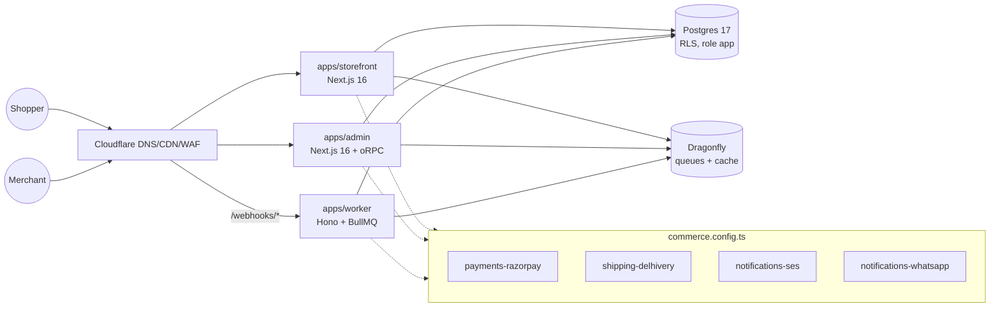
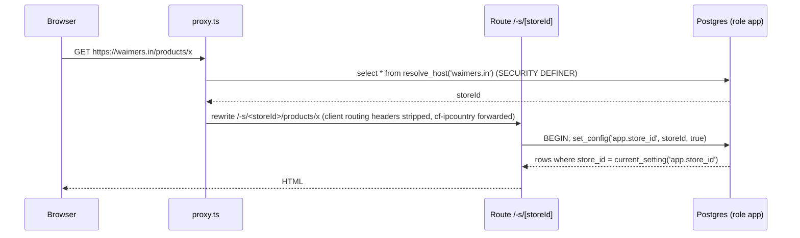
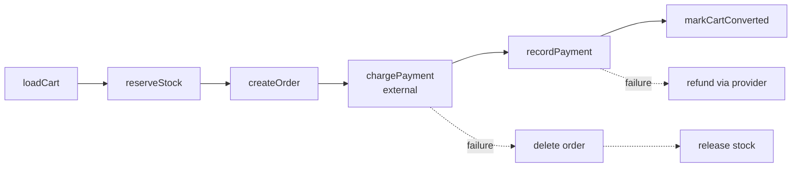
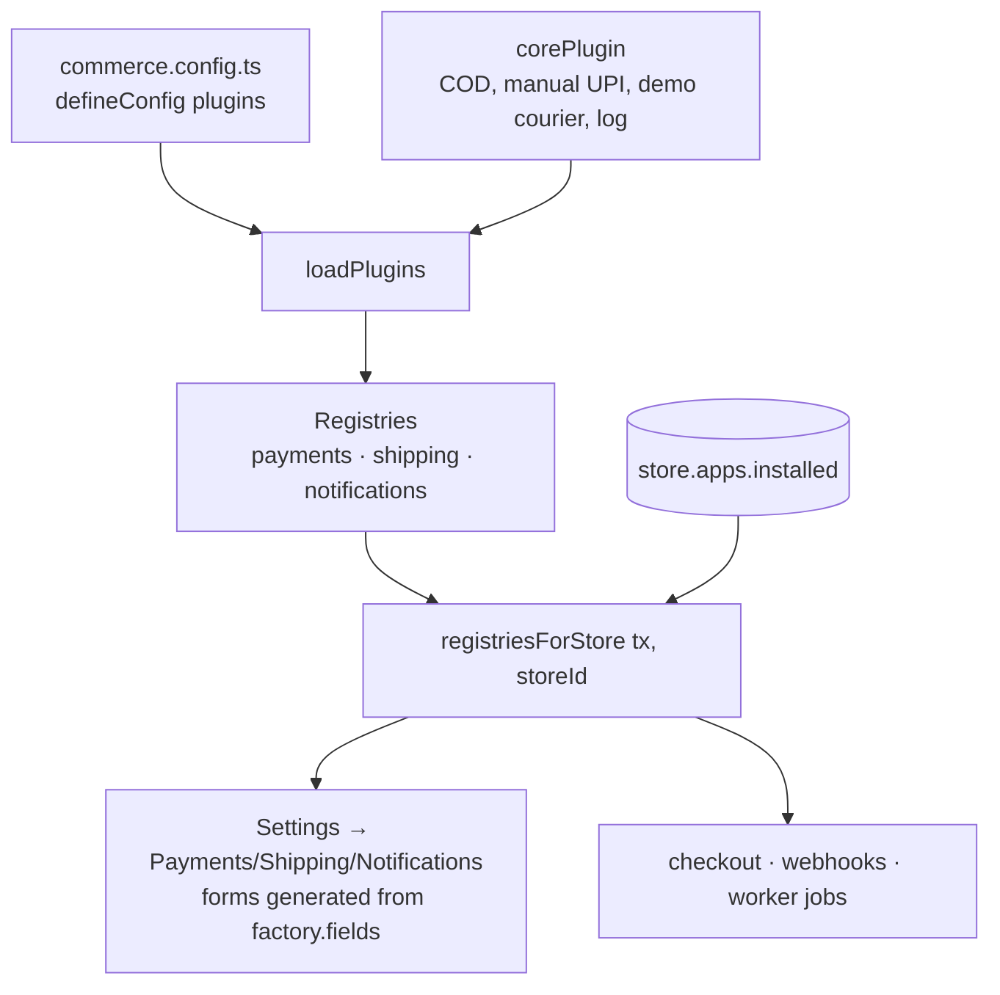
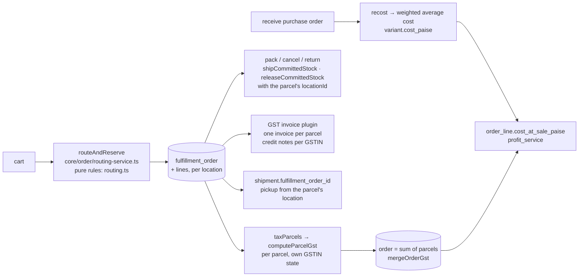

# Architecture

How the platform is built today and what keeps it multi-tenant. Sections 2–4 describe
**what exists**; section 5 points to what comes next. For a guided tour with diagrams start at
[How Koomerce works](/developer-docs/how-it-works/overview).

## 1. Goals

- **Indian D2C SaaS.** Many stores per deployment: INR, GST, UPI/COD, Delhivery,
  WhatsApp. Waimers is store #1, not a special case in code.
- **Cheapest viable infra.** One Postgres, one Dragonfly and the three apps on
  one server (Dokploy) behind Cloudflare. Every design choice must still hold when
  that becomes several Postgres clusters.
- **Plugin-first.** Gateways, couriers and channels are packages behind a
  contract, installed per store from Admin → Apps. The platform never imports
  an adapter directly (`docs/plugins.md`).
- **Boring correctness.** RLS in the database, workflows with compensation,
  idempotent webhooks, one test database per package.

## 2. Current architecture

### 2.1 System context

| Piece | Where | Notes |
|---|---|---|
| Storefront | `apps/storefront` | Host → store via `proxy.ts` rewrite to `/-s/<storeId>/…`; server actions for cart/checkout; Puck-rendered pages from `@commerce/blocks`. |
| Admin | `apps/admin` | Better Auth (email OTP + organisations; one org = one store); oRPC router in `packages/api`; Puck editor; Lexical editor. |
| Worker | `apps/worker` | Payment webhooks, notification delivery, shipment tracking poll, heartbeat. |
| Data | `packages/db` | Drizzle schema, migrations in `drizzle/` (234 files to `0249` on 15 Nov 2026), `withStore`, SECURITY DEFINER lookups. |
| Domain | `packages/core` | Workflows, settings + encrypted secrets, catalog, cart, order, payments/shipping/notifications glue, plugin registries. |
| Contracts | `packages/{payments,shipping,notifications}` | Provider interfaces, registries, conformance suites. |
| AI | `packages/ai` | One interface over the Vercel AI SDK, a platform gateway key (Vercel AI Gateway or OpenRouter), per-store quotas and metering; see [AI engine](/developer-docs/building/ai-engine). |
| Plugin host | `packages/plugins` | `definePlugin`, `defineConfig`, `loadPlugins` → registries, duplicate-id checks. |
| Queue | `packages/queue` | BullMQ/ioredis factories, named queues, Dragonfly cache helpers. |
| UI | `packages/ui`, `packages/blocks`, `packages/editor`, `packages/richtext` | shadcn shell + admin components; Zero Drift–derived storefront blocks; Lexical editor; server-safe rich-text renderer. |

### 2.2 Request flow (storefront)

Every tenant query runs inside `withStore(db, storeId, fn)`; the policy
`store_isolation` on every tenant table is what enforces isolation, not the
`where` clauses. Admin follows the same path after the membership check in
`storeProcedure` (session → organisation → `resolve_store_for_organization`).
[Request flow](/developer-docs/core-concepts/request-flow) walks through this, the admin path and
checkout-to-webhook step by step.

### 2.3 Order workflow

`placeOrder` runs as a saga through `runWorkflow` (`packages/core/src/workflow`).
Steps run in order; on failure, every completed step with a `compensate` is
undone in reverse. Property-based tests pin that invariant.

`chargePayment` and `recordPayment` are separate on purpose: a capture that
succeeded at the gateway but failed to persist must be refunded, and the split
makes the compensation for each half unambiguous. Payment-method adjustments
(COD fee, UPI discount) are recomputed server-side inside `createOrder`; the
client total is never trusted.

### 2.4 Plugin loading

A provider only exists for a store once its plugin is installed
(`store.apps`), then enabled and configured under Settings. Secrets are
AES-256-GCM encrypted at rest under `SETTINGS_SECRET` and masked in the API.

### 2.5 Parcels, routing, GST and cost

Stock, tax and cost are decided per **parcel** (a `fulfillment_order`: one order's goods from one
location under one GSTIN), not per order. An order always has at least one parcel unless it holds
only gift cards. Tables and rules are in the [data model](/developer-docs/core-concepts/data-model);
this is how the pieces connect.

- **Routing** (`routing.ts`, pure): one location with everything, else the fewest parcels up to
  `store.shipping.routing.maxParcels`, else the default location tops up and the parcel is
  flagged `needs_transfer`. `routeAndReserve` locks the variants' `inventory_level` rows and
  reserves per parcel inside `placeOrder` and `convertDraft`; it is the saga's reserve step.
- **Reading stock** goes through `sellableStock` (`packages/db/src/stock.ts`) everywhere: a
  variant may sell from several locations, and its stock is the sum of the selling ones.
- **GST** is split per parcel from its location's GSTIN (`computeParcelGst`), the order stores the
  merged figures, and the invoice plugin issues one invoice per parcel and one credit note per
  invoice a refund reduces.
- **Cost** is a separate chain: purchase orders and their charges feed `recost`
  (`core/inventory/costing.ts`), which keeps each variant's weighted average `cost_paise`;
  `placeOrder` snapshots it onto the order line (`cost_at_sale_paise`) and `profit.ts` turns
  orders into profit. Bills uploaded to a purchase order are read by the AI engine on the worker
  (`{ai}-purchase-documents` queue) and applied only after a person reviews them. See
  [AI engine](/developer-docs/building/ai-engine).
- **Short links.** The storefront route `/l/<slug>` (`app/-s/[storeId]/l/[slug]/route.ts`) counts
  the click and redirects with the link's UTM tags; attribution gained `linkId`. Tables
  `short_link` and `short_link_click_day`, rules in `@commerce/core/marketing`.
- **Theme versions.** Publishing a theme, or publishing changes to the live one, snapshots its
  templates into `theme_version` (newest 20 per template); a storefront preview link with
  `?theme-version=<batch>` renders one. See [Theme editor](/developer-docs/building/theme-editor).
- **Visitor analytics.** The Umami app (`packages/plugin-umami`) is a `connection` app: its script
  loads from `ConsentManager` after analytics consent, and the Analytics page reads Umami through
  `safeFetch`. See [Plugins SDK](/developer-docs/building/plugins).

## 3. Tenancy model

**What exists**

- Every tenant table has `store_id uuid not null`; `apply_store_rls()` (re-run
  in each migration that adds tables) enables **and forces** RLS with policy
  `store_isolation` using `current_setting('app.store_id', true)`.
- Runtime role `app` is `NOBYPASSRLS`. Cross-tenant lookups go through
  SECURITY DEFINER functions that return only ids: `resolve_host(hostname)`,
  `resolve_store_for_organization(org)`, `stores_with_open_shipments()`.
- `packages/db` has an RLS coverage test: any new table without the policy
  fails CI.
- Tests: one database per package (`commerce_test_{db,core,auth,api}`) so
  Turbo can run suites in parallel.
- Webhooks are deduplicated by `(store_id, provider, event_id)` in
  `payment_event`.

**Sharding-readiness rules** (keep these true so a pod split stays possible, section 5)

1. No query joins across stores. If you need it, it is a SECURITY DEFINER
   function that returns ids, run outside `withStore`.
2. Global tables (`user`, `organization`, `session`, `store`) are the only
   ones without `store_id`. Everything else is per store.
3. A `storeId` must be known before any tenant query — never derived from a
   row fetched without one.
4. Background jobs carry `storeId` in the payload and open their own
   `withStore` transaction.
5. IDs are UUIDv7 generated in the app, never database sequences, except
   per-store counters (`store.next_order_number` → `order.number`) that are explicitly scoped.
6. A reference written from a request (`orderId`, `segmentId`, …) is read under RLS before
   it is stored. Foreign-key checks bypass RLS, so the database alone would accept another
   store's id. The cross-store leak test (`docs/guardrails.md`) catches a missed one.

### Noisy neighbours: per-store fairness

One store's big job (a Shopify import with 5,000 images, a 50,000-recipient campaign, a
restock blast) must not make every other store wait. Two layers:

**Worker queues.** Every queue that carries store jobs has a worker `concurrency` and a
lower `perStore` cap, both in `QUEUE_LIMITS` (`packages/queue/src/index.ts`):

| Queue | Concurrency | Per store |
|---|---|---|
| notifications | 5 | 3 |
| app events | 3 | 2 |
| app jobs (imports, PDF batches) | 4 | 2 |
| marketing send | 2 | 1 |
| media processing | 2 | 1 |
| back in stock | 2 | 1 |
| store export | 2 | 1 |

`fairProcessor` (`packages/queue/src/fair.ts`) wraps each processor. Before a job runs it
takes a slot for the job's `storeId` in a Redis sorted set `fair:<queue>:<storeId>` (one
member per running job, scored by lease expiry; MULTI/EXEC, no Lua, so it works on
Dragonfly). A job whose store is at its cap is moved back to the delayed set for 1.5–3 s
(`moveToDelayed` + `DelayedError`: no attempt is used up) and the worker takes the next
job, usually another store's. When the deferred job comes back it joins the end of the
queue, so busy stores take turns with everyone else: rough round-robin, without BullMQ
Pro's groups. Slots are leases renewed by the running job, so a crashed worker's slot
lapses after a minute instead of blocking that store. The cap is shared by every worker
process, so it holds with several replicas.

Trade-off: the caps are not work-conserving. A store alone on the platform still runs at
most `perStore` jobs at once on a queue (one image at a time, for example). That is the
price of a hard guarantee; raise `perStore` for a queue if a lone store's speed matters more.

**Heavy admin actions.** Imports, bulk edits, exports and the full store export / delete
are rate-limited per store (`heavy(action)` middleware, `packages/api/src/procedures/heavy.ts`,
on the existing Dragonfly sliding-window store). Each kind is one budget per store, shared by
every button of that kind: import 20 an hour (a preview and a run count separately), bulk 60
per 10 minutes, export 30 per 10 minutes, full store data 5 an hour, AI reads of purchase
documents (`documentRead`) 30 an hour. Over budget the API
answers `TOO_MANY_REQUESTS` with a plain "try again in N minutes".

### Store export and offboarding

Settings → Store details → "Download your data" builds a zip of every table with a `store_id`
(one NDJSON file each, found from the catalogue, so new tables are included) plus the store
row, in the worker (`{store}-export` queue), into the store's own storage under
`stores/<id>/private/exports/` with a random suffix, downloadable through the API for 7 days.
Secrets are redacted; customer phones are decrypted. "Delete store" (owner only, store name
typed to confirm) deletes the store's files (`deletePrefix('stores/<id>/')` on each storage
it used), then every `store_id` row in foreign-key order (`deletionOrder`, children first,
read from `pg_constraint`), then the store row and its Better Auth organization, in one
transaction. Both write to `platform_audit_event`, a platform table the app role can insert
into but never read, so the record outlives the store. Code: `packages/core/src/store-data/`.

### Secrets keys

Provider credentials, gift card codes, import tokens and customer phones are AES-256-GCM
under `SETTINGS_SECRET`. Ciphertexts carry the key id (`v2.<keyId>.…`; legacy `v1.…` has
none and still decrypts), retired keys go in `SETTINGS_SECRET_PREVIOUS`, settings blobs are
re-encrypted under the current key whenever they are saved, and `bun run rotate-secrets`
moves everything else. Runbook: [Key rotation](/developer-docs/operations/key-rotation).

## 4. Modules and plugins

Compared with Medusa's [modules](https://docs.medusajs.com/learn/fundamentals/modules):
a Medusa module owns its tables and service and is isolated from other modules;
cross-module work happens in workflows and links. We are looser inside the
monolith (one schema, one `core` package) and stricter at the edge (adapters
are separate packages behind a contract). The pieces:

| Concept | Ours | Medusa equivalent |
|---|---|---|
| Contract | `PaymentProvider`, `ShippingProvider`, `NotificationChannel` | module provider interfaces |
| Adapter package | `@commerce/payments-razorpay` etc. with `src/plugin.ts` manifest | provider package |
| Registration | `commerce.config.ts` → `defineConfig({ plugins })` | `medusa-config.ts` modules |
| Per-store enablement | `store.apps.installed` + Settings | n/a (Medusa is single-tenant) |
| Conformance | `describePaymentProvider` etc. (offline + live env-gated) | n/a |
| Multi-step ops | `runWorkflow` with compensation | Workflows SDK |

What is **not** modular yet: catalog, cart, orders and settings live in
`packages/core` and share tables directly. That is fine for one team; the
seams to cut later are the service files under `packages/core/src/<domain>`.

## 5. What comes next

The scale roadmap that used to be here was written as a plan in September 2026; most of it is
built now (the outbox, read caching with invalidation and the Cloudflare edge cache, rate limits
and per-store queue caps, search, error tracking). What runs today is described in
[How Koomerce works](/developer-docs/how-it-works/overview); what is planned next is in
`docs/roadmap.md`.

One idea from it still shapes the code: if one database ever stops being enough, groups of stores
move to their own database (a **pod**, as Shopify does), chosen per store by a `store.pod` column.
The sharding-readiness rules in section 3 keep that possible.

## 6. Non-goals for now

- Microservices. One deployable per app is the plan until a pod split forces
  otherwise.
- Kafka or any broker beyond BullMQ on Dragonfly.
- Multi-region. India first; Cloudflare handles the edge.
- Runtime plugin installation without a deploy (marketplace). Plugins are
  npm packages listed in `commerce.config.ts`; per-store install is a flag.
- Per-tenant databases from day one. RLS in one database until a pod split is needed (section 5).

## 7. Glossary

- **Store** — a tenant. One organisation in Better Auth, one `store` row, N
  hostnames.
- **RLS** — Postgres row-level security; `store_isolation` policy on every
  tenant table.
- **`withStore`** — opens a transaction and sets `app.store_id` for it.
- **SECURITY DEFINER** — a function that runs as its owner (bypasses RLS) and
  is the only sanctioned way to look across stores.
- **Workflow / compensation** — ordered steps with undo actions run in reverse
  on failure (`runWorkflow`).
- **Plugin / provider / factory** — plugin = npm package with a manifest;
  provider = an implementation of a contract; factory = builds a provider from
  a store's settings and declares its form `fields`.
- **Registry** — the set of factories for one contract, filtered per store by
  installed apps.
- **Outbox** — events written in the same transaction as the change and
  relayed asynchronously by the worker (`outbox_event`, built; see
  [Worker and jobs](/developer-docs/how-it-works/worker-and-jobs)).
- **Pod** — a fully isolated datastore for a group of stores (an idea, not built; section 5).
