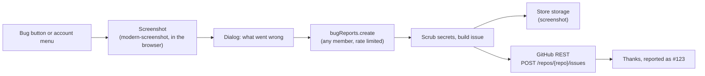
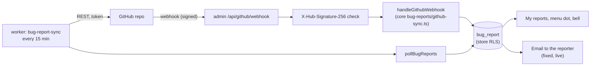

# Bug reports ("Report a bug")

On the **test server only**, every signed-in admin member (owner, admin and staff alike) gets a
**Report a bug** button: a small round bug button at the bottom left of the page, and the same
item in the account menu (top right). One report becomes one GitHub issue in
`Viora-Tech/e-commerce`, labelled `bug` and `test-server`. We built it ourselves (no Sentry or
other SaaS); the only outside piece is [modern-screenshot](https://github.com/qq15725/modern-screenshot)
(MIT) for the picture.

## What a report holds

| From | What |
| --- | --- |
| The member | "What went wrong?" (required, up to 200 characters), "What were you doing just before?" (optional, up to 4000) |
| The page | Page path and query, window size, browser, the last 20 errors this tab saw (uncaught errors, unhandled promise rejections, `console.error`), and a screenshot when the box is ticked |
| The server | Store name and id, reporter name, email and role, the commit (`SOURCE_COMMIT`, else `SENTRY_RELEASE`, else "unknown"), time in IST |

The screenshot is taken **before** the dialog opens, so the dialog is not in it; the floating
button and password fields are left out. It is a PNG (a JPEG when the PNG would be over 2 MB),
uploaded through the store's own storage connection (the same one media uses) under
`stores/<storeId>/bug-reports/<random>.png`, and linked in the issue. Closing a store deletes it
with the rest of the store's files.

Before anything is sent, the server removes what looks like a secret from every piece of text:
`key=value` pairs whose name says token, secret, password or key, `Bearer` tokens, six-digit
codes next to "code" / "OTP" / "PIN", and long hex or mixed-case base64 runs. `@name` mentions are
defused so a report never pings someone on GitHub.

Each person can send 10 reports an hour.

## How it works

- Client: `apps/admin/src/components/bug-report/` (host + dialog), `lib/capture-page.ts`
  (screenshot; the library loads only when a picture is taken), `lib/client-errors.ts` (the error
  ring buffer, installed once in `instrumentation-client.ts` so it catches errors from page
  load, hydration included; it never reads input values and logs objects by type name only).
  Copy: `data/bug-report.ts` + `data/hi/bug-report.ts`.
- Server: `packages/api/src/routers/bug-reports.ts` on `storeProcedureDetached` (membership, no
  permission, no transaction held while GitHub answers) and
  `packages/api/src/services/bug-report.service.ts`. GitHub's `fetch` is injected through the API
  context (`githubFetch`), so tests never reach GitHub.

## Turning it on (test server)

Set on the **admin** app in Dokploy (add one key at a time; never paste a whole env):

| Key | Value |
| --- | --- |
| `BUG_REPORTS_ENABLED` | `true` (default `false`) |
| `GITHUB_ISSUES_TOKEN` | the fine-grained token below |
| `GITHUB_ISSUES_REPO` | optional, default `Viora-Tech/e-commerce` |
| `SOURCE_COMMIT` | optional, the deployed commit; else `SENTRY_RELEASE`, else "unknown" |

A blank value counts as unset. With `BUG_REPORTS_ENABLED=true` and no token, **production refuses
to start** (`Invalid environment: GITHUB_ISSUES_TOKEN (...)`), because a report written only to a
log would be lost. In **development** the would-be issue (title and body) is printed to the admin's
server console instead, and the toast says so.

### The token

GitHub → Settings → Developer settings → Fine-grained tokens → Generate:

- **Resource owner**: Viora-Tech. **Repository access**: only `Viora-Tech/e-commerce`.
- **Permissions**: Repository → **Issues: Read and write** and **Contents: Read** (the status
  sync reads which commit closed an issue and whether it reached `main`). Nothing else
  (Metadata: read is added automatically). No writing code, no pull requests, no admin.
- Set an expiry and note it; when it expires reports fail with "GitHub did not take the report".

Only the labels `bug` and `test-server` are sent: GitHub refuses a label that does not exist.

## Privacy

Screenshots can show store data: customer names, order totals, addresses. That is why the button
is for the **test server only** (keep `BUG_REPORTS_ENABLED` off on the live server) and the dialog
says "It may show store details". The screenshot link is unguessable but public to anyone who has
it, and the issue lives in a private repository. Members can untick the screenshot before sending.

## Report status (Account → My reports)

Every report is also saved in the store's `bug_report` table (migration `0187_bug_report`) beside
its issue number, so the reporter can follow it in the admin without access to the private repo.
GitHub stays where the team works; the admin only reads the outcome.

| Status | Set when |
| --- | --- |
| `received` | The report is filed |
| `in_progress` | The issue gets the `in-progress` label, or a closed issue is reopened |
| `fixed` | The issue is closed as completed (normally by a fix PR merged into `dev` that says `Fixes #n`) |
| `live` | The commit that closed it is in `main` (a release went out). An issue closed by hand goes live with the next push to `main` |
| `wont_fix` | The issue is closed as *not planned*, or gets the `wontfix` label |

`live` never steps back to `fixed`, and a reopen always wins. The rules are pure functions in
`packages/core/src/bug-reports/sync.ts` (`nextBugReportStatus`, `statusFromIssue`).

**The team's reply.** The latest comment by an OWNER, MEMBER or COLLABORATOR is shown to the
reporter, secrets scrubbed, at most 4000 characters. Start a comment with `internal:` to keep it
between the team. Editing a comment updates the reply; deleting it, or editing it to start with
`internal:`, clears it.

### How the status gets here

- **Webhook** (`apps/admin/src/app/api/github/webhook/route.ts`): every delivery's
  `X-Hub-Signature-256` is an HMAC-SHA256 of the raw body with `GITHUB_WEBHOOK_SECRET`, compared
  in constant time; a missing or wrong signature gets 401 and changes nothing. With no secret set
  the route answers 404. Deliveries from any repository other than `GITHUB_ISSUES_REPO` are
  ignored, repeats of a delivery id are skipped, and the route is rate limited.
- **Poll** (`apps/worker/src/bug-report-sync.ts`): only with `GITHUB_ISSUES_TOKEN`. Every 15
  minutes it re-reads up to 40 open reports' issues that were not synced in the last 10 minutes,
  so a missed webhook catches up. A 401 or 403 stops the run.
- Every change is idempotent: the same status twice is a no-op, so retries, the poll and the
  webhook never double-notify.
- **The token** is read from `GITHUB_ISSUES_TOKEN` and lives only inside the GitHub client
  (`packages/core/src/bug-reports/github.ts`). Its errors carry the HTTP status only; the token
  is never logged or returned.

### Store isolation

`bug_report` has a `store_id` and gets the usual row-level security (`apply_store_rls()`), so
every read and write runs inside `withStore` and a store only ever sees its own reports. The
webhook names an issue, not a store: two `SECURITY DEFINER` functions return only store ids
(`bug_report_stores_for_issue`, `stores_with_bug_reports`), and each store's rows are then read
under that store's RLS. In the admin a member sees their own reports; the owner can also list
the whole store's (`bugReports.list` with `scope: 'store'`).

### Telling the reporter

- **My reports** (`/account/bug-reports`, linked from the account menu) lists the reports and
  marks changed ones **New**. The account menu shows a dot while a report has news
  (`bugReports.unreadCount`, re-asked every 5 minutes); opening the page calls
  `bugReports.markSeen`.
- **The bell** lists the member's own reports that turned fixed or live this week.
- **Email** (`bug_report_update`, from the platform email account) when a report turns fixed or
  live, only while the member keeps **Your bug reports → Email** on in Account → Notifications
  (`bugReports` in the member alert prefs; on by default for everyone, since it is only about
  their own report). Email only: the store's WhatsApp number is not used for platform messages.

### Webhook setup (test server)

1. Make a secret: `openssl rand -hex 32`. Set it as `GITHUB_WEBHOOK_SECRET` on the **admin** app
   in Dokploy (one key at a time). Set `ADMIN_URL` there and on the worker too, for the email's
   button.
2. GitHub → the repository → Settings → Webhooks → Add webhook:
   - **Payload URL**: `<ADMIN_URL>/api/github/webhook`
   - **Content type**: `application/json`
   - **Secret**: the same value
   - **Events**: *Let me select individual events* → **Issues**, **Issue comments**, **Pushes**,
     **Pull requests**.
3. GitHub sends a ping; the route answers `ok` with change `ignore`. "Recent Deliveries" shows a
   401 if the secrets differ.

The worker needs `GITHUB_ISSUES_TOKEN` (and `GITHUB_ISSUES_REPO` if not the default) for the poll.

### Not built yet

A staff page to set a status and reply from the admin (`/platform/reports`) waits for the staff
console (PR #952). Until then, reply and change status on GitHub; the admin follows.

## Where reports go next

Every bug is a GitHub issue; fix PRs say `Fixes #<n>`. Before a `dev` → `main` release, run the
smoke checklist (Operations → Release checklist) and file failing rows the same way.
