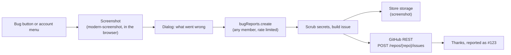

# Bug reports ("Report a bug")

On the **test server only**, every signed-in admin member (owner, admin and staff alike) gets a
**Report a bug** button: a small round bug button at the bottom left of the page, and the same
item in the account menu (top right). One report becomes one GitHub issue in
`Viora-Tech/e-commerce`, labelled `bug` and `test-server`. We built it ourselves (no Sentry or
other SaaS); the only outside piece is [modern-screenshot](https://github.com/qq15725/modern-screenshot)
(MIT) for the picture.

## What a report holds

| From | What |
| --- | --- |
| The member | "What went wrong?" (required, up to 200 characters), "What were you doing just before?" (optional, up to 4000) |
| The page | Page path and query, window size, browser, the last 20 errors this tab saw (uncaught errors, unhandled promise rejections, `console.error`), and a screenshot when the box is ticked |
| The server | Store name and id, reporter name, email and role, the commit (`SOURCE_COMMIT`, else `SENTRY_RELEASE`, else "unknown"), time in IST |

The screenshot is taken **before** the dialog opens, so the dialog is not in it; the floating
button and password fields are left out. It is a PNG (a JPEG when the PNG would be over 2 MB),
uploaded through the store's own storage connection (the same one media uses) under
`stores/<storeId>/bug-reports/<random>.png`, and linked in the issue. Closing a store deletes it
with the rest of the store's files.

Before anything is sent, the server removes what looks like a secret from every piece of text:
`key=value` pairs whose name says token, secret, password or key, `Bearer` tokens, six-digit
codes next to "code" / "OTP" / "PIN", and long hex or mixed-case base64 runs. `@name` mentions are
defused so a report never pings someone on GitHub.

Each person can send 10 reports an hour.

## How it works

- Client: `apps/admin/src/components/bug-report/` (host + dialog), `lib/capture-page.ts`
  (screenshot; the library loads only when a picture is taken), `lib/client-errors.ts` (the error
  ring buffer, installed once in `instrumentation-client.ts` so it catches errors from page
  load, hydration included; it never reads input values and logs objects by type name only).
  Copy: `data/bug-report.ts` + `data/hi/bug-report.ts`.
- Server: `packages/api/src/routers/bug-reports.ts` on `storeProcedureDetached` (membership, no
  permission, no transaction held while GitHub answers) and
  `packages/api/src/services/bug-report.service.ts`. GitHub's `fetch` is injected through the API
  context (`githubFetch`), so tests never reach GitHub.

## Turning it on (test server)

Set on the **admin** app in Dokploy (add one key at a time; never paste a whole env):

| Key | Value |
| --- | --- |
| `BUG_REPORTS_ENABLED` | `true` (default `false`) |
| `GITHUB_ISSUES_TOKEN` | the fine-grained token below |
| `GITHUB_ISSUES_REPO` | optional, default `Viora-Tech/e-commerce` |
| `SOURCE_COMMIT` | optional, the deployed commit; else `SENTRY_RELEASE`, else "unknown" |

A blank value counts as unset. With `BUG_REPORTS_ENABLED=true` and no token, **production refuses
to start** (`Invalid environment: GITHUB_ISSUES_TOKEN (...)`), because a report written only to a
log would be lost. In **development** the would-be issue (title and body) is printed to the admin's
server console instead, and the toast says so.

### The token

GitHub → Settings → Developer settings → Fine-grained tokens → Generate:

- **Resource owner**: Viora-Tech. **Repository access**: only `Viora-Tech/e-commerce`.
- **Permissions**: Repository → **Issues: Read and write**. Nothing else (Metadata: read is
  added automatically). No code, no pull requests, no admin.
- Set an expiry and note it; when it expires reports fail with "GitHub did not take the report".

Only the labels `bug` and `test-server` are sent: GitHub refuses a label that does not exist.

## Privacy

Screenshots can show store data: customer names, order totals, addresses. That is why the button
is for the **test server only** (keep `BUG_REPORTS_ENABLED` off on the live server) and the dialog
says "It may show store details". The screenshot link is unguessable but public to anyone who has
it, and the issue lives in a private repository. Members can untick the screenshot before sending.

## Where reports go next

Every bug is a GitHub issue; fix PRs say `Fixes #<n>`. Before a `dev` → `main` release, run the
smoke checklist (Operations → Release checklist) and file failing rows the same way.
