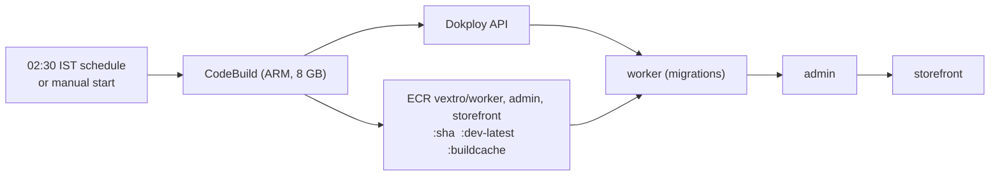

# Builds on CodeBuild

Production images are built by AWS CodeBuild instead of on the server. CodeBuild (ARM, same
architecture as the t4g server) builds them, pushes them to Amazon ECR, and then rolls them out
through the Dokploy API. The server only pulls and restarts, so a build can no longer starve
production of memory.

<Callout type="warning">
  **Status (10 October 2026): code only.** The scripts and this guide are in the repo. No AWS
  resource has been created yet, Dokploy still builds on the server, and the Dokploy field names
  the deploy script uses come from the API's tool schemas, not from a run against the live
  server. The first real run should use `SKIP_DEPLOY=1` (see "Try it safely"), then one app.
</Callout>



Code lives in `deploy/codebuild/`: `buildspec.yml`, `detect-changes.sh`, `build-images.sh`,
`deploy-dokploy.mjs`. The AWS CLI commands to create every resource are in
[`deploy/codebuild/README.md`](https://github.com/Viora-Tech/e-commerce/blob/main/deploy/codebuild/README.md).

## What a run does

1. Logs in to ECR and picks the apps to build: those whose own folder or shared inputs
   (`packages/`, `patches/`, lockfile, root configs) changed since the app's last deployed
   commit. That commit is stored in SSM at `/vextro/deploy/last-sha/<app>` and only updated after
   the app deployed healthy. A missing value builds the app. `BUILD_ALL=1` builds all three.
2. Builds each image with BuildKit; layers are cached in ECR (`:buildcache` tag), so a code-only
   change skips the dependency install. Tags: `:<git sha>` and `:dev-latest`.
3. For each built app, in order worker, admin, storefront: sets the Dokploy application's Docker
   image to `<ecr>/vextro/<app>:<sha>`, deploys, waits until the deployment is done, optionally
   probes `HEALTH_URL_<APP>`, then moves on. The first failure stops the run, so a broken worker
   migration never reaches admin or storefront.

## Environment

| Variable | Kind | Purpose |
| --- | --- | --- |
| `AWS_ACCOUNT_ID`, `ECR_PREFIX` | plain, on the project | ECR address |
| `NEXT_PUBLIC_WORKER_URL` | SSM, public | Admin build-arg, inlined into the browser bundle |
| `DOKPLOY_URL`, `DOKPLOY_APP_ID_WORKER/ADMIN/STOREFRONT` | SSM | Where to deploy |
| `DOKPLOY_API_KEY` | Secrets Manager `vextro/dokploy` | Dokploy API auth |
| `BUILD_ALL`, `SKIP_DEPLOY`, `HEALTH_URL_*` | plain, optional | Overrides |

No secret is needed at build time: the only build-arg is the public `NEXT_PUBLIC_WORKER_URL`, and
Sentry source-map upload is disabled in both apps, so there is no `SENTRY_AUTH_TOKEN`. Runtime
secrets stay in Dokploy's environment, never in an image.

## AWS resources

- 3 ECR repositories `vextro/worker`, `vextro/admin`, `vextro/storefront` with a lifecycle policy
  keeping the last 25 images (20 releases plus the cache tag).
- CodeBuild project `vextro-images`: ARM container, `BUILD_GENERAL1_LARGE` (the admin build needs
  more than 4 GB), privileged mode, full git clone depth.
- IAM role: ECR push to those repos, CloudWatch Logs, SSM read on `/vextro/deploy/*` (write only
  on `last-sha/*`), Secrets Manager read on `vextro/dokploy`.
- SSM parameters and one secret as above.
- EventBridge rule `cron(0 21 * * ? *)` (02:30 IST) starting the project. Manual start any time.
  An optional push-to-dev webhook is possible but deliberately off.

## Switching Dokploy to the images (one app at a time)

Do this off-hours, worker first, and only after one `SKIP_DEPLOY=1` build has pushed images.

1. For the app, Dokploy, Provider tab: choose **Docker**. Image `<ecr>/vextro/<app>:dev-latest`.
2. Registry: leave the credentials empty. `deploy-dokploy.mjs` writes a fresh ECR login on every
   deploy (username `AWS`, password from `aws ecr get-login-password`). Tokens last 12 hours,
   which only matters for a manual Redeploy that must pull a new layer; the image stays cached on
   the server. This is safer than a long-lived IAM user key stored in Dokploy. If you later need
   hands-off manual pulls, create an IAM user with read-only ECR on these repos instead and put its
   key in Dokploy (it never expires, so rotate it).
3. Keep the app's environment, domains and ports as they are. The container port stays the same
   (admin 3200, storefront 3100, worker 4100).
4. Deploy once from the dashboard, check the app is healthy, then do the next app.
5. Copy each application id into the SSM parameters.

Until an app is switched, its server-side build path keeps working untouched.

## Rollback

Every build is tagged with its git sha. In Dokploy set the app's image to
`<ecr>/vextro/<app>:<previous sha>` and press Deploy. Also reset
`/vextro/deploy/last-sha/<app>` to that sha so the next night rebuilds what you rolled back from.
Schema migrations run in the worker and are forward-only: roll the worker back only if the older
code works with the newer schema.

## Retiring the server nightly cron

After all three apps are switched and a full night has run clean:

```bash
sudo rm /etc/cron.d/nightly-deploy /usr/local/bin/nightly-deploy.sh
sudo rm -r /var/lib/nightly-deploy   # optional, keeps history if you leave it
```

Keep `/etc/cron.d/protect-live-apps`. Remove the deploy key from the repo settings if nothing
else uses it, and update the "Test server deploys" paragraph in the Deployment page.

## Cost (estimate, ap-south-1, check current prices)

| Item | Per month |
| --- | --- |
| CodeBuild ARM large, about 6 to 15 min a night, only when something changed | $3 to $10 |
| ECR storage, roughly 3 repos x 25 images, compressed | $1 to $3 |
| EventBridge, SSM standard parameters, Secrets Manager (1 secret) | about $0.50 |
| CloudWatch Logs | under $1 |
| Total | about $5 to $15 |

## Try it safely

Start a build with `SKIP_DEPLOY=1`. It builds and pushes only; compare the image in ECR, and run
it locally with `docker run` if you like. Nothing on the server changes.
