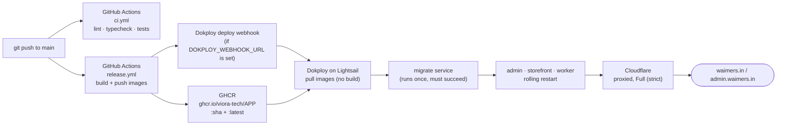

# Deployment

Production runs on **one AWS Lightsail server** (Mumbai region, 8 GB RAM / 2 vCPU burstable,
Ubuntu 24.04) running **Dokploy** (self-hosted PaaS, Apache-2.0 core — we don't use any of its
paid enterprise features). **Nothing is built on the server.** GitHub Actions
(`.github/workflows/release.yml`) builds every image, pushes it to the GitHub Container Registry
(GHCR), then calls Dokploy's deploy webhook; Dokploy only pulls the new images and restarts.
`.github/workflows/ci.yml` runs lint/typecheck/tests separately. **Both are paused to manual runs
(2026-10-02):** start them from the repo's Actions tab → "Run workflow"; checks run locally before
each PR. Restore their `push`/`pull_request` triggers to make them automatic again. Domains sit behind Cloudflare (proxied, Full (strict) SSL).



Why off the server: the first version of this setup (PR #173) had Dokploy run
`docker compose build` on the same 8 GB box that serves traffic. Building the admin alone used
about 7 GB and crashed Docker. Building in GitHub Actions keeps the box's memory for the running
apps.

### Images

`release.yml` builds five images from the monorepo root, in parallel, with the Docker layer cache
kept in the GitHub Actions cache (one scope per image):

| Image | Dockerfile | Used by |
| --- | --- | --- |
| `ghcr.io/viora-tech/admin` | `apps/admin/Dockerfile` | `admin` |
| `ghcr.io/viora-tech/storefront` | `apps/storefront/Dockerfile` | `storefront` |
| `ghcr.io/viora-tech/worker` | `apps/worker/Dockerfile` | `worker` |
| `ghcr.io/viora-tech/tasks` | `deploy/Dockerfile.tasks` | `migrate`, `backup`, restore, key rotation |

Each is tagged with the full commit sha and `latest`. The compose file runs
`${IMAGE_TAG:-latest}`, with `pull_policy: always` so a redeploy really fetches the new `latest`.

## Branches: `dev` and `main`

| Branch | What goes in | Deployed to |
| --- | --- | --- |
| `feat/…`, `fix/…` | One piece of work. Start from `origin/dev`. | nowhere |
| `dev` (default branch) | Every reviewed PR is merged here first. Several features collect here and are tested together. | test server (vioratech.in) |
| `main` | Only a release PR `dev` → `main`, once `dev` has been checked on the test server. | production |

- Open PRs with `--base dev` (it is the default, so `gh pr create` does this).
- After a PR merges, GitHub deletes its branch automatically (`delete_branch_on_merge`). `dev`
  is never deleted because it is the default branch.
- Hotfix for production: branch from `main`, PR into `main`, then merge `main` back into `dev`.
- The org is on GitHub Free, so branch protection rules aren't available on this private repo;
  the rule above is a convention, kept by review.

### Test server deploys (vioratech.in)

<Callout type="info">
  Code for moving image builds off this server (CodeBuild builds ARM images, pushes them to ECR
  and calls the Dokploy API to deploy one app at a time) is in the repo, but no AWS resource
  exists yet and Dokploy still builds on the server. Until the apps switch to the Docker
  provider, this section describes what runs. See [Builds on CodeBuild](/developer-docs/operations/codebuild)
  and [`deploy/codebuild/README.md`](https://github.com/Viora-Tech/e-commerce/blob/main/deploy/codebuild/README.md).
</Callout>

The test server is one EC2 machine running Dokploy, which builds the apps from `dev` with their
Dockerfiles. Builds are heavy, so:

- **No instant deploys.** Auto-deploy is off. `/usr/local/bin/nightly-deploy.sh` runs at
  02:30 IST (`/etc/cron.d/nightly-deploy`): worker first (it runs migrations), then admin, then
  storefront, **one at a time**, and **only apps whose watch paths changed** since their last
  deploy. It reads the repo with a read-only GitHub deploy key and keeps the last deployed commit
  per app in `/var/lib/nightly-deploy/<applicationId>.sha`. Log: `/var/log/nightly-deploy.log`;
  `nightly-deploy.sh --dry-run` shows what would deploy.
- **Need it now?** Press Deploy on the app in Dokploy.
- **Live apps first.** Running containers get CPU priority over builds
  (`/etc/cron.d/protect-live-apps`) and a memory reservation each.
- Environment variables live only in Dokploy. Add or change one key at a time; never paste a
  whole new env over an app's existing one.

## Server sizing and why

8 GB / 2 vCPU is the smallest Lightsail plan that comfortably fits Postgres, Dragonfly, three
Next/Bun app containers and Dokploy itself with headroom for traffic bursts — see the memory
budget at the top of `deploy/docker-compose.prod.yml`. Everything here (Postgres tuning, memory
limits) assumes this single box; if traffic outgrows it, Postgres and the apps split onto
separate instances before anything else changes.

### CPU for the worker

Shoppers and the worker share the box's two vCPUs. Image processing and imports can use all of
them: in October 2026 an image backlog held the worker at 200% CPU and store pages went from
about 1 s to 3 to 5 s. Docker splits CPU evenly between busy containers, and `nice` inside a
container only reorders that container's own threads, so the limit has to be set on the service.

In Dokploy, each application → **Advanced → Resources** (values are Docker's raw units:
`1000000000` NanoCPUs = 1 CPU), then **Deploy** the app for it to take effect:

| App | CPU limit | CPU reservation |
| --- | --- | --- |
| worker | `1000000000` (1 CPU) | empty |
| storefront | empty | `500000000` (0.5 CPU) |
| admin | empty | `250000000` |
| postgres | empty | `500000000` |

The worker's **limit** is what keeps the shop fast: whatever the worker does, at least one CPU
stays free for the storefront, admin and Postgres. Reservations only tell Swarm where a task
fits; on one box they document intent. Also set `MEDIA_PROCESS_CONCURRENCY=1` on the worker on a
2-vCPU box. A bigger box: raise the worker limit to half its CPUs and the concurrency with it.

`deploy/docker-compose.prod.yml` already caps the worker (`cpus: 1.0`) for setups that run the
compose file directly.

While a backlog runs, the admin tells the merchant (Home, Content → Files, the importer): see
[Image pipeline → The "store may be slower" notice](/developer-docs/building/media-pipeline#the-store-may-be-slower-notice).

## 1. Create the Lightsail instance

1. Region: **ap-south-1 (Mumbai)** — lowest latency to Indian shoppers and payment/shipping
   providers.
2. Blueprint: **Ubuntu 24.04 LTS**, plan: **8 GB RAM / 2 vCPU** (the "Large" bundle at time of
   writing).
3. Attach a **static IP** to the instance (Lightsail → Networking → Create static IP) before
   pointing any DNS at it — the instance's default public IP changes on stop/start.
4. Firewall (Lightsail → Networking → instance → Firewall):
   - `22` (SSH) — restrict to your IP if it's static, otherwise leave open with key-only auth.
   - `80`, `443` (HTTP/HTTPS) — Traefik (Dokploy's built-in reverse proxy).
   - `3000` — **temporarily**, only while installing and first configuring Dokploy (its own
     dashboard). Remove this rule once you've set up a domain + SSL for the Dokploy dashboard
     itself, or at least re-restrict it to your IP.
5. SSH in and apply OS updates: `sudo apt update && sudo apt upgrade -y`, then reboot if the
   kernel updated.

## 2. Install Dokploy

Use the official one-line installer from the Dokploy docs — don't paste a script from memory or
a blog post:

**https://docs.dokploy.com/docs/core/installation**

Follow that page's steps as of your install date; it changes over time. After it finishes,
Dokploy's dashboard is on port `3000` (see firewall step above). Create your admin account
immediately — the setup wizard is unauthenticated until you do.

## 3. GitHub and GHCR

**Repository settings** (GitHub → `Viora-Tech/e-commerce` → Settings → Secrets and variables →
Actions):

- Secret `DOKPLOY_WEBHOOK_URL`: the Compose application's deploy webhook (Dokploy → the Compose
  application → Deployments → Webhook URL; it exists once step 4 is done). Without it,
  `release.yml` still builds and pushes the images and just skips the deploy step, so you can
  add it last.
- Variable `NEXT_PUBLIC_WORKER_URL`: the public worker URL (same value as in Dokploy's env).
  Next bakes `NEXT_PUBLIC_*` into the admin's browser bundle when the image is built, so it has
  to be known to the build, not only at runtime.

No registry secret is needed for pushing: the workflow logs in to GHCR with its own
`GITHUB_TOKEN` (`packages: write`).

**Let the server pull from GHCR.** Packages pushed from a private repo are private, so the server
needs a read-only login once:

1. On GitHub, create a **classic personal access token** with only the `read:packages` scope
   (fine-grained tokens don't cover GHCR yet), ideally from a bot/machine account with read access
   to the org's packages. Store it in your password manager.
2. Either add it in Dokploy → Settings → **Registry** (registry URL `ghcr.io`, your GitHub
   username, the token as password), or SSH in and log Docker in directly — this works for
   Compose applications on every Dokploy version:

   ```sh
   echo "<token>" | sudo docker login ghcr.io -u <github-username> --password-stdin
   ```

3. Check it: `sudo docker pull ghcr.io/viora-tech/worker:latest` (after the first `release.yml`
   run) must succeed.

When the token expires or is revoked, pulls fail and redeploys keep the old containers running;
repeat step 2 with a new token.

**Dokploy's own GitHub connection** is still used, but only to read
`deploy/docker-compose.prod.yml` and `deploy/postgres/init.sh` from the repo on each deploy:
Dokploy → Settings → Git Providers → **GitHub** → install the Dokploy GitHub App on the
`Viora-Tech` org (or use a fine-grained PAT), scoped to the `e-commerce` repo.

## 4. Create the application in Dokploy

1. New Project → new **Compose** application (not "Application" — Compose lets us paste
   `deploy/docker-compose.prod.yml` directly instead of Dokploy inferring one service).
2. Point it at the GitHub connection from the previous step, branch `main`, and its "Compose
   Path" at `deploy/docker-compose.prod.yml` in this repo — Dokploy pulls the file from git on
   each deploy, so updates to the compose file itself ship through a normal PR + merge, no
   manual UI edits.
3. Environment: paste `deploy/env.production.example` into Dokploy's environment editor and
   fill in every value (never leave a required one blank — see that file's comments for what
   each key does and docs/security/data-protection.md for the secrets specifically).
4. **Volumes**: `pgdata` and `dragonflydata` (named volumes in the compose file) persist across
   redeploys automatically — Dokploy doesn't recreate named volumes on redeploy, only
   containers. Don't rename them once created, or you'll start from an empty database.
5. **Turn auto-deploy off** for this application (Deployments settings). `release.yml` calls the
   deploy webhook after the images are pushed; Dokploy's own auto-deploy on push would fire
   minutes earlier, before the new images exist, and just restart the old `latest`.
6. Copy the application's **Webhook URL** into the `DOKPLOY_WEBHOOK_URL` repo secret (step 3).

## 5. First deploy

1. Make sure `release.yml` has run at least once on `main` (GitHub → Actions → Release) so the
   images exist in GHCR, then trigger a deploy from the Dokploy UI (the first one is manual).
   Dokploy pulls each image and starts the services — no build happens on the box.
2. Watch the logs: `postgres` and `dragonfly` come up healthy, then `migrate` runs once and must
   exit `0` before `admin`, `storefront` and `worker` start — this ordering is
   `depends_on: service_completed_successfully` in the compose file, not a manual step. If
   `migrate` fails, the other three never start; fix the cause (usually a bad `DATABASE_URL` or
   an env var typo) and redeploy.
3. Confirm health: `admin`, `storefront` and `worker` each have a container healthcheck hitting
   `/api/health` (apps) or `/health` (worker) — Dokploy's UI shows them green once Postgres and
   Dragonfly both answer.
4. Seed data only if this is a brand-new database (a fresh production database is not
   auto-seeded — that's a `bun run db:seed` step you run once, deliberately, the same commands
   as `docs/handoff.md`, against `DATABASE_URL_OWNER`).

## 6. Domains and Cloudflare

1. In Dokploy, add domains to the `admin` and `storefront` services (or rely on the Traefik
   labels already in the compose file, which read `ADMIN_DOMAIN`/`STOREFRONT_DOMAIN` from env —
   either path ends up with the same Traefik router).
2. In Cloudflare DNS: `A` record for `waimers.in` (and `www`) and `admin.waimers.in`, both
   pointed at the Lightsail static IP, **proxied (orange cloud) on**.
3. Cloudflare SSL/TLS mode: **Full (strict)**. This requires Traefik to present a real
   certificate, not a self-signed one — Dokploy's Traefik does this with its own Let's Encrypt
   integration (the `letsencrypt` certresolver referenced in the compose file's labels).
   Confirm certs issue correctly before flipping SSL mode to strict, or you'll get a
   Cloudflare 526 loop.
4. Cloudflare Page Rules/Rulesets: none required to start; add caching/security rules later as
   needed.

### Merchants' own domains

Set `DOMAIN_PROVIDER=dns`, `STOREFRONT_A_RECORD` (this server's public IPv4) and
`STOREFRONT_CNAME_TARGET` (a hostname that resolves to it) on the admin and worker; with the
default `dev` provider real domains stay pending forever. Each domain that goes live also needs
its own HTTPS route on the storefront app in Dokploy. Set `DOKPLOY_URL`, `DOKPLOY_API_KEY`,
`DOKPLOY_STOREFRONT_APPLICATION_ID` (and `DOKPLOY_STOREFRONT_PORT` if not `3100`) on the worker
and it adds and removes those routes itself; unset, add each domain by hand. How to create the
key and find the id, plus troubleshooting: [Custom domains](/developer-docs/building/custom-domains).

### Lock the origin to Cloudflare (required)

Per-IP rate limits (sign-in codes, checkout, gift card checks, newsletter, webhooks) key on the
client IP. Behind Cloudflare the real IP is in `cf-connecting-ip`, but anyone who reaches the
server directly can send that header with any value and get a fresh limit per request. So:

1. In the Lightsail console, **Networking → IPv4 (and IPv6) firewall**: allow 80 and 443 only
   from [Cloudflare's published ranges](https://www.cloudflare.com/ips/) (`ips-v4` and
   `ips-v6`). Keep 22 for your own IP. Recheck the list when Cloudflare announces changes.
2. Set `TRUSTED_PROXY=cloudflare` in the environment (it is in
   `deploy/env.production.example`). The apps then read `cf-connecting-ip` and nothing else.

To let Cloudflare cache store pages as well, add the cache rule in
[Storefront performance → Cloudflare in front](/developer-docs/building/performance#cloudflare-in-front).

`TRUSTED_PROXY=none` (the default, and right for local development) believes no forwarded
header at all: `cf-connecting-ip`, `x-forwarded-for` and `x-real-ip` are ignored. The worker
then uses the socket's peer address; a Next.js server action has none, so all of its requests
share one bucket (limits get tighter, never bypassable). Production logs a warning once if it
runs like that. Better Auth's own IP tracking (admin sign-in) follows the same setting.

### Outbound network

Postgres, Dragonfly and `migrate` sit only on the `internal` network, which has no route out.
`worker` (payment gateways, couriers, SES, WhatsApp) and `backup` (R2/S3) also join `egress`,
an ordinary bridge network that publishes no ports. `admin` and `storefront` reach the internet
through Dokploy's `web` network. `scripts/sweeps/deploy-compose.test.ts` keeps it that way and
checks every app setting in `packages/config/src/env.ts` reaches the apps.

## 7. Deploy order (migrate-then-roll) and zero downtime

`migrate` always runs to completion before any app container starts or restarts — this is what
makes a schema change safe to ship in the same release as the code that depends on it. Rolling
restarts (`admin`/`storefront`: `deploy.update_config.order: start-first`) start the new
container, wait for its healthcheck, then stop the old one — no window where neither is
serving traffic. `worker` has no such window to protect (BullMQ jobs are retried, not
user-facing requests) so it restarts the plain way.

If a migration is not backward-compatible with the *previous* release's code, you cannot roll
back to that previous commit without also rolling back the migration — write migrations
additively (new nullable column, not a rename) when a same-day rollback matters.

## 8. Rollback

Every push to `main` leaves an image tagged with its commit sha in GHCR, so rolling back is
pointing the server at an older tag — no rebuild:

1. Find the last good commit sha (GitHub → Actions → Release, or `git log`). Use the full
   40-character sha; that's the tag `release.yml` pushes.
2. In Dokploy → the Compose application → Environment, set `IMAGE_TAG=<that sha>` and redeploy.
   Every app image (and the `tasks` image `migrate` uses) switches to that build together.
3. `migrate` runs again on the rollback deploy too (a no-op if there's nothing new to apply).
4. Once `main` is fixed (preferably `git revert` the bad commit), remove `IMAGE_TAG` (back to
   `latest`) so the next release deploys normally. While `IMAGE_TAG` is pinned, new releases
   still build and trigger a deploy, but the server keeps running the pinned sha.
5. If the bad release's migration must also be undone, that's a manual `pg_restore` from the
   most recent backup taken **before** the migration ran (see Restore below) — there is no
   automatic "down migration" in this codebase.

## 9. Restore

See [Backups](/developer-docs/operations/backups) for the full mechanics. On this server
specifically:

```sh
# From the Lightsail box, inside the tasks image (same image the `migrate`/`backup` services
# pull from GHCR):
docker run --rm -it --network dokploy-network \
  --env-file .env \
  ghcr.io/viora-tech/tasks:latest \
  bun run scripts/restore-db.ts --list
```

Always restore into a scratch database first to verify the backup, per
`docs/security/data-protection.md`'s guidance, before ever pointing `--target` at the real
`DATABASE_URL_OWNER`.

## 10. Key rotation

Follow [Key rotation](/developer-docs/operations/key-rotation). In short: set the new
`SETTINGS_SECRET`/`SETTINGS_SECRET_PREVIOUS` pair in Dokploy's environment, redeploy, run
`bun run rotate-secrets --apply` from the tasks image (same `docker run` pattern as Restore
above; it covers settings, gift cards, Shopify tokens and customer phones), confirm a dry run
reports zero values left, then remove `SETTINGS_SECRET_PREVIOUS` and redeploy once more.

## 11. Monitoring

- **Container health**: Dokploy's dashboard shows each service's healthcheck status and
  restart count directly — check it after every deploy.
- **Error tracking**: set `SENTRY_DSN` to a GlitchTip (or Sentry) project once one exists (see
  `docs/ops/error-tracking.md`); until then, `docker logs <container>` on the Lightsail box is
  the only error visibility.
- **Resource usage**: `docker stats` on the box, or Lightsail's own graphs (Metrics tab) for
  host-level CPU/RAM/network — set a Lightsail **budget/usage alert** (Account → Billing →
  Budgets) so an unexpected traffic spike or runaway container shows up as a cost alert, not a
  surprise invoice.
- **Backups**: the nightly `backup` service (or Dokploy Scheduled Job — see Backups doc) logs
  each run; check it's actually landing new objects in R2 periodically, not just that the
  container is "running".

## What's next

This covers one server, one region, images built in GitHub Actions and pulled by Dokploy. It
does not cover: multi-region, blue/green
across two boxes, a managed Postgres (RDS) migration, or the AWS ECS + CodePipeline path
mentioned as a considered alternative in earlier notes — Dokploy on Lightsail was chosen as the
cheaper first step (see `docs/handoff.md`). Move to ECS only once this box's headroom
(currently ~2.95 GB free at steady state) is actually exhausted.
