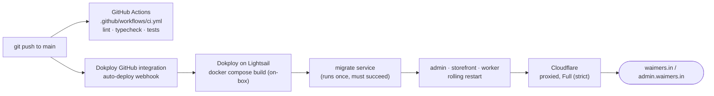

# Deployment

Production runs on **one AWS Lightsail server** (Mumbai region, 8 GB RAM / 2 vCPU burstable,
Ubuntu 24.04) running **Dokploy** (self-hosted PaaS, Apache-2.0 core — we don't use any of its
paid enterprise features). Dokploy's own GitHub integration watches the `main` branch and
**builds every image on the server itself**, straight from the Dockerfiles in this repo — there
is no GitHub Actions release workflow and no container registry in this setup.
`.github/workflows/ci.yml` still runs lint/typecheck/tests on every push and PR; it just isn't
part of the deploy path. Domains sit behind Cloudflare (proxied, Full (strict) SSL).



Builds run on the same 2 vCPU / 8 GB box that serves live traffic — there's no separate build
server on this plan. See "Builds run on the live box" at the top of
`deploy/docker-compose.prod.yml` for the memory budget and mitigations (deploy off-peak,
one-service-at-a-time builds, capped build heap); move builds to Dokploy's optional remote
build server before this box's headroom is what's actually limiting how often you can ship.

## Server sizing and why

8 GB / 2 vCPU is the smallest Lightsail plan that comfortably fits Postgres, Dragonfly, three
Next/Bun app containers and Dokploy itself with headroom for traffic bursts — see the memory
budget at the top of `deploy/docker-compose.prod.yml`. Everything here (Postgres tuning, memory
limits) assumes this single box; if traffic outgrows it, Postgres and the apps split onto
separate instances before anything else changes.

## 1. Create the Lightsail instance

1. Region: **ap-south-1 (Mumbai)** — lowest latency to Indian shoppers and payment/shipping
   providers.
2. Blueprint: **Ubuntu 24.04 LTS**, plan: **8 GB RAM / 2 vCPU** (the "Large" bundle at time of
   writing).
3. Attach a **static IP** to the instance (Lightsail → Networking → Create static IP) before
   pointing any DNS at it — the instance's default public IP changes on stop/start.
4. Firewall (Lightsail → Networking → instance → Firewall):
   - `22` (SSH) — restrict to your IP if it's static, otherwise leave open with key-only auth.
   - `80`, `443` (HTTP/HTTPS) — Traefik (Dokploy's built-in reverse proxy).
   - `3000` — **temporarily**, only while installing and first configuring Dokploy (its own
     dashboard). Remove this rule once you've set up a domain + SSL for the Dokploy dashboard
     itself, or at least re-restrict it to your IP.
5. SSH in and apply OS updates: `sudo apt update && sudo apt upgrade -y`, then reboot if the
   kernel updated.

## 2. Install Dokploy

Use the official one-line installer from the Dokploy docs — don't paste a script from memory or
a blog post:

**https://docs.dokploy.com/docs/core/installation**

Follow that page's steps as of your install date; it changes over time. After it finishes,
Dokploy's dashboard is on port `3000` (see firewall step above). Create your admin account
immediately — the setup wizard is unauthenticated until you do.

## 3. Connect GitHub

There is no container registry in this setup — Dokploy builds every image itself, on the
server, straight from this repo's Dockerfiles. Connecting GitHub is what makes that automatic:

1. Dokploy → Settings → Git Providers → **GitHub** → install the Dokploy GitHub App on the
   `Viora-Tech` org (or a fine-grained PAT if you'd rather not install the App), scoped to at
   least the `e-commerce` repo. This is what lets Dokploy clone the repo to build from and
   receive its push webhook.
2. You'll pick this connection when creating the Compose application (next step) and set:
   **branch** `main`, **auto-deploy** on. Dokploy then rebuilds and redeploys this Compose
   application on every push to `main` — the same trigger `.github/workflows/ci.yml` uses for
   lint/typecheck/tests, just a separate, unrelated hook.
3. **Watch paths** (if your Dokploy version supports it, under the application's Git settings):
   scope the trigger to paths that actually affect the running apps — e.g. `apps/**`,
   `packages/**`, `deploy/**`, `commerce.config.ts`, `commerce.blocks.config.ts`,
   `bun.lock`/`package.json` — so a docs-only change (`apps/docs/**`, `*.md`, `*.mdx`) doesn't
   trigger a full rebuild of admin/storefront/worker on the live box. If your version doesn't
   support this, it's a minor extra rebuild, not a correctness problem — skip it.

## 4. Create the application in Dokploy

1. New Project → new **Compose** application (not "Application" — Compose lets us paste
   `deploy/docker-compose.prod.yml` directly instead of Dokploy inferring one service).
2. Point it at the GitHub connection from the previous step, branch `main`, and its "Compose
   Path" at `deploy/docker-compose.prod.yml` in this repo — Dokploy pulls the file from git on
   each deploy, so updates to the compose file itself ship through a normal PR + merge, no
   manual UI edits.
3. Environment: paste `deploy/env.production.example` into Dokploy's environment editor and
   fill in every value (never leave a required one blank — see that file's comments for what
   each key does and docs/security/data-protection.md for the secrets specifically).
4. **Volumes**: `pgdata` and `dragonflydata` (named volumes in the compose file) persist across
   redeploys automatically — Dokploy doesn't recreate named volumes on redeploy, only
   containers. Don't rename them once created, or you'll start from an empty database.
5. Turn on **auto-deploy** for this application (Deployments settings) and confirm the branch
   is `main` — this is the actual switch that makes a push start a build; the GitHub connection
   in step 3 above only makes it possible.

## 5. First deploy

1. Trigger a deploy from the Dokploy UI (first one is always manual) — this builds every
   service's image on the box (`docker compose build`, one service at a time — see the compose
   file's own header comment) before starting anything, which takes noticeably longer than a
   pull-only deploy would. Subsequent deploys only rebuild what changed.
2. Watch the logs: `postgres` and `dragonfly` come up healthy, then `migrate` runs once and must
   exit `0` before `admin`, `storefront` and `worker` start — this ordering is
   `depends_on: service_completed_successfully` in the compose file, not a manual step. If
   `migrate` fails, the other three never start; fix the cause (usually a bad `DATABASE_URL` or
   an env var typo) and redeploy.
3. Confirm health: `admin`, `storefront` and `worker` each have a container healthcheck hitting
   `/api/health` (apps) or `/health` (worker) — Dokploy's UI shows them green once Postgres and
   Dragonfly both answer.
4. Seed data only if this is a brand-new database (a fresh production database is not
   auto-seeded — that's a `bun run db:seed` step you run once, deliberately, the same commands
   as `docs/handoff.md`, against `DATABASE_URL_OWNER`).

## 6. Domains and Cloudflare

1. In Dokploy, add domains to the `admin` and `storefront` services (or rely on the Traefik
   labels already in the compose file, which read `ADMIN_DOMAIN`/`STOREFRONT_DOMAIN` from env —
   either path ends up with the same Traefik router).
2. In Cloudflare DNS: `A` record for `waimers.in` (and `www`) and `admin.waimers.in`, both
   pointed at the Lightsail static IP, **proxied (orange cloud) on**.
3. Cloudflare SSL/TLS mode: **Full (strict)**. This requires Traefik to present a real
   certificate, not a self-signed one — Dokploy's Traefik does this with its own Let's Encrypt
   integration (the `letsencrypt` certresolver referenced in the compose file's labels).
   Confirm certs issue correctly before flipping SSL mode to strict, or you'll get a
   Cloudflare 526 loop.
4. Cloudflare Page Rules/Rulesets: none required to start; add caching/security rules later as
   needed.

## 7. Deploy order (migrate-then-roll) and zero downtime

`migrate` always runs to completion before any app container starts or restarts — this is what
makes a schema change safe to ship in the same release as the code that depends on it. Rolling
restarts (`admin`/`storefront`: `deploy.update_config.order: start-first`) start the new
container, wait for its healthcheck, then stop the old one — no window where neither is
serving traffic. `worker` has no such window to protect (BullMQ jobs are retried, not
user-facing requests) so it restarts the plain way.

If a migration is not backward-compatible with the *previous* release's code, you cannot roll
back to that previous commit without also rolling back the migration — write migrations
additively (new nullable column, not a rename) when a same-day rollback matters.

## 8. Rollback

There's no image tag to swap here (Dokploy builds from git, not from a registry) — rolling back
means redeploying an older commit:

1. Dokploy keeps a history of past deployments for this Compose application — its simplest
   rollback is picking a previous successful deployment from that list and redeploying it
   directly, if your version supports it.
2. Otherwise, roll back in git and let the normal path redeploy it: `git revert` the bad
   commit(s) on `main` (preferred — keeps history linear and honest) or, if you must, force the
   branch back to the last good commit; either way, the push triggers Dokploy's webhook and it
   rebuilds and redeploys that older code.
3. `migrate` runs again on the rollback deploy too (a no-op if there's nothing new to apply).
4. If the previous release's migration must also be undone, that's a manual `pg_restore` from
   the most recent backup taken **before** the migration ran (see Restore below) — there is no
   automatic "down migration" in this codebase.

## 9. Restore

See [Backups](/developer-docs/operations/backups) for the full mechanics. On this server
specifically:

```sh
# From the Lightsail box, inside the tasks image (same image the `migrate`/`backup` services
# use — built locally by Dokploy as commerce-tasks:local, not pulled from a registry):
docker run --rm -it --network dokploy-network \
  --env-file .env \
  commerce-tasks:local \
  bun run scripts/restore-db.ts --list
```

Always restore into a scratch database first to verify the backup, per
`docs/security/data-protection.md`'s guidance, before ever pointing `--target` at the real
`DATABASE_URL_OWNER`.

## 10. Key rotation

Follow `docs/security/data-protection.md`'s "Key rotation runbook" exactly — it's written
against Coolify/Dokploy environment variables already. In short: set the new
`SETTINGS_SECRET`/`SETTINGS_SECRET_PREVIOUS` pair in Dokploy's environment, redeploy, run
`scripts/rotate-secrets.ts --apply` and `scripts/backfill-phone-encryption.ts --apply` from the
tasks image (same `docker run` pattern as Restore above), confirm zero old-key rows remain,
then remove `SETTINGS_SECRET_PREVIOUS` and redeploy once more.

## 11. Monitoring

- **Container health**: Dokploy's dashboard shows each service's healthcheck status and
  restart count directly — check it after every deploy.
- **Error tracking**: set `SENTRY_DSN` to a GlitchTip (or Sentry) project once one exists (see
  `docs/ops/error-tracking.md`); until then, `docker logs <container>` on the Lightsail box is
  the only error visibility.
- **Resource usage**: `docker stats` on the box, or Lightsail's own graphs (Metrics tab) for
  host-level CPU/RAM/network — set a Lightsail **budget/usage alert** (Account → Billing →
  Budgets) so an unexpected traffic spike or runaway container shows up as a cost alert, not a
  surprise invoice.
- **Backups**: the nightly `backup` service (or Dokploy Scheduled Job — see Backups doc) logs
  each run; check it's actually landing new objects in R2 periodically, not just that the
  container is "running".

## What's next

This covers one server, one region, Dokploy building on-box. It does not cover: multi-region, blue/green
across two boxes, a managed Postgres (RDS) migration, or the AWS ECS + CodePipeline path
mentioned as a considered alternative in earlier notes — Dokploy on Lightsail was chosen as the
cheaper first step (see `docs/handoff.md`). Move to ECS only once this box's headroom
(currently ~2.95 GB free at steady state) is actually exhausted.
