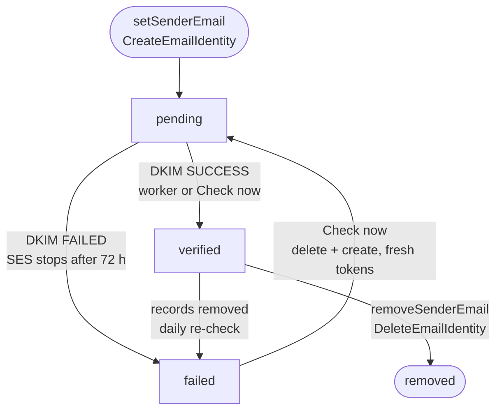

# Email sending and sender domains

Every store's customer email goes out through **one email account owned by the platform**:
**Amazon SES** or **Resend** (`SENDER_EMAIL_PROVIDER`), optionally with the other as a
**fallback** (`SENDER_EMAIL_FALLBACK`). Each store can add its own sender address
(`support@waimers.in`); its domain becomes a **domain identity** in the platform's SES account.
Merchants never need an AWS or Resend account. A store can still connect the **Amazon SES app**
with its own keys; then that app sends instead and none of this applies.

## Providers

| Provider | Package | Sends | Store sender domains |
| --- | --- | --- | --- |
| Amazon SES | `packages/notifications-ses` (AWS SDK v2 client) | Platform address and stores' verified domains | Yes, SES domain identities |
| Resend | `packages/notifications-resend` (`fetch` to `POST https://api.resend.com/emails`, no SDK) | Platform address only | No (see below) |

Both channels carry the same things: From name (cleaned, quoted or MIME encoded-word by
`formatMailbox`), Reply-To, attachments (Resend: base64 with `content_type`) and, on marketing
sends, the `List-Unsubscribe` headers. Resend sends also carry a tag: `template=<id>` for
transactional mail, `kind=marketing` for campaigns.

**Why store domains stay on SES.** Resend's Domains API could verify a domain too, but its
records are different (a `resend._domainkey` TXT key plus MX/SPF on a `send.` subdomain, not
three SES DKIM CNAMEs), so the `sender_email` table, the DNS record builder and the Sender email
card would all need a second shape, and with a fallback the merchant would have to add both
sets of records. So a **verified store domain always sends through SES**, whatever
`SENDER_EMAIL_PROVIDER` says; Resend sends only `PLATFORM_EMAIL_FROM`. Without SES keys
(`resend` alone) the Sender email card cannot start a domain (it shows the provider error), and
any store with a verified domain from before sends from the platform address with Reply-To the
shop.

### Fallback

`withFallback` (`packages/notifications/src/fallback.ts`) wraps two channels: the second is
tried **only** when the first fails with `retryable: true` on its `SendResult`, i.e. the
provider, not the message, failed:

- SES (`packages/notifications-ses/src/ses.ts`): the SDK's `$retryable` or `$fault: server`,
  HTTP 429/5xx, `Throttling`, `TooManyRequests`, `LimitExceeded`, `SendingPaused`,
  `AccountSuspended`, service errors, socket errors (`ECONNRESET`, `ETIMEDOUT`, …).
- Resend: no answer (network, 15 s timeout), HTTP 429 (rate limit, daily or monthly quota) or 5xx.

A rejected message (bad address, validation, unverified From) is never sent twice. The
notification log keeps the `platform_email` channel id either way; when the fallback delivered,
the provider reference is prefixed `resend:` or `ses:`. When SES sends a store's own domain and
fails, the Resend fallback sends from the platform address with Reply-To the shop, as before
verification. A timeout can, rarely, mean the first provider did deliver, so a fallback may
duplicate that one email.

| `SENDER_EMAIL_PROVIDER` | `SENDER_EMAIL_FALLBACK` | Platform address | Verified store domain |
| --- | --- | --- | --- |
| `ses` | `none` | SES | SES |
| `ses` | `resend` | SES, then Resend | SES, then Resend from the platform address |
| `resend` | `none` | Resend | SES if its keys are set, else Resend from the platform address |
| `resend` | `ses` | Resend, then SES | SES, then Resend from the platform address |

## Pieces

| Piece | Where | What it does |
| --- | --- | --- |
| `sender_email` table | `packages/db/src/schema.ts`, migration `0067_sender_email` | One row per store (unique `store_id`), `domain` unique across the platform, status `pending \| verified \| failed`, DKIM tokens, MAIL FROM state. Under RLS. |
| `sender_domain_taken(domain, store)` | SQL, `SECURITY DEFINER` | True when another store holds the domain, a parent or a subdomain. Returns yes/no only. |
| `stores_with_sender_email_checks()` | SQL, `SECURITY DEFINER` | Stores with a pending domain, or a verified one not checked for a day. Feeds the worker. |
| `SesIdentityProvider` | `packages/notifications-ses/src/identity.ts` | `CreateEmailIdentity` (Easy DKIM), `GetEmailIdentity`, `PutEmailIdentityMailFromAttributes`, `DeleteEmailIdentity`. |
| Dev provider | `packages/core/src/sender-email/dev-provider.ts` | Offline: `*.test`, `*.example`, `*.localhost` verify on the first check, `fail.*` fails, others stay pending. |
| Rules | `packages/core/src/sender-email/client.ts` (`@commerce/core/sender-email`) | Address parsing, DNS record builder, `chooseSender`. Pure, safe in the browser. |
| Lifecycle | `packages/core/src/sender-email/service.ts` | `setSenderEmail`, `checkSenderEmail`, `removeSenderEmail`, `pollSenderEmails`. |
| Channels | `packages/core/src/sender-email/channels.ts` | `storeNotificationChannels`: enabled apps plus the platform sender. Every send path uses it. |
| API | `packages/api/src/routers/notifications.ts` | `senderEmail`, `setSenderEmail`, `checkSenderEmail`, `removeSenderEmail`. |
| Worker | `apps/worker/src/sender-email.ts` | Repeat job every 5 minutes on `{sender-email}-verify`. |
| UI | `apps/admin/src/components/notifications/sender-email-card.tsx` | The Sender email card on Settings → Notifications. |

## The From / Reply-To rule

`chooseSender` (`packages/core/src/sender-email/client.ts`) decides, for every email:

- **Verified** sender, address on that exact domain: `From: Store name <support@waimers.in>`, no
  Reply-To.
- **Anything else** (no sender, pending, failed): `From: Store name <PLATFORM_EMAIL_FROM>`,
  `Reply-To: support@waimers.in` (or the store's contact email when no sender is set).

The display name is the sender name, else the store name. It is cleaned (no CR/LF or angle
brackets), quoted when needed and MIME encoded-word for non-ASCII (`formatMailbox`,
`packages/notifications-ses/src/address.ts`).

`storeNotificationChannels` adds the platform channel (id `platform_email`) only when the
platform account is configured and the store has no email app of its own (the dev `log`
channel does not count). `deliverNotification`, `deliverCartRecovery`, `deliverLoginCode`, gift
card delivery, marketing sends, back-in-stock alerts and **Send me a test** all resolve channels
through it.

`List-Unsubscribe` / `List-Unsubscribe-Post` ride only on `sendMarketing` (campaigns and
automations); transactional `send` never sets them.

## Lifecycle

- **Same domain, new local part or name**: the identity stays; the row is re-checked.
- **New domain**: the claim is checked (`sender_domain_taken`), a new identity is created, the
  row replaced in a savepoint, then the old identity deleted.
- **Race**: two stores claiming at once hit the `domain` unique index; the loser gets
  `domain_taken` and the winner's identity is left alone.
- **MAIL FROM** is `bounce.<domain>` with `BehaviorOnMxFailure: USE_DEFAULT_VALUE`, so a missing
  MX never blocks mail. If SES refuses it on a pending identity, it is retried once DKIM passes.

## Security

- Only a **verified** domain goes in From, and only for an address on that domain.
- Addresses are validated (`parseSenderAddress`): format, free-mail providers, platform domains
  (`PLATFORM_DOMAINS` and the domain of `PLATFORM_EMAIL_FROM`, including parents and subdomains).
- One store, one domain. Parents and subdomains are blocked too, because SES lets a subdomain
  inherit its parent's verification.
- Rate limits: `setSenderEmail` 5 per hour per store (each may create an SES identity), `checkSenderEmail`
  12 per 10 minutes.
- `SETTINGS_MANAGE` for changes, `SETTINGS_READ` to view.

## Env

| Key | Default | Meaning |
| --- | --- | --- |
| `SENDER_EMAIL_PROVIDER` | `dev` | `ses` or `resend` turns on the platform account and picks who sends the platform address. `dev` checks domains offline and sends nothing through the platform. |
| `SENDER_EMAIL_FALLBACK` | `none` (blank = `none`) | `ses` or `resend`: the other provider, tried on provider errors. Needs that provider's keys too. Naming the provider itself is ignored. |
| `RESEND_API_KEY` | none | Resend API key with sending access. `PLATFORM_EMAIL_FROM`'s domain must be verified in the Resend dashboard (once, by hand). |
| `SES_REGION` | none | Region of the platform SES account, e.g. `ap-south-1`. Also the MAIL FROM MX (`feedback-smtp.<region>.amazonses.com`). |
| `SES_ACCESS_KEY_ID`, `SES_SECRET_ACCESS_KEY` | none | IAM user with `ses:SendEmail`, `ses:CreateEmailIdentity`, `ses:GetEmailIdentity`, `ses:DeleteEmailIdentity`, `ses:PutEmailIdentityMailFromAttributes`, `ses:TagResource`. |
| `PLATFORM_EMAIL_FROM` | none | The platform's verified sender, e.g. `no-reply@mail.waimers.com`. Verify its domain in SES by hand once. |
| `PLATFORM_EMAIL_NAME` | the platform name (`siteConfig.brand.name`) | Display name when a store has no name. |
| `SES_CONFIGURATION_SET` | none | Optional default configuration set for every store identity (event destinations). |

Set these on **all three apps** (admin, storefront, worker): the storefront sends sign-in codes,
the worker sends order email and runs the poll, the admin creates identities.
`SENDER_EMAIL_PROVIDER=ses` without the SES keys or `PLATFORM_EMAIL_FROM` (or `resend` without
`RESEND_API_KEY`, or a fallback without its keys) fails at first use with a clear error. Blank
values (compose's `${KEY:-}`) count as unset. The SES account must be **out of the sandbox** (production access), or it
can only mail verified addresses. The same `SES_*` keys drive the SES package's live test suite, so never put
real keys in `.env.test`.

## Bounces and complaints

Not wired in this release, for either provider. SES's **account-level suppression list** (on
by default for new accounts, bounces and complaints) and Resend's own suppression list already
stop repeat sends to bad addresses. Follow-up: one suppression path in core (mark customers
`bounced`/`complained`) fed by an SNS handler (SES configuration set `SES_CONFIGURATION_SET`,
SNS signature check) and a Resend webhook route (`email.bounced`, `email.complained`, svix
signature check). There is no SES handler yet, so no Resend one was added on its own.

## Testing

All SES calls are mocked: `packages/notifications-ses/test/identity.test.ts` (SDK commands and
state mapping), `packages/core/src/sender-email/client.test.ts` (rules) and
`packages/core/src/sender-email/service.test.ts` (lifecycle, claims across stores, RLS, the
From/Reply-To choice before and after verification, BYO SES precedence).

Resend is never called for real: `packages/notifications-resend/test/resend.test.ts` mocks
`fetch` (request body, error mapping, retryable classes, conformance suite).
`packages/notifications/test/fallback.test.ts` covers `withFallback`, and
`packages/core/src/sender-email/platform.test.ts` covers provider choice, fallback both ways
and store domains staying on SES, with SES and Resend both mocked.
