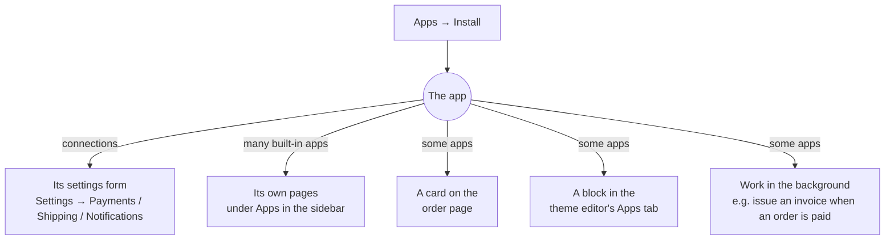

# Apps

**Apps** is where you add tools to your store: invoicing, importers, marketing tools,
couriers, payment gateways and more. Each one is a plugin you can turn on or off any time.

## What this is for

- Turning on **GST invoices** before your first B2B order.
- Connecting **Delhivery** or **Shiprocket** so orders get rates, labels and tracking.
- Moving from Shopify with the **Shopify importer**.
- Adding a "Notify me when it's back" button with **Back in stock**.
- Showing "or ₹X/month" under product prices with **EMI & pay later**.

## How it works

Installing an app switches on what it brings, for your store only. Depending on the app, that
can be a settings form, its own pages in the sidebar, a card on the order page, or a block you
can place in the theme editor.

## Recommended for your store

At the top of **Apps** a strip called **Recommended for** *your store's name* suggests up to three
apps you have not installed yet, each with a short reason. It looks at what is missing: with no
courier connected it suggests Delhivery (then Shiprocket or RapidShyp); with no reviews it suggests
Reviews; then WhatsApp, GST invoices, Back in stock and a payment gateway. A gap counts as
covered as soon as you have any app that does that job, so the strip only ever shows what you
actually lack, and goes away when nothing is missing. Select an app to see what it does, and
**Install** to add it. You see what the app can do before it is switched on.

## Built-in apps vs connections

The Apps page has two sections:

- **Built-in apps**: "Made by us. Turn one on and start using it — no account to set up."
- **Connections**: link your store to another company's account. They show **by \<company\>**
  on their card and need that company's account details.

| App | Section | What it adds |
| --- | --- | --- |
| GST invoices | Built-in | Tax invoices, credit notes, vouchers, GSTR-1 export. Pages: Queue, Invoices, Returns, Settings. |
| Shopify importer | Built-in | Brings products, collections, customers, orders, pages, blog posts, menus, redirects, files, content types, extra fields, discounts and gift card balances over from Shopify. Pages: Imports, CSV files, Connect store. See [Move from Shopify](/merchant-guide/start-here/move-from-shopify). |
| Back in stock | Built-in | A **Notify me** block and restock alerts. Pages: Overview, Signups, Settings. |
| Reviews | Built-in | Product reviews with photos, verified buyer badges, your replies, review request emails after delivery and an import from Judge.me. Pages: Reviews, Import, Settings. See [Reviews](/merchant-guide/apps/reviews). |
| Forms | Built-in | Makes the contact and advice forms of an imported theme work: messages are saved on the Submissions page and emailed to your store contact email. |
| EMI & pay later | Built-in | "or ₹X/month" under product prices (Razorpay's offers box with Razorpay) and an **EMI offers** block. Page: Settings. See [EMI & pay later](/merchant-guide/apps/emi-and-pay-later). |
| Razorpay | Connection, by Razorpay | Cards, UPI, netbanking, and UPI — confirmed automatically (a QR per order). |
| Cashfree | Connection, by Cashfree Payments | UPI, cards, netbanking, wallets and pay later. See [Cashfree](/merchant-guide/money-and-gst/cashfree). |
| Delhivery | Connection, by Delhivery | Rates, labels, pickups, tracking, and a **Delivery checker** block. |
| RapidShyp | Connection, by RapidShyp | Multi-courier rates, labels, pickups and tracking. Tracking is checked on a schedule rather than by webhook. See [Shipments](/merchant-guide/orders/shipments). |
| Umami | Connection, by Umami | Visitor analytics without cookies: a **Visitors** section on Analytics. See [Visitor analytics (Umami)](/merchant-guide/analytics/visitor-analytics). |
| Google Search Console | Connection, by Google | The Google searches that find you, top pages, pages almost on page 1, pages losing clicks, sitemaps, a **Google search** card on products and search issues in the SEO report. Pages: Overview, Top searches, Top pages, Almost page 1, Losing traffic, Sitemaps, Settings. See [Google Search Console](/merchant-guide/apps/google-search-console). |
| Shiprocket | Connection, by Shiprocket | Multi-courier rates, labels, tracking, and a **Delivery checker** block. |
| Amazon SES email | Connection, by Amazon Web Services | Sends order emails through Amazon SES. |
| WhatsApp | Connection, by Meta | Order updates on WhatsApp through the Meta Cloud API. |
| Cloudflare R2 | Connection, by Cloudflare | Stores your images and files on your own R2 bucket. |
| Amazon S3 | Connection, by Amazon Web Services | Stores your images and files on your own S3 bucket, with a guided setup and a CloudFront option. |

Every store also has the core features built in, with nothing to install: cash on delivery,
UPI or bank transfer, a demo courier for testing, and local file storage.

<Screenshot
  name="Apps page"
  caption="Apps page with the Built-in apps section on top (GST invoices showing Installed, Shopify importer and Back in stock with Install buttons) and the Connections section below, filtered to All."
/>

## Connect your Shopify store

The Shopify importer's **Connect store** page (Apps → Shopify importer → Connect store) offers
two ways in. Both are read-only: the import never writes anything back to Shopify.

- **Connect with your Shopify app (recommended)** — Shopify retired creating new custom apps
  from its own admin on 1 January 2026, so new connections go through the
  [Shopify Dev Dashboard](https://shopify.dev/docs/apps/build/authentication-authorization/client-credentials-grant)
  instead:
  1. In the Dev Dashboard, create an app.
  2. Give it these read scopes: `read_products`, `read_inventory`, `read_customers`,
     `read_orders`, `read_all_orders`, `read_content`, `read_online_store_navigation`,
     `read_files`, `read_metaobject_definitions`, `read_metaobjects`, `read_discounts`,
     `read_gift_cards`, `read_shipping`, `read_legal_policies` (the files, content type,
     discount and gift card scopes bring those over; the last two are for Store settings;
     see [Move from Shopify](/merchant-guide/start-here/move-from-shopify)).
  3. Release a version, then install the app on your own store.
  4. Copy the **client ID** and **client secret** from the app's API credentials page and paste
     them into the Connect store form, alongside your store address.

  Behind the scenes we exchange the client ID/secret for a Shopify access token (the
  "client credentials grant"). That token expires after 24 hours; the importer refreshes it
  automatically, both before it expires and if Shopify ever answers a request with 401 mid-import.
  Your client secret stays encrypted at rest — the same way every other connection's credentials
  do — and is never shown again once saved.

- **I already have an Admin API token** — if you already made a custom app in the classic
  admin flow before 1 Jan 2026, its `shpat_...` token keeps working exactly as before; paste it
  under this tab.

Either way, use **Test connection** on the Connect store page to confirm the shop name and see,
in plain words, which of the scopes above are granted and which are missing, before you preview
an import.

A one-click "Connect Shopify" button (the kind that redirects a *different* merchant's store back
to sign the connection) needs a public HTTPS address to send them back to, so it ships once the
admin has one — for connecting your own store today, the Dev Dashboard app above is the
supported path.

## Images from a Shopify import

The importer copies every product, collection, page and blog image into your own store, then
optimises each one straight away, the same as an image you upload yourself: location data and
other hidden details are removed and smaller copies are made for phones. Images show on your
store while this runs and switch to the optimised copies once each one is done. Running an
import again does not copy or optimise the same image twice, and a preview never downloads
anything. Videos are copied as they are.

If an image was copied but could not be sent for optimising, the import lists it under its
issues ("was copied but not queued for optimising"). The product still imports with the image
as it came from Shopify, and it is optimised the next time the platform reprocesses media.

## Install an app step by step

<Steps>

### Open Apps

Select **Apps** in the sidebar. Use the **All** / **Installed** filter and the category chips
(Invoicing, Payments, Shipping, Messages, Storage and so on) to find one.

### Install

Select **Install** on the app's card. Built-in apps are ready straight away.

### Set it up

For a connection, the card shows **Set up in Payments** (or Shipping, Notifications). Enter the
company's account details there, or on the app's own **Connect** page for Delhivery,
Shiprocket, Amazon SES email and WhatsApp, then **Test connection** where offered. The card switches from **Not connected** to
**Connected**.

### Open it

Apps with their own pages appear under **Apps** in the sidebar. Select **Open** on the card, or
the app's name in the sidebar.

</Steps>

## Uninstalling

Select **Uninstall**, then confirm with **Uninstall** (or **Keep** to back out). Uninstalling
switches the app's features off for your store, but saved credentials are kept until you remove
them from Settings, so reinstalling restores your setup. Blocks the app added to your pages
stay in place but show nothing until you reinstall.

## Storage: local disk, R2 or S3

Every store starts on the built-in **Local disk** storage: no setup, and it's the default
whenever you haven't connected a storage app. To keep your files on your own bucket instead,
install **Cloudflare R2** or **Amazon S3** and use **Move existing files**. The move runs in
the background and only removes each original once its copy is verified.

The **Amazon S3** app's Connect page walks through the whole setup: create a bucket, create an
IAM user with a policy scoped to just that bucket (the exact JSON is shown, with a copy
button), paste the access key and secret, then **Test connection** — it writes a tiny file to
the bucket, reads it back and deletes it, so you know the keys and policy actually work before
you save. It also explains public access vs. putting CloudFront in front of the bucket, and
shows the CORS rule the bucket needs so uploads can go straight from your browser to S3.

<Callout type="info">
  **Tip.** Apps can credit the open-source projects they're built on. Look for "Built with …"
  on an app's card; GST invoices, for example, credits the project its invoice templates come
  from.
</Callout>

## Common problems and fixes

| Problem | Why it happens | Fix |
| --- | --- | --- |
| Installed a connection but nothing changed | It's installed but not connected yet. | Follow **Set up in …** and fill in the account details. |
| App's page says to install it first | The app was uninstalled. | Install it again from **Apps**; your settings come back. |
| Can't install apps | Your role doesn't allow it. | Ask the store owner, or an Administrator. |
| The theme editor's Apps tab is empty | No app with blocks is installed. | Install Back in stock, EMI & pay later, Delhivery or Shiprocket. |

## FAQ

<Faq>

<FaqItem question="Do apps cost extra?">

Built-in apps come with the platform. Connections use your own account with that company
(Razorpay, Delhivery and so on), so their charges are between you and them.

</FaqItem>

<FaqItem question="Can I get an app for a gateway or courier that isn't listed?">

A developer can build one as a plugin (see [Build your first app](/developer-docs/building/first-app)).
A public app store for apps from other developers is coming soon.

</FaqItem>

<FaqItem question="Where did the app's settings go? They're not under Settings.">

Installed apps keep everything under **Apps** in the sidebar, including their own **Settings**
page. Only connections' account details live in **Settings → Payments / Shipping /
Notifications**.

</FaqItem>

</Faq>

## Related guides

<RelatedGuides ids={['shipments', 'payments', 'gst', 'online-store']} />
