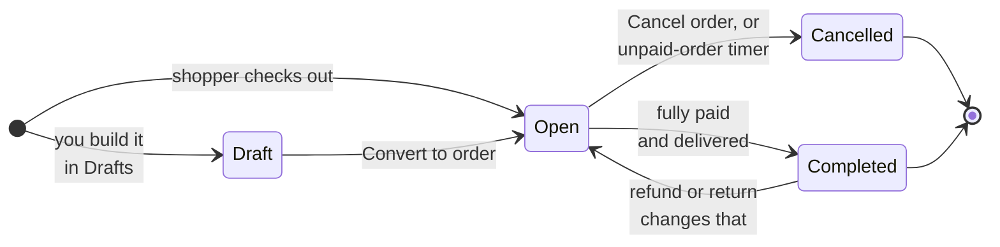
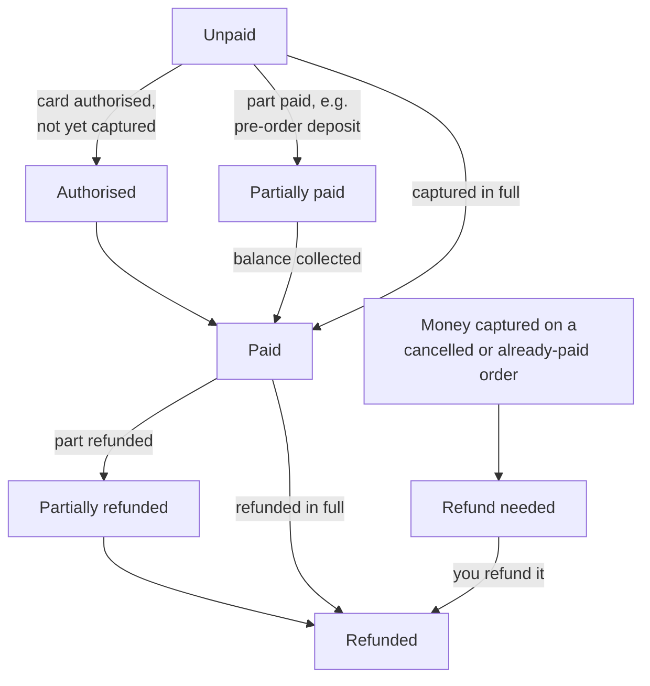
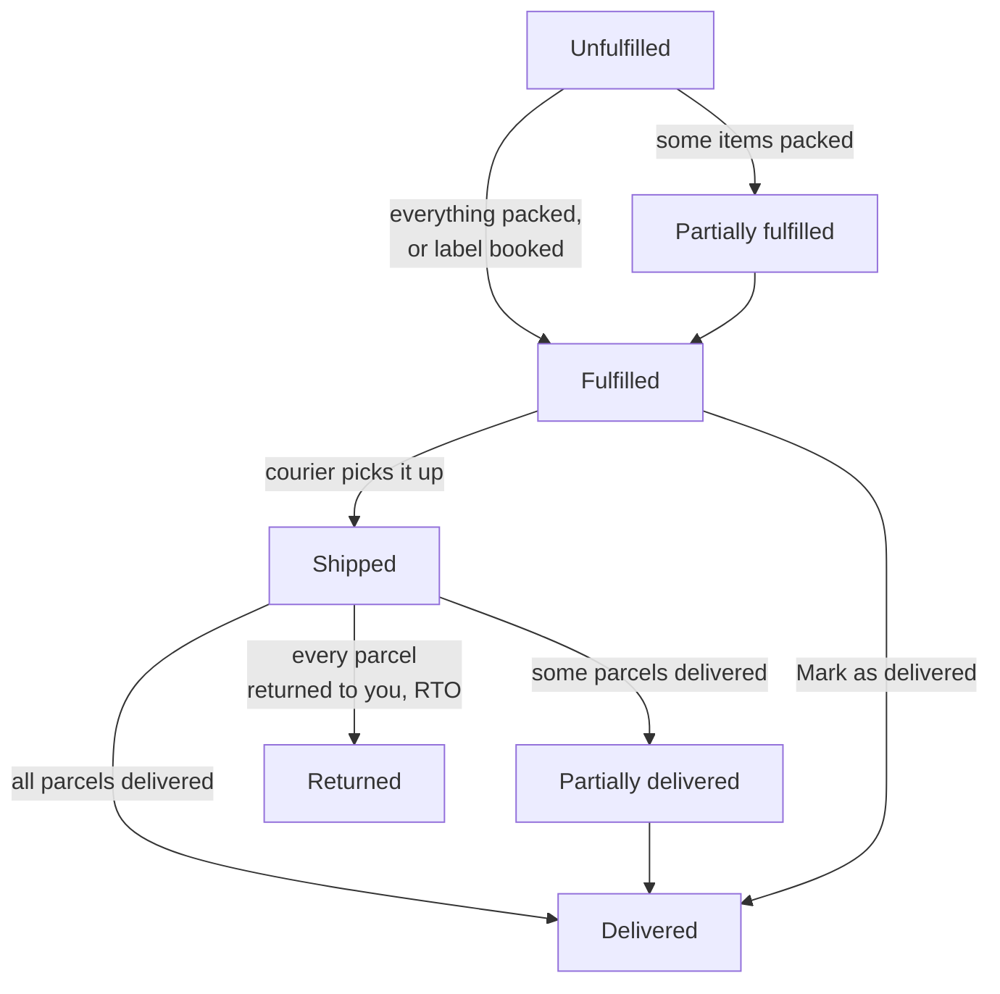

# Orders

Every sale lands in **Orders**, whether a shopper paid by UPI on your store, chose cash on
delivery, or you created it yourself as a draft order for a WhatsApp customer.

## What this is for

- Seeing at a glance which orders need money checked, which need packing, and which are done.
- Recording payments that happen outside the gateway, like a ₹2,499 UPI transfer straight to
  your bank or cash collected by the courier.
- Packing, shipping, cancelling and refunding.
- Collecting the rest of the money on a pre-order.

## How it works

An order has **three statuses**, and each answers a different question:

| Status | Question it answers | Values you'll see |
| --- | --- | --- |
| **Status** | Is this order still being worked on? | Draft, Open, Completed, Cancelled |
| **Payment** | Has the money come in? | Unpaid, Authorised, Partially paid, Paid, Partially refunded, Refunded, Refund needed |
| **Fulfilment** | Have the goods gone out? | Unfulfilled, Partially fulfilled, Fulfilled, Shipped, Partially delivered, Delivered, Returned |

You never set Payment or Fulfilment directly. They are worked out from what actually happened:
payments captured, refunds made, items packed, and what the courier reports. An order becomes
**Completed** by itself once it is fully paid **and** delivered.

<Tabs items={['Order status', 'Payment', 'Fulfilment']}>
<Tabs.Tab>

A **Draft** holds no stock and counts as no sale. **Cancelled** is final: a cancelled order
can't be reopened, paid or shipped. Cancelling puts unpacked items back into stock.

</Tabs.Tab>
<Tabs.Tab>

**Refund needed** is a warning, not an error: a shopper paid twice, or paid after the order was
cancelled. The order page shows it until you refund that payment.

</Tabs.Tab>
<Tabs.Tab>

Booking a courier label packs every item, so the order moves to **Fulfilled** straight away,
then to **Shipped** and **Delivered** as the courier's tracking updates arrive (checked every
30 minutes).

</Tabs.Tab>
</Tabs>

<Screenshot
  name="Order list with tabs"
  caption="Orders → Order list on the All orders tab, with Payment and Fulfilment columns showing a mix of Paid / Unpaid and Unfulfilled / Shipped, and the Pending UPI tab visible."
/>

## Work an order step by step

<Steps>

### Pick a tab

The **Order list** has tabs so you can work through one kind of order at a time: **All
orders**, **Unpaid**, **Unfulfilled**, **Pending UPI**, **Completed** and **Cancelled**. Most
days start on **Pending UPI** (money to check) and **Unfulfilled** (parcels to pack).

### Open the order

Select an order, say **#1042** from Asha in Pune for ₹2,499. You'll see the items, the
payment summary (Subtotal, CGST/SGST or IGST, Shipping, Payment fee or discount, Total, Paid by
customer, Balance due) and a **Timeline** of everything that happened.

<Screenshot
  name="Order detail"
  caption="Order #1042 detail page: line items at the top, payment summary card with CGST 9% and SGST 9% lines and Total ₹2,499, and the Timeline showing Order placed then Payment captured."
/>

### Check the money

If the order is **Unpaid** and the shopper paid you outside the gateway (a UPI transfer or
cash), select **Collect payment**, then **Mark as paid**. For a gateway order such as Razorpay,
use **Open pay page** instead and send the shopper the link: the gateway marks it paid itself.

### Ship it

Book a courier label from **Orders → Shipments → Ready to ship** (see
[Shipments](/merchant-guide/selling/shipments)). Or, if you ship your own way, select **Fulfil
items** and enter the courier name, tracking number and tracking link.

### Close it out

Nothing to do. When the courier reports **Delivered** and the order is **Paid**, it moves to
**Completed** on its own. If you delivered it by hand, select **Mark as delivered**.

</Steps>

<VideoTip
  title="Verify a UPI transfer and mark the order paid"
  caption="Open Pending UPI, match the ₹ amount and order number in your bank app, Collect payment, Mark as paid."
/>

### Doing many at once

Select several orders in the list and use **Mark as** to set them **Paid**, **Fulfilled**,
**Delivered** or **Cancelled** together. Draft and cancelled orders can't be changed this way.

## Pre-orders and balance due

A pre-order product can take a deposit at checkout, say ₹500 of a ₹3,000 order, with the
remaining ₹2,500 collected before it ships. The order shows **Deposit paid** and **Balance
due** until the rest comes in, and its Payment status is **Partially paid**.

- Select **Request balance** to email the shopper a payment link, or **Send balance request
  again** to remind them.
- You can have the request and reminders sent automatically. See
  [Payments → Pre-order balances](/merchant-guide/money/payments#pre-order-balances).
- You can't fulfil an order while a balance is due. Collect it first.

## UPI: auto-confirmed vs manual

| | UPI (auto-confirmed) | UPI / bank transfer (manual) |
| --- | --- | --- |
| How the shopper pays | Scans a single-use QR for the exact amount | Pays your UPI ID or bank account directly |
| Who confirms it | Razorpay, automatically | You, after checking your bank or UPI app |
| Where the order waits | Nowhere, it's marked paid in seconds | The **Pending UPI** tab |
| Setup | Razorpay connected, QR method on | Your UPI ID and bank details in Payments |

For manual transfers, select **Send payment reminder** if the shopper forgets. You can also
have unpaid transfer orders cancel themselves after a set number of hours; the shopper gets an
email 12 hours before that happens.

<Callout type="info">
  **Tip.** Before you mark a manual UPI order paid, match both the **amount** and the **order
  number** the shopper put in the payment note. Two orders of the same amount on the same day
  are common during a sale.
</Callout>

## Refunds and cancellations

- **Refund** opens **Refund payment**: enter the **Amount (₹)** and a **Reason**, or select
  **Refund remaining**. Gateway payments are refunded through the gateway; cash and manual UPI
  refunds are recorded for your books and you send the money yourself.
- **Cancel order** asks "Cancel this order?" Select **Cancel order** to confirm or **Keep
  order** to back out. Cancelling returns unpacked items to stock. It doesn't refund money on
  its own: refund any payment separately.

## Common problems and fixes

| Problem | Why it happens | Fix |
| --- | --- | --- |
| Can't find **Collect payment** on a Razorpay order | Gateway orders are paid through the gateway. | Use **Open pay page** and share the link with the shopper. |
| **Fulfil items** is blocked | A pre-order balance is still due. | Collect the balance first (**Request balance**). |
| Order shows **Refund needed** | Money arrived after cancellation, or the order was paid twice. | Open the order and refund the extra payment. |
| An online order cancelled itself | It stayed unpaid past your **Unpaid orders** window. | Adjust the minutes in **Settings → Payments → Unpaid orders**, or set 0 to turn it off. |
| Order stuck on **Shipped** | The courier hasn't reported delivery yet. | Use **Refresh tracking** on the order, or wait for the next 30-minute check. |

## FAQ

<Faq>

<FaqItem question="Why is a paid, delivered order still Open?">

Check Payment. A partial refund or a pre-order balance keeps Payment from being settled, and an
order is only **Completed** when it is fully settled **and** delivered.

</FaqItem>

<FaqItem question="Is cash on delivery ever auto-cancelled?">

No. The unpaid-order timer skips cash on delivery, manual UPI/bank transfer (which has its own
optional timer) and gift card payments.

</FaqItem>

<FaqItem question="Can I change an order after it's placed?">

You can add notes, collect payments, fulfil, refund and cancel. To sell something different,
cancel and create a new draft order from **Orders → Drafts**, then **Send invoice** or
**Convert to order**.

</FaqItem>

<FaqItem question="What does &quot;Imported from Shopify&quot; mean?">

The order came in through the Shopify importer app. Imported orders are read-only history,
kept for your records rather than worked like new orders.

</FaqItem>

</Faq>

## Related guides

<RelatedGuides ids={['payments', 'shipments', 'gst', 'glossary']} />
