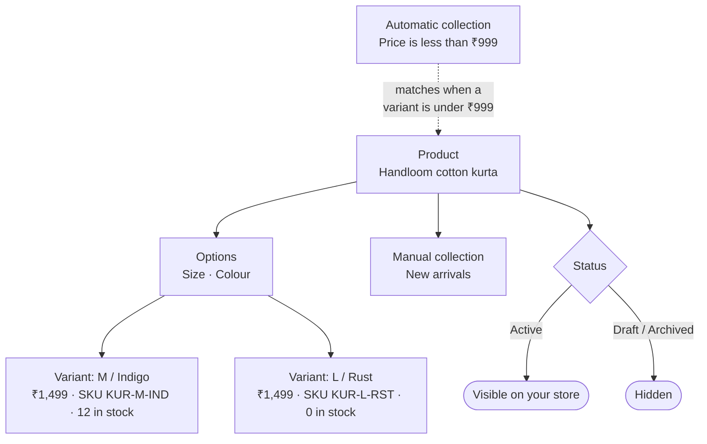

# Products and collections

**Products** is everything you sell. **Collections** group products into category pages on
your store, like "Cotton kurtas", "New arrivals" or "Under ₹999".

## What this is for

- Adding a kurta in 4 sizes and 3 colours, each with its own price, SKU and stock.
- Showing an MRP of ₹1,999 with a sale price of ₹1,499 ("Save ₹500").
- Putting the right HSN code and GST rate on each product, so invoices are correct.
- Taking pre-orders for a new launch, with a countdown and a deposit.
- Keeping a "Under ₹999" collection that fills itself.

## How it works

A **product** is what shoppers see as one page. Its **variants** are the versions they choose
between (Size: S, M, L; Colour: Indigo, Rust). Price, SKU, barcode and stock live on each
variant. **Collections** point at products: a **Manual** collection holds the products you
pick, an **Automatic** one holds whatever matches its conditions, and updates itself.

## Add a product step by step

<Steps>

### Start a product

Go to **Products → Product list** and select **Add product**. Enter a **Title** and
**Description**.

### Set the price

Under **Pricing**, enter the **Product price**. Add a **Compare at price** (your MRP) to show a
saving, and **Cost per item** to see your margin (shoppers never see it). **Charge tax on this
product** and **Tax included** control GST; in India prices usually include tax, so leave
**Tax included** on **Yes**.

### Add photos

In **Media**, drop images in or **Browse** the file library.

### Add variants

Under **Variants**, select **Add options like size or colour**. Type an **Option name** (Size)
and **Option values** (S, M, L, XL). Up to 3 options. Then set each variant's price, MRP, SKU
and quantity in the table, or use **Set price** and **Set quantity** for many at once.

<Screenshot
  name="Variants table"
  caption="Add product → Variants card with options Size (S, M, L) and Colour (Indigo, Rust), showing the 6 generated variants with Price ₹1,499, MRP ₹1,999, SKU and Available columns filled."
/>

### Shipping and GST details

In **Shipping**, fill **Weight (grams)**, **HS (harmonised system) code** (your HSN, e.g.
`6211` for kurtas), **GST rate (%)** (e.g. `5` or `12`, blank uses your store rate) and
**Country of origin**. Weight is used for courier rates; HSN and GST go on invoices.

### Stock

Under **Inventory**, turn on **Track quantity**, then set the **Stock quantity**, **SKU (Stock
Keeping Unit)** and **Barcode (ISBN, UPC, GTIN)**. When you change stock by hand, pick a
**Reason for change** (Stock received, Damaged, Returned, Sold offline and so on) so the
history makes sense later.

### Organise and publish

In the side column, set **Status** (**Active** shows it on your store), and under
**Organisation** add a **Vendor**, **Product tag**s and **Collections**. Fill in **Search engine
listing** (a **Page title** up to 70 characters and a **Meta description**). Then select
**Publish product**, or **Save to draft** to finish later.

</Steps>

<VideoTip
  title="Add a product with sizes in 30 seconds"
  caption="Add product, title and price, add a Size option with S/M/L, set stock for each, Publish product."
/>

## Pre-orders and launch countdowns

Open **Pre-order & launch** on a product:

- **Allow pre-orders on this product**, with an **Expected ship date** or **Or, ships in
  (days)**, an optional **Pre-order quantity limit** and a **Pre-order button label** ("Pre-order
  now").
- **Payment**: **Charge in full**, **Fixed deposit (₹)** (e.g. ₹500) or **Percentage deposit
  (%)** (e.g. 20%). The rest becomes the order's **Balance due** (see
  [Orders](/merchant-guide/catalog/orders#pre-orders-and-balance-due)).
- **Launch countdown → Launches at**: the product can't be bought before this time (store time,
  Asia/Kolkata). Pair it with the **Pre-order countdown** block in the
  [editor](/merchant-guide/selling/online-store#app-blocks).
- **Hide from collections until launch** keeps it off category pages until then.

## Import and export

**Import** takes a Shopify products CSV. You see what will happen first (**New products**,
**Updated products**, **Variants**, **Image links**, **Rows skipped**), then select **Import**.
Products whose handle already exists are updated; the rest are created. **Export** downloads
`products.csv`.

You can also filter the list by **Vendor**, **Product type**, **Tag** and **Stock**, and select
many products to **Set as active**, **Set as draft**, **Archive**, **Add tag** or **Delete**.

## Collections

Go to **Products → Collections** and select **Create collection**. Give it a **Title** (and
optionally a **Description** and **Collection image**), then choose how products get in:

- **Manual**: "Add products one by one and drag them into the order shoppers see."
- **Automatic**: "Products matching these conditions are added and removed for you." Build
  conditions from **Product title**, **Product type**, **Vendor**, **Tag** or **Price**, with
  **is equal to**, **contains**, **starts with**, **is greater than**, **is less than** and so on.
  For "Under ₹999": **Price** **is less than** `999`.

Pick a **Sort order** (**Manual order**, **Title A to Z**, **Price low to high**, **Newest
first**...), fill the **Search engine listing**, and set **Status** to **Active**.

<Callout type="info">
  **Tip.** Tag products consistently (`festive`, `cotton`, `bestseller`) from day one. Automatic
  collections built on tags then look after themselves, even with hundreds of products.
</Callout>

## Common problems and fixes

| Problem | Why it happens | Fix |
| --- | --- | --- |
| Product isn't on my store | **Status** is **Draft** or **Archived**. | Set **Status** to **Active** and save. |
| Shows "Out of stock" but I have stock | **Track quantity** is on and the variant's quantity is 0. | Set the quantity on that variant, or turn **Track quantity** off. |
| Missing from an automatic collection | It doesn't match every condition (or any, depending on the setting). | Check the product's tag, type, vendor or price against the conditions. |
| Can't buy a pre-order product yet | **Launches at** is in the future. | Clear **Launches at** to sell right away. |
| CSV import skipped rows | Rows with no handle or bad values. | Fix the rows shown under **Rows skipped** and import again; re-importing is safe. |

## FAQ

<Faq>

<FaqItem question="What's the difference between Draft and Archived?">

**Draft**: "Hidden until you publish it." **Archived**: "Hidden and kept for order history." Use
Archived for products you've stopped selling, so old orders still show them.

</FaqItem>

<FaqItem question="Do I have to enter an HSN code?">

Only if you issue GST invoices. The invoice uses the product's HS code, falling back to the
**Default HSN** in the GST invoices app settings.

</FaqItem>

<FaqItem question="Can I import from Shopify directly, not just CSV?">

Yes, with the **Shopify importer** app (**Apps → Built-in apps**). It can import from a CSV or
connect to your Shopify store, preview what will change, and re-run safely.

</FaqItem>

<FaqItem question="Can one product be in several collections?">

Yes, as many as you like, manual and automatic.

</FaqItem>

</Faq>

## Related guides

<RelatedGuides ids={['orders', 'gst', 'online-store', 'set-up']} />
