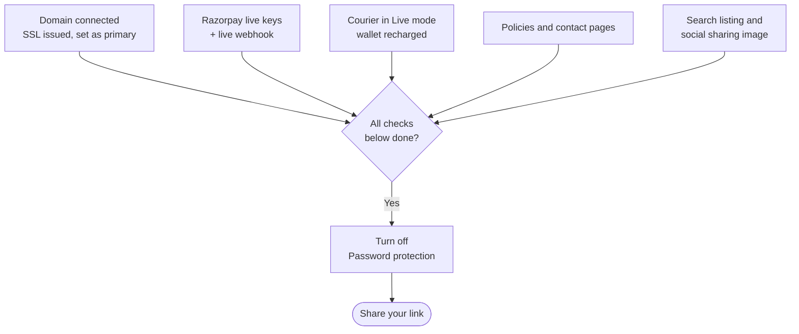

# Going live

The last checks before you share your store link on Instagram and WhatsApp. Do these once
[Set up your store](/merchant-guide/set-up-your-store) is done.

## What this is for

Making sure the first real shopper gets a working checkout, a correct invoice, a delivery
date you can keep, and a store on your own domain, not a test link.

## How it works

Going live is mostly switching things from "test" to "real": your domain, payment keys,
courier mode, and the password page.

## The go-live checklist

<Steps>

### Connect your domain

**Settings → Domains → Connect existing domain**, for example `ashahandlooms.in`. Add the **DNS
records** shown at your domain provider (GoDaddy, Hostinger, Cloudflare...), then select
**Verify connection**. Wait for the status to go from **Pending verification** to
**Connected**, and for the **SSL certificate** to be issued. Then **Set as primary**, and keep
**Redirect to primary domain** on.

<Screenshot
  name="Domain detail"
  caption="Settings → Domains → ashahandlooms.in detail page with status Connected, the DNS records table (A and CNAME rows), SSL certificate issued, and the Set as primary button."
/>

### Switch payments to live

In the Razorpay Dashboard, switch to **Live mode**, generate live keys, and put the live **Key
ID**, **Key secret** and a live webhook (with its **Webhook secret**) into **Settings →
Payments**. Test keys never take real money.

### Switch your courier to live

Set Delhivery's **Mode** to **Live** with your live API token, and recharge your courier wallet.
Update **Balance on the courier dashboard (₹)** and set a low-balance alert.

### Publish your policy pages

Under **Online Store → Pages**, publish at least: Contact us (with your phone and email),
Shipping policy, Returns and refunds, Privacy policy and Terms of service. Razorpay asks for
these during activation. Add them to your footer in **Content → Menus**.

### Check notifications

**Settings → Notifications**: make sure **Order placed**, **Payment received** and **Order
shipped** go out by email (Amazon SES), and WhatsApp if you use it.

### Polish search and sharing

**Online Store → Preferences**: a **Home page title** and meta description, a **Social sharing
image** (what WhatsApp shows when someone shares your link), and your GA4, Tag Manager or Meta
pixel IDs if you advertise.

### Do one real order

Buy one real product with a real UPI payment, ship it to a friend, and refund it. It's the only
way to be sure every step works with live keys.

### Open the doors

Turn off **Password protection** in **Online Store → Preferences** and share your link.

</Steps>

<Callout type="warning">
  **Cancel and refund** every test order, not just cancel it. Cancelling doesn't return the money
  on its own, and the refund is what issues the credit note your first GSTR-1 export needs.
</Callout>

## Common problems and fixes

| Problem | Why it happens | Fix |
| --- | --- | --- |
| Domain stuck on **Pending verification** | DNS changes can take a few hours to spread. | Double-check the records match, wait, then **Verify connection** again. |
| **SSL failed** | The domain points somewhere else too (an old website). | Remove old A/CNAME records at your provider, then verify again. |
| Real payments show as **Unpaid** | Webhook still points at test mode. | Add a live-mode webhook in the Razorpay Dashboard. |
| Shoppers see a password page | **Password protection** is still on. | Turn it off in **Online Store → Preferences**. |

## FAQ

<Faq>

<FaqItem question="Can I keep my old link working?">

Yes. Your store's included domain stays under **All domains**, and with **Redirect to primary
domain** on, visitors to it land on your new domain.

</FaqItem>

<FaqItem question="How long does Razorpay activation take?">

That's up to Razorpay, usually a few working days after you submit your KYC and website. Having
your policy pages published speeds it up.

</FaqItem>

</Faq>

## Related guides

<RelatedGuides ids={['set-up', 'payments', 'online-store', 'whats-new']} />
