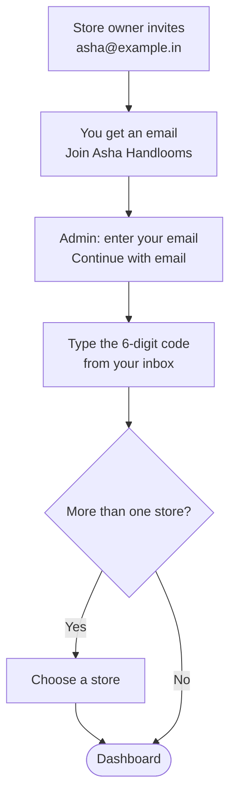

# Getting started

A short guide to logging in and finding your way around your store's admin. No jargon, and no
passwords to remember.

## What this is for

- Your first login, after the store owner invites you.
- Knowing what the home dashboard is telling you each morning.
- Finding orders, products, apps and settings quickly.

## How it works

Your store invites you by email. Every time you log in, we email you a fresh one-time code; if
you work in more than one store, you pick which one to open.

## Creating your store

If you are starting a brand new store rather than joining one you were invited to, sign in with
your email the same way (**Continue with email**, then the code). If you land on **Create your
store**, you answer four short questions, one per screen. The dots at the top show how far along
you are, and **Back** takes you to the previous question without losing your answers. Nothing is
saved until the last screen.

1. **Store name and address.** Pick a store name; a store address is suggested from it (letters,
   numbers and hyphens, 3-40 characters) with a live check for whether it is free.
2. **What do you sell?** Tap the picture that fits best. We add a few starter collections to
   match (for clothing: Women, Men, Kids), plus **New arrivals** and **Best sellers** for
   everyone. Each one fills itself from a product tag: tag a product `women` and it shows up in
   Women. Rename or delete them any time under **Products → Collections**.
3. **Where are you based?** India is chosen for you; pick your state. It goes on your store
   address (Settings → Store details) and decides whether an order gets CGST + SGST or IGST.
4. **Do you already sell somewhere?** Pick the main place. If you choose **Shopify**, select
   **Create store** and you land straight on **Apps → Shopify importer**, already installed, to
   bring your catalogue across. Otherwise you land on your new store's Home, with the usual setup
   checklist.

If instead you see **Signups are invite-only for now**, the platform is not open to sign-ups yet
and nobody has invited that email. Leave your email, phone number and what you sell, then select
**Join the waitlist**; you get an invite by email once there is room. Sending it again just
updates your details.

## Log in step by step

<Steps>

### Accept your invitation

Open the invitation email ("Join Asha Handlooms"). It says which role you'll join as. Select
**Accept invitation**; if you're not logged in yet, select **Sign in and join**.

### Enter your email

On the **Log in** screen, use the email your store invited and select **Continue with email**.
You'll see "Code sent to" your email address.

### Type the code

Enter the one-time code and select **Log in**. If it says **Wrong code**, check the newest email
or use **Use a different email** to start again.

### Pick a store

If you belong to more than one store, you'll see **Choose a store**. Select one; you can switch
any time from the store picker at the top of the sidebar.

</Steps>

<Screenshot
  name="Log in screen"
  caption="Admin Log in screen after Continue with email, showing 'Code sent to asha@example.in', the 6-digit code field and the Log in button."
/>

## The dashboard

After you log in, you land on **Dashboard**. At the top is a one-line summary of your day, for
example:

> Good evening, Asha. 14 orders today worth ₹23,400, 3 need shipping.

Below it, **Needs you** lists "The things only you can do next":

| You'll see | Button | What to do |
| --- | --- | --- |
| "3 orders are ready to ship" | **Ship orders** | Book labels in Shipments → To book. |
| "2 UPI payments need checking" | **Check payments** | Match transfers in your bank app, then mark them paid. |
| "5 GST invoices are queued" | **Issue invoices** | Review and issue the queued GST invoices. |
| "4 products are running low" | **Restock** | Order more or update stock. |
| "2 pre-orders are waiting on their balance" | **View pre-orders** | Request or chase the balance. |

When there's nothing to do it says "You're all caught up". Further down: **Latest orders**, a
**Live view** of shoppers on your store right now, and **How you're doing** for the week.

**Analytics → Live view** puts the same orders on a full-page globe. Drag to spin or tilt it;
scroll, pinch or use the + and − buttons to zoom (up to 4×). The closer you zoom, the more and
finer the dots, so India's coastline reads clearly up close. If your device has reduced motion
turned on, the globe stays still until you drag it.

<Screenshot
  name="Home dashboard"
  caption="Dashboard in the morning: the greeting line with today's orders and ₹ total, the Needs you card with Ship orders and Check payments rows, and Latest orders below."
/>

## Finding your way around

The sidebar is how you get everywhere:

| Section | What's inside |
| --- | --- |
| **Home** | The dashboard. |
| **Orders** | Drafts, Abandoned checkouts, Shipments. |
| **Products** | Collections, Inventory, Purchase orders, Transfers, Gift cards. |
| **Customers** | Segments. |
| **Content** | Files, Metaobjects, Menus, Blog posts. |
| **Analytics** | Reports, Live view. |
| **Marketing** | Campaigns, Automations. |
| **Discounts** | Codes and automatic discounts, with a different amount for each product if you like ([Discounts](/merchant-guide/selling/discounts)). |
| **Online Store** | Themes, Pages, Preferences. |
| **Apps** | Installed apps, each with its own entry. |
| **Settings** | Pinned at the bottom: General, Payments, Shipping, Notifications, Files, Staff, Custom data, Domains, Appearance. |

<Callout type="info">
  **Tip.** Press <kbd>Ctrl</kbd> <kbd>K</kbd> (<kbd>⌘</kbd> <kbd>K</kbd> on a Mac) anywhere
  in the admin to "Search or jump to" an order, product or customer. <kbd>G</kbd> then <kbd>O</kbd>
  jumps to Orders, <kbd>G</kbd> <kbd>P</kbd> to Products, <kbd>G</kbd> <kbd>C</kbd> to
  Customers, and <kbd>?</kbd> shows every shortcut.
</Callout>

## Common problems and fixes

| Problem | Why it happens | Fix |
| --- | --- | --- |
| The code email didn't arrive | Spam folder, or a typo in the email. | Check spam and Promotions; use **Use a different email** to retype it. |
| **Wrong code** | A mistyped or older code. | Type the code from the newest email, or ask for a new one. |
| **Signups are invite-only for now** | You aren't a member of any store, and this email has no live invite to create one. | Join the waitlist on that screen, ask whoever invited you for a fresh link, or ask the owner of an existing store to invite you instead. |
| "Too many tries" on the waitlist | The waitlist form was sent many times in an hour. | Wait for the time it shows, then try once more. You only need to join once. |
| "Invitation expired" | The link is too old. | Ask the owner to send a new invite. |

## FAQ

<Faq>

<FaqItem question="Can I set a password instead?">

No, and that's deliberate: one-time codes can't be reused or leaked from another website.

</FaqItem>

<FaqItem question="Can I use the admin on my phone?">

Yes. The admin works in your phone's browser. For day-to-day work (checking payments, booking
shipments) a phone is enough.

</FaqItem>

<FaqItem question="How do I switch to dark mode?">

**Account menu → Appearance → Theme**: Light, Dark or System. You can also pick an **Accent
colour** there.

</FaqItem>

</Faq>

## Next steps

<RelatedGuides ids={['set-up', 'going-live', 'products', 'orders']} />
