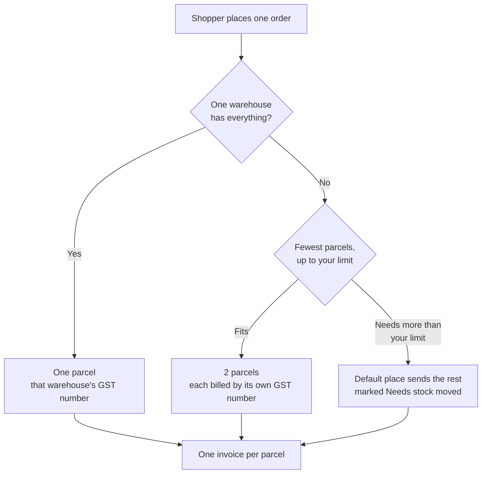

# Several warehouses and GST

If you keep stock in more than one place, one online order can be sent from more than one of
them. Your shopper still places **one order** and pays the price they saw. Behind it, each part of
the order (a **parcel**) is sent and billed from its own warehouse, under that warehouse's own GST
number.

## What this is for

- Selling from a Haryana warehouse and a Karnataka warehouse, each with its own GST number.
- Not losing a sale when no single warehouse has everything in the cart.
- Getting the right invoice and credit note from the right GST number without doing it by hand.

Nothing changes for your store until you turn on **Ships online orders** for a second place.

## How it works

1. **Pick one place first.** The order goes from one warehouse that has everything. If several
   do, the one in the shopper's own state wins, then the one higher in your list, then the one
   with the most stock.
2. **Otherwise split.** The order is split into as few parcels as possible, never more than
   **Most parcels per order** (2 unless you change it).
3. **Otherwise top up.** If it would need more parcels than you allow, your default place sends
   the rest even if it is short, and that parcel shows **Needs stock moved**. You move the stock
   there first. An order is only refused when all your places together do not have enough.

Pre-order items that no warehouse has stock for wait in a **held** parcel at your default place.

## Set it up

**Where to find it → What to do → What you'll see**

<Steps>

### A GST number for each state

**Settings → Taxes & GST → GST numbers.** Add the GST number for each state you keep stock in.
See [GST & invoices](/merchant-guide/settings/taxes#gst-numbers-tab).

### Tie each warehouse to its GST number

**Settings → Locations & warehouses →** open a place **→ Bills under.** Only GST numbers from the
place's own state are offered, because goods leaving a state are billed under that state's GST
number.

### Let it send online orders

On the same place, turn on **Ships online orders**. Your default place always ships. Back on the
list, the **Online orders** column says **Ships** or **Stock only**, and the arrows put the
places in order of preference.

### Choose how many parcels at most

Under **How orders are sent**, set **Most parcels per order**.

</Steps>

Prices include GST, so which warehouse sends an order never changes what the shopper pays. It
only decides CGST + SGST or IGST on the invoice. When you edit a product's **Stock** number, the
change goes to your main selling place, and the total becomes the number you typed.

## What your shopper sees

When an order will split, checkout shows **Ships in 2 parcels** under the delivery choice, with
each parcel's items, the city it comes from and its expected delivery dates. The same list is on
the thank-you page, in their account and in the order email. An order that ships in one parcel
looks exactly as before. If the only warehouse that has an item is on the composition scheme and
the shopper is in another state, they see *"We can't deliver this item to your state yet."*

## What you see on the order

The order page has **Ships from** (or **Ships in 2 parcels**): each parcel's place, city, GST
number, status, items and how many are packed, and the **Needs stock moved** badge. Courier
pickup goes from the parcel's own place.

## Invoices and credit notes

- **One tax invoice per parcel**, from that parcel's GST number and its own number series. It
  lists only that parcel's items, plus its share of shipping and discount. Together the invoices
  add up to what the shopper paid.
- **A split order can carry both taxes.** A parcel from a warehouse in the shopper's state shows
  CGST + SGST; a parcel from another state shows IGST. The order page, the thank-you page and
  the emails show whichever rows apply.
- **A warehouse on the composition scheme** prints a **bill of supply** with no GST, and never
  sends to another state.
- **Refunds make one credit note per GST number they touch.** Money for a returned item is
  credited by the GST number that sent it. Any other refund (a goodwill amount, shipping) is
  shared between the invoices by their value. No credit note ever credits more than its invoice.
- **Returns go back to the warehouse they left from.** The courier collects the return from the
  customer and brings it there.
- **Each GST number files its own GSTR-1.** See
  [GST invoices](/merchant-guide/money-and-gst/gst-invoices#more-than-one-gst-number).

## What still needs your CA

Vextro does not do these yet. Ask your chartered accountant how to handle them:

- **Moving stock between your own GST numbers.** A [transfer](/merchant-guide/stock/transfers)
  moves the count only. It makes no invoice or delivery challan, and it does not value the goods.
- **E-way bills.** They are not made for transfers or for parcels.
- **A warehouse that belongs to a different PAN** (a separate seller). One store, one business is
  the only set-up today.
- **A receipt for money taken in advance** on a split order or a pre-order, and what to do with a
  refund that is not tied to any item.

## Common problems and fixes

| Problem | Why it happens | Fix |
| --- | --- | --- |
| Every order still ships in one parcel | Only your default place sends online orders. | Turn on **Ships online orders** on the second place. |
| *"No GST number for Delhi yet"* | A place is in a state where you have no GST number. | Add it under **Settings → Taxes & GST**. |
| A parcel says **Needs stock moved** | The order needed more parcels than your limit, so the default place sent the rest. | Create a [transfer](/merchant-guide/stock/transfers) to that place, or raise **Most parcels per order**. |
| IGST where you expected CGST + SGST | That parcel is billed from a GST number in another state. | Check **Bills under** on the place. |
| The credit note is missing for one GST number | The refund did not reduce that invoice. | Credit notes are made only for invoices the refund reduces. |

## Related guides

<RelatedGuides ids={['locations', 'gst', 'orders', 'transfers']} />
