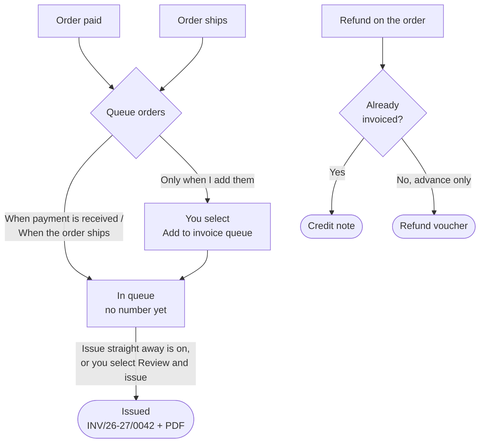

# GST invoices

The **GST invoices** app turns your orders into GST-ready documents: tax invoices, credit
notes, packing slips, order confirmations, receipt vouchers and refund vouchers, numbered in
your own series and saved as PDFs.

## What this is for

- A proper tax invoice for every order, with your GSTIN, the buyer's state, HSN codes and the
  CGST/SGST or IGST split, without typing anything.
- A credit note when you refund a shopper, linked to the original invoice.
- Invoices with the **buyer's GSTIN** for B2B orders, so your business customers can claim
  input tax credit.
- Exporting a GSTR-1 file for your CA at the end of the month.

## How it works

Orders enter an **invoice queue** at the moment you choose (when paid, or when shipped). A
queued document is **In queue** and has no number yet. When you **issue** it, it takes the next
number in your series and its PDF is made. Refunds produce a credit note against the invoice
(or a refund voucher, if the goods hadn't been invoiced yet).

Pre-orders are special: taking a deposit before the goods exist is an **advance** under GST,
so a paid pre-order gets a **receipt voucher** first, and its tax invoice when it ships.

## Set it up step by step

<Steps>

### Install the app

Go to **Apps**, find **GST invoices** under **Built-in apps**, and select **Install**. It now
appears under **Apps** in the sidebar with four pages: **Queue**, **Invoices**, **Returns** and
**Settings**.

### Business details

Open **Settings → Business details** and enter your **Legal name** (exactly as on your GST
registration), **GSTIN** (for example `27AAPFU0939F1ZV`, checked as you type), **State**,
**Logo**, **Signature** and **Signatory name**. These print as the supplier on every document,
as CGST rule 46 requires. Legal name, GSTIN and address can also be edited in
**Settings → Taxes & GST**; both screens change the same details.

<Callout type="info">
  Until your GSTIN is filled in, the Queue page shows "Finish setting up GST invoices" with a
  **Go to settings** button. Nothing is issued without it.
</Callout>

### Numbering series

Under **Numbering series**, set a **Prefix** (use `{FY}` to put the financial year in, e.g.
`INV/{FY}/` gives `INV/26-27/0042`), the number of **Digits**, and what the series is **Used
for**: Domestic, Export or **B2B (buyer GSTIN)**. **Add series** for credit notes and vouchers.
Set **HSN digits** (4, 6 or 8) and a **Default HSN** for products that don't have one. The
domestic tax invoice series (its prefix, next number and whether it starts again every April)
is also on **Settings → Taxes & GST**.

### Template and style

Choose **Classic**, **Minimal** or **GST compact**. The preview updates as you type.

<Screenshot
  name="GST invoice template preview"
  caption="Apps → GST invoices → Settings → Template and style with the Classic template selected and the live preview showing a tax invoice for ₹2,499 with HSN 6109 and CGST 6% + SGST 6% lines."
/>

### Queue and delivery

Pick **Queue orders**: **When payment is received**, **When the order ships** or **Only when I
add them**. Turn on **Issue queued invoices straight away** if you don't want to review each
one.

### Add HSN codes and GST rates to products

On each product's **Shipping** card, fill **HS (harmonised system) code** (your HSN, e.g. `6109`
for cotton T-shirts) and **GST rate (%)**. Leave the rate blank to use the store rate from
**Settings → Taxes & GST**.

</Steps>

<VideoTip
  title="Issue your first GST invoice"
  caption="Add your GSTIN in Business details, open Queue, select Review and issue, download the PDF."
/>

## Day to day

- **Queue** ("Invoice queue") lists documents **In queue**. Select **Review and issue**, then
  **Issue N invoices**. Use **Add orders** to queue older orders by hand.
- **Invoices** lists everything **Issued** or **Cancelled**, with the PDF for each.
- On an order's page, the **GST documents** card shows that order's documents, with **Add to
  invoice queue**, **Issue credit note** and the **Buyer GSTIN** for B2B orders.
- **Returns** has **Export GSTR-1** for the month, then **Mark filed** and **Close period** once
  your CA has filed it.

<Callout type="warning">
  Once issued, an invoice keeps its number forever. To correct one, issue a credit note and a
  fresh invoice, never edit the old number. That's what GST law expects, and what your CA will
  look for.
</Callout>

## How the tax split works

Prices in your store include GST. On each order the tax is split out of the price using the
product's **GST rate (%)**:

| Shopper ships to | Tax on the invoice | Example: ₹1,180 at 18% |
| --- | --- | --- |
| Your own state | CGST + SGST, half each | ₹1,000 + CGST ₹90 + SGST ₹90 |
| Another state | IGST | ₹1,000 + IGST ₹180 |

## Common problems and fixes

| Problem | Why it happens | Fix |
| --- | --- | --- |
| Nothing is being queued | **Queue orders** is **Only when I add them**, or the app isn't set up. | Check **Queue and delivery** and **Business details**. |
| A queued invoice won't issue | A required detail (like GSTIN) is missing. | The queue shows the reason; fix it in Settings and issue again. |
| Wrong HSN on an invoice | The product has no HS code, so **Default HSN** was used. | Add the HS code on the product; for the issued invoice, credit note and re-issue. |
| IGST where you expected CGST/SGST | The **State** in Business details doesn't match the shipping state. | Correct your State in Business details. |

## FAQ

<Faq>

<FaqItem question="Do I need this app if I'm not GST registered?">

No. If you're under the GST threshold, leave **GSTIN** blank in **Settings → General** and you
can skip this app. You can still print packing slips from each order.

</FaqItem>

<FaqItem question="Does cancelling an order create a credit note?">

Only a **refund** does. If you cancel an invoiced order and refund the shopper, the refund
issues the credit note (or a refund voucher, if only a pre-order advance was paid).

</FaqItem>

<FaqItem question="Can shoppers download their invoice?">

Yes. Once issued, a link to the invoice appears on the shopper's order page and in their order
emails.

</FaqItem>

<FaqItem question="What about exports without IGST?">

Under **Exports**, choose **Letter of Undertaking, without IGST** and enter your **LUT reference
number**, or **Payment of IGST, refund claimed later**.

</FaqItem>

</Faq>

## Related guides

<RelatedGuides ids={['orders', 'products', 'set-up', 'glossary']} />
