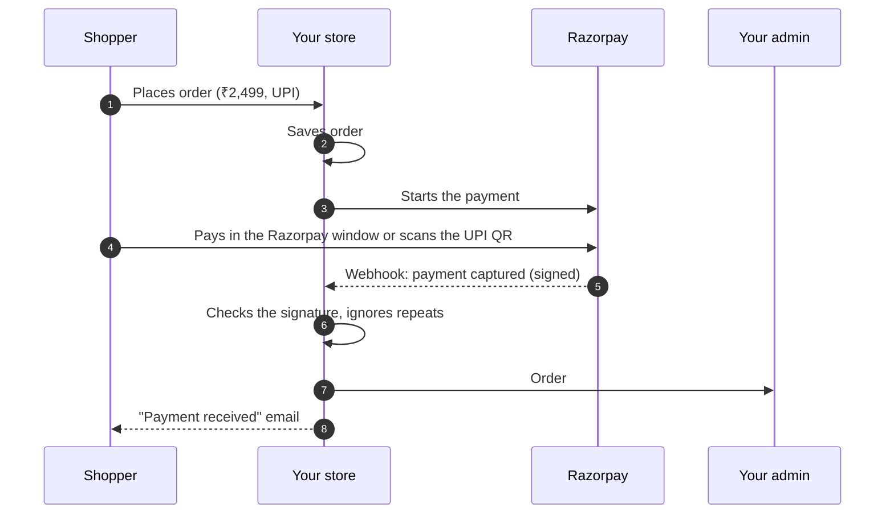

# Payments

**Settings → Payments** is where you choose how shoppers can pay, add a fee or discount per
method, and decide what happens to orders that never get paid. Gateway keys are stored
encrypted.

## What this is for

- Taking UPI, cards and netbanking through Razorpay.
- Offering cash on delivery with a ₹49 handling fee, or a 2% discount for paying by UPI.
- Letting shoppers pay straight to your UPI ID or bank account, and confirming it yourself.
- Cancelling online orders that were never paid, so stock isn't held for nobody.
- Collecting the rest of the money on pre-orders.

## How it works

When a shopper places an order, the order is saved first, then the payment starts. The order
is marked paid only when the money is confirmed, either by the gateway telling us directly (a
**webhook**) or by you, for cash and manual transfers.

Two safety nets are built in:

- **Every webhook is checked** against your Razorpay **Webhook secret**, and a repeated
  webhook (Razorpay retries) is recognised and ignored, so an order is never marked paid twice.
- **The total is always recalculated on our side**, including the payment method's fee or
  discount. A shopper can't change what they pay by editing the page.

## Payment methods

| Method | What the shopper does | Who confirms payment |
| --- | --- | --- |
| **Razorpay** | Pays by card, netbanking, UPI or wallet in the Razorpay window | Razorpay, automatically |
| **UPI (auto-confirmed, Razorpay QR)** | Scans a single-use QR for the exact amount | Razorpay, automatically |
| **UPI or bank transfer** | Pays your UPI ID or bank account from their own app | You, in **Orders → Pending UPI** |
| **Cash on delivery** | Pays the delivery person | You or the courier's remittance |

Razorpay can also offer EMI (Snapmint cardless EMI and card EMI) with **Offer EMI**.

## Set up payments step by step

<Steps>

### Open Settings → Payments

The page has three tabs: **Payment methods**, **Unpaid orders** and **Pre-orders**.

### Connect Razorpay

Install **Razorpay** from **Apps** if it isn't installed. On the **Razorpay** card, enter your
**Key ID** and **Key secret** from the Razorpay Dashboard (**Account & Settings → API Keys**),
and the **Name shown in checkout**, for example "Asha Handlooms".

### Add the webhook

Copy the **webhook URL** shown on the card into your Razorpay Dashboard's webhooks, set a
**Webhook secret** there and paste the same secret here. Tick the `payment.*` and `refund.*`
events, plus `qr_code.credited` and `qr_code.closed` if you use auto-confirmed UPI.

<Screenshot
  name="Razorpay payment method card"
  caption="Settings → Payments → Payment methods with the Razorpay card expanded: Key ID filled in, Key secret masked as ••••1234, the webhook URL with a copy button, and Enabled switched on."
/>

### Turn on the other methods you want

Enable **Cash on delivery**, **UPI or bank transfer** (fill in **UPI ID**, **Payee name**,
**Bank**, **Account holder**, **Account number**, **IFSC** and **Instructions for the shopper**)
and **UPI (auto-confirmed, Razorpay QR)**.

### Add a fee or discount (optional)

Each method has **Fee or discount**: **None**, **Fixed amount (₹)** or **Percent of subtotal**,
and a **Label shown to shoppers**, such as "COD handling" (₹49) or "UPI discount" (2%).

### Save and test

Select **Save**, then place a small test order on your storefront (say a ₹10 product) with each
method, and check it shows up correctly in **Orders**.

</Steps>

<VideoTip
  title="Connect Razorpay and add the webhook"
  caption="Copy Key ID and Key secret from the Razorpay Dashboard, paste them, copy our webhook URL back into Razorpay, Save."
/>

## Unpaid orders

- **Cancel unpaid online orders after (minutes)**: an online order that is never paid is
  cancelled after this many minutes, and its stock released. We check with the gateway first,
  so a payment that arrived late is kept, not cancelled. Set it to `0` to turn this off. Cash on
  delivery is never auto-cancelled.
- **Unpaid UPI or bank transfers** have their own, separate timer: **Cancel unpaid transfer
  orders automatically** after a number of hours (**Cancel after (hours from the order)**). The
  shopper gets an email 12 hours before their order is cancelled.

## Pre-order balances

For pre-orders that take a deposit at checkout, the **Pre-orders** tab controls the rest:

- **Request the balance automatically**, a set number of **Days before the expected ship
  date**.
- **Reminders (days after the request)**: how many reminders go out, and when.
- **If the balance is not paid** within a number of days of the request: **Do nothing, I will
  follow up myself**, **Cancel the order and refund the deposit**, or **Cancel the order and keep
  the deposit**.

<Callout type="info">
  **Tip.** If you keep deposits on unpaid pre-orders, say so clearly on the product page and in
  your terms. Shoppers in India expect a refund unless told otherwise, and a clear line avoids
  chargebacks.
</Callout>

## More gateways: coming soon

Razorpay is the gateway available today. Other gateways (Cashfree, PhonePe, PayU) can be added
by a developer as a plugin (see the [Plugins SDK](/developer-docs/building/plugins)); a one-click
**Connect** for them from Apps is coming soon.

## Common problems and fixes

| Problem | Why it happens | Fix |
| --- | --- | --- |
| Shopper paid but the order is still **Unpaid** | The webhook isn't reaching us, or the secret doesn't match. | Check the webhook URL and **Webhook secret** in the Razorpay Dashboard match this page exactly. |
| Auto-confirmed UPI orders never get paid | The QR events aren't ticked. | Tick `qr_code.credited` and `qr_code.closed` on the Razorpay webhook. |
| An order was cancelled but the shopper paid | They paid after the unpaid-order window. | The order shows **Refund needed**; refund that payment, or place a fresh order for them. |
| COD fee isn't showing at checkout | The fee is set on a disabled method, or Type is **None**. | Enable **Cash on delivery** and set **Fixed amount (₹)**. |

## FAQ

<Faq>

<FaqItem question="Where do I see my Razorpay payment ID?">

On the order page, each payment shows its reference and the gateway's own payment id (it starts
with `pay_`), so you can find it in the Razorpay Dashboard.

</FaqItem>

<FaqItem question="Are my Razorpay keys safe?">

Yes. The **Key secret** and **Webhook secret** are encrypted before they're stored and are shown
back to you masked, like `••••1234`. See [Security and data protection](/merchant-guide/money/security).

</FaqItem>

<FaqItem question="Can a shopper retry a failed payment?">

Yes. A failed attempt is kept as history and the shopper can pay again from the pay page; each
retry is a new attempt on the same order, and the gateway is never charged twice for one attempt.

</FaqItem>

<FaqItem question="Do refunds go back automatically?">

For Razorpay payments, yes: **Refund** sends the refund through Razorpay. For cash on delivery
and manual UPI/bank transfers, the refund is recorded for your books and you send the money
yourself.

</FaqItem>

</Faq>

## Related guides

<RelatedGuides ids={['orders', 'gst', 'security', 'going-live']} />
