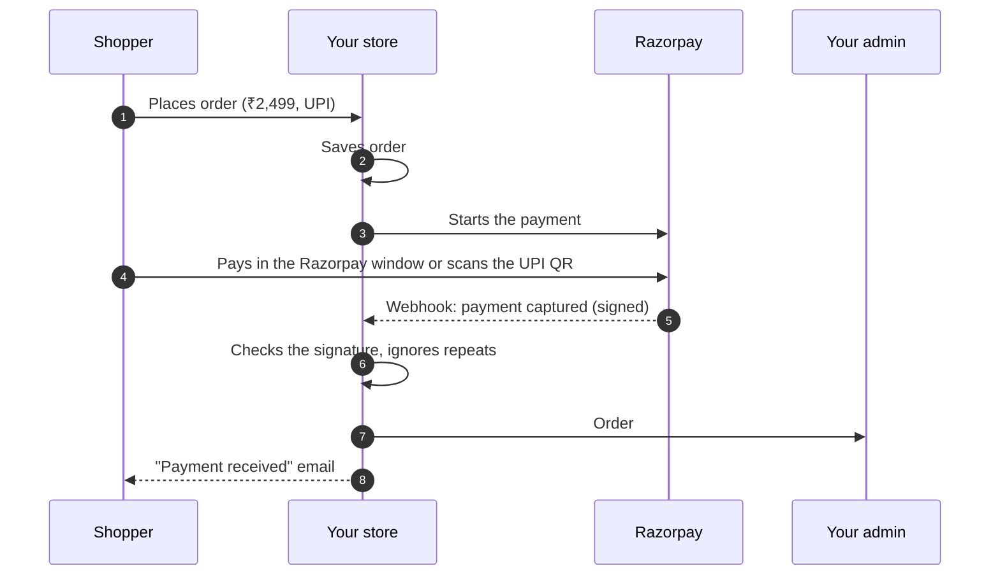

# Payments

**Settings → Payments** is where you get paid online. You connect one payment company (Razorpay
or Cashfree), choose which ways shoppers can pay (UPI, cards, cash on delivery and so on), and
try it with a ₹1 test order. Keys are stored encrypted.

## What this is for

- Taking UPI, cards, netbanking, wallets and pay later through Razorpay or Cashfree.
- Offering cash on delivery with a ₹49 handling fee, or a 2% discount for paying by UPI.
- Letting shoppers pay straight to your UPI ID or bank account, and confirming it yourself.
- Cancelling online orders that were never paid, so stock isn't held for nobody.
- Collecting the rest of the money on pre-orders.

## How it works

When a shopper places an order, the order is saved first, then the payment starts. The order
is marked paid only when the money is confirmed, either by the gateway telling us directly (a
**webhook**) or by you, for cash and manual transfers.

Two safety nets are built in:

- **Every webhook is checked** against your Razorpay **Webhook secret**, and a repeated
  webhook (Razorpay retries) is recognised and ignored, so an order is never marked paid twice.
- **The total is always recalculated on our side**, including the payment method's fee or
  discount. A shopper can't change what they pay by editing the page.

## The Payments page

<Screenshot
  name="Settings → Payments"
  caption="The status line (You can take payments), Main way to get paid with Razorpay in Test mode and a green Working tick, the Shoppers can pay with rows, and Add another way to get paid."
/>

From top to bottom:

- **Status line.** "✓ You can take payments", or what is missing ("You can take cash on delivery
  only"). **Place a test order** opens your checkout in a new tab with a ₹1 test item in the
  basket. The test item is hidden from your store and never touches your stock.
- **Main way to get paid.** The payment company that takes the money, **Test** or **Live**, a
  green **Working** tick, the last payment, and when money usually reaches your bank. **Manage**
  opens its Connect page; **Change** lets you pick another company. Your old keys are kept, so
  you can switch back.
- **Shoppers can pay with.** One row per way to pay: **UPI**, **Cards**, **Netbanking**,
  **Wallets**, **Pay later / EMI** and **Cash on delivery**. Switch each on or off, and drag
  the rows to change the order. Checkout shows only the ones that are on, in this order, and the
  payment window offers only those. New shops start with UPI, Cards and Netbanking on.
- **+ Add another way to get paid.** Search payment companies, filter by UPI, cards and so on,
  and see fees and when money reaches your bank. Razorpay and Cashfree connect today; others
  show **Coming soon**.
- **Advanced.** Bank transfer and UPI QR you confirm yourself, a fee or discount per method, and
  unpaid-order rules, on their own page (**Settings → Payments → Advanced**). Payments are taken
  as soon as the shopper pays, so there is no capture setting.

### When something is wrong

A problem shows as a red dot with one plain sentence, and a button to fix it where we can:

| Message | Button | What it does |
| --- | --- | --- |
| Payments go through, but updates aren't reaching your shop | **Fix it** | For a one-click Razorpay connection, points Razorpay's updates back at your shop. |
| (same, with pasted keys) | **Show me how** | Opens the Connect page at the webhook step. |
| Your connection ran out | **Connect again** | Opens the Connect page to run Connect Razorpay again. |
| Some connection details are missing or wrong | **Check details** | Opens the Connect page. |
| Every online way to pay is turned off | **Turn on UPI** | Turns UPI back on. |

## First-time setup, one question at a time

A new shop opening **Settings → Payments** gets a short guide with a progress bar. You can press
**Skip for now** at any step, and reopen it with **Set up step by step**.

<Steps>

### How do you want to get paid?

Pick **Razorpay**, **Cashfree**, or **Only cash on delivery for now**. Not sure? Press
**What's this?** for a two-line explanation.

### Connect

Pick **Test** or **Live**, then follow the three numbered steps. They tell you where to click in
your payment company's dashboard and what to copy. Press **Test connection** to check your keys
(nothing is charged or created), then **Save and connect**.

If your platform has Razorpay's partner app set up, you'll also see a **Connect Razorpay**
button: log in to Razorpay, press Allow, done. Payment updates are switched on for you.

### Which payments?

UPI, Cards and Netbanking are already on. Turn others on if you want them.

### Try a ₹1 test order

Press **Open test checkout**, pay ₹1 (in Test mode no real money moves), and see the order arrive
in **Orders**.

### You're ready

Money from real orders reaches your bank in about 2 working days.

</Steps>

## Connect Razorpay with API keys

1. Open the Razorpay Dashboard, **Account & Settings → API Keys**, and pick Test or Live at the
   top.
2. Press **Generate Key**, and paste the **Key ID** and **Key Secret** on the Connect page.
3. In **Account & Settings → Webhooks**, add a webhook with the **Webhook address** and
   **Webhook secret** shown on the Connect page (we make the secret for you; copy it). Tick
   `payment.captured`, `payment.failed` and `refund.processed`, plus `qr_code.credited` and
   `qr_code.closed` if you use auto-confirmed UPI.

<VideoTip
  title="Connect Razorpay"
  caption="Copy Key ID and Key Secret from the Razorpay Dashboard, paste them, copy our webhook address and secret back into Razorpay, then Save and connect."
/>

For Cashfree, see [Cashfree](/merchant-guide/money/cashfree): it needs only two values and no
webhook.

## Ways to pay you confirm yourself

| Method | What the shopper does | Who confirms payment |
| --- | --- | --- |
| **UPI (auto-confirmed, Razorpay QR)** | Scans a single-use QR for the exact amount | Razorpay, automatically |
| **UPI or bank transfer** | Pays your UPI ID or bank account from their own app | You, in **Orders → Pending UPI** |
| **Cash on delivery** | Pays the delivery person | You or the courier's remittance |

Set the first two up under **Advanced**. Each method can also have a **Fee or discount**:
**None**, **Fixed amount (₹)** or **Percent of subtotal**, with a **Label shown to shoppers**
such as "COD handling" (₹49) or "UPI discount" (2%).

## Unpaid orders

- **Cancel unpaid online orders after (minutes)**: an online order that is never paid is
  cancelled after this many minutes, and its stock released. We check with the gateway first,
  so a payment that arrived late is kept, not cancelled. Set it to `0` to turn this off. Cash on
  delivery is never auto-cancelled.
- **Unpaid UPI or bank transfers** have their own, separate timer: **Cancel unpaid transfer
  orders automatically** after a number of hours (**Cancel after (hours from the order)**). The
  shopper gets an email 12 hours before their order is cancelled.

## Pre-order balances

For pre-orders that take a deposit at checkout, **Advanced → Pre-orders** controls the rest:

- **Request the balance automatically**, a set number of **Days before the expected ship
  date**.
- **Reminders (days after the request)**: how many reminders go out, and when.
- **If the balance is not paid** within a number of days of the request: **Do nothing, I will
  follow up myself**, **Cancel the order and refund the deposit**, or **Cancel the order and keep
  the deposit**.

<Callout type="info">
  **Tip.** If you keep deposits on unpaid pre-orders, say so clearly on the product page and in
  your terms. Shoppers in India expect a refund unless told otherwise, and a clear line avoids
  chargebacks.
</Callout>

## More payment companies

Razorpay and Cashfree connect today. Decentro, PhonePe and PayU are listed as **Coming soon**.
A developer can add others as a plugin (see the [Plugins SDK](/developer-docs/building/plugins)).

## Common problems and fixes

| Problem | Why it happens | Fix |
| --- | --- | --- |
| Shopper paid but the order is still **Unpaid** | The webhook isn't reaching us, or the secret doesn't match. | Press **Fix it** or **Show me how** on the red line, or check the webhook address and secret in the Razorpay Dashboard match the Connect page exactly. |
| Checkout shows only cash on delivery | Every online way to pay is off, or no payment company is connected. | Switch UPI (or another) on under **Shoppers can pay with**. |
| "These look like Live keys, but Test is picked" | The keys and the Test/Live switch don't match. | Pick the mode that matches your keys. |
| Auto-confirmed UPI orders never get paid | The QR events aren't ticked. | Tick `qr_code.credited` and `qr_code.closed` on the Razorpay webhook. |
| An order was cancelled but the shopper paid | They paid after the unpaid-order window. | The order shows **Refund needed**; refund that payment, or place a fresh order for them. |
| COD fee isn't showing at checkout | Cash on delivery is off, or Type is **None**. | Switch **Cash on delivery** on under **Shoppers can pay with**, and set **Fixed amount (₹)** under **Advanced**. |

## FAQ

<Faq>

<FaqItem question="Where do I see my Razorpay payment ID?">

On the order page, each payment shows its reference and the gateway's own payment id (it starts
with `pay_`), so you can find it in the Razorpay Dashboard.

</FaqItem>

<FaqItem question="Are my Razorpay keys safe?">

Yes. The **Key secret** and **Webhook secret** are encrypted before they're stored and are shown
back to you masked, like `••••1234`. See [Security and data protection](/merchant-guide/money/security).

</FaqItem>

<FaqItem question="Can a shopper retry a failed payment?">

Yes. A failed attempt is kept as history and the shopper can pay again from the pay page; each
retry is a new attempt on the same order, and the gateway is never charged twice for one attempt.

</FaqItem>

<FaqItem question="Do refunds go back automatically?">

For Razorpay payments, yes: **Refund** sends the refund through Razorpay. For cash on delivery
and manual UPI/bank transfers, the refund is recorded for your books and you send the money
yourself.

</FaqItem>

</Faq>

## Related guides

<RelatedGuides ids={['cashfree', 'orders', 'security', 'going-live']} />
