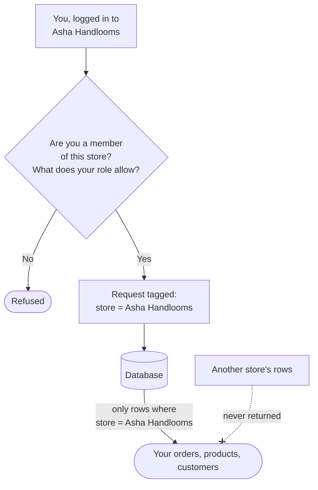

# Security and data protection

A plain-words summary of how your store and your customers' data are protected. The full
technical detail is in the developer [Security](/developer-docs/building/security) page.

## What this is for

- Answering a customer who asks "is my phone number safe with you?"
- Filling in your own DPDP Act (India's Digital Personal Data Protection Act, 2023) paperwork.
- Deciding which staff get which role.

## How it works

Many stores run on the same platform, but each store's data is walled off **inside the
database itself**. Every request is tagged with one store, and the database only hands back
that store's rows, even if a screen or a report has a bug.

## What we protect, and how

<Steps>

### Logging in

No passwords to remember or leak. You log in with a one-time code sent to your email each
time, and login codes and sessions are stored scrambled (hashed), never readable.

### Your store's data stays your store's

Row-level security in the database keeps every store's orders, products and customers apart.
A mistake elsewhere in the app can't show another store's data in yours.

### Secrets are encrypted

Gateway keys, courier API tokens and other credentials you enter are encrypted (AES-256-GCM)
before they're saved, and shown back masked, like `••••1234`.

### Customer phone numbers are encrypted

Customers' phone numbers on their profiles are encrypted too. You can still find a customer by
typing their **full** phone number in search; a partial number like "987" won't match, on
purpose.

### Staff only see what their role allows

**Settings → Staff** has three built-in roles: **Owner** ("Full access, including billing and
staff"), **Administrator** ("Runs the store day to day. Cannot change billing or manage staff
roles") and **Staff** ("Works orders and stock. Read-only elsewhere"). You can **Create role**
for anything in between, such as a "Packing team" that sees orders but not customers' phone
numbers.

### Backups

Your database, and files kept on local disk storage, are backed up daily, encrypted before they
leave the server. We keep the latest 7 daily and 4 weekly backups.

</Steps>

<Callout type="info">
  **Tip.** Give each person their own login, never a shared one. Then **Remove from store**
  works cleanly when someone leaves, and each person gets exactly the role they need.
</Callout>

## What isn't encrypted (and why)

Shipping addresses, including the phone number on them, are not encrypted yet, because they
print on labels, invoices and packing slips all day. City, state and PIN code are never
encrypted: they're needed for GST (state decides CGST/SGST vs IGST), delivery and reports.

## Your DPDP Act checklist

Not legal advice, but a pointer to where the platform already helps:

| DPDP requirement | Where it's covered |
| --- | --- |
| Consent | Marketing and WhatsApp consent are recorded with when and where they were given; unsubscribing stops all future sends. |
| Access and correction | Customers can see and edit their details on their account page; you can on the customer page. |
| Erasure | You can delete a customer, except while orders still reference them (tax records must be kept). |
| Security safeguards | Encryption, store isolation, roles and encrypted backups, above. |
| Breach detection | **Coming soon.** There's no automated breach alerting yet. |

## Common problems and fixes

| Problem | Why it happens | Fix |
| --- | --- | --- |
| Staff member can't see a page | Their role doesn't include it. | Edit their role in **Settings → Staff → Roles**, or give them another role. |
| Customer search by phone finds nothing | Phone search needs the full number. | Type all 10 digits; spaces and `+91` are fine. |
| "Not a member of this store" | You were removed, or you're logged in with a different email. | Ask the owner to invite this email again. |
| Can't delete a customer | They have orders. | Orders must be kept for tax; that's expected. |

## FAQ

<Faq>

<FaqItem question="Can other stores on the platform see my customers?">

No. Store isolation is enforced by the database for every query, not just by the screens you see.

</FaqItem>

<FaqItem question="Can Waimers staff read my Razorpay key secret?">

Secrets are encrypted at rest and never shown in full, even to you. Only the running app
decrypts them, at the moment it needs to talk to Razorpay.

</FaqItem>

<FaqItem question="How do I remove someone's access?">

**Settings → Staff → Members**, open the menu on their row, and select **Remove from store**.
They lose access immediately.

</FaqItem>

</Faq>

## Related guides

<RelatedGuides ids={['getting-started', 'payments', 'dev-security', 'going-live']} />
