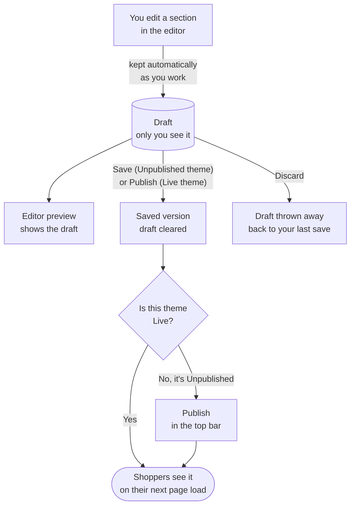

# Online store

Your online store is the website shoppers see. You choose how it looks with a **theme**, and
you change what is on each page in the **editor**, section by section, without writing code.

## What this is for

- Changing your home page banner before a Diwali sale.
- Adding a "Notify me" button to sold-out products, or a PIN code delivery checker.
- Trying a new look on a copy of your theme, then switching to it in one click.
- Adding simple pages such as "About us", "Shipping policy" or "Bulk orders".

## How it works

Every store has one **Live** theme (what shoppers see) and can keep others in the theme
library, marked **Unpublished**. Inside a theme, each page type (home, product, collection,
cart and so on) has a template made of **sections**. Your edits are kept as a draft while you
work, and only reach shoppers when you **Publish**: on the Live theme that saves your changes,
on an Unpublished theme it makes that theme Live.

The chip next to the theme's name tells you where you are: **Unsaved changes** while there is a
draft, **Live** or **Unpublished** once it is saved. Nothing you do in the editor is visible to
shoppers until you publish.

On **Online Store → Themes**, each theme shows a picture of its home page, when it was last
saved and by whom, and an **Unsaved changes** label when the editor holds edits nobody has saved
yet. The picture updates by itself each time you save the home page in the editor; a theme that
has never been opened shows its colours until then. Above the list are **Import Shopify theme**
(see [Import a Shopify theme](/merchant-guide/online-store/import-a-shopify-theme)) and **Add theme**
(start from a preset). **Themes** and **Preferences** are two tabs under the page title.

<Callout type="warning">
  **Always try changes on a copy.** Open the theme's **⋯** menu, select **Duplicate**, then
  **Customize** the copy. Your Live theme is what shoppers see, so a copy is the safe place to
  experiment. Publish the copy only when you are happy with it.
</Callout>

<Screenshot
  name="Themes library"
  caption="Online Store → Themes with the Current theme card marked Live at the top, and one Unpublished theme (Minimal preset) in the Theme library below it."
/>

## Edit your store step by step

<Steps>

### Open the editor

Go to **Online Store → Themes**. On your **Current theme** card, select **Customize**. To try
changes without touching the live store, first open the theme's menu, select **Duplicate**,
then **Customize** the copy.

### Pick the page to edit

Use the page switcher in the middle of the top bar to choose a template: Home, Product,
Collection, Cart and so on. You can also open the **Pages** panel in the narrow strip of icons on
the left and pick one there; its **New page** button starts a new page template. The strip
has, from the top: **Add section**, **Build with AI**, **Pages**, **Layers**, **Media**, **Theme
settings** and **Page settings**. The **Layers** panel groups the page into **Header**,
**Template** and **Footer**; its **Add** button opens the Add panel. Select a group's name to fold
it away when you don't need it.

Products, collections, pages, blogs and blog posts can each have **alternate templates** (for
example a "preorder" product layout). In the page switcher every alternate shows how many items
use it ("3 products"), and its **⋯** menu can **Rename** it (the items using it move to the new
name), **Duplicate** it, or **Delete** it (the items using it fall back to the default). The
default template of each type can't be renamed or deleted.

### Add a section

Decide where it goes first, then pick it:

- **Between two sections**: move the pointer over the gap between two sections, in the list
  or on the page itself. A thin line with a **+** appears. Select it.
- **At the end of a group**: select **Add section** under the header, the template or the
  footer.
- **Anywhere, by dragging**: open the **Add** panel and drag a section onto the page.

The **Add** panel has two sides: **Sections** (whole sections, grouped by kind, and your saved
**My sections**) and **Blocks** (layout and element blocks, and blocks from apps you installed).
Click a group's name to fold it; search with **Search layouts**.

Down the left edge of the editor: **Add**, **Build with AI** (suggestions for this page from the
AI assistant, when it is on; **New chat** starts over), **Pages**, **Layers** (the sections on this page), **Media**,
**Theme settings**, **Page settings** (the page's search listing, social image and who can see
it; **Store-wide settings** opens menus, policies and the rest) and **Help** at the bottom.

Each way opens the same list. The **Sections** tab has the library (banners, product grids,
rich text, testimonials and more), each with a small picture of how it looks; point at one for a
bigger picture. The **Apps** tab has blocks from apps you installed. Pick
one and it goes in exactly where you chose. Some sections first ask you to **choose a style**:
a hero as a slideshow, centred, split or with a video; feature cards 3 or 4 across or without
icons; a banner with its words centred or on the left. Every setting stays editable afterwards,
so a style is only where you start. The page scrolls to it and its settings open on
the right.

<Screenshot
  name="Editor, Add panel on the Apps tab"
  caption="Theme editor with the Add panel open on the Apps tab, showing Pre-order countdown and, with Back in stock installed, the Notify me block."
/>

### Change its settings

Select the section on the canvas or in the list. A small bar appears above it on the page (see
[The bar above a block](#the-bar-above-a-block)) and its settings open on the right in two tabs.
**Basic** holds the section's own settings (text, images, links). **Advanced** holds **Section
settings** in four groups: **Layout**, **Spacing**, **Style** and **Advanced** (details below).
A path at the top of the panel, such as *Template › Group › Image banner*, shows where you are;
select any name in it to jump to that block.

### Type straight onto the page

Click a heading, a button label or a paragraph on the canvas and type, the same as in a
document. This works in every section: the library sections, the
[Zero Drift theme sections](#zero-drift-theme-sections) and the blocks you build yourself (Tabs,
Accordion, Heading, Text, Button). The setting on the right updates as you type.

When you click a paragraph, text buttons appear at the end of the bar above it: **Bold**,
**Italic**, **Underline**, **Link** and **Clear formatting**. Select some words first, then pick
a button. The other buttons stay where they are.

To drag a section somewhere else, grab it by an empty area or use the sections list, not the
text you are editing.

<Callout type="info">
  In the editor, every answer of a **FAQ** section is shown open so you can click and edit it.
  Shoppers still see the answers closed.
</Callout>

### Check it on a phone

Use the three buttons in the top bar to switch between **Desktop**, **Tablet** and **Mobile**.
The page is drawn at that device's real width (1440, 768 or 390 px) and shrunk to fit your
screen. **Undo** and **Redo** are in the top bar too. Under the canvas, switch between **Light**
and **Dark** if your theme has a dark mode; that only changes how the editor shows the page. To
look closer, see [Zoom](#zoom).

### Save

On your **Live** theme, select **Publish**: shoppers see the change on their next page load.
On an **Unpublished** theme, **Save** (next to Publish, while you have changes) keeps your work
without going live, and **Publish** saves it and makes this theme the Live one. Throw away
unsaved changes from **More actions** → **Discard**.

</Steps>

<VideoTip
  title="Change your home page banner in 30 seconds"
  caption="Open Customize, select the banner, swap the image and heading, switch to Mobile to check it, Save."
/>

## The sections list

Each section in the list has, from left to right:

- a **grip** to drag it up or down (or use the arrow keys after pressing space on it);
- an **arrow** that shows the section's **blocks** (its slides, columns, logos or questions),
  if it has any;
- its **name**;
- an **eye** to hide it from shoppers without deleting it. Hidden sections stay in the list,
  crossed out, so you can bring them back;
- a **⋯ menu** with **Duplicate**, **Rename** and **Remove**.

**Rename** only changes the name you see in the list, for example "Diwali banner" instead of
"Image banner". Shoppers never see it. Double-click a name to rename it quickly. The header,
the footer and a page's main content can be renamed and hidden but not removed.

Under a section's blocks, **Add block** adds another slide, column or question with starter
text, ready to edit on the right. Hover a block and select **×** to remove it.

<Screenshot
  name="Sections list"
  caption="The Sections list with the Header, Template and Footer groups, one row's ⋯ menu open on Duplicate, Rename and Remove, and the blue insert line with its + between two sections."
/>

## The bar above a block

Click a section or a block on the page and a small bar floats above it, with its name on the
left. It follows the block as you scroll, and it stays inside the page for a block at the very
top. It has:

- **Move up** and **Move down**. They are greyed out at the top and bottom of the page.
- **Duplicate** and **Remove**.
- **⋯ More**: **Hide on the page** (or **Show on the page**) and **Copy**, so you can paste the
  block into another page.
- For a block inside another block (a button inside a group, say), **Select** the container.
  Select it to jump to the block around it.
- While you are typing in a paragraph: **Bold**, **Italic**, **Underline**, **Link** and **Clear
  formatting**. To add a link, select some words, press **Link**, then paste an address or type a path like
  `/about`.

Pointing at a block outlines it with a dashed line and shows just its name. A selected block has
a solid outline.

## Check the page for mistakes (Audit)

Open the **Layers** panel and switch from **Sections** to **Audit**. The number on the tab says
how many things to fix on this page. It looks for:

- pictures with no description (shoppers who use screen readers hear nothing);
- buttons that have words but no link;
- sections hidden on both phones and computers;
- empty headings;
- theme colours that are hard to read.

Each row says what is wrong and how to fix it. Select a row and the page scrolls to that block,
which is selected so you can fix it at once. A colour row opens **Theme settings**. Blocks you
hid with the eye are not checked. When the page is fine it says **Nothing to fix**.

## Pages, Media and Theme settings

The strip of icons on the left opens these panels:

- **Pages** lists the pages and templates you can edit. Select one to switch. For templates that
  have alternates it shows how many items use each one, with a **⋯** menu to rename, duplicate
  or delete it. **Create template** makes a new alternate.
- **Media** shows the pictures in your store. Search them, or press **Upload**. **Click** a
  picture to put it in the section you selected (it goes into the first empty picture setting).
  Or **drag** a picture onto the page and drop it on a block, which is outlined with a dashed
  line while you hover. If no section is selected, it says to select one first. Add or tidy
  pictures in **Content → Files**.
- **Theme settings** shows the everyday choices first: your five main colours (**Brand**,
  **Accent**, **Background**, **Text**, **Buttons**; click a square to pick, or type a colour
  code), the heading and body fonts with a size of **S**, **M** or **L**, and button corners
  (**Square**, **Soft**, **Round**) with **Filled** or **Outline** and a sample. **All colours**,
  **More type settings** and **More button settings** open the exact controls. Below:
  **Presets**, **Logo & favicon**, **Layout**, **Product cards** and **Checkout branding** (opens in
  a new tab). The round arrow at the top puts the preset back.
- **Page settings**, on the home page, edits the search listing (**SEO title** and **SEO
  description**, with a preview of how it can look on Google), the **Social image** and
  **Visibility**: **Published**, or **Password** to lock the whole store with a password. Press
  **Save page settings** to keep them; they are the same settings as **Online store →
  Preferences**. On a product, collection, page or blog template it explains that each item has
  its own listing and links to the one you are previewing.

## Zoom

The top bar shows the page width and zoom, for example **1440 PX / 60 %**. Select it to pick
**Fit** (the default) or a fixed zoom from 25 % to 200 %, or use **Zoom in** and **Zoom out**.
Zooming changes only how big the page looks while you edit; it never changes the store. The bar
above a block, the **+** insert line and the outlines keep their size.

## Section settings

Select a section, open the **Advanced** tab on the right, and you'll find **Section settings**
with four groups. Each group shows a short summary when it's closed (for example "Normal ·
Center" or "Mobile only"), so you can see what's set without opening it.

**Where to find it:** Customize → select a section → **Advanced**. **What to do:** change the
setting. **What you'll see:** the page changes straight away; shoppers see it after you save.

- **Layout**
  - **Content width**: Narrow, Normal, Wide or Full. Pick one of the four buttons.
  - **Alignment**: Left, Center or Right.
  - **Gap**: the space between the items inside the section.
- **Spacing** (the space above and below the section)
  - Choose the screen under **Editing**: desktop, tablet or mobile. A section can be tighter on
    a phone than on a wide screen.
  - The box shows a **Section** block with a number above it (top) and below it (bottom). Type a
    number, or press **−** and **+**. Each press moves 4 px; hold <kbd>Shift</kbd> to move 40 px.
  - **Quick sizes** set top and bottom together for that screen: **None**, **S**, **M**, **L** or
    **XL**.
- **Style**
  - **Colour scheme**: small coloured chips named after your theme's schemes. Pick one.
  - **Background**: switch between **Colour** and **Image**. Colour offers **None**, **Text**,
    **Brand**, **Background**, **White** and **Custom** (opens a colour picker). The theme
    colours follow your colour scheme and dark mode; a line named **Current** says which colour
    is on. For **Image**, pick a picture and set how dark the shade over it is.
  - **Corner radius**: None, Small, Med or Large. **Border** on or off. **Shadow**: None, Small
    or Medium.
- **Advanced**
  - **Show on mobile** and **Show on desktop**: hide the section on one of them.
  - **Entrance animation**: None, Fade, Slide up or Zoom, played as the section scrolls into
    view. A **Preview** label next to it plays the effect so you can see it without saving.
    Shoppers whose device is set to reduce motion see the section plain.
  - **Anchor ID**: a name for linking straight to the section, such as `reviews`.

Sections you edited before this panel existed keep looking exactly the same. Their old colour
scheme and padding are carried into these groups the first time you open them.

A few sections show fewer settings, because their design decides the rest:

| Section | What you can change |
| --- | --- |
| **Hero carousel** and **Announcement bar** | Spacing, show on mobile and desktop, anchor ID. |
| **Header** and **Footer** | The same, without a colour scheme (the footer is always the dark band). |
| **Product, collection, page, blog, cart and search pages**, **Related products**, **Recently viewed** | Spacing, colour scheme, show on mobile and desktop, anchor ID. |
| **Cookie banner**, **Signup popup**, **Sticky add to cart**, **Mobile dock** | None. They float over the page. |
| Sections from an **imported Shopify theme** | None here. They use their own theme's settings. |

Blocks you build yourself (Group, Tabs and so on) keep their own **Style** panel.

<Screenshot
  name="Section settings panel"
  caption="A banner section selected on the canvas, with the right panel showing the Layout, Spacing, Style and Advanced groups and Spacing expanded to the mobile, tablet and desktop boxes."
/>

## Images

Every image setting works the same way:

1. **Add the picture.** Drag a photo from your computer straight onto the image box, or select
   **Select** to open your files. There you can search, pick from **Recently used**, or upload
   new photos (you'll see each one's progress). Use the arrow keys to move between photos and
   Enter to pick one.
2. **Write the alt text** in the box under the picture. It describes the picture for shoppers
   who use screen readers, and helps search engines. For example "Black mechanical keyboard on
   a wooden desk".
3. **Set the focal point.** Click the part of the picture that must always stay in view, such
   as a face or the product. When a banner crops the photo to fit a phone screen, that spot is
   kept in the frame. You can also move the point with the arrow keys.

The **⋯** menu next to **Change** has **Replace**, **Reset focal point** and **Remove**. A new
picture starts with its focal point in the middle again.

## Links

Every link in a section's settings (a button, a banner, a logo) uses the same picker:

- **Search** for anything in your store: products, collections, pages, blog posts and
  policies all show up together as you type.
- **Browse** a kind instead: select **Products**, **Collections**, **Pages**, **Blog posts** or
  **Policies** to see the whole list with its own search. Select **←** to go back.
- **Recent** shows the last few links you picked, and **Home page** is always one click away.
- **Paste a link** at the bottom takes any web address, such as your Instagram page. It's
  checked before it's used, so a typo like `htps//` is caught.
- **Open in a new tab**, for buttons and banners, opens the link in a new browser tab. Use it
  for links that leave your store.

The link then shows as a small tag with what it points at, for example **Glass mouse pad ·
Product**, not a web address. Select **×** to remove the link.

## Zero Drift theme sections

The sections that come with the Zero Drift theme are listed in [Themes](/merchant-guide/online-store/themes#zero-drift-theme-sections).

## New sections

These sections are in the **Add** list alongside the originals:

| Section | What it's for |
| --- | --- |
| **Spotlight hero** | A bold opening with a soft glowing spotlight that follows the pointer |
| **Split hero** | A heading and button beside a large image (image on either side) |
| **Video hero** | A looping, muted background video behind your heading and button |
| **CTA banner with glow** | A call to action on a rounded card with a slowly moving glow |
| **Bento grid** | Features or benefits in a grid of mixed-size tiles |
| **Stats counter** | Big numbers ("10,000+ orders") that count up as they scroll into view |
| **FAQ accordion** | Questions that open with a smooth slide, with an optional intro beside them |
| **Testimonial marquee** | Customer quotes gliding past in one or two rows |
| **Logo marquee** | Brand or press logos scrolling in a loop |
| **Image gallery** | A lookbook of your photos as a grid, a masonry wall or a swipeable row on phones |
| **Grid hero** | A centred headline over a grid floor that drifts slowly toward the shopper |
| **Rotating words hero** | A headline that swaps one word ("gifts that feel *personal*, *handmade*…"), a picture beside it and a line of social proof |
| **Showcase hero** | A launch headline above one large framed picture, with a light running round the frame |
| **Logo cloud** | Press or partner logos in a neat grid; a logo without a picture shows its name |
| **Stat cards** | Up to four big numbers that count up, each in a card with a label and a detail line |
| **Call to action card** | A closing card with a short message and two buttons, over a faint dot pattern |
| **Call to action with image** | An offer beside a picture, with one button |
| **Feature cards** | Your benefits (free shipping, easy returns…) in cards with an icon each; the border lights up under the mouse |
| **How it works** | Numbered steps joined by a line |
| **Features with image** | A picture beside a heading and a short list of ticked points |
| **Testimonial wall** | Customer quotes with stars in a wall of cards |
| **Quote spotlight** | One customer quote, large and centred, with their photo and name |
| **FAQ with contact** | Questions on one side, a "still have a question?" card with your contact button on the other |
| **Comparison table** | What you offer next to what others do, with ticks |
| **Plans and bundles** | Two to four plans or bundles side by side; one can be highlighted as "Most popular" |
| **Lookbook** | Your photos in a masonry wall with captions; a photo can link anywhere |
| **Email signup band** | Your offer ("10% off your first order") beside an email field; signups go to your subscribers like the Email signup section |
| **Our story timeline** | Milestones down a line, alternating sides on a computer |
| **Team** | The people behind your shop, with a photo (or their initials), role and one line |
| **Trust badges** | A slim band of reassurances such as free shipping, secure payments and easy returns |

Each one works in light and dark mode, has a phone layout, and uses the same **Section
settings** as every other section. Sections based on outside design libraries say so under
their name, for example "by Magic UI". Moving effects pause for shoppers whose device is set to
reduce motion, and so do the editor's own small animations.

## Version history

Every time a theme goes live (you publish it, or publish changes to the live theme) a version is
kept: the newest 20 of each page. On **Online Store → Themes** open the theme's **⋯** menu and
select **Versions**. **Preview** shows the page as that version had it. **Restore** brings that
version back as unsaved changes in the editor; shoppers see nothing new until you publish.

## Fill a list from your content

Sections with rows (FAQ questions, quotes, logos, team members, photos) can take their rows from
your store instead of typing each one. Under the rows select **Use content from…**, choose a
content type (Content › Content types) or a collection's products, how many rows to show (up to
50), and what each row shows. The rows on the page update by themselves when that content
changes. While a list is linked you edit its rows where the content lives; **Unlink** puts back
the rows you had typed. If the content is empty, your typed rows show instead.

## Show your store's own data in a section

Instead of typing a heading, a price or a picture into a section, you can **connect** the
setting to something your store already knows. The section then shows the real value on every
page, and keeps up by itself when you change it. On a product page, one banner can show each
product's own material, size chart image or price, without a separate template per product.
Shopify calls this "dynamic sources"; it works the same way here.

<Steps>

### Find the connect button

Select a section, then look at its settings on the right. Next to text, rich text, image,
link, number and colour settings there is a small **database** button, **Connect dynamic
source**.

### Pick what to show

A list opens with only what fits that setting. An image setting lists images (the product's
featured image, a collection image, your logo, image custom fields), a text setting lists
text, prices and dates, and a link setting lists links and product or collection pages.

- **On a product template**: the product's title, price, compare-at price, vendor, product
  type, category, description, featured image and other images, plus its custom fields.
- **On a collection template**: the collection's title, description, image and link, plus its
  custom fields.
- **Everywhere**: your store name, logo, contact email, phone and address, and the fields of
  your **Content → Content types** entries (FAQs, size guides, team members and so on).

### Check the chip

The setting now shows a chip such as **Product › Material**. The preview fills it in from the
product or collection chosen in the picker at the top of the editor. Select the chip to pick a
different source, or the **✕** to disconnect.

### Save

Select **Save** as usual. If a connected source no longer exists (for example you deleted
that custom field), Save tells you which section and setting to fix.

</Steps>

<Callout type="info">
  What you typed before connecting is kept. It shows whenever the source is empty, for
  example a product with no material filled in, and comes back if you disconnect.
</Callout>

## App blocks

The **Add** panel's **Blocks** side lists, under **Apps**, the blocks that installed apps give you. The core
platform always adds **Pre-order countdown** (a launch countdown for a pre-order product).
Installed apps add more:

| Block | Comes from | What it does |
| --- | --- | --- |
| Pre-order countdown | Built in | Counts down to a pre-order product's launch time. |
| Notify me | Back in stock app | A "tell me when it's back" button on sold-out products. |
| Delivery checker | Delhivery or Shiprocket app | Shopper types a PIN code (say `560034`) and sees an estimated delivery date. |

If no app that adds blocks is installed yet, the tab says which ones do, with a link to
install them. Uninstalling an app never breaks a page: its block stays in place but shows
nothing to shoppers until you reinstall the app.

## Pages

Your pages are listed under **Content → Pages**. See [Pages](/merchant-guide/content/pages).

## Preferences

Store-wide site settings are under **Online Store → Preferences**. See [Preferences](/merchant-guide/online-store/preferences).

## Common problems and fixes

| Problem | Why it happens | Fix |
| --- | --- | --- |
| **Publish** is greyed out | You have unsaved changes. | Select **Save** first, then **Publish**. |
| My change isn't on the store | You edited an Unpublished theme, or didn't save. | Check the badge says **Live** and the status says **All changes saved**. |
| "Could not keep your draft. Check your connection." | Your internet dropped while editing. | Wait for the connection to return and keep editing; select **Save** once the warning goes. |
| A section shows on desktop but not on phones | **Advanced → show on mobile** is off. | Turn it back on in the section's **Advanced** group. |
| The Apps tab is empty | No app that adds blocks is installed. | Install Back in stock, Delhivery or Shiprocket from **Apps**. |
| A face or product is cut off on phones | The banner crops the photo to fit a narrow screen. | Open the image and click the part that must stay in view to set the **focal point**. |
| "Enter a web address or a path starting with /" | The pasted link isn't a web address. | Paste the full address from your browser's address bar, for example `https://instagram.com/yourstore`. |
| I can't find **Remove** for a section | The header, footer and a page's main content can't be removed. | Use the eye to hide it instead. |
| **Save** says a setting "is connected to ... which no longer exists" | The custom field or metaobject entry it showed was deleted, renamed or hidden from the online store. | Open that section, select the chip's **✕** to disconnect, or pick another source. |
| A connected setting shows my old text | The source is empty for this product or collection. | Fill in the field on the product, collection or metaobject entry, or change the typed-in text. |
| My custom field isn't in the connect list | It doesn't fit that setting (for example text for an image), it is a list, or it isn't visible on the online store. | Check the field's type and **Storefront access** in **Settings → Custom data**. |

## FAQ

<Faq>

<FaqItem question="Can shoppers see my changes while I'm still editing?">

No. Edits are a draft that only the editor preview shows. Shoppers see them after you select
**Save** on your Live theme.

</FaqItem>

<FaqItem question="What does Discard do?">

**Discard** (under **More actions**) throws away everything since your last save and reloads
the editor at that saved version. It cannot be undone.

</FaqItem>

<FaqItem question="Can I have a different layout for one product?">

Yes. Use **Create template** in the editor to make an alternate product template, then pick it
under **Theme template** on that product's page in Products. Collections, pages and blog posts
have the same **Theme template** card; a blog has it in its **Edit blog** dialog.

</FaqItem>

<FaqItem question="Why can't I connect product fields on the home page?">

The home page isn't about one product, so there is no product to read from. Product fields
appear on product templates and collection fields on collection templates. Your store details
and metaobject entries can be connected on any page, the header and footer included.

</FaqItem>

<FaqItem question="Who can publish a theme?">

Anyone whose role includes the Online store publish permission. Owners always can. Staff
without it can edit and save an Unpublished theme, but can't make it Live.

</FaqItem>

</Faq>

## Related guides

<RelatedGuides ids={['apps', 'products', 'going-live', 'glossary']} />
