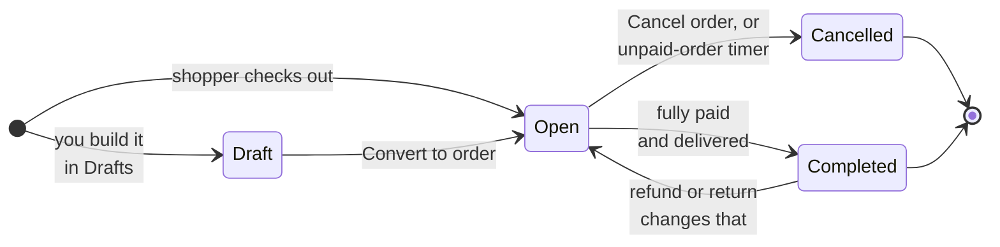
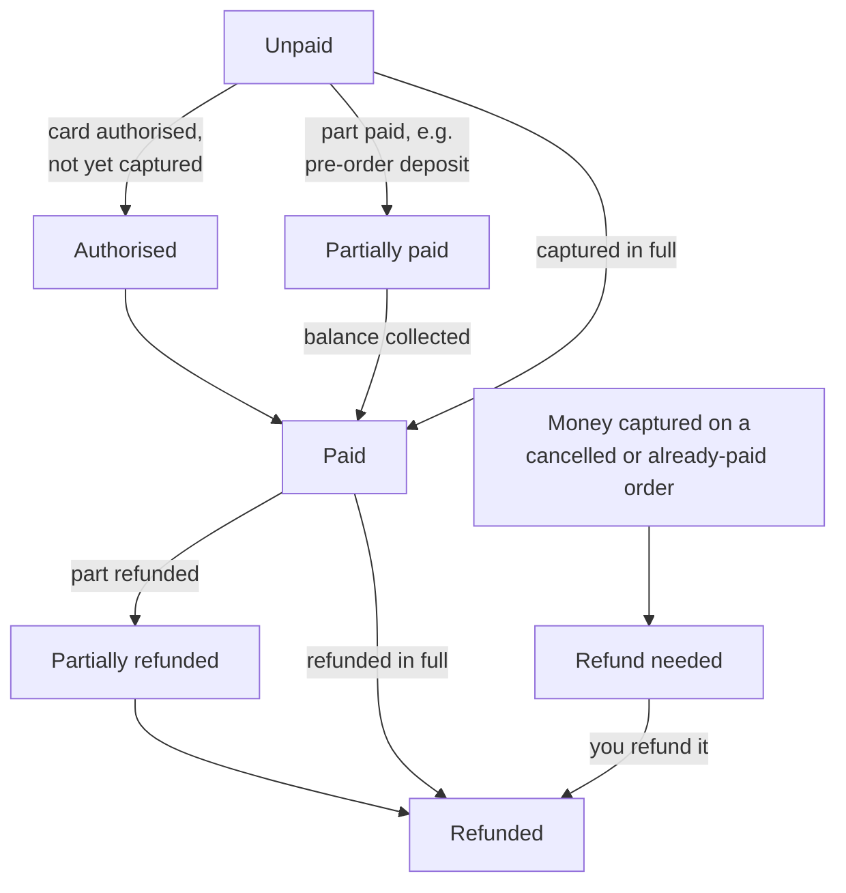
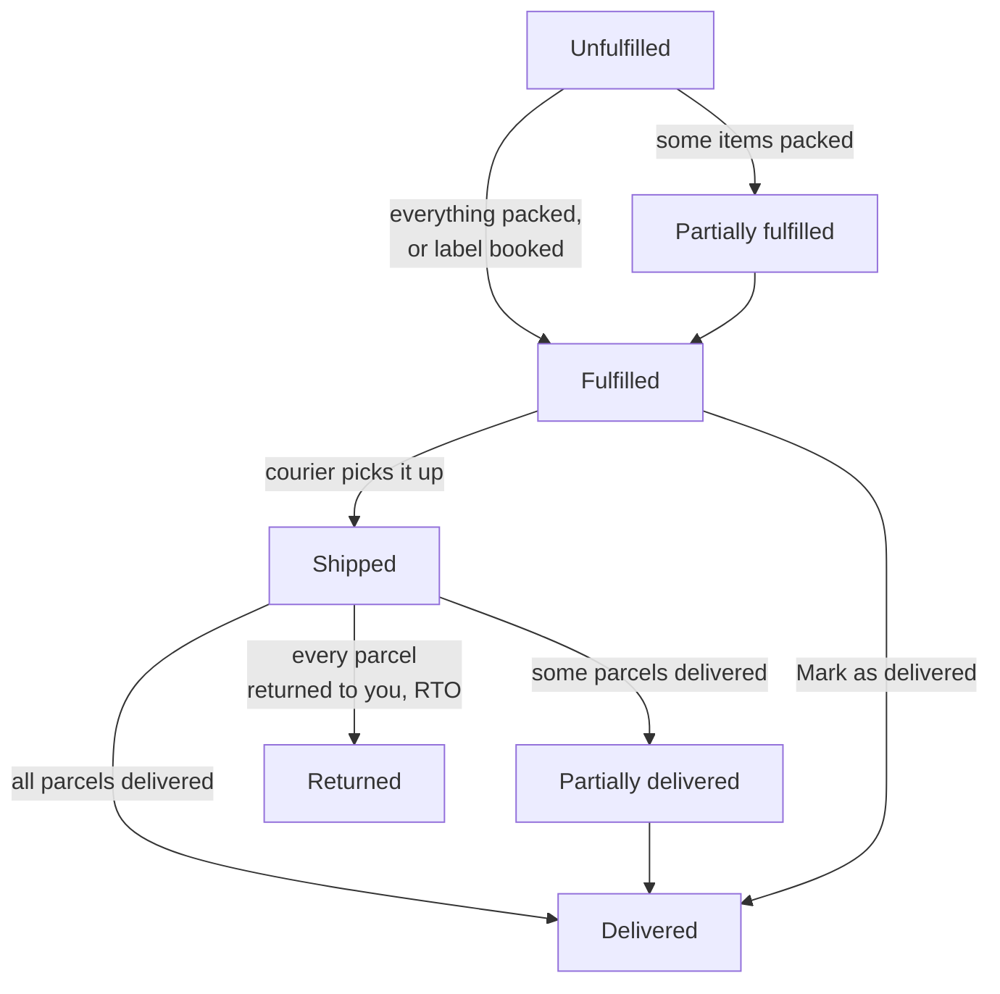

# Orders

Every sale lands in **Orders**, whether a shopper paid by UPI on your store, chose cash on
delivery, or you created it yourself as a draft order for a WhatsApp customer.

## What this is for

- Seeing at a glance which orders need money checked, which need packing, and which are done.
- Recording payments that happen outside the gateway, like a ₹2,499 UPI transfer straight to
  your bank or cash collected by the courier.
- Packing, shipping, cancelling and refunding.
- Collecting the rest of the money on a pre-order.

## How it works

An order has **three statuses**, and each answers a different question:

| Status | Question it answers | Values you'll see |
| --- | --- | --- |
| **Status** | Is this order still being worked on? | Draft, Open, Completed, Cancelled |
| **Payment** | Has the money come in? | Unpaid, Authorised, Partially paid, Paid, Partially refunded, Refunded, Refund needed |
| **Fulfilment** | Have the goods gone out? | Unfulfilled, Partially fulfilled, Fulfilled, Shipped, Partially delivered, Delivered, Returned |

You never set Payment or Fulfilment directly. They are worked out from what actually happened:
payments captured, refunds made, items packed, and what the courier reports. An order becomes
**Completed** by itself once it is fully paid **and** delivered.

<Tabs items={['Order status', 'Payment', 'Fulfilment']}>
<Tabs.Tab>

A **Draft** holds no stock and counts as no sale. **Cancelled** is final: a cancelled order
can't be reopened, paid or shipped. Cancelling puts unpacked items back into stock.

</Tabs.Tab>
<Tabs.Tab>

**Refund needed** is a warning, not an error: a shopper paid twice, or paid after the order was
cancelled. The order page shows it until you refund that payment.

</Tabs.Tab>
<Tabs.Tab>

Booking a courier label packs every item, so the order moves to **Fulfilled** straight away,
then to **Shipped** and **Delivered** as the courier's tracking updates arrive (checked every
30 minutes).

</Tabs.Tab>
</Tabs>

<Screenshot
  name="Order list with tabs"
  caption="Orders → Order list on the All orders tab, with Payment and Fulfilment columns showing a mix of Paid / Unpaid and Unfulfilled / Shipped, and the Pending UPI tab visible."
/>

## Work an order step by step

<Steps>

### Pick a tab

The **Order list** has tabs so you can work through one kind of order at a time: **All
orders**, **Unpaid**, **Unfulfilled**, **Pending UPI**, **Completed** and **Cancelled**. Most
days start on **Pending UPI** (money to check) and **Unfulfilled** (parcels to pack).

To narrow the list further, open the filter button beside the search box and combine as many
filters as you need: **Product** (part of a product name or SKU), **Collection** (orders with a
product from that collection), **Payment**, **Fulfilment**, **Date**, **Order value** (a min and
max in rupees), **Payment method**, **Channel** (where the visit came from), **Tags**, **Discount
code**, **Return status** and **Courier**. Every filter applies together, so **Product**
`pd170` with **Fulfilment** Unfulfilled shows only the PD170 orders still to pack. **Date**
offers Today and the last 7, 30 or 90 days, or **Custom range** with your own **From** and **To**
dates (either can stay empty, and the To day counts in full). The filters also work together with
the tab you picked: switching tabs keeps them. Each filter in use shows as a chip above the
table; remove one with its ×, or all with **Clear all**.

### Open the order

Select an order, say **#1042** from Asha in Pune for ₹2,499. You'll see the items, the
payment summary (Subtotal, CGST/SGST or IGST, Shipping, Payment fee or discount, Total, Paid by
customer, Balance due) and a **Timeline** of everything that happened.

<Screenshot
  name="Order detail"
  caption="Order #1042 detail page: line items at the top, payment summary card with CGST 9% and SGST 9% lines and Total ₹2,499, and the Timeline showing Order placed then Payment captured."
/>

### Check the money

If the order is **Unpaid** and the shopper paid you outside the gateway (a UPI transfer or
cash), select **Collect payment** (or **Mark as paid** at the top). Pick **How were you paid?**:
**UPI**, **Bank transfer (NEFT, IMPS, RTGS)**, **Cash**, **Cheque** or **Other**. Add the **UTR
or reference** from your bank or UPI app if you have it, check the **Date received**, then
select **Mark as paid**. The Timeline shows it as, for example, "Marked as paid: ₹2,499 by UPI,
Reference 424512345678, received 27 Sept 2026". For a gateway order such as Razorpay, use **Open
pay page** instead and send the shopper the link: the gateway marks it paid itself.

### Ship it

Book a courier label from **Orders → Shipments → To book** (see
[Shipments](/merchant-guide/orders/shipments)). Or, if you ship your own way, select **Fulfil
items** and paste the **Tracking number**. The courier is picked for you when the number's
format gives it away (see [Tracking numbers](#tracking-numbers)); you can always choose another
in the **Courier** list, which you can search by typing. The shopper's tracking link is made
from the courier you choose.

### Close it out

Nothing to do. When the courier reports **Delivered** and the order is **Paid**, it moves to
**Completed** on its own. If you delivered it by hand, select **Mark as delivered**.

</Steps>

<VideoTip
  title="Verify a UPI transfer and mark the order paid"
  caption="Open Pending UPI, match the ₹ amount and order number in your bank app, Collect payment, Mark as paid."
/>

## Customer details on the order

The **Customer details** card on the right lists **Name**, **Email**, **Phone**, each address
line, **City**, **State** and **PIN code** on its own line, each with a copy button. Courier
apps ask for these one at a time, so copy and paste them field by field.

**Copy all** copies them in one go, one per line, in the order courier apps ask for them: name,
phone, address, city, state, PIN code.

### Change the customer's details on an order

Select **Edit** on the card. You can change the **Name**, **Email** and **Mobile number** and
the **Shipping address** (billing uses the same address) without leaving the order. Type the
**PIN code** and the city and state fill in on their own; change them if they are wrong.

The change applies to this order only. Tick **Also update the customer's saved address** to make
this their default address for future orders too. Every change is written to the order's
**Timeline**, with who made it, for example "Shipping address changed from 12 MG Road, Pune, MH
411001 to 4 Park Street, Kolkata, WB 700016".

## Tracking numbers

When you paste a tracking number in **Fulfil items**, the courier is chosen from how the number
looks:

| Courier | What its numbers look like | Picked for you? |
| --- | --- | --- |
| India Post | Two letters, nine digits, then IN, for example EE123456785IN | Yes (the last digit is checked) |
| Ekart | FMPC or FMPP then ten digits, for example FMPC0123456789 | Yes |
| Shadowfax | SF, digits, then letters, for example SF2964097734F | Yes |
| DTDC | One letter then eight digits, for example D57291883 | Yes |
| Blue Dart | Eleven digits | Suggested, you confirm |
| Delhivery, XpressBees, Ecom Express, Amazon Shipping | Twelve to sixteen digits | Suggested, you confirm |

Many couriers use plain numbers of the same length, so for those you see **Could be** with the
likely couriers as buttons: select the right one. Shiprocket, Delhivery B2B and others are in the
**Courier** list too. If yours isn't there, choose **Other** and type its name.

### Doing many at once

Select several orders in the list and use **Mark as** to set them **Paid**, **Fulfilled**,
**Delivered** or **Cancelled** together. Draft and cancelled orders can't be changed this way.

## Pre-orders and balance due

A pre-order product can take a deposit at checkout, say ₹500 of a ₹3,000 order, with the
remaining ₹2,500 collected before it ships. The order shows **Deposit paid** and **Balance
due** until the rest comes in, and its Payment status is **Partially paid**.

- Select **Request balance** to email the shopper a payment link, or **Send balance request
  again** to remind them.
- You can have the request and reminders sent automatically. See
  [Payments → Pre-order balances](/merchant-guide/money-and-gst/payments#pre-order-balances).
- You can't fulfil an order while a balance is due. Collect it first.

## UPI: confirmed automatically vs your own ID

| | UPI — confirmed automatically | UPI to your own ID — you confirm it |
| --- | --- | --- |
| How the shopper pays | Scans a single-use QR for the exact amount | Pays your UPI ID or bank account directly |
| Who confirms it | Razorpay, automatically | You, after checking your bank or UPI app |
| Where the order waits | Nowhere, it's marked paid in seconds | The **Pending UPI** tab |
| Setup | Razorpay connected, QR method on | Your UPI ID and bank details in Payments |

For manual transfers, select **Send payment reminder** if the shopper forgets. When WhatsApp is
connected (Apps → Messages), choose **Send by** Email, WhatsApp or Both; WhatsApp sends your
approved `payment_reminder` template with the payment link. Without WhatsApp connected, **Open in
WhatsApp** opens a chat with the reminder typed in, so you can send it from your own number. Each
reminder shows on the order's timeline. You can also
have unpaid transfer orders cancel themselves after a set number of hours; the shopper gets an
email 12 hours before that happens.

<Callout type="info">
  **Tip.** Before you mark a manual UPI order paid, match both the **amount** and the **order
  number** the shopper put in the payment note. Two orders of the same amount on the same day
  are common during a sale.
</Callout>

## What the order page shows you

Besides the items and the timeline, the order page has cards that tell you what to do and what
the order earned:

- **Next step**: one card that says what to do now: check the UPI payment, collect payment, pack
  and ship, "on its way" (with a four-step tracker), delivered or cancelled.
- **Ships from** (or **Ships in 2 parcels**): where each part goes from when you keep stock in
  more than one place, with a **Needs stock moved** badge when a part must wait for a transfer.
  See [Several warehouses and GST](/merchant-guide/money-and-gst/several-warehouses-and-gst).
- **Profit**: net sales, cost of goods, courier charge, fees and what was left. See
  [Profit](/merchant-guide/analytics/profit).

## Draft orders

Orders you build yourself live under **Orders → Drafts**. See [Drafts](/merchant-guide/orders/drafts).

## Abandoned checkouts

Carts that were left behind are under **Orders → Abandoned checkouts**. See [Abandoned checkouts](/merchant-guide/orders/abandoned-checkouts).

## Refunds and cancellations

- **Refund** opens **Refund payment**: enter the **Amount (₹)** and a **Reason**, or select
  **Refund remaining**. Gateway payments are refunded through the gateway; cash and manual UPI
  refunds are recorded for your books and you send the money yourself.
- **Cancel order** asks "Cancel this order?" Select **Cancel order** to confirm or **Keep
  order** to back out. Cancelling returns unpacked items to stock. It doesn't refund money on
  its own: refund any payment separately.

## Common problems and fixes

| Problem | Why it happens | Fix |
| --- | --- | --- |
| Can't find **Collect payment** on a Razorpay order | Gateway orders are paid through the gateway. | Use **Open pay page** and share the link with the shopper. |
| **Fulfil items** is blocked | A pre-order balance is still due. | Collect the balance first (**Request balance**). |
| Order shows **Refund needed** | Money arrived after cancellation, or the order was paid twice. | Open the order and refund the extra payment. |
| An online order cancelled itself | It stayed unpaid past your **Unpaid orders** window. | Adjust the minutes in **Settings → Payments → Unpaid orders**, or set 0 to turn it off. |
| **Could be** shows two couriers | Their tracking numbers look the same. | Select the one on your label, or pick it from the **Courier** list. |
| PIN code didn't fill city and state | The PIN code isn't in the directory, or it isn't installed on your server. | Type the city and pick the state yourself. |
| Order stuck on **Shipped** | The courier hasn't reported delivery yet. | Use **Refresh tracking** on the order, or wait for the next 30-minute check. |

## FAQ

<Faq>

<FaqItem question="Why is a paid, delivered order still Open?">

Check Payment. A partial refund or a pre-order balance keeps Payment from being settled, and an
order is only **Completed** when it is fully settled **and** delivered.

</FaqItem>

<FaqItem question="Is cash on delivery ever auto-cancelled?">

No. The unpaid-order timer skips cash on delivery, manual UPI/bank transfer (which has its own
optional timer) and gift card payments.

</FaqItem>

<FaqItem question="Can I change an order after it's placed?">

You can change the customer's contact and shipping address (**Edit** on the Customer details
card), add notes, collect payments, fulfil, refund and cancel. To sell something different,
cancel and create a new draft order from **Orders → Drafts**, then **Send invoice** or
**Convert to order**.

</FaqItem>

<FaqItem question="What does &quot;Imported from Shopify&quot; mean?">

The order came in through the Shopify importer app. Imported orders are read-only history,
kept for your records rather than worked like new orders.

</FaqItem>

</Faq>

## Related guides

<RelatedGuides ids={['payments', 'shipments', 'customers', 'gst', 'glossary']} />
