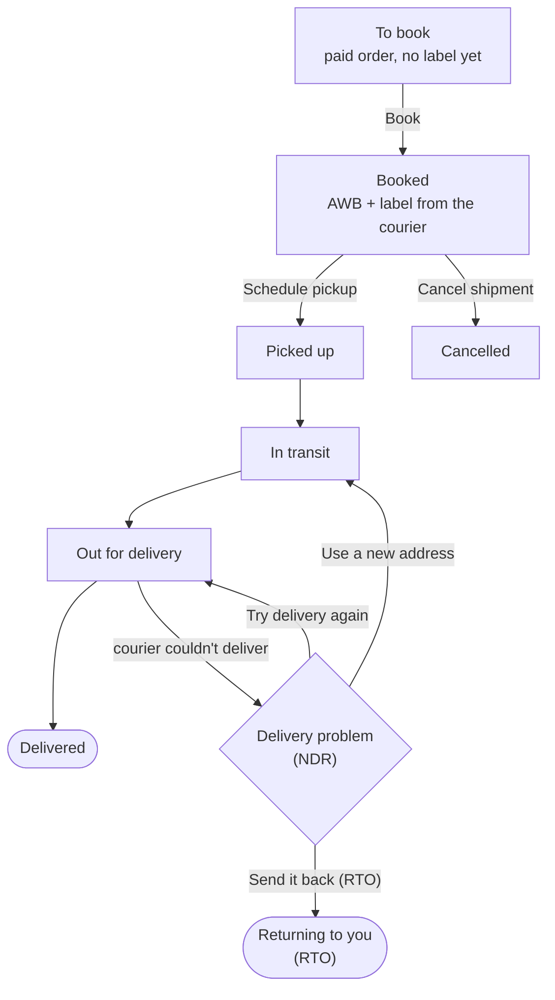

# Shipments

**Orders → Shipments** is where every parcel across every courier gets booked, tracked,
labelled and handled. One table has five tabs: **To book**, **Booked**, **In transit**,
**Delivered** and **Returned (RTO)**. **Pickups** (in the header) and the deliveries that
need you (the "need attention" link under the title) open in a side panel.

## What this is for

- Booking 20 Diwali orders with a courier in one go, instead of typing each address into the
  courier's website.
- Comparing Delhivery, Shiprocket and RapidShyp prices for a 500 g parcel from Jaipur
  (`302001`) to Guwahati (`781001`) before you book.
- Printing all labels as one sheet, and asking the courier to come and collect.
- Seeing which parcels are stuck, and telling the courier what to do with them.

## How it works

You connect a courier account once. After that, each paid order waits in **To book**.
When you book, the courier gives back an **AWB** (the waybill number that tracks the parcel)
and a shipping label. From then on we check the courier's tracking every 30 minutes (and
instantly, when the courier supports tracking webhooks), and the order's Fulfilment status
follows along by itself.

When every parcel on an order is **Delivered** (and the order is paid), the order becomes
**Completed**. If every parcel comes back as **RTO**, the order's Fulfilment shows **Returned**
and the order gets a **Returned to you (RTO)** task. See [Returns and RTO](/merchant-guide/orders/returns-and-rto).

## Connect a courier

Connect your Delhivery, Shiprocket, RapidShyp, Xpressbees, Ekart or Shadowfax account once under **Apps → Couriers**. See [Couriers](/merchant-guide/apps/couriers).

## Ship orders step by step

<Steps>

### Set up your boxes once

Under **Settings → Shipping → Your boxes**, add the boxes you pack into, for example "Small
mailer, 25 × 20 × 5 cm, 80 g", and **Make main box** the one you use most. The main box
fills in the size when booking. The parcel weight is the sum of your products' weights when
they have one, otherwise the box weight.

### Open Create shipment

Every ship button opens the same **Create shipment** window: **Ship now** on a row in **To
book**, **Book selected** for several ticked orders, **Create shipment** on the order page (the
next-step card or the **Shipment** card), and **⋯ → Book by order number**.

### Package

Check what goes in the parcel and where the courier picks it up. When an order ships from two
warehouses you book each **Parcel** on its own; **Pick up from** starts on that parcel's
warehouse (when courier pickup is on for it under **Settings → Locations**). The **Box**, size
and **Weight** come from your products and your main box; change them if you packed
differently. Choose **Prepaid** or **Cash on delivery** and, for cash on delivery, the
**Amount to collect**.

### Courier

Every connected courier is listed with its price for this parcel, the delivery date and whether
it offers cash on delivery there. **Recommended** marks the cheapest courier that can take it
(the fastest when no courier gives a price), and **Cheapest** and **Fastest** are marked too.
Pick the one you want. A courier that doesn't deliver to the PIN code, doesn't offer cash on
delivery there, or didn't answer says so on its own row; the others still work. A courier
without a price API (Delhivery today) shows **Rate on booking**. **Ship it yourself** is always
there for your own courier or local delivery: type the AWB and the courier name.

<Screenshot
  name="Create shipment, Courier step"
  caption="Create shipment for #1042, Courier step: Shiprocket ₹62 with Recommended and Cheapest badges, Delhivery Rate on booking with Fastest, RapidShyp greyed out with Doesn't deliver to this PIN code, and Ship it yourself at the bottom."
/>

### Review and book

Check the summary and select **Book shipment**. You get the **AWB**, **Print label** and
**Download label**, and the order page shows the new status straight away.

### Ask the courier to collect

Still in the same window, pick a **Pickup date** and a start time (**From**, 24-hour, e.g.
`14:00`) and select **Schedule pickup**. Each courier is asked for its own parcels. You can
also do this later from **Pickups** in the header.

</Steps>

### Book many orders at once

Tick orders in **To book** and select **Book selected** (or paste numbers in **⋯ → Book by
order number**, for cash on delivery orders **To book** doesn't list). Choose one box for all or
keep each order's own weight, then how couriers are picked: **One courier for all** (with its
total for the batch), **Cheapest for each order** or **Fastest for each order**. The table shows
what each order gets before you **Book**; the result lists every order as booked (with its AWB)
or not (with the reason), with **Print all labels** and one pickup request. Orders that ship in
several parcels are left out of a batch: book them from the order page.

## Pickups and manifests

Select **Pickups** in the header and tick the booked parcels to book the courier pickup for
them. **Create manifest** groups a pickup's shipments into one printable label
sheet for the delivery person to sign. Delhivery has no separate manifest API yet, so the
sheet is made from your saved labels.

## Delivery problems (NDR)

When a courier can't deliver a parcel (shopper not home, phone switched off, address
incomplete) it's called an **NDR**, a non-delivery report. A parcel moves into **Delivery
problems** (the red "need attention" link under the title, and a **Delivery failed** chip in
**In transit**) by itself as soon as the courier's own tracking update says so - the same tracking
check that flips a parcel to **Out for delivery** or **Delivered** (every 30 minutes for
RapidShyp - it has no tracking webhook - and instantly over a webhook for Delhivery and
Shiprocket) also reads the courier's remark for a failed attempt and, if it looks like one,
opens it here with what the **Courier said**. No parcel needs a manual nudge into this tab.
For each one choose:

- **Try delivery again**: the courier re-attempts.
- **Use a new address**: fix the address or phone number, and the courier tries there.
- **Send it back (RTO)**: return to origin. The parcel comes back to your pickup address.

Then select **Send to courier**. Once the courier's next update reports **Delivered** or
**RTO**, the parcel clears out of Delivery problems automatically too - there's nothing to
dismiss by hand.

<Callout type="info">
  **How the match works.** None of Delhivery, Shiprocket or RapidShyp has a single fixed
  "this is an NDR" status code over their tracking APIs - each describes a failed attempt in
  free text (Delhivery's scan remarks, Shiprocket's and RapidShyp's "Undelivered" activity
  text) rather than a coded field. Detection matches that wording, so an unusual phrasing
  from a courier could in rare cases be missed; if a parcel sits on **Out for delivery** for
  more than a day without moving here, check it from your courier's dashboard directly.
</Callout>

<Callout type="warning">
  Shiprocket does not accept **Send it back (RTO)** over its API yet; raise the RTO in
  Shiprocket itself.
</Callout>

## RTO: parcels that came back

The **Returned (RTO)** tab lists the parcels that came back. Each RTO opens a task on its order where you put the items back in stock with one click, then
refund the customer or ship it again. The full steps are in
[Returns and RTO](/merchant-guide/orders/returns-and-rto).

## Courier wallet balance

Your courier wallet balance and recharge link are covered in [Couriers](/merchant-guide/apps/couriers#courier-wallet-balance).

## Common problems and fixes

| Problem | Why it happens | Fix |
| --- | --- | --- |
| **Test connection** fails for Delhivery | Token expired or was regenerated. | Request a new live token in Delhivery One and paste it straight away. |
| Booking fails with a pickup location error | **Pickup location name** doesn't match Delhivery exactly. | Copy the warehouse name from Delhivery character for character. |
| Order missing from **To book** | The list only shows paid (or deposit-paid) orders that aren't packed yet and aren't tagged `hold` or `on-hold`. Unpaid cash on delivery orders aren't listed. | Book COD orders with **⋯ → Book by order number**, or from the order page. Remove a `hold` tag when it's ready. |
| Rates look too high | The parcel weight fell back to the box weight. | Add weights to your products so the real weight is used. |
| Status stuck on **Booked** | The courier hasn't picked it up yet. | Check **Pickups**; schedule one if you haven't. |

## FAQ

<Faq>

<FaqItem question="Can I use Delhivery and Shiprocket together?">

Yes. Install both and you compare them on every booking: **Create shipment** lists each one
with its price and delivery date and you pick. **Settings → Shipping → Which courier ships**
is the rule a batch books with when you don't pick per order: **Cheapest price**, **Fastest
delivery**, **Always the same courier** or **The state it goes to**.

</FaqItem>

<FaqItem question="Does cash on delivery work with couriers?">

Yes, where the courier offers COD for that PIN code. Turn on **Offer cash on delivery where the
courier allows it** in **When orders go out**. The courier collects the cash and pays it to you
on their own remittance schedule.

</FaqItem>

<FaqItem question="What is an AWB?">

The air waybill number: the courier's tracking number for one parcel. It's printed on the label
and shown as **Waybill** in the Shipments list. See the [Glossary](/merchant-guide/help/glossary).

</FaqItem>

<FaqItem question="Can I ship without a courier account?">

Yes. Open the order, select **Create shipment**, and on the **Courier** step pick **Ship it
yourself** and type the AWB and courier name. (**Fulfil items** still packs part of an order by
hand.) Tracking won't update automatically for these.

</FaqItem>

</Faq>

## Related guides

<RelatedGuides ids={['orders', 'returns', 'apps', 'glossary']} />
