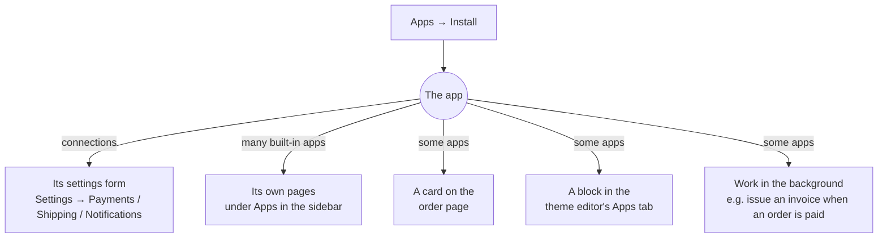

# Apps

**Apps** is where you add tools to your store: invoicing, importers, marketing tools,
couriers, payment gateways and more. Each one is a plugin you can turn on or off any time.

## What this is for

- Turning on **GST invoices** before your first B2B order.
- Connecting **Delhivery** or **Shiprocket** so orders get rates, labels and tracking.
- Moving from Shopify with the **Shopify importer**.
- Adding a "Notify me when it's back" button with **Back in stock**.

## How it works

Installing an app switches on what it brings, for your store only. Depending on the app, that
can be a settings form, its own pages in the sidebar, a card on the order page, or a block you
can place in the theme editor.

## Built-in apps vs connections

The Apps page has two sections:

- **Built-in apps**: "Made by us. Turn one on and start using it — no account to set up."
- **Connections**: link your store to another company's account. They show **by \<company\>**
  on their card and need that company's account details.

| App | Section | What it adds |
| --- | --- | --- |
| GST invoices | Built-in | Tax invoices, credit notes, vouchers, GSTR-1 export. Pages: Queue, Invoices, Returns, Settings. |
| Shopify importer | Built-in | Brings products, collections, customers, orders, pages, blog posts, menus and redirects over from Shopify. Pages: Imports, CSV files, Connect store. |
| Back in stock | Built-in | A **Notify me** block and restock alerts. Pages: Overview, Signups, Settings. |
| Razorpay | Connection, by Razorpay | Cards, UPI, netbanking, and UPI — confirmed automatically (a QR per order). |
| Cashfree | Connection, by Cashfree Payments | UPI, cards, netbanking, wallets and pay later. See [Cashfree](/merchant-guide/money/cashfree). |
| Delhivery | Connection, by Delhivery | Rates, labels, pickups, tracking, and a **Delivery checker** block. |
| Shiprocket | Connection, by Shiprocket | Multi-courier rates, labels, tracking, and a **Delivery checker** block. |
| Amazon SES email | Connection, by Amazon Web Services | Sends order emails through Amazon SES. |
| WhatsApp | Connection, by Meta | Order updates on WhatsApp through the Meta Cloud API. |
| Cloudflare R2 | Connection, by Cloudflare | Stores your images and files on your own R2 bucket. |

Every store also has the core features built in, with nothing to install: cash on delivery,
UPI or bank transfer, a demo courier for testing, and local file storage.

<Screenshot
  name="Apps page"
  caption="Apps page with the Built-in apps section on top (GST invoices showing Installed, Shopify importer and Back in stock with Install buttons) and the Connections section below, filtered to All."
/>

## Install an app step by step

<Steps>

### Open Apps

Select **Apps** in the sidebar. Use the **All** / **Installed** filter and the category chips
(Invoicing, Payments, Shipping, Messages, Storage and so on) to find one.

### Install

Select **Install** on the app's card. Built-in apps are ready straight away.

### Set it up

For a connection, the card shows **Set up in Payments** (or Shipping, Notifications). Enter the
company's account details there, or on the app's own **Connect** page for Delhivery and
Shiprocket, then **Test connection** where offered. The card switches from **Not connected** to
**Connected**.

### Open it

Apps with their own pages appear under **Apps** in the sidebar. Select **Open** on the card, or
the app's name in the sidebar.

</Steps>

## Uninstalling

Select **Uninstall**, then confirm with **Uninstall** (or **Keep** to back out). Uninstalling
switches the app's features off for your store, but saved credentials are kept until you remove
them from Settings, so reinstalling restores your setup. Blocks the app added to your pages
stay in place but show nothing until you reinstall.

## Storage: local disk or R2

Every store starts on the built-in **Local disk** storage: no setup, and it's the default
whenever you haven't connected a storage app. To keep your files on your own Cloudflare R2
bucket instead, install the **Cloudflare R2** connection and use **Move existing files**. The
move runs in the background and only removes each original once its copy is verified.

<Callout type="info">
  **Tip.** Apps can credit the open-source projects they're built on. Look for "Built with …"
  on an app's card; GST invoices, for example, credits the project its invoice templates come
  from.
</Callout>

## Common problems and fixes

| Problem | Why it happens | Fix |
| --- | --- | --- |
| Installed a connection but nothing changed | It's installed but not connected yet. | Follow **Set up in …** and fill in the account details. |
| App's page says to install it first | The app was uninstalled. | Install it again from **Apps**; your settings come back. |
| Can't install apps | Your role doesn't allow it. | Ask the store owner, or an Administrator. |
| The theme editor's Apps tab is empty | No app with blocks is installed. | Install Back in stock, Delhivery or Shiprocket. |

## FAQ

<Faq>

<FaqItem question="Do apps cost extra?">

Built-in apps come with the platform. Connections use your own account with that company
(Razorpay, Delhivery and so on), so their charges are between you and them.

</FaqItem>

<FaqItem question="Can I get an app for a gateway or courier that isn't listed?">

A developer can build one as a plugin (see [Build your first app](/developer-docs/building/first-app)).
A public app store for apps from other developers is coming soon.

</FaqItem>

<FaqItem question="Where did the app's settings go? They're not under Settings.">

Installed apps keep everything under **Apps** in the sidebar, including their own **Settings**
page. Only connections' account details live in **Settings → Payments / Shipping /
Notifications**.

</FaqItem>

</Faq>

## Related guides

<RelatedGuides ids={['shipments', 'payments', 'gst', 'online-store']} />
