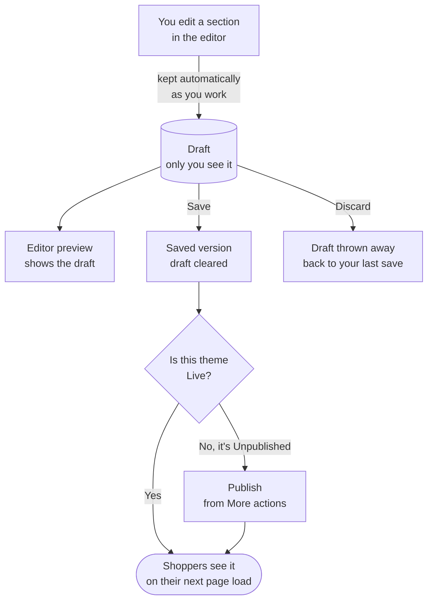

# Online store

Your online store is the website shoppers see. You choose how it looks with a **theme**, and
you change what is on each page in the **editor**, section by section, without writing code.

## What this is for

- Changing your home page banner before a Diwali sale.
- Adding a "Notify me" button to sold-out products, or a PIN code delivery checker.
- Trying a new look on a copy of your theme, then switching to it in one click.
- Adding simple pages such as "About us", "Shipping policy" or "Bulk orders".

## How it works

Every store has one **Live** theme (what shoppers see) and can keep others in the theme
library, marked **Unpublished**. Inside a theme, each page type (home, product, collection,
cart and so on) has a template made of **sections**. Your edits are kept as a draft while you
work, and only reach shoppers when you **Save** a Live theme, or **Publish** another one.

The toolbar tells you where you are: **Unsaved changes** while there is a draft, **All
changes saved** once you save. Nothing you do in the editor is visible to shoppers until you
save.

<Screenshot
  name="Themes library"
  caption="Online Store → Themes with the Current theme card marked Live at the top, and one Unpublished theme (Minimal preset) in the Theme library below it."
/>

## Edit your store step by step

<Steps>

### Open the editor

Go to **Online Store → Themes**. On your **Current theme** card, select **Customize**. To try
changes without touching the live store, first open the theme's menu, select **Duplicate**,
then **Customize** the copy.

### Pick the page to edit

Use the page switcher at the top to choose a template: Home, Product, Collection, Cart and so
on. The **Sections** list on the left groups the page into **Header**, **Template** and
**Footer**. Select a group's name to fold it away when you don't need it.

### Add a section

Decide where it goes first, then pick it:

- **Between two sections**: move the pointer over the gap between two sections, in the list
  or on the page itself. A thin line with a **+** appears. Select it.
- **At the end of a group**: select **Add section** under the header, the template or the
  footer.
- **Anywhere, by dragging**: open the **Add** panel and drag a section onto the page.

Each way opens the same list. The **Sections** tab has the library (banners, product grids,
rich text, testimonials and more); the **Apps** tab has blocks from apps you installed. Pick
one and it goes in exactly where you chose. The page scrolls to it and its settings open on
the right.

<Screenshot
  name="Editor, Add panel on the Apps tab"
  caption="Theme editor with the Add panel open on the Apps tab, showing Pre-order countdown and, with Back in stock installed, the Notify me block."
/>

### Change its settings

Select the section on the canvas or in the list. A small toolbar appears above it on the page
(**Move up**, **Move down**, **Duplicate**, **Remove**) and its settings open on the right: first
its own settings (text, images, links), then **Section settings** in four groups: **Layout**,
**Spacing**, **Style** and **Advanced** (details below).

### Type straight onto the page

In the Glide theme sections (see [Glide theme sections](#glide-theme-sections)) you can click a
heading, a button label or a paragraph on the canvas and type, the same as in a document. The
setting on the right updates as you type.

When you click a paragraph, a small formatting bar appears above the section: **Bold**,
**Italic**, **Underline**, lists and **Link**. Select some words first, then pick a button. The
section's own toolbar (**Move up**, **Move down**, **Duplicate**, **Remove**) stays where it is.

To drag a section somewhere else, grab it by an empty area or use the sections list, not the
text you are editing.

### Check it on a phone

Use the dock under the canvas to switch between **Desktop**, **Tablet** and **Mobile**, and
between **Light** and **Dark** if your theme has a dark mode. **Undo** and **Redo** are there
too.

### Save

Select **Save**. The status changes to **All changes saved**. If this is your Live theme,
shoppers now see the change. If it is an Unpublished theme, open **More actions** and select
**Publish** when you are ready.

</Steps>

<VideoTip
  title="Change your home page banner in 30 seconds"
  caption="Open Customize, select the banner, swap the image and heading, switch to Mobile to check it, Save."
/>

## The sections list

Each section in the list has, from left to right:

- a **grip** to drag it up or down (or use the arrow keys after pressing space on it);
- an **arrow** that shows the section's **blocks** (its slides, columns, logos or questions),
  if it has any;
- its **name**;
- an **eye** to hide it from shoppers without deleting it. Hidden sections stay in the list,
  crossed out, so you can bring them back;
- a **⋯ menu** with **Duplicate**, **Rename** and **Remove**.

**Rename** only changes the name you see in the list, for example "Diwali banner" instead of
"Image banner". Shoppers never see it. Double-click a name to rename it quickly. The header,
the footer and a page's main content can be renamed and hidden but not removed.

Under a section's blocks, **Add block** adds another slide, column or question with starter
text, ready to edit on the right. Hover a block and select **×** to remove it.

<Screenshot
  name="Sections list"
  caption="The Sections list with the Header, Template and Footer groups, one row's ⋯ menu open on Duplicate, Rename and Remove, and the blue insert line with its + between two sections."
/>

## Section settings

Under each section's own settings there's a **Section settings** area with four groups. Each
group shows a short summary when it's closed (for example "Normal · Center" or "Mobile only"),
so you can see what's set without opening it:

- **Layout**: content width (narrow, normal, wide or full), alignment and the gap between
  items inside it.
- **Spacing**: padding above and below, with a box each for mobile, tablet and desktop side by
  side, so a section can be tighter on a phone than on a wide screen.
- **Style**: colour scheme, an optional background colour or image (with an overlay), corner
  rounding, a border toggle and a shadow.
- **Advanced**: show or hide the section on mobile or desktop, an entrance animation (fade,
  slide up or zoom in as it scrolls into view) and an anchor ID for linking straight to it.

Sections you edited before this panel existed keep looking exactly the same. Their old colour
scheme and padding are carried into these groups the first time you open them.

<Screenshot
  name="Section settings panel"
  caption="A banner section selected on the canvas, with the right panel showing the Layout, Spacing, Style and Advanced groups and Spacing expanded to the mobile, tablet and desktop boxes."
/>

## Images

Every image setting works the same way:

1. **Add the picture.** Drag a photo from your computer straight onto the image box, or select
   **Select** to open your files. There you can search, pick from **Recently used**, or upload
   new photos (you'll see each one's progress). Use the arrow keys to move between photos and
   Enter to pick one.
2. **Write the alt text** in the box under the picture. It describes the picture for shoppers
   who use screen readers, and helps search engines. For example "Black mechanical keyboard on
   a wooden desk".
3. **Set the focal point.** Click the part of the picture that must always stay in view, such
   as a face or the product. When a banner crops the photo to fit a phone screen, that spot is
   kept in the frame. You can also move the point with the arrow keys.

The **⋯** menu next to **Change** has **Replace**, **Reset focal point** and **Remove**. A new
picture starts with its focal point in the middle again.

## Links

Every link in a section's settings (a button, a banner, a logo) uses the same picker:

- **Search** for anything in your store: products, collections, pages, blog posts and
  policies all show up together as you type.
- **Browse** a kind instead: select **Products**, **Collections**, **Pages**, **Blog posts** or
  **Policies** to see the whole list with its own search. Select **←** to go back.
- **Recent** shows the last few links you picked, and **Home page** is always one click away.
- **Paste a link** at the bottom takes any web address, such as your Instagram page. It's
  checked before it's used, so a typo like `htps//` is caught.
- **Open in a new tab**, for buttons and banners, opens the link in a new browser tab. Use it
  for links that leave your store.

The link then shows as a small tag with what it points at, for example **Glass mouse pad ·
Product**, not a web address. Select **×** to remove the link.

## Glide theme sections

The **Glide theme** group at the top of the **Add** list holds the sections from our Glide
theme's home page, rebuilt for this editor. They start with the same text as the theme. Pick your
own photos, products and collections in each one's settings.

| Section | What it's for |
| --- | --- |
| **Ships today** | The order-by time for same-day dispatch, with a few promises such as free shipping |
| **Category panels** | Your collections as tall photo panels that open when a shopper points at one |
| **Featured carousel** | Products you pick, shown one large slide at a time |
| **Reviews showcase** | Your star rating, a moving wall of reviews and a window of customer photos |
| **Promo bento** | Promo tiles of different sizes, each linked to a collection or product |
| **Latest drop** | One new product with a short blurb, spec chips and a countdown |
| **Drops teaser** | Cards for what is coming next, each with a date and a status |
| **Perfect match** | A "find your perfect match" heading with products circling it |
| **Brand lab** | The brands you carry, each with a logo and a short line |
| **Logo carousel** | Brand logos, photo tiles or press quotes in a moving row |
| **Drop reveal** | A box that opens as shoppers scroll, showing a drop's products |
| **Notes series** | Your latest blog posts as a numbered series |
| **Social wall** | Instagram, X and YouTube posts with tabs, as a grid or a moving row |
| **Community invite** | An invite to your Discord or community, with perks and a button |

Reviews and social posts are typed in by you: the editor does not read them from another app
yet. Each section starts with sample reviews or posts, so replace them before you publish.

## New sections

These sections are in the **Add** list alongside the originals:

| Section | What it's for |
| --- | --- |
| **Spotlight hero** | A bold opening with a soft glowing spotlight that follows the pointer |
| **Split hero** | A heading and button beside a large image (image on either side) |
| **Video hero** | A looping, muted background video behind your heading and button |
| **CTA banner with glow** | A call to action on a rounded card with a slowly moving glow |
| **Bento grid** | Features or benefits in a grid of mixed-size tiles |
| **Stats counter** | Big numbers ("10,000+ orders") that count up as they scroll into view |
| **FAQ accordion** | Questions that open with a smooth slide, with an optional intro beside them |
| **Testimonial marquee** | Customer quotes gliding past in one or two rows |
| **Logo marquee** | Brand or press logos scrolling in a loop |
| **Image gallery** | A lookbook of your photos as a grid, a masonry wall or a swipeable row on phones |

Each one works in light and dark mode, has a phone layout, and uses the same **Section
settings** as every other section. Sections based on outside design libraries say so under
their name, for example "by Magic UI". Moving effects pause for shoppers whose device is set to
reduce motion, and so do the editor's own small animations.
## Show your store's own data in a section

Instead of typing a heading, a price or a picture into a section, you can **connect** the
setting to something your store already knows. The section then shows the real value on every
page, and keeps up by itself when you change it. On a product page, one banner can show each
product's own material, size chart image or price, without a separate template per product.
Shopify calls this "dynamic sources"; it works the same way here.

<Steps>

### Find the connect button

Select a section, then look at its settings on the right. Next to text, rich text, image,
link, number and colour settings there is a small **database** button, **Connect dynamic
source**.

### Pick what to show

A list opens with only what fits that setting. An image setting lists images (the product's
featured image, a collection image, your logo, image custom fields), a text setting lists
text, prices and dates, and a link setting lists links and product or collection pages.

- **On a product template**: the product's title, price, compare-at price, vendor, product
  type, category, description, featured image and other images, plus its custom fields.
- **On a collection template**: the collection's title, description, image and link, plus its
  custom fields.
- **Everywhere**: your store name, logo, contact email, phone and address, and the fields of
  your **Content → Content types** entries (FAQs, size guides, team members and so on).

### Check the chip

The setting now shows a chip such as **Product › Material**. The preview fills it in from the
product or collection chosen in the picker at the top of the editor. Select the chip to pick a
different source, or the **✕** to disconnect.

### Save

Select **Save** as usual. If a connected source no longer exists (for example you deleted
that custom field), Save tells you which section and setting to fix.

</Steps>

<Callout type="info">
  What you typed before connecting is kept. It shows whenever the source is empty, for
  example a product with no material filled in, and comes back if you disconnect.
</Callout>

## App blocks

The **Add** panel's **Apps** tab lists sections that installed apps give you. The core
platform always adds **Pre-order countdown** (a launch countdown for a pre-order product).
Installed apps add more:

| Block | Comes from | What it does |
| --- | --- | --- |
| Pre-order countdown | Built in | Counts down to a pre-order product's launch time. |
| Notify me | Back in stock app | A "tell me when it's back" button on sold-out products. |
| Delivery checker | Delhivery or Shiprocket app | Shopper types a PIN code (say `560034`) and sees an estimated delivery date. |

If no app that adds blocks is installed yet, the tab says which ones do, with a link to
install them. Uninstalling an app never breaks a page: its block stays in place but shows
nothing to shoppers until you reinstall the app.

## Pages

**Online Store → Pages** lists every page built with the editor, with its title, URL, status
(**Published** or **Draft**) and when it was last updated. Select **Add page** to start one.
Each page has its own **Search engine listing** (title and description), **Visibility**
(Visible or Hidden) and a **Theme template**; **Edit content** opens it in the editor.

Your header and footer menus are under **Content → Menus**, not Online Store.

## Preferences

**Online Store → Preferences** holds the store-wide settings for your site: the home page
title and meta description, a social sharing image, **Password protection** (useful before
launch), the cookie banner and your Google Analytics 4, Google Tag Manager and Meta pixel IDs.

**Custom HTML tags in Tag Manager.** Your store only runs scripts it trusts, to keep shoppers
safe. Tags that load a script file work as they are. A **Custom HTML** tag with code written
inside it needs one extra step in Tag Manager, once:

1. In Tag Manager, open **Variables → New** and choose **DOM Element**.
2. Set **Selection Method** to **CSS Selector**, **Element Selector** to `script[nonce]` and
   **Attribute Name** to `nonce`. Name the variable `nonce` and save.
3. In each Custom HTML tag, change `<script>` to `<script nonce="{{nonce}}">`, then publish
   your container.

Google explains the same steps in
[Using Google Tag Manager with a Content Security Policy](https://developers.google.com/tag-platform/security/guides/csp).

<Callout type="info">
  **Tip.** Before a big sale, **Duplicate** your Live theme, make the sale changes on the copy,
  and **Publish** it on the morning of the sale. After the sale, publish your old theme again.
  Nothing is lost, because Unpublished themes stay in the library.
</Callout>

## Common problems and fixes

| Problem | Why it happens | Fix |
| --- | --- | --- |
| **Publish** is greyed out | You have unsaved changes. | Select **Save** first, then **Publish**. |
| My change isn't on the store | You edited an Unpublished theme, or didn't save. | Check the badge says **Live** and the status says **All changes saved**. |
| "Could not keep your draft. Check your connection." | Your internet dropped while editing. | Wait for the connection to return and keep editing; select **Save** once the warning goes. |
| A section shows on desktop but not on phones | **Advanced → show on mobile** is off. | Turn it back on in the section's **Advanced** group. |
| The Apps tab is empty | No app that adds blocks is installed. | Install Back in stock, Delhivery or Shiprocket from **Apps**. |
| A face or product is cut off on phones | The banner crops the photo to fit a narrow screen. | Open the image and click the part that must stay in view to set the **focal point**. |
| "Enter a web address or a path starting with /" | The pasted link isn't a web address. | Paste the full address from your browser's address bar, for example `https://instagram.com/yourstore`. |
| I can't find **Remove** for a section | The header, footer and a page's main content can't be removed. | Use the eye to hide it instead. |
| **Save** says a setting "is connected to ... which no longer exists" | The custom field or metaobject entry it showed was deleted, renamed or hidden from the online store. | Open that section, select the chip's **✕** to disconnect, or pick another source. |
| A connected setting shows my old text | The source is empty for this product or collection. | Fill in the field on the product, collection or metaobject entry, or change the typed-in text. |
| My custom field isn't in the connect list | It doesn't fit that setting (for example text for an image), it is a list, or it isn't visible on the online store. | Check the field's type and **Storefront access** in **Settings → Custom data**. |

## FAQ

<Faq>

<FaqItem question="Can shoppers see my changes while I'm still editing?">

No. Edits are a draft that only the editor preview shows. Shoppers see them after you select
**Save** on your Live theme.

</FaqItem>

<FaqItem question="What does Discard do?">

**Discard** (under **More actions**) throws away everything since your last save and reloads
the editor at that saved version. It cannot be undone.

</FaqItem>

<FaqItem question="Can I have a different layout for one product?">

Yes. Use **Create template** in the editor to make an alternate product template, then pick it
under **Theme template** on that product's page in Products.

</FaqItem>

<FaqItem question="Why can't I connect product fields on the home page?">

The home page isn't about one product, so there is no product to read from. Product fields
appear on product templates and collection fields on collection templates. Your store details
and metaobject entries can be connected on any page, the header and footer included.

</FaqItem>

<FaqItem question="Who can publish a theme?">

Anyone whose role includes the Online store publish permission. Owners always can. Staff
without it can edit and save an Unpublished theme, but can't make it Live.

</FaqItem>

</Faq>

## Related guides

<RelatedGuides ids={['apps', 'products', 'going-live', 'glossary']} />
