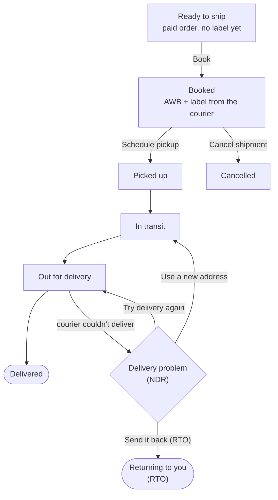

# Shipments

**Orders → Shipments** is where every parcel across every courier gets booked, tracked,
labelled and handled. It has four tabs: **Ready to ship**, **Shipments**, **Pickups** and
**Delivery problems**.

## What this is for

- Booking 20 Diwali orders with a courier in one go, instead of typing each address into the
  courier's website.
- Comparing Delhivery, Shiprocket and RapidShyp prices for a 500 g parcel from Jaipur
  (`302001`) to Guwahati (`781001`) before you book.
- Printing all labels as one sheet, and asking the courier to come and collect.
- Seeing which parcels are stuck, and telling the courier what to do with them.

## How it works

You connect a courier account once. After that, each paid order waits in **Ready to ship**.
When you book, the courier gives back an **AWB** (the waybill number that tracks the parcel)
and a shipping label. From then on we check the courier's tracking every 30 minutes (and
instantly, when the courier supports tracking webhooks), and the order's Fulfilment status
follows along by itself.

When every parcel on an order is **Delivered** (and the order is paid), the order becomes
**Completed**. If every parcel comes back as **RTO**, the order's Fulfilment shows **Returned**.

## Connect a courier

If no courier is connected yet you'll see "Connect a courier to start shipping", with
**Connect Delhivery**, **Connect Shiprocket** and **Connect RapidShyp** buttons.

<Tabs items={['Delhivery', 'Shiprocket', 'RapidShyp']}>
<Tabs.Tab>

From **Apps**, install **Delhivery**, then open its **Connect** page. It takes about a minute.

<Steps>

### Open Delhivery One

Sign in to your Delhivery account in a new tab.

### Copy your API token

Go to **Settings › API Setup** and copy the token shown there.

<Callout type="warning">
  The token is shown only once and stays visible for about 5 minutes, so copy it straight
  away. If it disappears, select **Request Live API Token** to get a new one. The old one stops
  working the moment you do.
</Callout>

### Paste it below and pick your pickup location

Fill in the fields, then select **Test connection** before saving. A working connection says
"Connected — Delhivery serves 302001." (with your own PIN code).

<Screenshot
  name="Delhivery connection form"
  caption="Apps → Delhivery → Connect, Mode set to Live, API token, Client name, Pickup location name and Origin PIN code filled in, after Test connection shows the green Connected message."
/>

</Steps>

| Field | Where to find it |
| --- | --- |
| **API token** | Delhivery One → Settings → API Setup. Paste it right after copying. |
| **Client name** | Usually next to your API token on the same page. |
| **Pickup location name** | Must match your registered warehouse name in Delhivery **exactly**, spaces and capitals included. |
| **Origin PIN code** | The 6-digit PIN code your parcels ship from, e.g. `302001`. |

The **Mode** switch picks **Test** (Delhivery's staging, needs a separate staging token) or
**Live** (real shipments, real charges).

</Tabs.Tab>
<Tabs.Tab>

From **Apps**, install **Shiprocket**, then open its **Connect** page.

<Steps>

### Create an API user

In Shiprocket, go to **Settings › API › Configure** and add a new API user. This is a
separate login from the one you sign in with. It only needs an email and a password, and it's
what we connect with, never your own dashboard password.

### Note the API user email and password

<Callout type="warning">
  Shiprocket does not show these again, so save them somewhere safe (a password manager) the
  moment you create them.
</Callout>

### Paste them below and pick your pickup location

Enter **API user email**, **API user password**, **Pickup location nickname** and **Origin
PIN code**, then **Test connection**.

</Steps>

The test logs in with your API user; nothing is booked. It can't confirm your pickup location
nickname, because Shiprocket only checks that when you book a shipment.

</Tabs.Tab>
<Tabs.Tab>

From **Apps**, install **RapidShyp**, then open its **Connect** page.

<Steps>

### Generate an API key

In your RapidShyp dashboard, look under **Settings** for the API key generator and create
one. If you don't see it on your plan, email `techsupport@rapidshyp.com` and ask them to
enable API access for your account.

### Copy the API key

<Callout type="warning">
  RapidShyp may not show the full key again later, so save it somewhere safe (a password
  manager) the moment you generate it.
</Callout>

### Paste it below and pick your pickup location

Enter **API key**, **Store name** (use `DEFAULT` unless RapidShyp set up a named sales
channel for you), **Pickup location nickname** and **Origin PIN code**, then **Test
connection**.

</Steps>

The test runs a real serviceability lookup with your API key; nothing is booked. It can't
confirm your pickup location nickname, because RapidShyp only checks that when you book a
shipment.

<Callout type="warning">
  RapidShyp support in this app is rate comparison and booking only for now. Label printing,
  automatic tracking, delivery-problem (NDR) detection, cancelling from this app and wallet
  balance could not be confirmed against RapidShyp's fetchable API docs, so they aren't wired
  up yet - manage those from the RapidShyp dashboard directly until a follow-up adds them.
</Callout>

</Tabs.Tab>
</Tabs>

<VideoTip
  title="Connect Delhivery in under a minute"
  caption="Copy the API token from Delhivery One, paste it into Apps → Delhivery → Connect, Test connection, Save."
/>

## Ship orders step by step

<Steps>

### Set up your boxes once

Under **Settings → Shipping → Your boxes**, add the boxes you pack into, for example "Small
mailer, 25 × 20 × 5 cm, 80 g", and **Make main box** the one you use most. The main box
fills in the size when booking. The parcel weight is the sum of your products' weights when
they have one, otherwise the box weight.

### Pick orders in Ready to ship

Paid orders waiting on a label show up in **Ready to ship**. Tick the ones you want.

### Compare rates

Select **Compare rates**. For each order you see the couriers side by side, with **Store
default**, **Cheapest**, **Fastest** and **Recommended** picks. Tick **Insure these
shipments** for high-value parcels, then **Book** them.

<Screenshot
  name="Compare couriers"
  caption="Ready to ship → Compare couriers dialog for 3 selected orders, Delhivery, Shiprocket and RapidShyp rates side by side with the Cheapest badge on one and the Book 3 shipments button at the bottom."
/>

### Print labels

Select **Print labels** to get every label for the batch in one file.

### Schedule pickup

Select **Schedule pickup**, pick a **Pickup date** and a start time (**From**, 24-hour, e.g.
`14:00`). The courier gets the request; the pickup shows under **Pickups → Recent pickups**.

</Steps>

There's also **Advanced: book by order number** if you'd rather type order numbers than tick
them.

## Pickups and manifests

Pick shipments in the **Shipments** tab, then come back to **Pickups** to book the courier
pickup for them. **Create manifest** groups a pickup's shipments into one printable label
sheet for the delivery person to sign. Delhivery has no separate manifest API yet, so the
sheet is made from your saved labels.

## Delivery problems (NDR)

When a courier can't deliver a parcel (shopper not home, phone switched off, address
incomplete) it's called an **NDR**, a non-delivery report. A parcel moves into **Delivery
problems** by itself as soon as the courier's own tracking update says so - the same tracking
check that flips a parcel to **Out for delivery** or **Delivered** (every 30 minutes, and
instantly over a webhook) also reads the courier's remark for a failed attempt and, if it
looks like one, opens it here with what the **Courier said**. No parcel needs a manual nudge
into this tab. For each one choose:

- **Try delivery again**: the courier re-attempts.
- **Use a new address**: fix the address or phone number, and the courier tries there.
- **Send it back (RTO)**: return to origin. The parcel comes back to your pickup address.

Then select **Send to courier**. Once the courier's next update reports **Delivered** or
**RTO**, the parcel clears out of Delivery problems automatically too - there's nothing to
dismiss by hand.

<Callout type="warning">
  RapidShyp shipments don't move through this tab automatically yet - tracking isn't wired
  up for RapidShyp (see the RapidShyp connect page for what is and isn't supported today).
  Check delivery problems from the RapidShyp dashboard for now.
</Callout>

<Callout type="info">
  **How the match works.** Neither Delhivery nor Shiprocket has a single fixed "this is an
  NDR" status code over their tracking APIs - both describe a failed attempt in free text
  (Delhivery's scan remarks, Shiprocket's "Undelivered" activity text) rather than a coded
  field. Detection matches that wording, so an unusual phrasing from a courier could in rare
  cases be missed; if a parcel sits on **Out for delivery** for more than a day without
  moving here, check it from your courier's dashboard directly.
</Callout>

<Callout type="warning">
  Shiprocket does not accept **Send it back (RTO)** over its API yet; raise the RTO in
  Shiprocket itself.
</Callout>

## Courier wallet balance

Delhivery, Shiprocket and RapidShyp are prepaid: shipments are charged from a wallet on their side. They
don't share the balance over their APIs yet, so you enter it by hand after checking the
courier's dashboard (**Balance on the courier dashboard (₹)**, then **Save balance**). Set
**Warn me when my courier wallet is below (₹)** under **Settings → Shipping → When orders go
out → More options**, say
₹2,000, and you'll see "Balance is low. Recharge soon to avoid shipments getting stuck."

<Callout type="info">
  **Tip.** Put your real dispatch days, order cutoff (for example `14:00`) and holidays (Diwali,
  Holi) in **Settings → Shipping → When orders go out**. Delivery dates shown to shoppers are worked
  out from these, so they stay honest during festival weeks.
</Callout>

## Common problems and fixes

| Problem | Why it happens | Fix |
| --- | --- | --- |
| **Test connection** fails for Delhivery | Token expired or was regenerated. | Request a new live token in Delhivery One and paste it straight away. |
| Booking fails with a pickup location error | **Pickup location name** doesn't match Delhivery exactly. | Copy the warehouse name from Delhivery character for character. |
| Order missing from **Ready to ship** | The list only shows paid (or deposit-paid) orders that aren't packed yet and aren't tagged `hold` or `on-hold`. Unpaid cash on delivery orders aren't listed. | Book COD orders with **Advanced: book by order number**, or from the order page. Remove a `hold` tag when it's ready. |
| Rates look too high | The parcel weight fell back to the box weight. | Add weights to your products so the real weight is used. |
| Status stuck on **Booked** | The courier hasn't picked it up yet. | Check **Pickups**; schedule one if you haven't. |

## FAQ

<Faq>

<FaqItem question="Can I use Delhivery and Shiprocket together?">

Yes. Install both and compare them on every booking. **Settings → Shipping → Which courier
ships** decides which one is pre-selected: **Cheapest price**, **Fastest delivery**, **Always the
same courier** or **The state it goes to**.

</FaqItem>

<FaqItem question="Does cash on delivery work with couriers?">

Yes, where the courier offers COD for that PIN code. Turn on **Offer cash on delivery where the
courier allows it** in **When orders go out**. The courier collects the cash and pays it to you
on their own remittance schedule.

</FaqItem>

<FaqItem question="What is an AWB?">

The air waybill number: the courier's tracking number for one parcel. It's printed on the label
and shown as **Waybill** in the Shipments list. See the [Glossary](/merchant-guide/reference/glossary).

</FaqItem>

<FaqItem question="Can I ship without a courier account?">

Yes. Open the order, select **Fulfil items**, and type the courier name, tracking number and
tracking link yourself. Tracking won't update automatically for these.

</FaqItem>

</Faq>

## Related guides

<RelatedGuides ids={['orders', 'online-store', 'apps', 'glossary']} />
