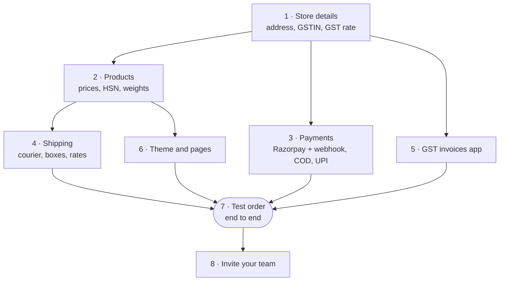

# Set up your store

Your day-one checklist. Work through it top to bottom; most stores are ready to take a test
order in an afternoon. Each step links to the full guide.

## What this is for

Getting from an empty admin to a store that can take, pay for and ship a real order, without
missing the boring-but-important bits like GSTIN, PIN codes and payment webhooks.

## How it works

Some steps depend on others: your address and GSTIN go on invoices, your products need weights
before couriers can quote, and payments need a webhook before orders mark themselves paid.

## The checklist

<Steps>

### Fill in your store details

**Settings → General**:

- **Store details**: **Store name**, **Contact email** (shoppers reply to it), **Phone**.
- **Business address**: address lines, **City**, **State**, **PIN code** (e.g. `302001`). This
  is printed on invoices and used as the starting point for delivery estimates.
- **Standards and formats**: **Timezone** (India, Asia/Kolkata), **GSTIN** (leave blank if you
  aren't registered) and **GST rate (%)**, the tax already inside your prices, used to split
  CGST, SGST and IGST.

Select **Save**; you'll see "Store details saved".

### Add your products

**Products → Add product**, or bring them all in at once with **Import** (Shopify CSV) or the
**Shopify importer** app. For each product set the price, **Compare at price** (MRP), variants,
stock, **Weight (grams)**, **HS (harmonised system) code** and **GST rate (%)**. Group them
into a few **Collections**. Guide: [Products and collections](/merchant-guide/catalog/products-collections).

### Turn on payments

**Settings → Payments**: connect **Razorpay** (keys + webhook), and enable **Cash on delivery**
and **UPI to your own ID — you confirm it** if you take them. Set **Cancel unpaid online orders after
(minutes)**; 30 is a sensible start. Guide: [Payments](/merchant-guide/money/payments).

### Set up shipping

1. Connect **Delhivery** or **Shiprocket** from **Apps**
   ([Shipments](/merchant-guide/selling/shipments#connect-a-courier)).
2. **Settings → Shipping → Box presets**: add your boxes and **Make default** the usual one.
3. **Shipping rates**: **Create zone** (e.g. "All of India") and **Add rate**, like "Standard"
   ₹60, with **Free shipping above (optional)** ₹999.
4. **Dispatch policy**: **Warehouse PIN code**, **Order cutoff (HH:mm)**, **Dispatch days** and
   **Holidays**.
5. **Try a PIN code** with a far-away PIN (say `781001`) and select **Check**.

### Turn on GST invoices (if registered)

Install **GST invoices** from **Apps**, then fill in **Business details** and **Numbering
series**. Guide: [GST invoices](/merchant-guide/money/gst-invoices).

### Make it look like your brand

**Online Store → Themes**: pick a preset (Waimers, Minimal, Bold or Soft), **Customize** your
home page banner, logo, colours and fonts, and **Save**. Add pages like "About us", "Shipping
policy" and "Returns" under **Online Store → Pages**, and link them in **Content → Menus**.
Guide: [Online store](/merchant-guide/selling/online-store).

### Place a test order

On your storefront, buy a cheap product with each payment method you enabled. Check that each
order shows up in **Orders**, that the Razorpay one turns **Paid** by itself, that its invoice
is queued, and that you can book a label (use the courier's **Test** mode, or cancel the
shipment straight after). Cancel and refund the test orders afterwards.

### Invite your team

**Settings → Staff → Invite member**: enter their **Email address**, pick a **Role**, and
**Send invite**.

</Steps>

<VideoTip
  title="Your first afternoon, in 30 seconds"
  caption="A speed run of the checklist: store details, one product, Razorpay, Delhivery, a theme, and a test order."
/>

<Callout type="info">
  **Tip.** Turn on **Password protection** in **Online Store → Preferences** while you set up.
  Shoppers who find your link early see a password page instead of a half-finished store. Turn
  it off when you [go live](/merchant-guide/going-live).
</Callout>

## Common problems and fixes

| Problem | Why it happens | Fix |
| --- | --- | --- |
| Invoices show the wrong state | **State** in Business address is wrong. | Fix it in **Settings → General**. |
| Checkout says a PIN code isn't serviceable | No shipping zone covers it, or the courier doesn't deliver there. | Check **Shipping rates** covers **All of India**, and **Try a PIN code**. |
| Test Razorpay order stays **Unpaid** | Webhook not set up. | Add the webhook URL and secret in the Razorpay Dashboard. |

## FAQ

<Faq>

<FaqItem question="Do I need all of this before my first sale?">

No. The minimum is store details, one product, one payment method and one way to ship (even
**Fulfil items** by hand). Everything else can follow.

</FaqItem>

<FaqItem question="Is there a setup checklist inside the admin?">

The GST invoices app has its own ("Finish setting up GST invoices"). A store-wide guided setup
inside the admin is coming soon; until then, this page is the checklist.

</FaqItem>

<FaqItem question="Which currency can I sell in?">

INR only, for now.

</FaqItem>

</Faq>

## Related guides

<RelatedGuides ids={['going-live', 'products', 'payments', 'shipments']} />
