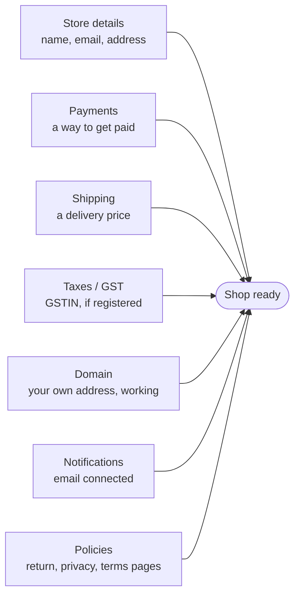

# Settings home and General

**Settings** opens on a page called **Overview**. It shows what your shop still needs, with a
progress bar, and a list of every settings page. **Settings → General** holds your shop name,
contact details, business address and GST number.

## What this is for

- Seeing at a glance what is left before your shop is ready, like "4 of 7 done".
- Finding a setting without knowing where it lives: type "UPI", "COD", "GST" or "courier".
- Filling in the details that go on your invoices and order emails.

## How it works

Each checklist item is ticked by the system from your real settings, not by you. Fix the
thing and the tick appears the next time you open Settings.

| Item | Ticked when | Where to fix it |
| --- | --- | --- |
| **Store details** | Shop name, contact email and business address (line 1, city, pincode) are filled in. | **Settings → General** |
| **Payments** | A payment company (Razorpay, Cashfree, Decentro) is connected, or you saved your own choice, like turning on UPI to your own ID. Cash on delivery being on from the start does not count. | **Settings → Payments** |
| **Shipping** | At least one delivery area has a price. | **Settings → Shipping** |
| **Taxes / GST** | Your GSTIN is saved. Skip it if you are not GST registered. | **Settings → General → Taxes / GST** |
| **Domain** | Your own website address is connected and working. | **Settings → Domains** |
| **Notifications** | The Amazon SES email app is connected, so customers get order emails. | **Settings → Notifications** |
| **Policies** | All five policies (refund, privacy, terms, shipping, contact) are created and shown on your store. | **Settings → Policies** |

## Search settings

At the top of the settings menu there is a box that says **Search settings…**. Type a plain
word and pick a result:

- "UPI", "COD", "Razorpay" or "bank transfer" → **Payments**
- "GST" or "GSTIN" → **General → Taxes / GST**
- "courier" → **Shipping → Which courier ships**, or **Apps** to connect one
- "WhatsApp" or "email" → **Notifications**

Use the **↑** and **↓** keys to move, **Enter** to open, **Esc** to clear.

## Settings → General

<Steps>

### Check how much is done

The bar at the top says, for example, "3 of 5 details done", and lists what is still missing.

### Store details

**Store name**, **Contact email** (customers' replies come here) and **Phone** (with the
country code, like `+91 98765 43210`).

### Business address

Printed on your invoices and used to work out delivery dates. If it is empty you will see
**Add your business address**; select **Add address** and fill in the lines, **City**,
**State** and **Pincode**.

### Taxes / GST

Only if you are GST registered: your 15-character **GSTIN**, and **GST in your prices (%)**
(most shops use 18). This is used to show CGST, SGST and IGST on invoices.

### Currency and time

Prices are in Indian rupees for now. Pick your **Time zone** (India is `Asia/Kolkata`).

### Save

Select **Save** in the bar at the top. You will see "Store details saved".

</Steps>

<Callout type="info">
  **Tip.** Work down the checklist from the top. Store details, Payments and Shipping are
  enough to take a first real order; the rest can follow.
</Callout>

## Common problems and fixes

| Problem | Why it happens | Fix |
| --- | --- | --- |
| **Store details** is not ticked | The contact email or part of the address is empty. | Fill in email, address line 1, city and pincode in **General**, then **Save**. |
| **Policies** is not ticked | One of the five policies is missing or hidden. | Open **Settings → Policies**, select **Create from template** on each one marked **Needed**, and save. Guide: [Policies](/merchant-guide/settings/policies). |
| Search finds nothing | The word is not one we know yet. | Try a simpler word, like "pay", "delivery" or "email". |

## FAQ

<Faq>

<FaqItem question="Do I have to finish every item?">

No. Taxes / GST is only for GST-registered shops, and your own domain can come later. The
checklist just shows what is left.

</FaqItem>

<FaqItem question="Can I tick an item myself?">

No. Each tick comes from your real settings, so it never says "done" when it isn't.

</FaqItem>

</Faq>

## Related guides

<RelatedGuides ids={['set-up', 'payments', 'notifications', 'shipping']} />
