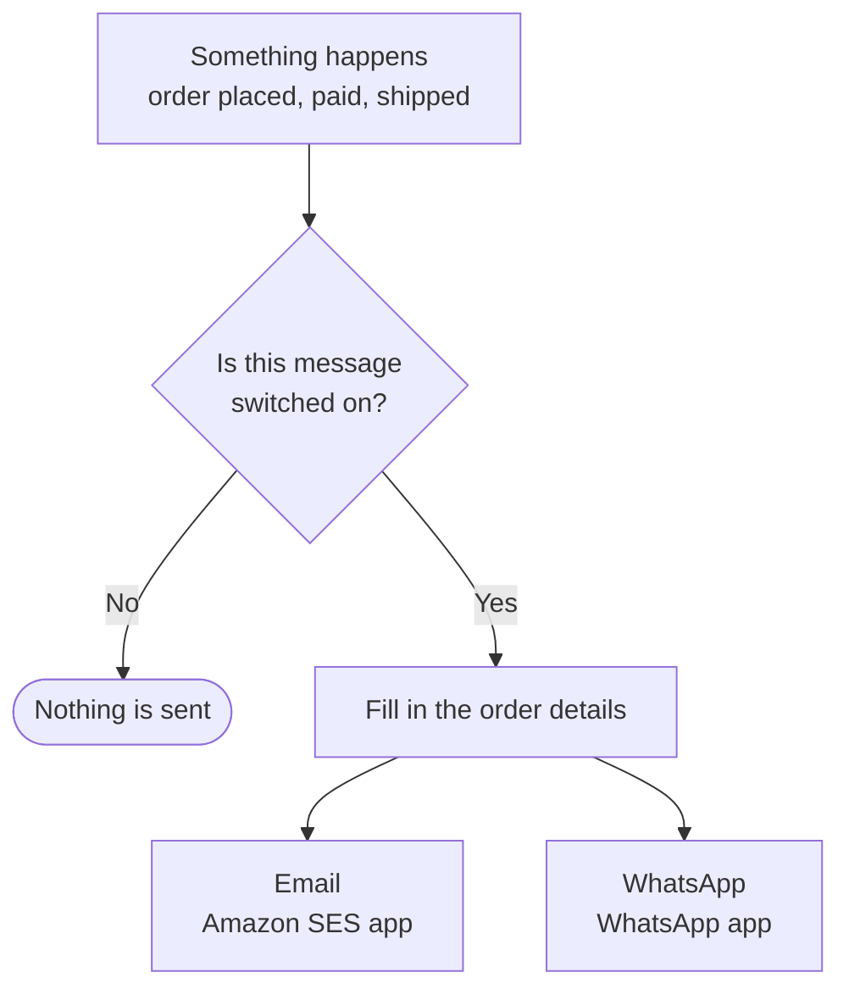

# Notifications

**Settings → Notifications** lists every message your shop sends: order confirmation, payment
received, order shipped, pre-order and UPI reminders, and more. You can look at each one,
send yourself a test, and switch off the ones you do not want. It also shows how messages are
sent: by email (the Amazon SES app) and WhatsApp (the WhatsApp app).

## What this is for

- Making sure customers hear from you the moment they order.
- Seeing exactly what the "Order shipped" email looks like before a customer does.
- Turning off a message you would rather not send, like "Payment received".
- Connecting email or WhatsApp in a few steps.

## How it works

When something happens to an order, the shop picks the matching message, checks you have not
switched it off, fills it in, and sends it through every connected channel: email to the
customer's email address, WhatsApp to their phone.

## The Notifications page

From top to bottom:

- **Status line.** "Your customers get order messages by email", or "Customer messages are not
  being sent yet" with a **Connect email** button.
- **Messages your customers get**, in groups:
  - **Orders**: Order confirmation, Payment received, Order shipped, Out for delivery,
    Delivered, Delivery attempt failed, Order cancelled, Refund issued.
  - **UPI or bank transfer orders**: Order cancelled for not paying.
  - **Pre-orders**: Pay the rest, Reminder to pay the rest, Rest of payment received.
  - **Sent only when you choose**: Reminder to pay (UPI or bank transfer), Invoice with a pay
    link, Left items in their cart, Copy of an invoice. These go out only when you click
    **Send** on an order or cart.
  - **Always sent**: Sign-in code and Gift card. The shop needs these, so they cannot be turned
    off.
  - **From your apps**: Back in stock messages. Change them in the Back in stock app.
- **Messages you get**: Unpaid order will be cancelled, sent to your shop email.
- **Sender email**: the address customers see in From, and the DNS records that make it yours.
  See [Send emails from your own address](/merchant-guide/settings/sender-email).
- **How messages are sent**: Email and WhatsApp, each **Connected** or **Not set up**, with a
  **Connect** button.

Each message shows which channels it can use (**Email**, **WhatsApp**), an on/off switch when
it can be switched off, **Preview** and **Send me a test**.

## Set up customer messages

<Steps>

### Set your sender email

On a live shop, email already works: we send it for you. Type your address under **Sender
email** and add the DNS records it shows, so emails come from your own address. See
[Send emails from your own address](/merchant-guide/settings/sender-email).

### Connect your own Amazon SES (optional)

Only if you want your own Amazon account: under **How messages are sent**, select **Use my own
Amazon SES** (or **Connect**) next to **Email**. This adds the Amazon SES
app and opens its **Connect email** page. Follow the three steps on the page: open Amazon SES,
verify the address you send from, and paste the access details. Switch it on and **Save**.

### Connect WhatsApp (optional)

Select **Connect** next to **WhatsApp**. When you see **Connect with Facebook**, use it:

1. Sign in with Facebook in the window that opens.
2. Pick your business, then pick or create your WhatsApp Business account and the phone number
   to send from. A number on the personal WhatsApp app must be moved or deleted there first.
3. When the window closes, the number is connected and switched on. The page shows the number,
   its display name and its quality.

Already use the **WhatsApp Business app** on that number? Select **I use the WhatsApp Business
app** instead. Meta shows a QR code to scan from the app on your phone. The app and your chats stay
on your phone, and Koomerce sends order messages from the same number.
4. Add a payment method in **WhatsApp Manager** (in rupees). Meta bills messages to your own
   WhatsApp Business account; from 1 January 2027 Meta stops sending for Indian accounts that
   are not billed in rupees.

If Meta later restricts or disables the account, or flags the number's quality, the WhatsApp page
says so, with the last failed message, so you know to look in WhatsApp Manager.

To do it by hand instead: create the message templates `order_placed`,
`payment_received` and `order_shipped` in Meta Business Manager, wait for approval, then paste
your phone number ID and access token. Until the templates are approved you can tick test mode;
it only reaches people who messaged your shop in the last day.

### Preview a message

Select **Preview** on any message. You see the email filled with a sample order, and the
WhatsApp text if it has one. Nothing is sent.

### Send yourself a test

Select **Send me a test**. The email goes to the email address you sign in with, never to a
customer. You can send five tests every ten minutes.

### Switch off what you do not want

Use the switch next to a message. It saves straight away; "Payment received turned off" confirms
it. Everything is on to begin with.

</Steps>

<Callout type="info">
  **Tip.** Send yourself a test of **Order confirmation** after connecting email, and check it
  did not land in spam. If it did, ask Amazon SES to verify your whole domain.
</Callout>

## Common problems and fixes

| Problem | Why it happens | Fix |
| --- | --- | --- |
| "Connect an email app first" when sending a test | No email app is connected. | **Connect** next to **Email**, then try again. |
| The test email never arrives | New Amazon SES accounts can only send to verified addresses. | Verify your own email in SES, or ask Amazon for production access. |
| WhatsApp messages are not delivered | The templates are not approved yet, or test mode is on. | Check the templates in Meta Business Manager; switch test mode off once approved. |

## FAQ

<Faq>

<FaqItem question="If I switch off Order confirmation, is anything else affected?">

No. Only that one message stops. Orders, payments and invoices carry on as normal.

</FaqItem>

<FaqItem question="How do I get an email for every new order?">

Each person picks their own alerts in **Account → Notifications** (account menu, top right):
new orders, a daily summary, and more. See
[Your account](/merchant-guide/settings/your-account#notifications). The **New order alert
(team)** and **Daily summary (team)** switches under *Messages you get* here turn them off for
the whole team.

</FaqItem>

<FaqItem question="Do customers get SMS?">

Not yet. Email and WhatsApp for now.

</FaqItem>

<FaqItem question="Where did the Worker log go?">

It is a developer tool, so it now lives under **Advanced** and only shows while developing.

</FaqItem>

</Faq>

## Related guides

<RelatedGuides ids={['sender-email', 'settings', 'apps', 'orders']} />
