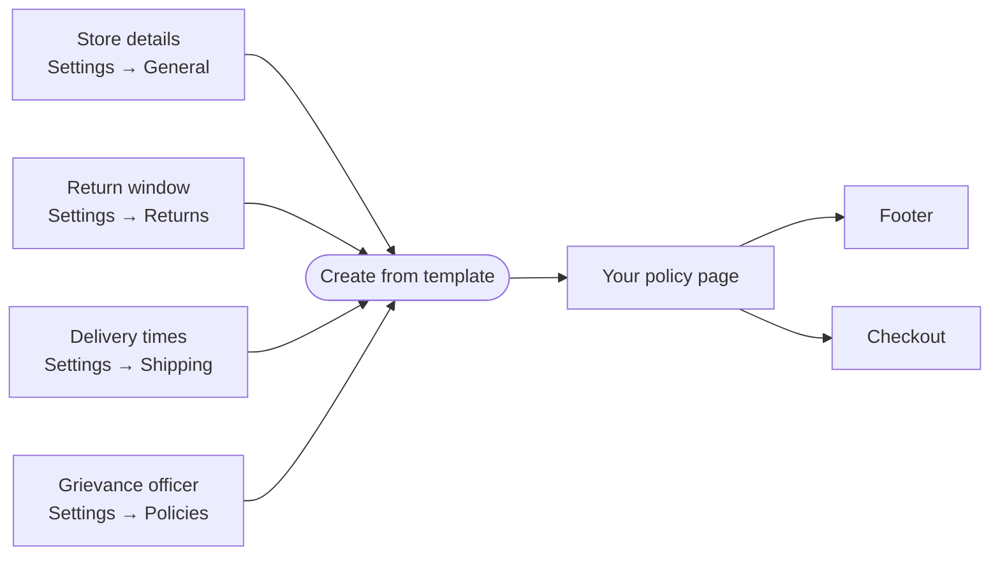

# Policies

**Settings → Policies** holds the five pages every Indian online shop should publish:
**Refund and returns**, **Privacy**, **Terms of service**, **Shipping** and **Contact
information**. Each one can be created from a template filled in with your own details.

<Callout type="warning">
Templates are a starting point, not legal advice. Read each one, change what does not fit
your shop, and ask a lawyer if you are unsure.
</Callout>

## What this is for

- Meeting the Consumer Protection (E-Commerce) Rules 2020: your business details, a grievance
  officer, and clear return, refund and delivery terms.
- A privacy notice written for the Digital Personal Data Protection Act 2023.
- Payment companies such as Razorpay ask for these pages before they approve your account.

## How it works

Each policy is a page on your store at its own address, for example
`yourshop.in/policies/refund-policy`. Published policies appear on their own in your store
footer and above the **Place order** button at checkout ("By placing your order, you agree to
our …"). They also appear under **Policies** in the theme editor's link picker, so you can add
them to a menu.

## Set up your policies

<Steps>

### Fill in your business details

At the bottom of the page, add your **Registered business name** if it differs from your
store name (for example "Waimers Tech Private Limited"). Your address, email, phone and GSTIN
come from **Settings → General**.

### Name a grievance officer

The law asks every online shop to name a person customers can complain to. It can be you.
Add their name, role, email and phone. They appear in your privacy policy and in your store
footer.

### Create each policy

Select **Create from template** next to a policy. The text is filled in with your details:
your return window from **Settings → Returns**, delivery times from your shipping rates, and
free delivery above an amount if a rate offers it. Anything missing shows in `[brackets]`,
with a list of what to add. Read it through, edit it like any other page, then **Save**.

### Show it on your store

**Show on your store** is on for a new policy. Turn it off to keep a policy hidden while you
work on it. Each policy shows **Last updated** with the date you last saved it.

</Steps>

## What the templates say

| Policy | Filled in from | Covers |
| --- | --- | --- |
| Refund and returns | Return window and refund choice in **Settings → Returns** | How to ask for a return, items that cannot go back, damaged or wrong items, refunds within 7 working days, cancellations, seller details, grievance officer |
| Privacy | Business details, grievance officer | DPDP Act 2023: what you collect and why, consent and how to withdraw it, who you share data with, how long you keep it, the shopper's rights, the Data Protection Board of India, cookies |
| Terms of service | Return window, delivery times, cash on delivery | Orders, prices with GST, delivery, returns, liability, Indian law, seller details |
| Shipping | Delivery times and free delivery from your shipping rates | Where you deliver, delivery time, charges, cash on delivery, tracking, late or lost parcels |
| Contact information | Store details, grievance officer | How to reach you and your grievance officer |

## Common questions

| Question | Answer |
| --- | --- |
| I already have a "refund-policy" page from Shopify. | It is used as your refund policy. Pages with the web addresses `refund-policy`, `privacy-policy`, `terms-of-service`, `shipping-policy` and `contact-information` are your policies. Old `/pages/refund-policy` links go to `/policies/refund-policy`. |
| The setup checklist says **Policies** is not done. | All five policies must be created and shown on your store. |
| I changed my return window. Does the policy update? | No. Your policy is your own text once saved. Select **Start again from template** to fill it in with the new window, then save. |
