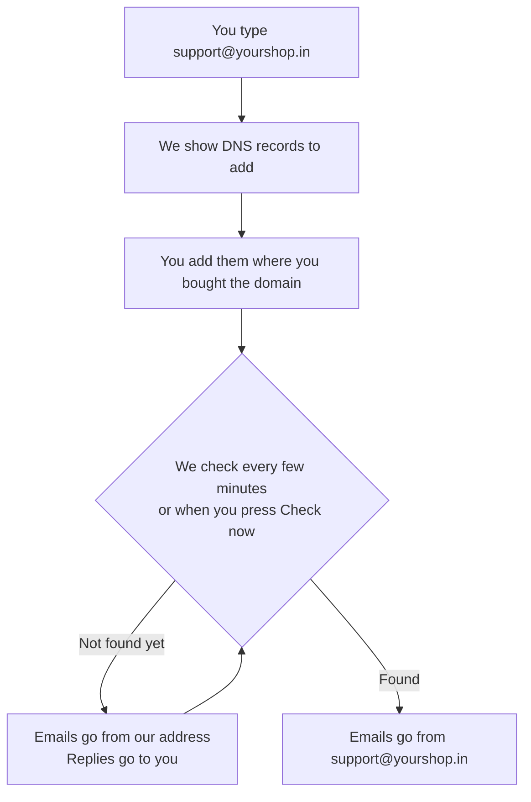

# Send emails from your own address

Your order emails can come from your own address, for example `support@waimers.in`, instead of
ours. Customers trust an email from the shop they bought from, and fewer emails land in spam.

You do not need an Amazon account or any email software. You type your address, copy a few
records to the company where you bought your domain, and we check them for you.

## What this is for

- Customers see **Your Shop &lt;support@yourshop.in&gt;** on every order email.
- Replies go straight to your inbox.
- Your emails are signed as yours, so Gmail and Yahoo trust them more.

## How it works

Until your domain is checked, emails still go out, from our address, with **Replies go to** set
to your address. Nothing stops working while you set this up. Once the records are found, the
switch to your own address is automatic.

## Set it up

<Steps>

### Open Sender email

Go to **Settings → Notifications** and find **Sender email**.

### Type your address

Enter the address customers should see, for example `support@waimers.in`, and a **Sender name**
if you want something other than your shop name. Select **Save and get DNS records**.

The address must be at your own website domain. Gmail, Yahoo, Outlook and similar addresses
cannot be used, because nobody can change their DNS.

### Add the DNS records

The card now shows a table of records with **Type**, **Name** and **Value**. Log in where you
bought your domain (Cloudflare, GoDaddy, Hostinger, Namecheap or another company), open the DNS
settings and add each record. Use the copy button next to each Name and Value so nothing is
mistyped. **Where do I add these?** on the card has short steps for each company.

| Type | Name (what you type) | What it does |
| --- | --- | --- |
| CNAME (three of them) | `xxxx._domainkey` | **Required.** Proves the domain is yours and signs your emails. |
| MX | `bounce` | Recommended. Lets bounced emails come back to us, so we can stop sending to dead addresses. Priority `10`. |
| TXT | `bounce` | Recommended. Allows our email service to send for `bounce.yourshop.in`. |
| TXT | `_dmarc` | Recommended. Tells inboxes your domain is protected. Skip it if you already have one. |

### Wait for the green tick

We check every few minutes on our own. You can also press **Check now**. Most records are found
within an hour; some companies take up to a day. When it says **Verified**, your emails come
from your own address.

</Steps>

<Callout type="info">
  **Many companies add your domain for you.** If you type `xxxx._domainkey.yourshop.in` and the
  company adds `.yourshop.in` again, the record ends up as `xxxx._domainkey.yourshop.in.yourshop.in`
  and is never found. Type only the part shown in the **Name** column.
</Callout>

### Company by company

- **Cloudflare**: your domain → **DNS** → **Records** → **Add record**. Turn the orange cloud
  **off** (DNS only) for the CNAME records.
- **GoDaddy**: **My Products** → your domain → **DNS** → **Add New Record**.
- **Hostinger**: hPanel → **Domains** → your domain → **DNS / Nameservers** → **DNS records**.
- **Namecheap**: **Domain List** → **Manage** → **Advanced DNS** → **Add New Record**. MX records
  are under **Mail Settings**, choose **Custom MX**.

## Changing or removing the address

- **Change address** keeps your records if only the part before `@` changes (for example
  `support@` to `orders@`). A different domain needs new records and a new check; until then
  emails go out from our address again.
- **Stop using this address** sends every email from our address again, with replies still going
  to your shop email.
- If you connected your own **Amazon SES app**, that app sends your emails instead, from the
  address saved in it.

## Why emails might land in spam

- The domain is not verified yet. Add the records above.
- There is no `_dmarc` record. Gmail and Yahoo look for it.
- The email looks like an ad: all capitals, lots of "FREE" or "!!!", or one big picture with no
  text.
- Sending offers to people who did not ask for them. Only email customers who agreed.
- Many customers mark your emails as spam, or the addresses do not exist.

Order emails (confirmations, shipping updates) are the least likely to be filtered. Marketing
emails always carry a one-click unsubscribe link; order emails never do, because customers need
them.

## Common problems and fixes

| Problem | Why it happens | Fix |
| --- | --- | --- |
| "Gmail, Yahoo and similar addresses cannot be used" | You cannot change DNS for those services. | Use an address at your own domain. |
| "This domain is already used by another shop" | Another shop on the platform set it up first. | Contact support; we will check who owns it. |
| Still **Waiting for DNS** after a day | A record is missing, or the name has your domain twice. | Compare each record with the table; type only the short name. |
| **Not verified**: "The records were not found within 3 days" | Amazon stops looking after 72 hours. | Fix the records, then press **Check now**. You get fresh records to add. |
| "A record is there but its value is different" | The value was cut short or has a space. | Copy the value again with the copy button and paste it in full. |

## FAQ

<Faq>

<FaqItem question="Do I need to buy anything or make an Amazon account?">

No. Sending runs on our account. You only need access to your domain's DNS settings.

</FaqItem>

<FaqItem question="Will my normal email (Google Workspace, Zoho, Hostinger mail) stop working?">

No. These records do not touch the records your inbox uses. The `bounce` records sit on their own
subdomain for exactly that reason.

</FaqItem>

<FaqItem question="Can two shops use the same domain?">

No. One domain belongs to one shop, so nobody else can send emails as you.

</FaqItem>

</Faq>

## Related guides

<RelatedGuides ids={['notifications', 'settings', 'going-live']} />
