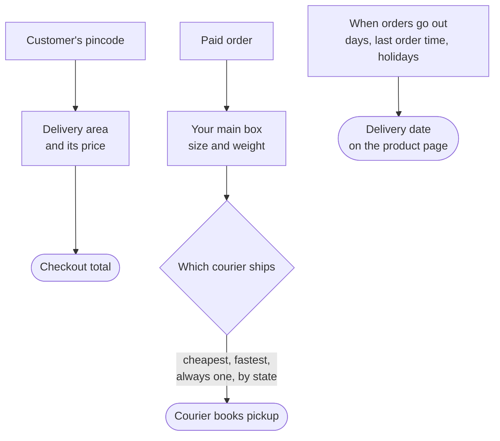

# Shipping

**Settings → Shipping** is one page of plain sections: **Where you ship and what it costs**,
**Your boxes**, **When orders go out**, **Which courier ships** and **Check delivery to a
pincode**. Couriers themselves (Delhivery, Shiprocket) are connected in **Apps**.

## What this is for

- Charging ₹49 for delivery anywhere in India, free above ₹999.
- Not typing box sizes every time you book a courier.
- Showing customers a delivery date you can keep, taking your holidays into account.
- Letting the cheapest courier ship each order automatically.

## How it works

At checkout the customer's pincode picks a delivery area and its price. When you book, your
main box fills in the size and weight, and your courier rule picks the courier. The delivery
date shown on the product page comes from when you send parcels plus the courier's delivery
time.

At the top, a status line says whether a courier is connected ("Delhivery connected. Pickups
and tracking work.") or offers **Connect a courier**, which opens **Apps**. You can still pack
and send orders yourself without one.

## Set up shipping

<Steps>

### Where you ship and what it costs

Select **Add a delivery area**, for example "All of India", and add a price like "Standard"
₹49 with free delivery above ₹999. An area without a price shows "No price yet: customers here
cannot check out".

### Your boxes

Add the boxes you pack in, with their size in cm and weight in grams. Select **Make main box**
on the one you use most; it fills in when you book a courier.

### When orders go out

Fill in the **Pincode you send parcels from**, the **Last order time for same-day sending**
(like `14:00`), the **Days you send parcels** and **Days you are closed** (one per line:
`2026-10-20` for one day, `01-26` for every year). Tick **Offer cash on delivery where the
courier allows it** if you take COD.

**More options** holds the rest: days couriers deliver, usual delivery time when the courier
doesn't say, your return address, when to insure a parcel, and when to warn you that your
courier wallet is low.

### Which courier ships

With more than one courier, choose how one is picked: **Cheapest price (recommended)**,
**Fastest delivery**, **Always the same courier**, or **The state it goes to**. You can always
choose a different courier for one order. **Connect or manage couriers in Apps** opens Apps.

### Save and check a pincode

Select **Save** in the bar at the top. Then type a far-away pincode (say `781001`) in **Check
delivery to a pincode** and select **Check**. You see exactly what a customer there sees.

</Steps>

<Callout type="info">
  **Tip.** Add your holidays (Diwali, Holi, Republic Day) under **Days you are closed** before
  the festive season, so delivery dates stay honest.
</Callout>

## Common problems and fixes

| Problem | Why it happens | Fix |
| --- | --- | --- |
| Checkout says delivery isn't available | No delivery area covers that pincode, or the area has no price. | Add a price to the area, or add an "All of India" area. |
| Delivery dates look too early | The last order time or closed days are wrong. | Fix **When orders go out**, **Save**, and check a pincode again. |
| "Which courier ships" says to connect a courier | No courier app is connected. | **Connect or manage couriers in Apps**. |

## FAQ

<Faq>

<FaqItem question="Where did the Couriers tab go?">

Couriers are apps now. Connect Delhivery or Shiprocket from **Apps**; this page links there.

</FaqItem>

<FaqItem question="What was the Demo courier?">

A pretend courier for testing. It only shows under **Advanced** while developing, never in a
live shop.

</FaqItem>

</Faq>

## Related guides

<RelatedGuides ids={['shipments', 'settings', 'apps', 'set-up']} />
