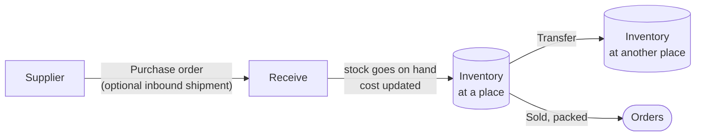

# Stock

**Stock** is the menu for everything about the goods you hold. Counting what you have, buying
more, and moving it between your places all live here. **Products** keeps what you sell
(products, collections, gift cards).

## What this is for

- Seeing at a glance what is running low or sold out.
- Fixing a count after a stock check, or after something is damaged.
- Ordering from a supplier and finding out what the goods really cost you.
- Moving stock from your main place to a second warehouse or shop.

## The five pages

| Page | Use it to |
| --- | --- |
| [**Inventory**](/merchant-guide/stock/inventory) | See and change how many of each product you have, at each place. |
| [**Purchase orders**](/merchant-guide/stock/purchase-orders) | Order from a supplier, receive the goods and work out their real cost. |
| **Inbound shipments** | Group the purchase orders that came in one container or Bill of Entry, and share its freight and customs. See [Inbound shipments](/merchant-guide/stock/inbound-shipments#inbound-shipments). |
| **Suppliers** | Save each supplier once: name, country, the currency they bill in, GSTIN and payment terms. See [Suppliers](/merchant-guide/stock/suppliers#suppliers). |
| [**Transfers**](/merchant-guide/stock/transfers) | Move stock between your own places. |

Open **Stock** in the sidebar and it opens on **Inventory**.

## How the pieces fit

Receiving a purchase order is the moment stock goes on your shelf and the product's cost is
updated. From then on the cost feeds your [profit](/merchant-guide/analytics/profit).

## Where it used to be

Until 10 October 2026 these pages were inside **Products**. Old links still work and take you to
the new page.

## Related guides

<RelatedGuides ids={['products', 'locations', 'profit']} />
